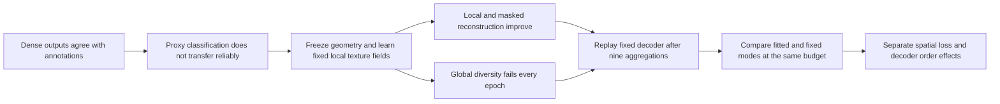

# IEEE Access manuscript — decoder-aware spatial budget audit

**Author-review draft, revision 3.** This revision incorporates the supplied review, verified TRACE architecture, subspace diagnostics, and train-only affine readout.

> **A Decoder-Aware Spatial Budget Audit for Local Texture Evidence in Tyre Inspection**

The supplied biographies identify **Edara Sreenivasa Reddy and Shanmukesh Bonala**, VIT-AP University. Final authorship, contributions,
declarations, and approval remain the authors' decisions.

## Open and edit

| Item | File | Purpose |
|---|---|---|
| Read the paper | [main.pdf](main.pdf) | Compiled IEEE Access double-column manuscript |
| Edit the paper | [main.tex](main.tex), [sections/](sections/) | Main file and ten substantive sections |
| Reviewer response | [REVIEW_RESPONSE.md](REVIEW_RESPONSE.md) | Point-by-point scientific and presentation changes |
| Novelty and evidence | [NOVELTY_AND_EVIDENCE.md](NOVELTY_AND_EVIDENCE.md) | Prior art, contribution scope, new results and limitations |
| References | [references.bib](references.bib) | 23 primary research sources |
| TRACE architecture | [Editable SVG](figures/architecture.svg), [vector PDF](figures/architecture.pdf) | Forward paths, tile encoder, and axial residual block |
| Figures | [figures/](figures/) | Nine vector PDF figures and matching PNG previews |
| Exact table inputs | [evidence/](evidence/), [generated/](generated/) | Direct CSV/JSON evidence and generated aggregation rows |
| Scientific claim audit | [CLAIMS_AND_LIMITATIONS.md](CLAIMS_AND_LIMITATIONS.md) | Claim, endpoint, denominator, evidence, and permitted interpretation |
| Rebuild / reproduce | [REPRODUCIBILITY.md](REPRODUCIBILITY.md) | Offline figure/build commands and larger-study boundaries |
| Before submission | [SUBMISSION_CHECKLIST.md](SUBMISSION_CHECKLIST.md) | Completed preparation and unresolved author actions |
| Source checking | [CITATION_AUDIT.md](CITATION_AUDIT.md) | Primary-source bibliography and current venue-policy links |
| Writing record | [WRITING_LOG.md](WRITING_LOG.md) | Scope, editorial choices, corrections, and preservation |
| Numerical / PDF checks | [audit/VALIDATION.json](audit/VALIDATION.json) | Reconciliations, pagination, abstract, citations, preservation |
| Visual review | [audit/VISUAL_REVIEW.md](audit/VISUAL_REVIEW.md) | Review of the final page rendering |

## The paper's argument



The contribution is a controlled analysis, with a small application-specific model
as its subject. It does not claim state-of-the-art wear classification, physical
depth, calibrated alignment, independent safety validation, or a promoted TRACE
checkpoint. GEO and TRACE both retain their original **selected=None** outcome.

The final paper includes data and annotation provenance, architecture and loss
equations, the complete aggregation comparison, all 60 TRACE validation epochs,
two deterministic real-image examples, group/descriptor effects, covariance and
mask-layout controls, reproducibility, limitations, AI disclosure, and both supplied photo
author biographies. See the validation receipt for current page/figure counts.

## Build locally

From the repository root:

```powershell
.\phase3\run_cv.cmd -B phase3\ACCESS_latex_template_20260513\build_assets.py
.\phase3\run_cv.cmd -B phase3\ACCESS_latex_template_20260513\build_spatial_budget.py
.\phase3\ACCESS_latex_template_20260513\build.ps1
.\phase3\run_cv.cmd -B phase3\ACCESS_latex_template_20260513\verify_paper.py
```

All Python runs through **cv_conda**. No package replacement or model training is
needed. The build uses the existing Tectonic executable, with a cache isolated in
this folder. A first cold build downloads TeX dependencies; subsequent builds use
that cache. The source can also be compiled with a full TeX installation or
imported into Overleaf. Open `main.tex` as the root file and retain the supplied
class, font, compatibility, and figure files.
The supplied sample entry point access.tex forwards to main.tex. Recheck placement
after editing references or preceding content.

## Preservation and publication boundaries

- The repository-root template and earlier manuscript remain unchanged.
- Executed notebooks, frozen training packages, checkpoints, both workstations,
  data, and scientific result files are preserved.
- The model was frozen, and the reviewer sensitivity analysis fits two analytic affine readouts on train tokens. Two existing RGB cache chunks were read from
  pinned public HF objects for deterministic figure examples. Two synthetic forwards check the architecture.
- Existing fit/review artifacts are on Hugging Face. New manuscript assets and
  aggregation derivatives have **not** been uploaded by this task.
- Git retains the paper, editable source, compact evidence, and curated figures.
  TeX caches, intermediate files, and rendered review pages are ignored. No Git
  staging, commit, history change, or push is performed.

The next step is **author review of this draft and the submission checklist**.
There is no notebook rerun or additional training prerequisite to that review.

The existing [interactive aggregation explorer](../texture_aggregation_20261102/Aggregation_Explorer.html)
can accompany the static publication figures during local review.
