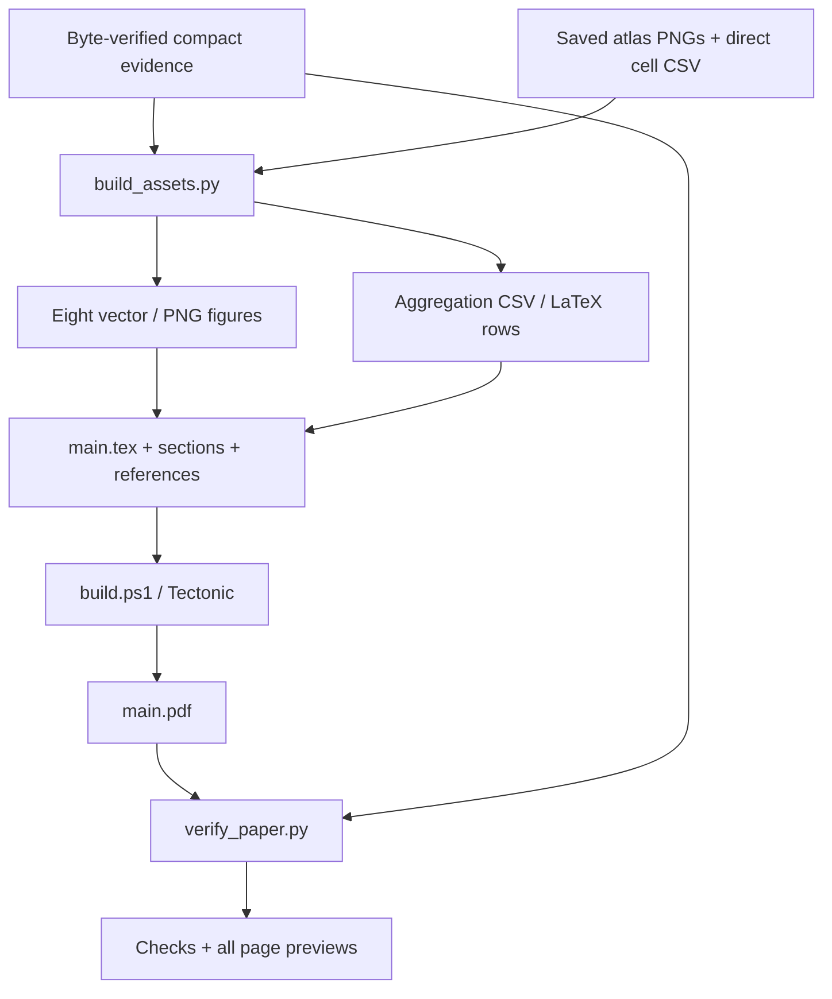

# Reproduction and artifact map

## Rebuild from this folder



From the repository root:

```powershell
.\phase3\run_cv.cmd -B phase3\ACCESS_latex_template_20260513\build_assets.py
.\phase3\run_cv.cmd -B phase3\ACCESS_latex_template_20260513\build_spatial_budget.py
.\phase3\ACCESS_latex_template_20260513\build.ps1
.\phase3\run_cv.cmd -B phase3\ACCESS_latex_template_20260513\verify_paper.py
```

All Python uses **cv_conda** through the existing wrapper. The figure builder
uses NumPy, pandas, Matplotlib and Pillow; verification uses PyMuPDF. It does not
load a neural model. Do not replace the CUDA/PyTorch environment. Existing OpenCL
registration messages may appear before execution; check the exit code and
explicit validation result.

Figure reproduction is offline. A cold TeX cache downloads TeX dependencies;
subsequent builds use `.build/cache/`. The existing compiler executable under
`prototype/.cache/latex-tools/` is a read-only dependency. Its new cache and all
outputs are in this paper folder, preserving the old manuscript/workstations.

## Portability and optional preparation

Keep the main/section sources, bibliography, generated table macro, vector figures,
class, engine compatibility file, bibliography style, logos, all supplied font/map/
FD/TFM files together. Choose `main.tex` as root. Tectonic performs all necessary
passes. A full TeX installation can use the normal LaTeX/BibTeX rerun sequence;
Overleaf can import this source tree. Only the local Tectonic route has been
executed here; the alternatives are not claimed as tested.

| Utility | Purpose | Normal rebuild? |
|---|---|---|
| `prepare_paper.py` | One-time compact evidence/template snapshot and baseline | No |
| `prepare_references.py` | Recreate curated bibliography, preserving the old one | Only after bibliography-source changes |
| `prepare_visual_evidence.py` | Extract original epoch records and two deterministic old atlas examples | No; copied CSV/PNG inputs are supplied |
| `build_assets.py` | Regenerate figures/table rows from compact copied inputs | Yes |
| `build_spatial_budget.py` | Regenerate the equal-budget figure/table from sealed summary | Yes |
| `run_spatial_budget.py` | Recompute the train-derived basis and frozen-head comparisons from pinned evidence | Optional |
| `build.ps1` | Compile paper with isolated TeX cache | Yes |
| `verify_paper.py` | Check numeric claims, preservation, citations and PDF; render every page | Yes |

Optional visual-evidence extraction can read two pinned public HF RGB chunks if
not cached. It does not read credentials, construct/execute a model or upload.

## Exact identities

| Object | Identifier |
|---|---|
| HF dataset repository | `Shanmuk4622/tyre-wear-study` |
| TRACE fit revision | `510cbc827337cbc963562c798811226326dc7c0c` |
| TRACE review revision | `7672729fdb1ccd0f55b565c1d60e8a50c6be078e` |
| TRACE fit protocol | `ef8c68133a8a060c47792f7e02a84a953b783cf71653e1c87eff596f8172ad2f` |
| Aggregation protocol | `06b2a06afb53a360f1ce2a254ab67d4e71a4ab698ee9f8e7a46f67dda710c44d` |
| Executed NB24 SHA-256 | `23e081e52454a617be134dbf9c6de9eb3e339ba5fa9e07a8164c4d66bf67da20` |
| Frozen 32-file package identity | `050f71ae540b387e33795144cf97894934cbccfad239fed9078a0c9140315356` |
| GEO geometry export | `8358e0595d46caee1160818ad975042f2031e14f7d0fa6f2ac105b9312325450` |

These are existing identities, not a new experiment namespace. Earlier checkpoint
provenance remains in original completion reports.

## Audit scopes

| Receipt | Establishes | Does not establish |
|---|---|---|
| `audit/EVIDENCE_FILES.json` | Compact input/source byte identity | Every large native object copied here |
| `audit/TEMPLATE_FILES.json` | Supplied class/font identity | IEEE endorsement |
| `audit/PRESERVATION_BASELINE.json` | Original manuscript/reports unchanged | Coauthor approval |
| `audit/ADDITIONAL_INPUTS.json` | Original tables/cache and deterministic display outputs recorded | More independent photos |
| `audit/ASSET_BUILD.json` | Figure inputs and output hashes | Automatic validation of scientific interpretation |
| `audit/VALIDATION.json` | 36 aggregation values, core gains, 60 gate outcomes, fit totals, citations, abstract/PDF | All prose approved by authors |
| `audit/VISUAL_REVIEW.md` | Latest rendered pages inspected | IEEE production certification |

This task does not repeat the full 47-million-row training audit. It uses the pinned
published review, the bounded independent NB24 verification, and the completed
aggregation verification, with those distinctions preserved in Section IX.

## Recompute the matched-budget extension

With the pinned NB24 local mirror and original aggregation derivatives present,
run the following command from the repository root.

```powershell
.\phase3\run_cv.cmd -B phase3\ACCESS_latex_template_20260513\run_spatial_budget.py
```

The analysis verifies 249 pinned bodies and writes direct CSVs. It solves
spatial eigensystems on full-support training tokens and calls only the retained
two-layer decoder. The computation receipt distinguishes 9,122,048 decoder
vector readouts from optimizer updates and encoder or geometry forwards, which
are zero. The detailed `IMAGE_RESULTS.csv` contains 282,720 rows and the fitted
vectors are stored in `BASIS_VECTORS.csv` under `.build/spatial_budget/`.
The four compact evidence CSVs are sufficient for figure regeneration. If the
detail table is present, manuscript verification independently reduces all of
its rows to compare with the published role, view, and basis summaries.

## Rebuild Figure 1 only

From the repository root, use the targeted asset build and then compile the paper.

```powershell
.\phase3\run_cv.cmd -B phase3\ACCESS_latex_template_20260513\build_assets.py --architecture-only
.\phase3\ACCESS_latex_template_20260513\build.ps1
```

[Figure builder](build_trace_figure.py) checks the model's source hash,
execution shapes, parameter count, and recorded hidden-RGB invariance before
drawing. It exports the paper's [vector PDF](figures/architecture.pdf), a
[PNG proof](figures/architecture.png), and [editable SVG/XML](figures/architecture.svg)
with live text and vector paths. Edit the builder to regenerate all three
formats from one source. The targeted build updates only Figure 1 and its asset
receipt. The diagram reads bottom to top and uses shading for learned modules
and dashed lines for metadata.

## Reviewer analysis

With the 249 pinned input bodies and the prior fitted basis vectors available,
run from the repository root:

~~~powershell
.\phase3\run_cv.cmd -B phase3\ACCESS_latex_template_20260513\run_reviewer_analysis.py
~~~

The script measures principal angles and decoder Jacobian variation and solves
two cell-specific affine ridge readouts on the saved training tokens. It retains
25,080 paired image rows and fit coefficients under .build/reviewer, plus five
compact evidence CSVs. Two synthetic forwards check module reuse and hidden
RGB invariance at fixed geometry and support.
[Analysis receipt](audit/REVIEWER_ANALYSIS.json) · [Architecture receipt](audit/TRACE_ARCHITECTURE.json).

The original TRACE publication contains 3,553 direct CSVs and 47,263,346
rows, 6,725 native arrays and 64 PyTorch files. Of the CSV rows, 297,021 are
inherited cache rows and 46,966,325 are main-fit rows. The original dense
review reconciles 361,795,584 dense values and 14,132,640 moment values.
The separate bounded audit independently checks 946 native bodies.
[Pinned evidence and audit](../phase3NB24Completion.md).

## Larger original saved-feature study

Outputs remain in [`../texture_aggregation_20261102/`](../texture_aggregation_20261102/)
with its [methods](../texture_aggregation_20261102/METHODS.md), direct CSV/native
arrays, protocol, validation and exploratory addendum. Source routines remain in
[`../analysis/`](../analysis/), including `texture_aggregation_math.py`,
`analyze_texture_aggregation.py`, preparation and independent validation scripts.

Repeating that primary sweep requires its pinned native inputs and unchanged
frozen decoder. It is **not** the manuscript figure-build command and needs no
retraining. Large new derivatives remain local; publication and raw-image
redistribution are separate author actions.
