# Phase 3 — start here

<!-- IEEE_ACCESS_PAPER_20261103 -->
## Latest — separate IEEE Access author-review paper

**3 November 2026:** [Paper and handoff](phase3PaperIEEEAccess.md),
[PDF](paper_ieee_access/main.pdf), and [editable source](paper_ieee_access/README.md)
are prepared from completed Phase 3 evidence. The focused contribution is local
texture utility versus global aggregation, with all failed gates and data limits
retained. No new fit, photo, workstation change, HF publication or Git push.

Next is author review and the [submission checklist](paper_ieee_access/SUBMISSION_CHECKLIST.md),
not another notebook. Original manuscript, measured sources and selections remain unchanged.
<!-- END_IEEE_ACCESS_PAPER_20261103 -->

<!-- TEXTURE_AGGREGATION_20261102 -->
## Latest — saved texture aggregation investigation complete

**2 November 2026:** [Full investigation](phase3TextureAggregationInvestigation.md)
traces actual TRACE local/context features, nine predeclared aggregations,
two recorded views and unchanged decoder weights across the existing 570 images.
No image/geometry inference, optimizer updates, new photos or workstation edits.
Frozen decoder/projector readouts are explicitly counted; this is not a
zero-computation review or a newly trained candidate.

One average preserves 61.14% of local validation advantage over the position
control; a train-position template plus five residual moments preserves 81.76%.
Orientation/contrast suffer disproportionately. Averaging preferentially
removes within-component variation, while context already changes diversity.
Invertible scaling and mask placement can inflate rank without useful new
texture information. Original gates/selections, including selected=None, stay intact.

[Interactive explorer](texture_aggregation_20261102/Aggregation_Explorer.html) ·
[Methods and direct-file dictionary](texture_aggregation_20261102/METHODS.md).
New raw/derived CSV and FP64 NPY evidence is local, not HF-published. Large
native/detail tables are ignored by Git; compact summaries/figures remain visible.
The supported next design question is incremental local spatial-residual utility
beyond global/position controls. No new architecture/objective or fit is selected here.
<!-- END_TEXTURE_AGGREGATION_20261102 -->

<!-- PROJECT_RETROSPECTIVE_20261102 -->
## Latest analysis — whole-project retrospective through NB24

**2 November 2026:** [Full project analysis](phase3ProjectRetrospective.md)
connects original research, Phase 2, TREAD-ONE, ATLAS/LC/context, GEO, TRACE,
both workstations and manuscript scope. The inventory covers 236 maintained
Markdown documents. Phase 3 measured bookkeeping is 7 fit families /10 fit
executions /600 epochs /29,400 updates, excluding engineering and avoiding
double-counting NB13A or notebook masters.

A new saved-only [TRACE component review](phase3TRACEComponentReview.md)
checks 570 image records /10 conservative components from 444 verified CSV
inputs. Every image beats all 3 masked controls for final clean view 0 and its
recorded plan; validation gain 21.63%, historical-test gain 17.85%. Per-position
local tokens are more varied than pooled summaries. This does not alter
selected=None, establish a pooling cause or validate physical wear.

[Interactive evidence explorer](retrospective_20261102/Project_Evidence_Explorer.html)
and 10 direct CSV inventories/derived tables are local; no new HF publication,
fit, forward, photo or workstation change. Next investigate local evidence and
aggregation under existing-data controls before justifying another model.
The completed NB24 status below remains authoritative for that run.
<!-- END_PROJECT_RETROSPECTIVE_20261102 -->

<!-- NB24_VERIFIED_20261102 -->
## Current — NB24 TRACE completed and HF-verified

**2 November 2026:** NB24 completed preparation, actual T4×2/HF continuation,
one seed /60 epochs /2,940 updates, and the saved-evidence review/passport.
All 33 payloads match. **No NB21/NB22/NB23/NB24 rerun needed.**
[Completion and verification scope](phase3NB24Completion.md).

Final validation masked reconstruction beats the strongest declared control by
**21.63%**; local reconstruction improves **36.44%**. Utility passes60/60, but
projector/encoder diversity passes0/60: ranks **1.0225 /1.2296 /1.2489**.
**Selected=None; research-only, unpromoted.**
[Illustrated findings and next research](phase3TreadTwoTRACEFindings.md).

The fit retains **3,553 direct CSVs /47,263,346 rows /6,725 NPY /64 PT /13.507 GB**;
570 existing photos only. Counts include inherited cache rows; no new photos.
Independent audit reconstructs all 2,940 objectives and60 validation gates; the
published full dense audit and the bounded local audit have explicit scopes.
All five owners are released; earlier publications remain unchanged.

Next use saved local texture/component evidence to justify any future revision;
no new fit or NB25 is required to complete this cycle. Preserve executed
notebook/runtime/protocol. Both workstations remain deferred.
<!-- END_NB24_VERIFIED_20261102 -->

<!-- TRACE_BATCH_20261102 -->
## Historical — TRACE batch delivery before NB24 execution

**2 November 2026:** all four self-contained TRACE notebooks are implemented.
**[NB24 Run All master](notebooks/phase3_NB24_TREAD_TWO_TRACE_All_In_One_Batch.ipynb)**
automatically sequences fixed-target preparation, actual dual-T4/HF continuation
and storage gates, one seed / 60 epochs / 2,940 updates, then the saved-evidence
review and interactive passport. Individual NB21/NB22/NB23 files are supplied too.

Use a dedicated Kaggle **T4×2**, Internet ON, the existing expanded
`shanmuk4622/tire-dataset-prepared-phase2` input and **HF_TOKEN**. Start cold with
at least 19 GB free; actual capacity must also preserve the 2 GB reserve. Run one
master, not competing writers. [Full setup/recovery guide](phase3TreadTwoTRACEBatch.md).

Local real-model lifecycle/restart/fault/review and fresh payload tests pass.
All 570 existing photos and 60 source schedules were exercised. The executable
schema has 48 CSV families / 671 fields with native predictions/tokens, all epoch
weights and complete-update recovery. [Acceptance and boundaries](phase3TreadTwoTRACEValidation.md).

**Actual Kaggle/live HF and measured training remain pending user execution.**
The notebooks enforce those live gates automatically. No local token/HF write,
new photo or workstation change. Original GEO remains closed/unselected; no old
completed notebook needs a rerun. Preserve this new source/notebook/protocol
once execution starts.
<!-- END_TRACE_BATCH_20261102 -->

<!-- TRACE_DESIGN_20261102 -->
## Earlier design checkpoint — TRACE prototype checked

**2 November 2026:** the user authorised work on the next design. **TREAD-TWO /
TRACE** now has four prototype modules, 71,022 new trainable parameters, fixed
spatial descriptors and explicit position-sensitive pooling. All 386 train photos
were audited: 197,632 target cells / 1,185,792 values retained. CPU leakage, loss,
gradient, state-restore and frozen-geometry equivalence checks pass.

[Design, findings and interactive examples](phase3TreadTwoTRACEDesign.md) ·
[Detailed rollout](tread_two/trace_design/DELIVERY_PLAN.md).

This is **local design/engineering**, not a measured model, live HF publication,
48 implemented telemetry writers or runnable Kaggle batch. Next build the full
data/transaction/evidence runtime and prove storage/dual-T4/HF continuation, then
deliver all justified notebooks with a sequential master. Existing photos only;
both workstations and every completed experiment remain preserved. NB20/GEO stays
closed and unselected; no old notebook rerun is needed.
<!-- END_TRACE_DESIGN_20261102 -->

<!-- NB20_VERIFIED_GEO_CLOSED_20261102 -->
## Completed prior cycle — NB20 HF-verified; GEO research cycle complete

**2 November 2026:** NB20 completed both NB18 review and NB19 passport stages.
All 19 payloads match; three cells complete without saved errors. Actual HF
revisions **610bdb22… / abfec8d6…** contain **121 logical files, 51 CSVs /
183,812 rows**. All 119 objects, released owners, 48 reference-comparable tables,
exact vector arrays and actual passport provenance check out. Earlier NB13–NB17
selecting manifests are unchanged. **No NB18/NB19/NB20 rerun needed.**
[Completion and numerical/evidence notes](phase3NB20Completion.md).

The current GEO cycle is closed as **unselected, unpromoted research**. Geometry
passes 60/60 epochs; representation eligibility passes 0/60. The original
27,514,418 CSV rows and native/epoch evidence remain on HF.
[Compact research handoff](phase3TreadTwoGEOResearchClosure.md).

**Recommended next direction:** separately design a texture revision with fixed
local targets and batch-compatible diversity, reusing saved geometry and existing
photos. [Design brief](phase3TreadTwoGEONextResearch.md). This is proposed,
not implemented or trained. No new notebook/fit is required to finish this cycle.
Both workstation implementations remain deferred and preserved.
<!-- END_NB20_VERIFIED_GEO_CLOSED_20261102 -->

<!-- NB17_COMPLETE_POSTRUN_BATCH_20261102 -->
## Historical — NB17 verification and batch delivery before NB20 execution

**2 November 2026:** the attachment is completed NB17 (message says NB16).
HF revision `1113bf8a…`: **11,637 logical files / 3,080 direct CSVs /
27,514,418 rows / 8,457 native arrays / 10.31 GB**. One seed,
60 epochs and 2,940 updates; all selected bytes, schemas, native evidence and original masks
independently checked. Owner released; earlier four publication manifests unchanged.
**Do not rerun NB16/NB17 training.** [Completion and illustrated insights](phase3NB17Completion.md).

The geometry floor passes 60/60; human point MAE improves 5.23% retrospectively.
Representation eligibility passes 0/60: final validation projector rank 1.038659,
pooled 96D rank 1.020990; masked gain 4.0337% is below 5%. **Selected unavailable;
final remains research-only, unpromoted.** No new classification/depth/safety claim.

**Next: [NB20 Run All master](notebooks/phase3_NB20_TREAD_TWO_GEO_All_In_One_Postrun.ipynb)**.
It automatically runs/publishes NB18 full review then NB19 evidence passport.
All three notebooks are delivered now; individual stage files are optional.
CPU / None, Internet ON, existing expanded Kaggle input, HF_TOKEN, at least 13 GB free
on a fresh start. One shared verified cache, complete-stage recovery, publication
every 30 minutes and at major/stop boundaries. [Full batch/run guide](phase3TreadTwoGEOPostrunBatch.md).
Local actual-data audit and offline source/handoff/restore checks pass; new
NB18/NB19 Kaggle/HF publication remains pending. Existing photos only, no extra
fit or workstation change. User preference: supply all justified next notebooks
together with an automatic sequential master; preserve scientific gates.
<!-- END_NB17_COMPLETE_POSTRUN_BATCH_20261102 -->

<!-- NB16_COMPLETE_NB17_READY_20261101 -->
## Historical — NB16 HF-verified; NB17 pre-execution delivery

**1 November 2026:** executed NB16 is complete and independently verified at HF revision9f991635…: **174 direct files /60 CSVs /42,217 rows /65 native arrays**, actual two T4s and HF-restored continuation, 96 matching scientific files, released owner. All27 payloads match; earlier context/review/readiness manifests are unchanged. **Do not rerun NB16.** [Completion and insights](phase3NB16Completion.md).

**Next: [NB17 GEO resumable pilot](notebooks/phase3_NB17_TREAD_TWO_GEO_Resumable_Pilot.ipynb)** — T4×2,Internet ON, existing expanded Kaggle input, HF_TOKEN,  fresh kernel and≥19 GBfree for a new run; Run All. The new integrated storage/HF gate runs automatically before one seed / 60 epochs/2,940 updates. Local complete lifecycle, 307-shard recovery, loss/rotation/quota/transport and selected-export provenance tests pass. Actual NB17 live gate/measured results remain pending. [Protocol](phase3TreadTwoGEOProtocol.md) and [run guide](tread_two/geo_pilot/OPERATIONS.md).

Implemented40 CSVfamilies/468executable fields (443 draft +25 pre-fit accounting/provenance fields; 14type corrections), bounded direct NPY/CSV storage, all epoch weights and full rolling recovery. Stable experiment registry prevents accidental refits; source/env/history mismatch stops. Preserve executed notebooks/sources. Existing photos only; no classifier loss, physical-depth/safety claim or workstation change. NB18 follows completed NB17 evidence.
<!-- END_NB16_COMPLETE_NB17_READY_20261101 -->
<!-- GEO_NB16_20261101 -->
## Historical — NB16 preparation delivery before execution

**1 November 2026:** the user approved the complete geometry-first plan and requested notebooks. [NB16 preparation](notebooks/phase3_NB16_TREAD_TWO_GEO_Preparation_And_Contract_Gate.ipynb) is implemented and locally checked: **355,879 trainable / 1,728,038 total parameters**, frozen original selected anchor, isolated geometry/texture/error branches and complete-update native/CSV recovery. Real batch8 four-update restore, loss/leakage/gradient/skip/crash checks pass locally. [Delivery and scope](phase3NB16Preparation.md).

**Next: T4×2, Internet ON, existing expanded Kaggle input, HF_TOKEN,  at least4GBfree; Run All in NB16.** It publishes direct CSV/native engineering evidence, proves actual HF download/continuation in a fresh secret-free worker, and displays32interactive mask cases. No local HF credentials/writes were used. Actual dual-T4/HF proof remains pending.

NB16 is preparation, not the measured60-epoch fit. **NB17/NB18 are not yet delivered**: actual NB16 verification and complete40-family/443-field measured logging, shard/staging and validation integration precede the one measured candidate. The original plan JSON is retained as a dated design snapshot. No new photos, classifier sweep, production promotion or workstation change. Preserve executed notebooks/sources after the user runs them.
<!-- END_GEO_NB16_20261101 -->

<!-- GEO_PLAN_20261101 -->
## Historical — complete geometry-first plan before implementation

**1 November 2026:** the user requested the complete geometry-first development plan. [Master plan](phase3TreadTwoGeometryPlan.md) and [technical package](tread_two/geometry_first/plan/README.md) now define one new **TREAD-TWO / GEO** research candidate: frozen selected TREAD-ONE features, bounded supervised geometry refinements, an isolated masked-texture/self-supervised branch, and experimental annotation-error estimates. No mileage-classification loss in the first pilot.

The plan chooses one seed / 60 epochs / 2,940 updates, exact existing data/anchor, source-coverage scheduling, independent gradient clipping, original-role validation, checkpoint eligibility/selection, full raw-tensor retention and **40 CSV families / 443 declared fields**. New HF namespace, dual-T4 ownership, complete-update restore and 30-minute / major/stop publication are specified. Proposed 15 GB logical / 18 GB peak ceilings require actual fixture measurements within the 20 GB assumption; 1 TB scratch is optional.

**Status: design only; runtime, numerical/live resource gates and training notebooks are pending.** Next: implement isolated data/model/store modules and build planned **NB16 GEO engineering/contract gate**, then one NB17 measured pilot if its gates pass. No existing executed notebook is rerun or regenerated. No new photos, model forward/optimizer update, HF write or workstation change occurred during planning.

The completed ATLAS v1/LC/context series remains closed and unpromoted. This new geometry/representation objective is a separate requested direction; earlier statements about no extra notebook to close the unchanged classifier series remain historical and valid in that scope. Both workstations stay deferred.
<!-- END_GEO_PLAN_20261101 -->

<!-- NB15_CLOSED_20261101 -->
## Historical — NB15 verified; current ATLAS experiments closed as research

**1 November 2026:** executed NB15 is complete and HF-verified at `f4b44d3d…`: **38 direct files / 16 CSVs / 196,905 rows**, three figures and the interactive capability passport. All published bytes, table values, schemas and capability records pass independent checks; owner released. Earlier context fit/review manifests remain unchanged. **No NB13/NB13A/NB14/NB15 rerun is needed.** [Completion and proof](phase3NB15Completion.md).

Scientific readiness remains false as expected: training conservative components low/mid/high = 1/1/4, and two conditional holdouts remove a fit class. All three completed candidate fits remain research-only/unpromoted; historical low recall is 0/62. This is a support/result finding, not an execution error or a claim that every alternative model must fail.

**Next consolidation step is implemented:** [interactive research evidence hub](tread_two/research_release/Evidence_Hub.html), three model cards, original selected/final native pointers, nine pinned publications and seven metadata CSVs. [Research closure and technical handoff](phase3TreadTwoResearchClosure.md). The index is local; its underlying scientific records are already on HF. No NB16 or fourth full classifier fit is needed to close these unchanged studies.

The broader application is not declared complete. Workstation changes remain deferred, both workstations and frozen experiments are preserved, and only existing photos are used. A later experiment needs a distinct supported objective/protocol. Earlier pending-run instructions below are dated history.
<!-- END_NB15_CLOSED_20261101 -->

<!-- NB14_COMPLETED_20261101 -->
## Historical — NB14 verified; NB15 existing-data readiness implemented

**1 November 2026:** executed NB14 is complete and HF-verified at `10c2f16d…`: **80 direct files / 52 CSVs / 585,825 rows**, five figures, 1,854 cases and 206 attention matrices. Every table matches independent local reconstruction exactly; all 1,502 original fit entries remain unchanged; owner released. **Do not rerun NB13/NB13A/NB14.** [Completion and findings](phase3NB14Completion.md).

The classifier remains research-only: historical BA 50%, low recall 0/62 and worse context NLL. Implemented next: [NB15 readiness/evidence passport](notebooks/phase3_NB15_TREAD_TWO_Existing_Data_Readiness_And_Evidence_Passport.ipynb). Local analysis passes; support readiness is false: known training tyres low/mid/high = 1/3/4 form conservative components 1/1/4, so two of six conditional holdouts remove an entire fit class. All 47,040 saved training views were already argmax-correct under the frozen LC prior; context mainly strengthens training confidence. [Detailed evidence and limits](phase3TreadTwoReadiness.md).

**Next: CPU / None, Internet ON, HF_TOKEN,  no image dataset, 2 GiB free / about 4 GB RAM; Run All in NB15.** It retains 16 CSV tables / 196,905 rows, three figures and an interactive capability passport in a separate HF namespace. No fourth full fit, checkpoint reselection, new photos or workstation changes. [Run guide](tread_two/readiness_gate/README.md). Actual NB15 Kaggle/HF publication remains pending. Earlier pending steps below are dated history.
<!-- END_NB14_COMPLETED_20261101 -->

<!-- NB13_COMPLETED_20261101 -->
## Historical — NB13A complete and HF-verified; NB14 CPU review ready

**1 November 2026:** the supplied NB13A restored the newer HF checkpoint at **2,486 updates** and completed the original **60 epochs / 2,940 updates**. All **1,503 direct files / 58,176,066 scientific CSV rows**, the native/CSV ledger and all 60 frozen-prior epoch states are verified; ownership is released. **Do not rerun NB13/NB13A.** [Completion and illustrated findings](phase3NB13Completion.md).

The context branch responds to layout but does not fix classification: selected/final historical BA **50%**, low recall **0/62**, high **41/41**; NLL worsens to **2.174813 / 2.358475**. Keep it unpromoted. These are previously inspected mileage-proxy cohorts, not independent physical wear/depth/safety validation.

**Next: [NB14 saved-data review](notebooks/phase3_NB14_TREAD_TWO_CONTEXT_Completed_Review.ipynb)** — **CPU / None, Internet ON, HF_TOKEN,  no dataset attachment, 4 GiB free and about 8 GB RAM; Run All**. Locally checked: 52 derived CSVs / 585,825 rows, five figures, 1,854 interactive cases and 206 endpoint attention matrices. Zero new fitting/model forwards; additive direct HF review publication. Actual NB14 Kaggle/HF completion remains pending. [Run guide](tread_two/context_review/README.md) · [Review design and checks](phase3TreadTwoContextReview.md).

Preserve all completed notebooks/runtime identities and both workstations. Existing photos only. Earlier recovery positions/pending instructions below are dated history, superseded by this completion proof.
<!-- END_NB13_COMPLETED_20261101 -->

<!-- NB13A_REPAIR_UPDATE_20261031 -->
## Historical — NB13A missing-file error fixed; standalone recovery ready

**31 October 2026:** supplied NB13A failed before recovery because its original local `run/POINTER.json` was unavailable. The executed error is archived (`b5a4dd68…`). Revision 2 now embeds the unchanged runtime and original contract, prefers compatible local/attached saved state, and otherwise restores the full verified HF checkpoint. Latest independently verified HF recovery remains update **1,294**; earlier local notebook output showed **2,467**. Missing unsent progress is recoverable only from surviving files. [Repair, evidence and instructions](phase3NB13ARepair.md).

Next: run the updated [NB13A](notebooks/phase3_NB13A_TREAD_TWO_CONTEXT_Existing_Session_Recovery.ipynb) directly with **Run All**: T4×2, Internet, existing expanded Kaggle input and HF_TOKEN. It can run without the old workspace. Preserve/use the older session or attach its saved output if available. Do not run concurrent writers. The original passed live gate is reused, compatibility is verified and the same experiment resumes; no fresh fit is allowed without a matching recovery snapshot.

Eighteen offline recovery checks and the actual notebook setup in an empty fixture directory pass. Actual revised Kaggle recovery remains pending. All 32 frozen model/runtime entries, original NB13 protocol/source/notebooks and both workstations are preserved. Earlier existing-session-only instructions below describe superseded revision 1.
<!-- END_NB13A_REPAIR_UPDATE -->

<!-- NB13_RECOVERY_UPDATE_20261031 -->
## Historical — NB13 incomplete; preserve the stopped Kaggle session

**31 October 2026:** the user reports an apparent freeze and confirms stopped execution with local files retained. Saved NB13 output reaches **2,467 / 2,940 updates**; the independently verified HF checkpoint is only at **1,294**, phase train. All 33 embedded files match the unchanged 32-file runtime. The actual T4×2/live-HF preflight passed. No final completion or clean owner release is verified. [Status, proof and diagnosis](phase3NB13FreezeAndRecovery.md).

Next: copy the **two code cells** from [NB13A existing-session recovery](notebooks/phase3_NB13A_TREAD_TWO_CONTEXT_Existing_Session_Recovery.ipynb) into the existing stopped Kaggle NB13 and run them in order. Keep its files, same settings/input and HF_TOKEN. Do not reset into a new empty session or run another original training cell concurrently. Recovery verifies local/remote history, publishes ahead local progress before fitting, and resumes the original protocol with phase/status/stack diagnostics. [Original run guide](tread_two/context_pilot/README.md).

Exact stop cause is not established: no traceback was saved. Long snapshot/verification/upload paths lacked continuous status; do not claim a proven numerical/GPU/HF failure. The external orchestration repair and notebook pass local offline checks; actual Kaggle recovery remains pending. Preserve executed NB13 (`e0c714be…`), all frozen sources, protocol `36f473b0…`, native/CSV progress and earlier completed experiments. No model/recipe/data/workstation change. Earlier pending-NB13 delivery text below is historical.
<!-- END_NB13_RECOVERY_UPDATE -->

<!-- NB12_CONTEXT_UPDATE_20261030 -->
## Historical — NB12 verified; NB13 context pilot ready

**30 October 2026. NB12 is complete and independently HF-verified:** all 63 direct files, 40 CSVs / 380,595 rows, four figures and 1,442 review cases checked. All 1,350 original NB11 manifest entries are unchanged; ownership is released. No NB12 or earlier fit rerun is needed. [Completion and insights](phase3NB12Completion.md).

Appearance stability improved, but selected/final LC endpoint BA remains 50% with low recall 0/62; selected NLL improved and ECE worsened. A train-only layout check confirms that the old shared-local/equal-band pooling ignores band/column reordering. This is a structural limitation, not proof of the cause of those errors.

**Next: [NB13 / ATLAS-CONTEXT r3](notebooks/phase3_NB13_TREAD_TWO_ATLAS_CONTEXT_Resumable_Pilot.ipynb).** One new seed-1/60-epoch candidate freezes selected LC epoch 7 and learns a bounded position-aware correction. Initial logits match LC exactly. Local math/recovery/fresh-package/CSV accounting pass; actual T4×2/live-HF preflight, measured fit and accuracy remain pending. Use T4×2, Internet, existing expanded Kaggle input and HF_TOKEN,  then Run All. [Run guide](tread_two/context_pilot/README.md).

Keep all 27 CSV families, native recovery/all epoch weights, separate base/context evidence and full selected/final attention. Per-update matrices are not retained; per-observation summaries are. Existing tyre photos only, no workstation changes or completed-source rewrites. Earlier dated pending instructions below are historical and superseded by this block.

[Architecture](phase3TreadTwoContextArchitecture.md) · [Protocol](phase3TreadTwoContextProtocol.md) · [Schema](phase3TreadTwoContextEvidenceSchema.md) · [Engineering proof](phase3TreadTwoContextValidation.md).
<!-- END_NB12_CONTEXT_UPDATE -->

<!-- NB10_LC_UPDATE_20261030 -->
## Historical — NB10 closed; NB11 ready, 30 October2026

NB10 is completed and independently HF-verified:495 direct files,1,918,052 scientific rows,386native training records,T4×2,zero fitting/held-out forwards and released ownership. No NB10 rerun is needed. [Completion proof](phase3NB10Completion.md).

Next is [NB11 / ATLAS-LC r2](notebooks/phase3_NB11_TREAD_TWO_ATLAS_LC_Resumable_Pilot.ipynb): one separately versioned seed,paired LC views,18-photo source-SHA exclusions,all386queries and sqrt-size group sampling. Local batch8 recovery/package checks pass; actual Kaggle/live-HF preflight and measured accuracy remain pending. Use T4×2,Internet,the existing expanded Kaggle dataset and HF_TOKEN. [Architecture](phase3TreadTwoLCArchitecture.md), [protocol](phase3TreadTwoLCProtocol.md).

Existing tyre data only. Both workstations and completed experiments are preserved.

<!-- END_NB10_LC_UPDATE -->
<!-- NB09_GATE_UPDATE_20261030 -->
**Latest, 30 October 2026 — NB09 complete / HF-verified; next gate implemented.**
All four NB09 cells and all 51 direct HF files pass the
[completion audit](phase3NB09Completion.md); no rerun is needed.
The [training-only gate](phase3TreadTwoAppearanceGate.md) is implemented and
locally complete on all 386 training images: **1,918,052 scientific CSV rows**,
full native image state and an 18-distinct-photo UNTRAINED proposal.
**Next: [NB10 on T4×2](notebooks/phase3_NB10_TREAD_TWO_Train_Only_Appearance_And_Reference_Gate.ipynb)**
with the existing expanded Kaggle dataset, Internet and HF_TOKEN,  then Run All.
[Settings/recovery](tread_two/appearance_gate/README.md). Actual dual-T4/HF gate
execution remains pending; no new fitting or workstation change occurred.
Earlier pending-NB09 statements below are historical local-delivery records.

**30 October 2026 — ATLAS failure/evidence review complete locally.**
The classifier fits sampled training observations but misses every low
validation image and predicts every low endpoint image as mid. Grayscale and final-checkpoint dimming expose
appearance sensitivity. [Findings, figures and next gate](phase3TreadTwoFindings.md).
Thirty new CSV tables / **246,157 derived rows** and the full
[interactive review](tread_two/analysis_report/ATLAS_Failure_Explorer.html) are ready.
**Next: run [NB09](notebooks/phase3_NB09_TREAD_TWO_ATLAS_Completed_Review.ipynb)
on Kaggle CPU to publish the review to HF.** No NB08 rerun or new training.
Local checks pass; actual NB09/HF review publication remains pending.

**30 October 2026 — NB08 finished normally.** A direct public HF check finds
the completed **60-epoch / 2,940-update** ATLAS fit, selected/final evaluation,
diagnostics and a released writer lease. The user clarified that no error
appeared. **Do not restart training.** [Current status and verification scope](phase3NB08CompletionStatus.md).
The earlier repair/rerun directions below describe the preceding failure.

**30 October 2026 — [NB08 error repaired](phase3NB08Repair.md).** The actual
T4/HF recovery gate passed, then the notebook's own hourly HTTP limiter timed
out. Use the current [NB08](notebooks/phase3_NB08_TREAD_TWO_ATLAS_Resumable_Pilot.ipynb)
and Run All. The audited transport-only repair keeps the original 24-file
source/bank/recipe and run identity; compatible gates/progress are reused.
No measured checkpoint was present at the inspected remote revision.

<!-- TREAD TWO CURRENT -->
**29 October 2026 — TREAD-TWO / ATLAS pilot implemented and locally checked.**
The [self-contained NB08 notebook](notebooks/phase3_NB08_TREAD_TWO_ATLAS_Resumable_Pilot.ipynb)
and [run guide](tread_two/PILOT_RUN_GUIDE.md) are ready. One seed-1 classifier
fit is gated behind actual Kaggle dual-T4/pinned-HF recovery and resource checks.
Local batch-eight fixtures pass pause/abrupt/fresh-process equivalence;
**no measured TREAD-TWO result exists yet**.

The isolated runtime retains 21 transactional CSV families, 247 column
definitions, complete native recovery, all epoch checkpoints, frozen-control
scores and full selected/final evidence maps. [Implementation](tread_two/PILOT_IMPLEMENTATION.md),
[schema](tread_two/PILOT_EVIDENCE_SCHEMA.md), [validation](tread_two/PILOT_VALIDATION.md).
Use existing data only. Both workstations and selected prior models are
preserved; the user deferred UI changes. The earlier prototype/app chronology
below remains history, not a request to rerun completed TREAD-ONE work.
<!-- END TREAD TWO CURRENT -->

<!-- STATION CURRENT -->
**Current scope, 29 October 2026: existing tyre data only. The user will not
collect more tyre photos.** The earlier assumed acquisition campaign is
superseded. The completed app deliverable is **[TREAD-ONE Studio](phase3TreadOneWorkstation.md)**,
a separate native workstation in [workstation/](workstation/README.md).
It uses the declared r1 seed-3/epoch-20 export, has its own launcher/model/Qt/
cache/evidence, and preserves the original workstation. Real model and UI
checks pass. [User guide](workstation/README.md).

Training and NB02–NB07 audits remain complete. Historical classification and
cohort limits remain; the prospective-readiness=false result is preserved as
research evidence and does not block this authorized desktop implementation.
The separate app is ready for existing media. No new photos or NB07 rerun is
required. Its further changes are deferred by the latest TREAD-TWO request.
<!-- END STATION CURRENT -->

Created: 27 October 2026 (Asia/Calcutta). Chat name: **phase 3**.

**Previous milestone — 29 October 2026: NB06 is complete and independently HF-verified.**
All six cells passed; 35 direct files include ten CSV tables / 758 derived rows,
three figures and the complete image atlas. [Completion and publication](phase3NB06Completion.md).
The NB05 selected projection result remains worse than baseline; no model was
trained or promoted by NB06. Its planned next milestone is now implemented as the
[independent-tyre data/protocol gate](phase3ProspectiveDataGate.md), with
[intake templates](data_intake/README.md) ready for the user's later help.

**Earlier r1 completion — 28 October 2026: all three original TREAD-ONE runs are complete and independently HF-verified.** Read the [completion audit and insights](phase3CompletionAudit.md), [next steps](phase3NextSteps.md) and [direct-CSV data policy](phase3DataRetentionPolicy.md). Mean selected test balanced accuracy is 34.146%, Dice 97.978%, point error 1.189% image width. The declared seed-3/epoch-20 export has 50% classification balanced accuracy and does not improve the installed task scores; the app stays unchanged.

**NB02 is also complete:** all five code cells executed successfully and the direct-file publication is independently verified at HF `91ccd3315bd296a76a8b583a6d0f2515ccb3d370`. It contains **18 CSV tables / 25 files / zero ZIP uploads**, preserving 191,904 scientific records. [Completion report, inventory and verification diagrams](phase3NB02Completion.md). No notebook rerun is needed.

| Stage | Current state | Main evidence |
|---|---|---|
| Custom-model training | Complete: 3 seeds × 60 epochs | [Scientific results](phase3CompletionAudit.md) |
| Direct CSV publication | Complete and independently verified | [NB02 completion](phase3NB02Completion.md) |
| Classifier diagnosis / NB03 | **Complete on Kaggle and independently HF-verified** | [Completion and publication](phase3NB03Completion.md), [results and figures](phase3ClassifierDiagnosticResults.md) |
| Evidence / recovery gate / NB04 | **Complete on both T4s / independently HF-verified** | [NB04 completion](phase3NB04Completion.md);572 published files and exact native recovery |
| Controlled shared-gradient comparison / NB05 | **Complete / independently HF-verified; candidate selected endpoint regresses** | [Completion](phase3NB05Completion.md); both 60 epochs / 2,940 updates |
| Completed-pair review / NB06 | **Complete on Kaggle / independently HF-verified** | [Completion](phase3NB06Completion.md); 35 direct files / ten CSV tables |
| NB07 data/protocol gate | Complete on Kaggle / independently HF-verified | [Completion](phase3NB07Completion.md); 46 direct files, source pass, prospective ready=false |
| Identity/capture preparation | Historical review pack implemented / checked; acquisition superseded | [Review guide](phase3CollectionReview.md); existing-data-only scope now governs |
| TREAD-ONE Studio | Complete / independent native app | [Implementation and checks](phase3TreadOneWorkstation.md); later UI changes deferred |
| TREAD-TWO / ATLAS | Measured fit completed on Kaggle and published; completion/report checks | [Current status](phase3NB08CompletionStatus.md); no training rerun |

```mermaid
flowchart LR
    A["Complete<br/>TREAD-ONE r1 training"] --> B["Complete<br/>audit + direct CSV on HF"]
    B --> C["Complete + HF verified<br/>TREAD-ONE NB03 diagnosis"]
    C --> D["Complete: both T4s + HF verified<br/>NB04 native / CSV recovery"]
    D --> E["Complete: NB05 paired pilot<br/>candidate regresses on selected endpoint"]
    E --> F["NB06 review + publication complete"]
    F --> G["NB07 complete + HF verified<br/>existing-data-only user decision"]
    G --> H["TREAD-ONE Studio complete<br/>later UI changes deferred"]
    H --> I["TREAD-TWO / ATLAS prototype<br/>next: resumable Kaggle pilot engineering"]
```

The original r1 notebooks/runtime/release remain preserved; their pending-execution and ZIP guidance is historical. NB02's earlier missing-directory failure and repair are retained in the [repair record](phase3NB02Repair.md). The local review has two supplementary CSV tables beyond the 18 published core tables; [the inventory explains the counts](phase3NB02Completion.md).

**New NB03 finding:** all six saved checkpoints fit all 386 nominal training images correctly, while validation BA ranges from 2.44% to 100%. Oracle tread gates do not repair the transfer failure; a fixed-batch check finds opposing classification/segmentation gradients. These are post-hoc observations, not historical training accuracy or a causal proof. [Full interpretation](phase3ClassifierDiagnosticResults.md).

**NB03 publication is complete:** 27 direct files, 336,600 core CSV records, 78 native gallery examples and zero ZIP uploads at HF `75400f019ba0c6741b5060925b9c956c0a1ca0a8`. All 14,010 class predictions agree with the local diagnosis; probabilities have small environment-dependent differences. [Independent verification](phase3NB03Completion.md).

Open the [interactive image explorer](diagnostics/TREAD_ONE_Classifier_Explorer.html) for fixed-gallery probabilities, masks, boundary guides, gates and signed evidence. It is self-contained, about 31 MiB. **NB04 is now complete:** all 572 files, native states, CSV cursors, 11 scientific tables and9 native arrays per recovery path were independently checked. [Completion audit](phase3NB04Completion.md). No rerun is needed.

[NB05](phase3NB05Completion.md) completed its one paired seed and both matched 60-epoch conditions. The mechanism activated on 2,700 candidate updates, but the selected candidate misses every low test photo and recognizes only 14/41 high photos. [NB06](phase3NB06Completion.md) completed the CPU-only review and direct HF publication. The [prospective data/protocol gate](phase3ProspectiveDataGate.md) completed as NB07. The later existing-data-only decision supersedes [the old acquisition plan](phase3DataGrowth.md).

This folder is the working home for Phase 3. The first task established project understanding and durable notes. The user then authorized a completely custom model combining the project's classification, localisation, segmentation, geometry and explanation needs, with the existing Kaggle/HF workflow.

## Reading order

| File | Purpose |
|---|---|
| [phase3Understanding.md](phase3Understanding.md) | What the project does, completed work, deployed models and limitations |
| [AGENTS.md](AGENTS.md) | Working instructions, including the user's Kaggle/HF requirements |
| [phase3Environment.md](phase3Environment.md) | `cv_conda`, launch instructions and the environment issue observed today |
| [phase3RepositoryMap.md](phase3RepositoryMap.md) | Where code, notebooks, data, evidence and manuscripts belong |
| [phase3DocumentationInventory.md](phase3DocumentationInventory.md) | All 103 pre-existing Markdown paths, roles and duplicate-copy coverage |
| [phase3DocumentationConflicts.md](phase3DocumentationConflicts.md) | Which older instructions have been superseded |
| [phase3EvidenceRegister.md](phase3EvidenceRegister.md) | Exact local evidence paths and recorded HF revisions |
| [phase3Progress.md](phase3Progress.md) | Current Phase 3 status |
| [phase3CompletionAudit.md](phase3CompletionAudit.md) | Verified full-run results, plots, limitations and CSV recovery |
| [phase3NextSteps.md](phase3NextSteps.md) | Completed publication status, next classifier diagnosis and later controlled revision gates |
| [phase3NB02Completion.md](phase3NB02Completion.md) | Verified Kaggle execution, HF commit, 18-table inventory, provenance diagrams and implications |
| [phase3NB03Completion.md](phase3NB03Completion.md) | Verified executed NB03, all 27 HF files, cross-environment comparison and scientific implications |
| [phase3NB04Completion.md](phase3NB04Completion.md) | Both T4s, 572 pinned files, 7,524 repeated engineering rows and independently verified native/CSV recovery |
| [phase3R2PairedPilot.md](phase3R2PairedPilot.md) | NB05 matched seed-1 comparison, gradient math, expanded retention, recovery and exact run instructions |
| [phase3NB05Repair.md](phase3NB05Repair.md) | Supplied HF lease conflict, notebook-only safe retry, preserved source contract and local regression evidence |
| [phase3NB05Completion.md](phase3NB05Completion.md) | Both measured conditions, 3,515 verified files, 23-family evidence audit, class/tyre failures and fixed next decision |
| [phase3NB06Review.md](phase3NB06Review.md) | CPU reproduction/direct publication of ten post-hoc CSV tables, plots and complete interactive image atlas |
| [phase3R2EvidenceSchema.md](phase3R2EvidenceSchema.md) | Exact NB05 CSV field/units dictionary, planned counts, native arrays, lifecycle and checkpoint timing records |
| [phase3TrainingEvidenceGate.md](phase3TrainingEvidenceGate.md) | NB04 training-evidence schema, native/CSV recovery, tests, diagrams, image viewer and Kaggle run guide |
| [phase3TrainingEvidenceSchema.md](phase3TrainingEvidenceSchema.md) | Exact 13-table CSV data dictionary: every column, units, supports, coordinate grids and missing-value semantics |
| [phase3ClassifierDiagnostic.md](phase3ClassifierDiagnostic.md) | TREAD-ONE NB03 contract, detailed outputs, tested inference recovery and exact Kaggle instructions |
| [phase3ClassifierDiagnosticResults.md](phase3ClassifierDiagnosticResults.md) | Full local findings, plots, intervention/gradient evidence and next engineering decision |
| [phase3DataGrowth.md](phase3DataGrowth.md) | User-assisted independent tyre collection, provenance and richer evidence retention |
| [phase3NB02Repair.md](phase3NB02Repair.md) | NB02 missing-directory repair, verification and exact rerun instructions |
| [phase3DataRetentionPolicy.md](phase3DataRetentionPolicy.md) | Superseding no-HF-ZIP rule and richer future telemetry requirements |
| [phase3Decisions.md](phase3Decisions.md) | Decisions and their rationale |
| [phase3ModelRationaleAndLogging.md](phase3ModelRationaleAndLogging.md) | Prior findings behind the custom design; current metric retention and future logging priorities |
| [phase3OpenItems.md](phase3OpenItems.md) | Remaining questions and separate future work |
| [phase3SessionLog.md](phase3SessionLog.md) | Dated actions, findings, checks and troubleshooting |

## Current understanding

The implemented application is **Tread Station**, a native Windows desktop tyre-inspection workstation. The original research study, later Phase 2 retraining, and paper revisions are related but have different datasets, checkpoints and claims. Phase 2 records report all **15 runs × 60 epochs** and final NB06 complete; the workstation selects five Phase 2 exports by validation. TREAD-ONE is a separate Phase 3 experiment, not a rerun/replacement of those completed jobs.

The orientation catalogues **103 Markdown files / 94 distinct SHA-256 contents**, including ignored manuscript build copies, backup readmes, the packaged dataset readme and a vendor licence. Full source text was loaded for the inventory/section scan; primary operational documents were read directly, long historical documents reviewed through section excerpts, and archived variants compared with maintained copies. This is a documentation/context review, not an exhaustive source-code review or a new remote scientific audit.

## Maintain these notes

At the end of each meaningful task, update Progress and append to SessionLog. Put changed decisions in Decisions, unresolved issues in OpenItems, and exact verification/provenance in EvidenceRegister. Refresh Understanding when the actual project state changes. Record a new dated state rather than adding an unqualified “run now” above old instructions.

New Phase 3 work belongs here. Existing code/data/notebooks stay at their current paths; identify necessary integration edits explicitly when that work is requested. The audit files are orientation snapshots, not training truth.
