# Phase 3 — start here

<!-- NB11_COMPLETE_UPDATE_20261030 -->
## Current — NB11 complete; NB12 review ready

**30 October 2026. NB11 is complete and independently HF-verified:** 60 epochs / 2,940 updates, 1,351 direct files and 54,336,368 raw scientific rows. The actual T4×2/live-HF preflight passed; ownership is released. No NB11 rerun is needed. [Full completion and findings](phase3NB11Completion.md).

Validation selected epoch 7 at BA 56.25%. Selected/final historical endpoint BA remains 50%: 62 low→mid and 41 high→high. NLL and appearance stability improve over v1; low recognition does not, and selected raw-score ECE worsens. Keep the candidate as research evidence; no workstation promotion.

Next: [NB12 saved-evidence review](notebooks/phase3_NB12_TREAD_TWO_ATLAS_LC_Completed_Review.ipynb), **CPU / Internet / HF_TOKEN / no dataset attachment**, then Run All. It adds 40 derived CSVs / 380,595 rows, four figures and a 1,442-case explorer with zero fitting or model forwards. Local recovery/cache/publication/package checks pass; actual NB12/HF review publication is pending. [Run guide](tread_two/lc_review/README.md).

<!-- END_NB11_COMPLETE_UPDATE -->
<!-- NB10_LC_UPDATE_20261030 -->
## Latest status — NB10 closed; NB11 ready, 30 October2026

NB10 is completed and independently HF-verified:495 direct files,1,918,052 scientific rows,386native training records,T4×2,zero fitting/held-out forwards and released ownership. No NB10 rerun is needed. [Completion proof](phase3NB10Completion.md).

Next is [NB11 / ATLAS-LC r2](notebooks/phase3_NB11_TREAD_TWO_ATLAS_LC_Resumable_Pilot.ipynb): one separately versioned seed,paired LC views,18-photo source-SHA exclusions,all386queries and sqrt-size group sampling. Local batch8 recovery/package checks pass; actual Kaggle/live-HF preflight and measured accuracy remain pending. Use T4×2,Internet,the existing expanded Kaggle dataset and HF_TOKEN. [Architecture](phase3TreadTwoLCArchitecture.md), [protocol](phase3TreadTwoLCProtocol.md).

Existing tyre data only. Both workstations and completed experiments are preserved.

<!-- END_NB10_LC_UPDATE -->
<!-- NB09_GATE_UPDATE_20261030 -->
**Latest, 30 October 2026 — NB09 complete / HF-verified; next gate implemented.**
All four NB09 cells and all 51 direct HF files pass the
[completion audit](phase3NB09Completion.md); no rerun is needed.
The [training-only gate](phase3TreadTwoAppearanceGate.md) is implemented and
locally complete on all 386 training images: **1,918,052 scientific CSV rows**,
full native image state and an 18-distinct-photo UNTRAINED proposal.
**Next: [NB10 on T4×2](notebooks/phase3_NB10_TREAD_TWO_Train_Only_Appearance_And_Reference_Gate.ipynb)**
with the existing expanded Kaggle dataset, Internet and HF_TOKEN, then Run All.
[Settings/recovery](tread_two/appearance_gate/README.md). Actual dual-T4/HF gate
execution remains pending; no new fitting or workstation change occurred.
Earlier pending-NB09 statements below are historical local-delivery records.

**30 October 2026 — ATLAS failure/evidence review complete locally.**
The classifier fits sampled training observations but misses every low
validation image and predicts every low endpoint image as mid. Grayscale and final-checkpoint dimming expose
appearance sensitivity. [Findings, figures and next gate](phase3TreadTwoFindings.md).
Thirty new CSV tables / **246,157 derived rows** and the full
[interactive review](tread_two/analysis_report/ATLAS_Failure_Explorer.html) are ready.
**Next: run [NB09](notebooks/phase3_NB09_TREAD_TWO_ATLAS_Completed_Review.ipynb)
on Kaggle CPU to publish the review to HF.** No NB08 rerun or new training.
Local checks pass; actual NB09/HF review publication remains pending.

**30 October 2026 — NB08 finished normally.** A direct public HF check finds
the completed **60-epoch / 2,940-update** ATLAS fit, selected/final evaluation,
diagnostics and a released writer lease. The user clarified that no error
appeared. **Do not restart training.** [Current status and verification scope](phase3NB08CompletionStatus.md).
The earlier repair/rerun directions below describe the preceding failure.

**30 October 2026 — [NB08 error repaired](phase3NB08Repair.md).** The actual
T4/HF recovery gate passed, then the notebook's own hourly HTTP limiter timed
out. Use the current [NB08](notebooks/phase3_NB08_TREAD_TWO_ATLAS_Resumable_Pilot.ipynb)
and Run All. The audited transport-only repair keeps the original 24-file
source/bank/recipe and run identity; compatible gates/progress are reused.
No measured checkpoint was present at the inspected remote revision.

<!-- TREAD TWO CURRENT -->
**29 October 2026 — TREAD-TWO / ATLAS pilot implemented and locally checked.**
The [self-contained NB08 notebook](notebooks/phase3_NB08_TREAD_TWO_ATLAS_Resumable_Pilot.ipynb)
and [run guide](tread_two/PILOT_RUN_GUIDE.md) are ready. One seed-1 classifier
fit is gated behind actual Kaggle dual-T4/pinned-HF recovery and resource checks.
Local batch-eight fixtures pass pause/abrupt/fresh-process equivalence;
**no measured TREAD-TWO result exists yet**.

The isolated runtime retains 21 transactional CSV families, 247 column
definitions, complete native recovery, all epoch checkpoints, frozen-control
scores and full selected/final evidence maps. [Implementation](tread_two/PILOT_IMPLEMENTATION.md),
[schema](tread_two/PILOT_EVIDENCE_SCHEMA.md), [validation](tread_two/PILOT_VALIDATION.md).
Use existing data only. Both workstations and selected prior models are
preserved; the user deferred UI changes. The earlier prototype/app chronology
below remains history, not a request to rerun completed TREAD-ONE work.
<!-- END TREAD TWO CURRENT -->

<!-- STATION CURRENT -->
**Current scope, 29 October 2026: existing tyre data only. The user will not
collect more tyre photos.** The earlier assumed acquisition campaign is
superseded. The completed app deliverable is **[TREAD-ONE Studio](phase3TreadOneWorkstation.md)**,
a separate native workstation in [workstation/](workstation/README.md).
It uses the declared r1 seed-3/epoch-20 export, has its own launcher/model/Qt/
cache/evidence, and preserves the original workstation. Real model and UI
checks pass. [User guide](workstation/README.md).

Training and NB02–NB07 audits remain complete. Historical classification and
cohort limits remain; the prospective-readiness=false result is preserved as
research evidence and does not block this authorized desktop implementation.
The separate app is ready for existing media. No new photos or NB07 rerun is
required. Its further changes are deferred by the latest TREAD-TWO request.
<!-- END STATION CURRENT -->

Created: 27 October 2026 (Asia/Calcutta). Chat name: **phase 3**.

**Previous milestone — 29 October 2026: NB06 is complete and independently HF-verified.**
All six cells passed; 35 direct files include ten CSV tables / 758 derived rows,
three figures and the complete image atlas. [Completion and publication](phase3NB06Completion.md).
The NB05 selected projection result remains worse than baseline; no model was
trained or promoted by NB06. Its planned next milestone is now implemented as the
[independent-tyre data/protocol gate](phase3ProspectiveDataGate.md), with
[intake templates](data_intake/README.md) ready for the user's later help.

**Earlier r1 completion — 28 October 2026: all three original TREAD-ONE runs are complete and independently HF-verified.** Read the [completion audit and insights](phase3CompletionAudit.md), [next steps](phase3NextSteps.md) and [direct-CSV data policy](phase3DataRetentionPolicy.md). Mean selected test balanced accuracy is 34.146%, Dice 97.978%, point error 1.189% image width. The declared seed-3/epoch-20 export has 50% classification balanced accuracy and does not improve the installed task scores; the app stays unchanged.

**NB02 is also complete:** all five code cells executed successfully and the direct-file publication is independently verified at HF `91ccd3315bd296a76a8b583a6d0f2515ccb3d370`. It contains **18 CSV tables / 25 files / zero ZIP uploads**, preserving 191,904 scientific records. [Completion report, inventory and verification diagrams](phase3NB02Completion.md). No notebook rerun is needed.

| Stage | Current state | Main evidence |
|---|---|---|
| Custom-model training | Complete: 3 seeds × 60 epochs | [Scientific results](phase3CompletionAudit.md) |
| Direct CSV publication | Complete and independently verified | [NB02 completion](phase3NB02Completion.md) |
| Classifier diagnosis / NB03 | **Complete on Kaggle and independently HF-verified** | [Completion and publication](phase3NB03Completion.md), [results and figures](phase3ClassifierDiagnosticResults.md) |
| Evidence / recovery gate / NB04 | **Complete on both T4s / independently HF-verified** | [NB04 completion](phase3NB04Completion.md);572 published files and exact native recovery |
| Controlled shared-gradient comparison / NB05 | **Complete / independently HF-verified; candidate selected endpoint regresses** | [Completion](phase3NB05Completion.md); both 60 epochs / 2,940 updates |
| Completed-pair review / NB06 | **Complete on Kaggle / independently HF-verified** | [Completion](phase3NB06Completion.md); 35 direct files / ten CSV tables |
| NB07 data/protocol gate | Complete on Kaggle / independently HF-verified | [Completion](phase3NB07Completion.md); 46 direct files, source pass, prospective ready=false |
| Identity/capture preparation | Historical review pack implemented / checked; acquisition superseded | [Review guide](phase3CollectionReview.md); existing-data-only scope now governs |
| TREAD-ONE Studio | Complete / independent native app | [Implementation and checks](phase3TreadOneWorkstation.md); later UI changes deferred |
| TREAD-TWO / ATLAS | Measured fit completed on Kaggle and published; completion/report checks | [Current status](phase3NB08CompletionStatus.md); no training rerun |

```mermaid
flowchart LR
    A["Complete<br/>TREAD-ONE r1 training"] --> B["Complete<br/>audit + direct CSV on HF"]
    B --> C["Complete + HF verified<br/>TREAD-ONE NB03 diagnosis"]
    C --> D["Complete: both T4s + HF verified<br/>NB04 native / CSV recovery"]
    D --> E["Complete: NB05 paired pilot<br/>candidate regresses on selected endpoint"]
    E --> F["NB06 review + publication complete"]
    F --> G["NB07 complete + HF verified<br/>existing-data-only user decision"]
    G --> H["TREAD-ONE Studio complete<br/>later UI changes deferred"]
    H --> I["TREAD-TWO / ATLAS prototype<br/>next: resumable Kaggle pilot engineering"]
```

The original r1 notebooks/runtime/release remain preserved; their pending-execution and ZIP guidance is historical. NB02's earlier missing-directory failure and repair are retained in the [repair record](phase3NB02Repair.md). The local review has two supplementary CSV tables beyond the 18 published core tables; [the inventory explains the counts](phase3NB02Completion.md).

**New NB03 finding:** all six saved checkpoints fit all 386 nominal training images correctly, while validation BA ranges from 2.44% to 100%. Oracle tread gates do not repair the transfer failure; a fixed-batch check finds opposing classification/segmentation gradients. These are post-hoc observations, not historical training accuracy or a causal proof. [Full interpretation](phase3ClassifierDiagnosticResults.md).

**NB03 publication is complete:** 27 direct files, 336,600 core CSV records, 78 native gallery examples and zero ZIP uploads at HF `75400f019ba0c6741b5060925b9c956c0a1ca0a8`. All 14,010 class predictions agree with the local diagnosis; probabilities have small environment-dependent differences. [Independent verification](phase3NB03Completion.md).

Open the [interactive image explorer](diagnostics/TREAD_ONE_Classifier_Explorer.html) for fixed-gallery probabilities, masks, boundary guides, gates and signed evidence. It is self-contained, about 31 MiB. **NB04 is now complete:** all 572 files, native states, CSV cursors, 11 scientific tables and9 native arrays per recovery path were independently checked. [Completion audit](phase3NB04Completion.md). No rerun is needed.

[NB05](phase3NB05Completion.md) completed its one paired seed and both matched 60-epoch conditions. The mechanism activated on 2,700 candidate updates, but the selected candidate misses every low test photo and recognizes only 14/41 high photos. [NB06](phase3NB06Completion.md) completed the CPU-only review and direct HF publication. The [prospective data/protocol gate](phase3ProspectiveDataGate.md) completed as NB07. The later existing-data-only decision supersedes [the old acquisition plan](phase3DataGrowth.md).

This folder is the working home for Phase 3. The first task established project understanding and durable notes. The user then authorized a completely custom model combining the project's classification, localisation, segmentation, geometry and explanation needs, with the existing Kaggle/HF workflow.

## Reading order

| File | Purpose |
|---|---|
| [phase3Understanding.md](phase3Understanding.md) | What the project does, completed work, deployed models and limitations |
| [AGENTS.md](AGENTS.md) | Working instructions, including the user's Kaggle/HF requirements |
| [phase3Environment.md](phase3Environment.md) | `cv_conda`, launch instructions and the environment issue observed today |
| [phase3RepositoryMap.md](phase3RepositoryMap.md) | Where code, notebooks, data, evidence and manuscripts belong |
| [phase3DocumentationInventory.md](phase3DocumentationInventory.md) | All 103 pre-existing Markdown paths, roles and duplicate-copy coverage |
| [phase3DocumentationConflicts.md](phase3DocumentationConflicts.md) | Which older instructions have been superseded |
| [phase3EvidenceRegister.md](phase3EvidenceRegister.md) | Exact local evidence paths and recorded HF revisions |
| [phase3Progress.md](phase3Progress.md) | Current Phase 3 status |
| [phase3CompletionAudit.md](phase3CompletionAudit.md) | Verified full-run results, plots, limitations and CSV recovery |
| [phase3NextSteps.md](phase3NextSteps.md) | Completed publication status, next classifier diagnosis and later controlled revision gates |
| [phase3NB02Completion.md](phase3NB02Completion.md) | Verified Kaggle execution, HF commit, 18-table inventory, provenance diagrams and implications |
| [phase3NB03Completion.md](phase3NB03Completion.md) | Verified executed NB03, all 27 HF files, cross-environment comparison and scientific implications |
| [phase3NB04Completion.md](phase3NB04Completion.md) | Both T4s, 572 pinned files, 7,524 repeated engineering rows and independently verified native/CSV recovery |
| [phase3R2PairedPilot.md](phase3R2PairedPilot.md) | NB05 matched seed-1 comparison, gradient math, expanded retention, recovery and exact run instructions |
| [phase3NB05Repair.md](phase3NB05Repair.md) | Supplied HF lease conflict, notebook-only safe retry, preserved source contract and local regression evidence |
| [phase3NB05Completion.md](phase3NB05Completion.md) | Both measured conditions, 3,515 verified files, 23-family evidence audit, class/tyre failures and fixed next decision |
| [phase3NB06Review.md](phase3NB06Review.md) | CPU reproduction/direct publication of ten post-hoc CSV tables, plots and complete interactive image atlas |
| [phase3R2EvidenceSchema.md](phase3R2EvidenceSchema.md) | Exact NB05 CSV field/units dictionary, planned counts, native arrays, lifecycle and checkpoint timing records |
| [phase3TrainingEvidenceGate.md](phase3TrainingEvidenceGate.md) | NB04 training-evidence schema, native/CSV recovery, tests, diagrams, image viewer and Kaggle run guide |
| [phase3TrainingEvidenceSchema.md](phase3TrainingEvidenceSchema.md) | Exact 13-table CSV data dictionary: every column, units, supports, coordinate grids and missing-value semantics |
| [phase3ClassifierDiagnostic.md](phase3ClassifierDiagnostic.md) | TREAD-ONE NB03 contract, detailed outputs, tested inference recovery and exact Kaggle instructions |
| [phase3ClassifierDiagnosticResults.md](phase3ClassifierDiagnosticResults.md) | Full local findings, plots, intervention/gradient evidence and next engineering decision |
| [phase3DataGrowth.md](phase3DataGrowth.md) | User-assisted independent tyre collection, provenance and richer evidence retention |
| [phase3NB02Repair.md](phase3NB02Repair.md) | NB02 missing-directory repair, verification and exact rerun instructions |
| [phase3DataRetentionPolicy.md](phase3DataRetentionPolicy.md) | Superseding no-HF-ZIP rule and richer future telemetry requirements |
| [phase3Decisions.md](phase3Decisions.md) | Decisions and their rationale |
| [phase3ModelRationaleAndLogging.md](phase3ModelRationaleAndLogging.md) | Prior findings behind the custom design; current metric retention and future logging priorities |
| [phase3OpenItems.md](phase3OpenItems.md) | Remaining questions and separate future work |
| [phase3SessionLog.md](phase3SessionLog.md) | Dated actions, findings, checks and troubleshooting |

## Current understanding

The implemented application is **Tread Station**, a native Windows desktop tyre-inspection workstation. The original research study, later Phase 2 retraining, and paper revisions are related but have different datasets, checkpoints and claims. Phase 2 records report all **15 runs × 60 epochs** and final NB06 complete; the workstation selects five Phase 2 exports by validation. TREAD-ONE is a separate Phase 3 experiment, not a rerun/replacement of those completed jobs.

The orientation catalogues **103 Markdown files / 94 distinct SHA-256 contents**, including ignored manuscript build copies, backup readmes, the packaged dataset readme and a vendor licence. Full source text was loaded for the inventory/section scan; primary operational documents were read directly, long historical documents reviewed through section excerpts, and archived variants compared with maintained copies. This is a documentation/context review, not an exhaustive source-code review or a new remote scientific audit.

## Maintain these notes

At the end of each meaningful task, update Progress and append to SessionLog. Put changed decisions in Decisions, unresolved issues in OpenItems, and exact verification/provenance in EvidenceRegister. Refresh Understanding when the actual project state changes. Record a new dated state rather than adding an unqualified “run now” above old instructions.

New Phase 3 work belongs here. Existing code/data/notebooks stay at their current paths; identify necessary integration edits explicitly when that work is requested. The audit files are orientation snapshots, not training truth.
