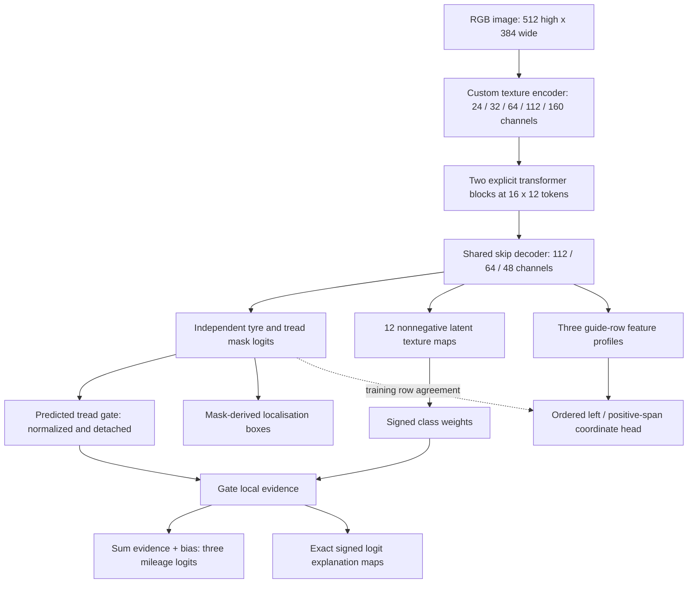

# TREAD-ONE — custom model design

Version: r1, 27 October 2026. Status: implemented; local checks are in `validation/`. Kaggle execution, long training and accuracy results are pending.

## The idea

Build one compact model that draws the regions it uses, estimates their boundaries, and accounts for its class decision through visible signed evidence. The four tasks share the same representation instead of loading five unrelated networks. The design is custom PyTorch code, with **1,372,159 trainable parameters**, random initialization and no downloaded backbone, pretrained teacher or external foundation-model dependency.

The creative part is the connection between tasks: the predicted tread supplies the classifier's spatial gate; a local latent-texture bank supplies exact additive class evidence; an ordered boundary head must agree with the predicted mask at the same three guides; training periodically changes the labelled background while asking the classification distribution to remain stable. Each connection has a measurable failure case.

This is a custom synthesis of established operations, not a claim that convolutions, transformers, additive classifiers or multi-task learning are newly invented. Success is an experiment, not guaranteed by the architecture.

## Model map



## Encoder and context

The stem downsamples by four. Four custom stages combine depthwise 5×5 spatial filters, alternating dilation, GroupNorm, channel mixing and trainable residual scaling. GroupNorm avoids tiny-batch running-statistic dependence. This is useful when seeds train in separate GPU processes.

The coarsest feature grid is 16×12, or 192 tokens. A learned projection of normalized image coordinates supplies position. Two four-head transformer blocks use explicit matrix multiplications, FP32 attention scores/softmax, residual projections and feed-forward networks. No flash/SDPA dispatch is required. The transformer is affordable at this grid; full-resolution quadratic attention is deliberately absent.

A three-stage skip decoder restores quarter-resolution features, 128×96×48. Integer repeat/crop upsampling avoids the nondeterministic interpolation-backward problem previously encountered in this project. Masks train against 4×4 aggregated targets, with cells touching ignored pixels excluded. Image-space reporting repeats the predictions by four to the 512×384 input grid.

## Segmentation and localisation

Two independent sigmoid channels predict tyre and tread. They can overlap. The raw labels are preserved, including explicit ignore pixels for contradictory annotations. A small containment penalty discourages predicted tread outside predicted tyre, without silently correcting source masks.

Localisation boxes are the enclosing boxes of thresholded masks. Empty masks produce a missing box. This is **mask-derived localisation**, not a separately trained detector or a claim of multi-instance detection AP. Report box IoU, missing predictions and segmentation metrics under their actual definitions.

## Geometry

Each image supplies its recorded three guide fractions. At each guide, the decoder provides a horizontal feature profile. Sixteen bins summarize the profile, followed by a shared small MLP. Its two outputs parameterize:

```text
left  = 0.99 * sigmoid(a)
right = left + (1 - left) * sigmoid(b)
```

This guarantees ordered, bounded proposals by construction. There is no hidden sorting of crossed predictions. The model can still be confidently wrong, narrow or clipped; order is a structural constraint, not a visibility/confidence estimate.

Human geometry targets retain weight 1. New polygon-derived targets retain weak weight 0.25, as in the runnable Phase 2 protocol. Images with no point targets have zero supervised point loss. Mask-row agreement is applied only to rows whose reference tread is nonempty and not touching the frame edges, while excluding ignored pixels. Its soft interval is compared with a detached predicted tread row.

Inference review flags identify empty/clipped mask rows and point/mask disagreement exceeding 5% image width. That tolerance is a frozen engineering heuristic, not a calibrated rejection rate. Raw coordinates always remain available. No visibility head, anomaly diagnosis, depth or physical camber/toe is invented.

## Intrinsic explanations

Let `C[k,h,w]` be 12 softplus latent texture maps. These are learned channels, not human-labelled concepts such as cracks or damage. Let `g[h,w]` be the predicted tread sigmoid normalized to sum one. Classification uses a **detached** gate, so its loss does not directly alter the segmentation head to invent a convenient gate.

```text
E[c,h,w] = g[h,w] * sum_k W[c,k] * C[k,h,w]
logit[c] = bias[c] + sum_h,w E[c,h,w]
probability = softmax(logits)
```

The maps contain positive and negative contributions; the bias is saved separately. Their sum must reconstruct the class logits. Deleting selected contributions while holding the evidence representation fixed changes a logit by exactly their sum. The implementation tests that accounting, saves raw arrays and renders signed overlays.

That exact property applies at the **evidence layer**. It does not make each location causally independent in the input: the encoder and transformer have wide receptive fields, and the gate itself depends on the image. It also does not turn a softmax into calibrated physical-wear probability. Final evaluation separately measures background-neutralization sensitivity and image occlusion effects, under the same inference precision, rather than equating them with algebraic evidence removal.

## Background intervention

Every fourth optimizer update, training creates a second image by retaining the union of labelled tyre/tread/ignore pixels and rolling the batch elsewhere. This is an appearance intervention using training annotations only. The model compares the new class distribution with the detached original distribution using KL divergence. Normal inference takes only RGB and fixed guide positions; validation/test masks never gate its normal predictions.

Swapping backgrounds does not guarantee invariance, remove every shortcut, or create independent tyres. A batch of similar backgrounds may give a weak intervention. Its contribution must be assessed through held-out diagnostics and, if later justified, a separately authorized matched ablation.

## Objective

```text
L = CE(label smoothing 0.05)
    + 0.20 * ordinal CDF squared error
    + segmentation BCE + soft Dice loss
    + 2.00 * weighted point SmoothL1(beta=0.02)
    + 0.10 * predicted containment violation
    + 0.10 * guide-row interval agreement
    + 0.20 * background KL on every fourth update
```

The two ordinal CDF values are computed explicitly (`p0`, `p0+p1`), avoiding a CUDA cumulative-sum operation that failed deterministic execution locally. Loss weights are frozen design choices. They are not automatically optimized on test data.

## What is and is not being tested

Primary engineering question: can one custom representation jointly support all four outputs under the same safe dataset and operational constraints? The classification target remains mileage proxy. Existing Phase 2 checkpoints are contextual baselines; random initialization and joint selection differ, so this is not a perfectly matched architecture-only ablation.

Default experiment: one architecture, three seeds, 60 epochs. No sweep, hidden teacher or extra pretraining. Single-seed demonstrations may be useful during troubleshooting, but the delivered study declares all three seeds and preserves missing states if a session ends.

The existing Phase 2 low/high-only holdout is retained to avoid unresolved mid-video identity leakage. It cannot establish full three-class or unseen-video generalization. A stronger subject-disjoint mid/video experiment requires additional verified identities/data, not merely an architectural modification.

## Implementation ownership

| Source | Responsibility |
|---|---|
| `runtime/model.py` | Architecture, losses and box extraction |
| `runtime/data.py` | Frozen overlay adapter, sample schedule, geometry guides and counterfactual input |
| `runtime/common.py` | Atomic I/O, RNG, deterministic mode, state comparisons and completion checks |
| `runtime/worker.py` | One GPU seed, numerical retries, real-model seam and completed-update training state |
| `runtime/evaluation.py` | Task metrics, interventions, raw arrays and gallery |
| `runtime/hub.py` | Publication, ownership fencing, verified restoration, rate/backoff handling |
| `runtime/run.py` | Dataset preflight, frozen protocol, two slots, three seeds, reporting/export |
| `build_notebooks.py` | Reproducible self-contained notebook/release generation |

## Technical references consulted

- [PyTorch deterministic algorithms](https://docs.pytorch.org/docs/stable/generated/torch.use_deterministic_algorithms.html): deterministic mode is enforced and unsupported operations fail, rather than merely warning.
- [PyTorch reproducibility](https://docs.pytorch.org/docs/stable/notes/randomness.html): RNG and runtime consistency matter; the real-model seam is checked on the executing hardware rather than assuming cross-version reproducibility.
- [Hugging Face Hub rate limits](https://huggingface.co/docs/hub/rate-limits): API/read classes have server-defined limits. The custom publisher respects response delays; its conservative application-call budget is not a claim about a universal HTTP quota.

These references support implementation choices, not the model's novelty or empirical performance. The existing project contracts and exact reused Phase 2 source copies are also retained.
