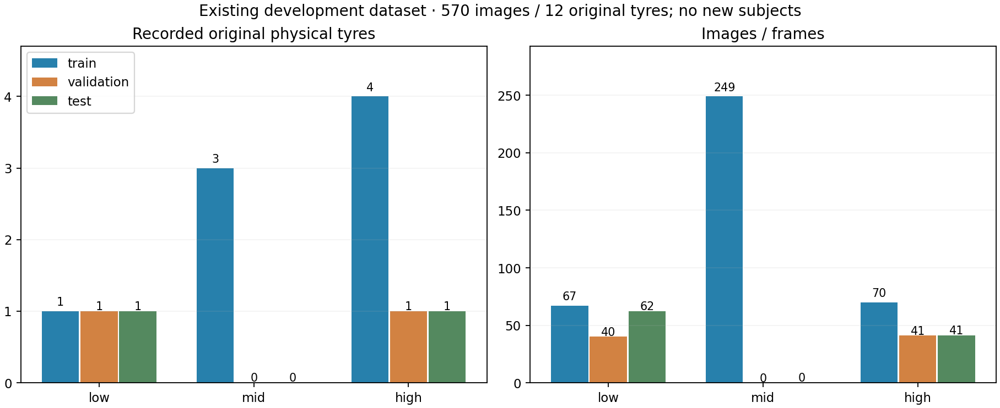
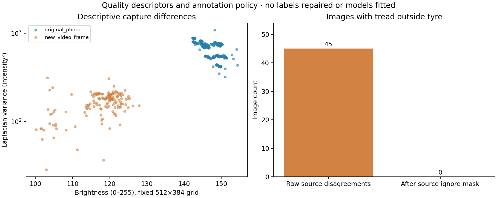

# NB07 direct CSV evidence — open here

<!-- PUBLISHED NB07 -->
**Kaggle publication is complete and independently verified.**
[Completion audit](../phase3NB07Completion.md) · [Pinned published files](https://huggingface.co/datasets/Shanmuk4622/tyre-wear-study/tree/1b6d7122ed47350a9623476975912aff54c690a1/phase3/tread-one/data-gate/v1/dbb3cf3634d1c2b19034b32e7182a4deaab1fdb5dc094a605f733514009d6f91) ·
[Cached published CSV folder](../data_gate_validation/nb07_publication/remote/csv).
The table links below retain the original local preflight exports: 20 CSVs
are byte-identical to publication, while image_quality/capture_descriptors
have small environment-sensitive numerical differences. See the completion
report for exact magnitudes. The local run/contract remains preserved.
<!-- END PUBLISHED NB07 -->

**29 October 2026. Locally completed audit.** 22 structured tables /
7,614 rows, including 206 schema rows. These are derived from
570 existing images / 12 original tyres and existing logged training evidence.
**Zero new independent tyres or images supplied; prospective training ready=false.**

[Full technical/run guide](../phase3NB07DataGate.md) ·
[Interactive source explorer](runs/a0df0c048f17/TREAD_ONE_Data_Gate.html) ·
[Intake guide](../data_intake/README.md) ·
[Validation receipt](../data_gate_validation/VALIDATION.json)

## Direct table inventory

| CSV | Rows | Record grain / interpretation |
|---|---:|---|
| [source_images.csv](csv/source_images.csv) | 570 | One existing source image/frame: IDs, hashes, domain, label, historical split and parent constraint |
| [source_tyres.csv](csv/source_tyres.csv) | 12 | One recorded original physical tyre; missing measurements remain blank |
| [source_clips.csv](csv/source_clips.csv) | 3 | One existing clip; no new independent subject |
| [video_parent_review.csv](csv/video_parent_review.csv) | 9 | One clip × possible original mid parent; similarity is review evidence only |
| [image_quality.csv](csv/image_quality.csv) | 570 | One existing image, fixed-grid quality and native conflict counts |
| [region_geometry.csv](csv/region_geometry.csv) | 1,140 | One existing image × tyre/tread region, valid native geometry |
| [point_geometry.csv](csv/point_geometry.csv) | 1,632 | One retained human/weak source point, native and normalized coordinates |
| [point_coverage.csv](csv/point_coverage.csv) | 570 | One image, including images without points |
| [similarity_candidates.csv](csv/similarity_candidates.csv) | 1,710 | One image × directed nearest-neighbour candidate, three per image |
| [exact_duplicates.csv](csv/exact_duplicates.csv) | 0 | One byte-identical image pair; empty with headers when none |
| [leakage_components.csv](csv/leakage_components.csv) | 10 | One conservative split co-assignment constraint; not a new subject count |
| [historical_class_support.csv](csv/historical_class_support.csv) | 9 | One historical role × proxy class, including absent classes |
| [capture_descriptors.csv](csv/capture_descriptors.csv) | 7 | One nonempty historical role × class, descriptive image-weighted means |
| [training_image_exposure.csv](csv/training_image_exposure.csv) | 1,140 | One condition × source image; aggregates saved augmented occurrences |
| [intake_tyres.csv](csv/intake_tyres.csv) | 0 | One supplied tyre record; currently none |
| [intake_sessions.csv](csv/intake_sessions.csv) | 0 | One supplied capture session; currently none |
| [intake_images.csv](csv/intake_images.csv) | 0 | One supplied native image; currently none |
| [intake_issues.csv](csv/intake_issues.csv) | 0 | One input validation issue; zero rows does not make empty intake ready |
| [prospective_support.csv](csv/prospective_support.csv) | 9 | One proposed role × class, including missing minima |
| [readiness_gaps.csv](csv/readiness_gaps.csv) | 12 | One missing prospective requirement |
| [gate_checks.csv](csv/gate_checks.csv) | 5 | One scoped historical/prospective check |
| [csv_schema.csv](csv/csv_schema.csv) | 206 | One column definition, units and provenance meaning; metadata rather than new observations |

Empty tables retain headers. Blank means unknown/not applicable; zero means
observed zero. The 1,140 exposure rows summarize 47,040 saved augmented
occurrences; they are not 47,040 independent photos. Points distinguish
720 human from 912 weak polygon-derived records. Similarity rows never assign
identity. Ten leakage components retain 12 physical tyres.

## Contracts and source identities

| Artifact | Meaning |
|---|---|
| [SUMMARY.json](SUMMARY.json) | Completed audit, historical pass and separate prospective-readiness result |
| [CSV_SCHEMA.json](CSV_SCHEMA.json) | Exact table headers, row counts, byte sizes and SHA-256 values |
| [CONTRACT.json](CONTRACT.json) | Source, code, environment, policy and intake identities |
| [POLICY.json](POLICY.json) | Actual draft policy used; no invented subject minima |
| [LATEST.json](LATEST.json) | Versioned original run path; these stable CSV/PNG copies preserve its exact bytes |
| [Publication preparation receipt](PUBLICATION_DELIVERY.json) | 46 direct files prepared, not a live HF revision |

Run ID: `a0df0c048f177fddd64622f648a214d56f621584f0ec13900297abc75f432263`.
Four raw input/control CSVs are preserved in the versioned run and separately
in the publication snapshot; their three unresolved clip rows are not included
in the structured-row total. Publication therefore contains 26 CSV files.

The source gallery was generated and its JavaScript/previews checked. Browser
interaction/layout was not verified. Full-resolution incoming data are hash-bound
by future audits but are not automatically uploaded by this evidence publisher.
