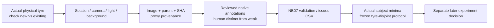

# Independent tyre intake — actual data, traceable identities

**29 October 2026. NB07 is complete and independently HF-verified.**
See the [completion audit](../phase3NB07Completion.md) and
[prepared identity comparison / CSV export](../phase3CollectionReview.md).
Rerun NB07 only when actual intake, reviewed mappings or policy change.
The three collection CSVs
remain empty: **zero new images and zero new tyres**. The separate resolution
CSV has three factual unresolved rows for existing clips. Read the
[NB07 guide](../phase3NB07DataGate.md) and [CSV index](../data_gate_outputs/CSV_INDEX.md).

## File layout and Kaggle input

```text
intake-root/
  INTAKE_VERSION.json
  physical_tyres.csv
  capture_sessions.csv
  images.csv
  video_identity_resolutions.csv
  protocol_policy.json           # optional actual policy; default is draft
  incoming/
    images/<actual-image>.jpg
    masks/<actual-tyre>.png
    masks/<actual-tread>.png
    annotations/<actual-mask>.json
    annotations/<actual-points>.json
```

The marker identifies schema `tyre-prospective-intake-v1`. Retain filenames and
headers. File paths in CSV **and** annotation JSON are relative to `incoming/`.
Absolute paths, traversal and referenced files outside that root are rejected.
Inputs are never edited. Attach one Kaggle intake dataset with this layout;
NB07 discovers its marker. No new attachment is needed for the current audit.



## Registries and fields

| Input | One row | Current rows | Rule |
|---|---|---:|---|
| [physical_tyres.csv](physical_tyres.csv) | Actual tyre | 0 | Stable identity; new/existing claim and proxy provenance reviewed |
| [capture_sessions.csv](capture_sessions.csv) | Capture session | 0 | Links to one registered tyre; cameras/sessions do not add subjects |
| [images.csv](images.csv) | Source image/frame | 0 | Consistent tyre/session/parent, native paths and proposed role |
| [video_identity_resolutions.csv](video_identity_resolutions.csv) | Existing clip | 3 | Unresolved unless mapping has actual supporting evidence |

Identifiers begin with a letter/digit, contain letters/digits/`.`/`_`/`-`, and
have at most 160 characters. IDs and headers must be unique. Blank means
unknown; actual measured zero remains zero. Never invent readings or use model
predictions as human labels.

| Tyre field | Meaning / value |
|---|---|
| `tyre_id` | Stable physical identity across all views and derivatives |
| `existing_project_tyre_id` | Original ID if applicable; consult [source_tyres.csv](../data_gate_outputs/csv/source_tyres.csv) |
| `new_independent_tyre_confirmed` | True only after checking it is additional; existing tyres cannot count again |
| `proxy_class` | `low`, `mid`, `high` under the documented project mileage-proxy rule |
| `mileage_value`, `mileage_unit`, `mileage_source` | Optional nonnegative finite reading in `km`/`miles`; proxy-label source/provenance is required |
| `brand_model`, `tyre_size` | Actual metadata when available |
| `measured_tread_depth_mm`, `depth_method` | Optional real finite nonnegative measurement and method; never predicted depth |
| `identity_review_status` | `confirmed` for eligibility |
| `notes` | Supporting evidence, missingness and uncertainty |

| Session field | Meaning |
|---|---|
| `session_id`, `tyre_id` | Unique session and registered physical tyre |
| `capture_date` | Required `YYYY-MM-DD` date |
| `domain`, `device_id`, `lighting` | Required actual capture provenance |
| `background_id`, `view_description` | Actual conditions/view when recorded |
| `source_video_id`, `notes` | Parent clip and other provenance when applicable |

| Image field | Meaning |
|---|---|
| `image_id`, `tyre_id`, `session_id` | Image with consistent foreign keys |
| `relative_path` | Native JPG/JPEG/PNG under incoming/ |
| `image_sha256` | Optional declared byte hash, checked if supplied; actual hash always computed |
| `parent_source_id` | Original photo/video identity; required for derivatives |
| `original_or_derivative` | Actual kind; `frame`, `derivative`, `augmentation` require a parent |
| `domain`, `proxy_class` | Source domain and optional class agreeing with tyre registry |
| `split` | Initially `unassigned`; later `train`, `validation`, `test` under the protocol |
| `mask_annotation`, `point_annotation` | JSON paths relative to incoming/ |
| `label_review_status` | `reviewed` for eligibility |
| `notes` | Actual evidence/review/uncertainty |

Unassigned is a useful acquisition state but prevents readiness. Every view and
derivative of one tyre follows one role; one parent source cannot cross tyres.
Reintroduced existing photos, hashes crossing identities/splits, bad foreign
keys and contradictory labels are errors. Similarity to historical images is
a warning for review, not physical identity proof.

## Native annotation format

The following examples illustrate formats only; they are not populated records.
Mask JSON must match the image ID. Native masks match image width/height, have
one channel and values 0/1 or 0/255. Tyre/tread masks overlap.

```json
{
  "image_id": "actual_image_id",
  "review_status": "reviewed",
  "tyre_mask": "masks/actual_tyre.png",
  "tread_mask": "masks/actual_tread.png",
  "ignore_mask": "masks/actual_ignore.png"
}
```

Omit `ignore_mask` when none exists. Unignored tread-outside-tyre pixels are
errors; the gate does not repair labels. Normalize EXIF rotation together with
annotations before intake.

```json
{
  "image_id": "actual_image_id",
  "review_status": "reviewed",
  "point_kind": "human",
  "points": [
    {"x": 30, "y": 50}, {"x": 150, "y": 50},
    {"x": 35, "y": 100}, {"x": 155, "y": 100},
    {"x": 40, "y": 150}, {"x": 160, "y": 150}
  ]
}
```

Replace coordinates with actual native-pixel labels. Six points are left/right
pairs at three strictly increasing rows, equal y within each pair and within
image bounds. `point_kind` is `human` or `weak_proposal`; do not relabel weak
polygon proposals as human truth. Under the shipped policy, reserved roles
need reviewed masks on every image and at least one reviewed human six-point
image per tyre. These software minima do not define an adequate study budget.

## Existing clip mappings

The three clips show user-confirmed distinct existing mid tyres. Set
`confirmed_original_tyre_id`, `review_status=confirmed` and `evidence_source`
only with supporting evidence. Allowed parents are the three original mid IDs
in the tyre registry; confirmed clip mappings must be distinct. Leave uncertain
rows unresolved. Consult [video_parent_review.csv](../data_gate_outputs/csv/video_parent_review.csv)
for candidate distances; similarity alone cannot establish the parent.

## Protocol and collection priorities

Prioritize additional low/mid/high tyres, including new reserved mid subjects,
across documented conditions. More images of existing tyres improve views,
not subject independence. Avoid class being uniquely associated with one
camera/background. Keep mileage proxies separate from depth, wear, safety and
calibrated alignment truth.

The default [policy](../data_gate/protocol_policy.json) is unfrozen with no
minima. After acquisition/study design, an intake-root policy may specify
positive integer `minimum_distinct_tyres_per_class_role` for each of train,
validation and test, applying to every class, then `frozen=true`. Preserve the
new-subject/annotation protections. Document full selection/task/failure rules
before inspecting reserved outcomes. Software cannot prove identity claims or
statistical adequacy.

NB07 publishes audit CSV/JSON/PNG/HTML/source using Kaggle HF_TOKEN. Incoming
full-resolution files are hash-bound but **not automatically uploaded** by
the audit; retain them for their authorized native dataset release. No ZIP,
fabricated data or automatic training.
