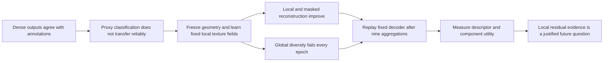

# IEEE Access manuscript — local texture evidence and aggregation

**Author-review draft, 3 November 2026.** A complete, separately maintained paper
based on the completed Phase 3 experiments and the saved TRACE aggregation study.
This is a research manuscript, not a journal submission or an accepted article.

> **Local Texture Evidence and Aggregation in Compact Tyre Inspection:
> A Reproducible Limited-Data Study**

Working author order follows the existing September manuscript: **Sreenivasa Reddy
Edara, Shanmukesh Bonala**, VIT-AP University. Final authorship, contributions,
declarations, and approval remain the authors' decisions.

## Open and edit

| Item | File | Purpose |
|---|---|---|
| Read the paper | [main.pdf](main.pdf) | Compiled IEEE Access double-column manuscript |
| Edit the paper | [main.tex](main.tex), [sections/](sections/) | Main file and nine substantive sections |
| References | [references.bib](references.bib) | 18 primary research sources and one disclosed AI system citation |
| Figures | [figures/](figures/) | Seven vector PDF figures and matching high-resolution PNG previews |
| Exact table inputs | [evidence/](evidence/), [generated/](generated/) | Direct CSV/JSON evidence and generated aggregation rows |
| Scientific claim audit | [CLAIMS_AND_LIMITATIONS.md](CLAIMS_AND_LIMITATIONS.md) | Claim, endpoint, denominator, evidence, and permitted interpretation |
| Rebuild / reproduce | [REPRODUCIBILITY.md](REPRODUCIBILITY.md) | Offline figure/build commands and larger-study boundaries |
| Before submission | [SUBMISSION_CHECKLIST.md](SUBMISSION_CHECKLIST.md) | Completed preparation and unresolved author actions |
| Source checking | [CITATION_AUDIT.md](CITATION_AUDIT.md) | Primary-source bibliography and current venue-policy links |
| Writing record | [WRITING_LOG.md](WRITING_LOG.md) | Scope, editorial choices, corrections, and preservation |
| Numerical / PDF checks | [audit/VALIDATION.json](audit/VALIDATION.json) | Reconciliations, pagination, abstract, citations, preservation |
| Visual review | [audit/VISUAL_REVIEW.md](audit/VISUAL_REVIEW.md) | Review of the final page rendering |

## The paper's argument



The contribution is a controlled analysis, with a small application-specific model
as its subject. It does not claim state-of-the-art wear classification, physical
depth, calibrated alignment, independent safety validation, or a promoted TRACE
checkpoint. GEO and TRACE both retain their original **selected=None** outcome.

The final paper includes data and annotation provenance, architecture and loss
equations, the complete aggregation comparison, all 60 TRACE validation epochs,
two deterministic real-image examples, group/descriptor effects, covariance and
mask-layout controls, reproducibility, limitations, AI disclosure, and both short
author biographies. See the validation receipt for current page/figure counts.

## Build locally

From the repository root:

```powershell
.\phase3\run_cv.cmd -B phase3\paper_ieee_access\build_assets.py
.\phase3\paper_ieee_access\build.ps1
.\phase3\run_cv.cmd -B phase3\paper_ieee_access\verify_paper.py
```

All Python runs through **cv_conda**. No package replacement or model training is
needed. The build uses the existing Tectonic executable, with a cache isolated in
this folder. A first cold build downloads TeX dependencies; subsequent builds use
that cache. The source can also be compiled with a full TeX installation or
imported into Overleaf. Open `main.tex` as the root file and retain the supplied
class, font, compatibility, and figure files.
The current draft uses an IEEE bibliography column-break trigger to balance the
last page; recheck that placement after editing references or preceding content.

## Preservation and publication boundaries

- The original `ACCESS_latex_template_20260513/` manuscript is unchanged.
- Executed notebooks, frozen training packages, checkpoints, both workstations,
  data, and scientific result files are preserved.
- No new fit or photo was introduced. Two old RGB cache chunks were read from
  pinned public HF objects for deterministic figure examples; no model ran.
- Existing fit/review artifacts are on Hugging Face. New manuscript assets and
  aggregation derivatives have **not** been uploaded by this task.
- Git retains the paper, editable source, compact evidence, and curated figures.
  TeX caches, intermediate files, and rendered review pages are ignored. No Git
  staging, commit, history change, or push is performed.

The next step is **author review of this draft and the submission checklist**.
There is no notebook rerun or additional training prerequisite to that review.

The existing [interactive aggregation explorer](../texture_aggregation_20261102/Aggregation_Explorer.html)
can accompany the static publication figures during local review.
