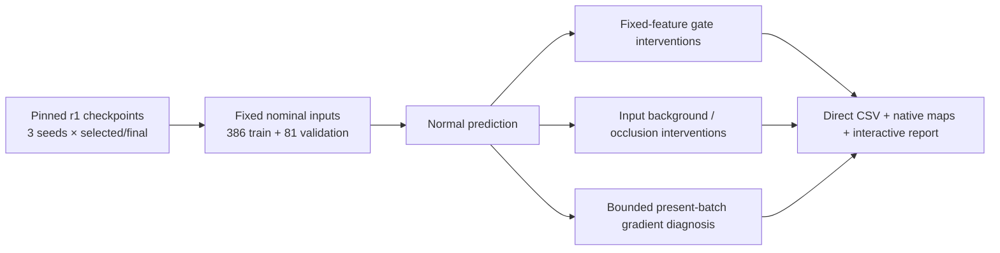
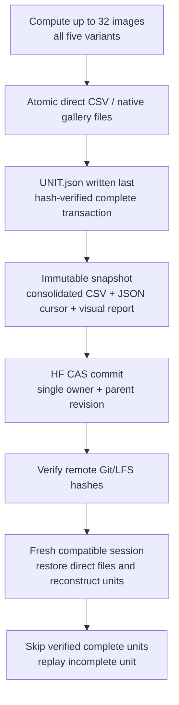

# TREAD-ONE NB03 — frozen-checkpoint classifier diagnosis

**Family: TREAD-ONE. Revision: classifier diagnostic r1. Date: 28 October 2026.**

**Execution update:** NB03 is complete on Kaggle and independently HF-verified.
The following run instructions are retained for reproducibility; no rerun is
needed. [Executed notebook, 27-file publication and cross-environment audit](phase3NB03Completion.md).
Next is the [NB04 evidence/recovery gate](phase3TrainingEvidenceGate.md).

This implements the next step after completed r1 training and NB02 publication.
It measures the existing checkpoints; it does not train a replacement model.
The original model/protocol/labels and workstation installation are preserved.

| TREAD-ONE stage | Role | Current authority |
|---|---|---|
| NB00 / NB01 | Data preflight and three-seed r1 training | [Scientific completion](phase3CompletionAudit.md) |
| NB02 | Recovery and direct-CSV publication | [Verified publication](phase3NB02Completion.md) |
| **NB03** | **Current classifier diagnosis and image exploration** | This guide; [local results](phase3ClassifierDiagnosticResults.md) |
| Later revision | One controlled architecture/objective change after evidence and logger checks | [Decision gates](phase3NextSteps.md) |
| User-assisted data growth | New independent tyre coverage and documented annotations | [Data growth plan](phase3DataGrowth.md) |

## 1. Questions and experimental scope



| Contract item | Definition |
|---|---|
| Source | HF `a0296f18e02b12d28f7e51377783d68538032209`, r1 protocol `371c40c0…3a0b8c` |
| Weights | Selected and fixed epoch-60 endpoints for seeds 1–3; strict shape and tensor-content hash checks |
| Selection | No checkpoint/seed reselection; declared export remains seed 3 / epoch 20 |
| Inputs | Exact r1 source overlay/preprocessing; nominal images, no training augmentation |
| Cohorts | 386 train and 81 validation images; **no test images evaluated** |
| Precision | FP32, no autocast/TF32, deterministic algorithms and configured cuBLAS workspace |
| Batching | Four images per forward; complete durable unit of at most 32 images |
| Full prediction table | 467 images × 6 checkpoint jobs × 5 variants = **14,010 records** |
| Raw gallery | Fixed first image per split and physical-tyre or unresolved-video-clip group, per checkpoint |
| Scientific meaning | Post-hoc measurements; nominal training-set inference is not the missing historical training-accuracy curve |

Validation has only low/high classes. Training has low/mid/high and known video
views. Compare class-specific supports and recalls, not an unqualified gap
between differently supported balanced-accuracy values. Video clips remain
capture groups, with unresolved parent-tyre mapping explicitly retained.

## 2. Interventions and what each tests

| Variant | What changes | What stays fixed | Interpretation |
|---|---|---|---|
| `normal` | Nothing | Learned weights and original inference path | Reference prediction |
| `uniform_gate` | Spatial pooling gate becomes uniform | Normal latent maps, class weights/bias and spatial outputs | Does the learned decision path depend strongly on its current pooling gate? |
| `oracle_tread_gate` | Pooling gate uses manual tread/valid support aggregated 4×4 | Normal latent maps, class weights/bias and spatial outputs | Evaluation-only oracle; not deployable inference or a refitted model |
| `background_neutralized` | Pixels outside the manual tyre/tread/ignore union become normalized zero | All learned weights | Measures a specified context intervention; normalized zero is ImageNet mean RGB |
| `top10_image_occluded` | Highest signed predicted-class evidence cells cover approximately 10% of the input grid, replaced by normalized zero | Weights and the chosen evidence-selection rule | Input sensitivity; not the algebraic removal of fixed features |

The top-cell ordering is deterministic, with stable descending ties. Gate
interventions recompute logits from the same nonnegative latent maps and signed
class weights. They do not recalibrate/refit the classifier. Their region and
point outputs are unchanged by construction and are recorded accordingly.

### Gradient diagnostic

One fixed nominal training image per available class is selected, preferring
existing human point labels. The full run uses the same three image IDs for
every checkpoint. Five task expressions are differentiated without an optimizer:

| Expression | Retained observation |
|---|---|
| Classification + 0.2 ordinal CDF loss | Present loss and gradient norm per module group |
| Segmentation BCE/Dice | Present loss and gradient norm per module group |
| 2 × geometry loss | Present loss and gradient norm per module group |
| 0.1 × row agreement | Present loss and gradient norm per module group |
| 0.1 × containment | Present loss and gradient norm per module group |
| Each task pair | Cosine alignment on shared parameters, or explicit zero-norm reason |

The periodic training background KL is excluded from these task expressions.
This is a bounded current-batch check, not an unlogged historical gradient trace.
Parameter hashes before/after the job must match; parameter `.grad` buffers are
not accumulated and no optimizer is created.

## 3. Retained evidence

| Direct output | Full-run scale / content |
|---|---|
| `csv/predictions.csv` | 14,010 rows; identities, logits/probabilities, class/margin/error metrics, intervention deltas, dense-task scores and gate/evidence checks |
| `csv/regions.csv` | 28,020 rows; TP/FP/FN/TN, valid/ignored support, smoothed Dice/IoU and predicted/target boxes |
| `csv/points.csv` | 84,060 rows; six coordinates, target kind, human eligibility, signed/absolute normalized and native-pixel errors |
| `csv/latents.csv` | 168,120 rows; all 12 latent-map statistics and gated masses for every variant |
| `csv/evidence.csv` | 42,030 rows; all class logits/biases, signed sums and inside/outside manual-tread contributions |
| `csv/timings.csv` | Per-unit data/forward/metrics durations, process memory, GPU allocation/peak and free storage |
| `csv/gradients.csv` | Task/module norms and shared-task alignment on the declared fixed batch |
| `summary/*.csv` | Per-cohort/group/domain metrics, class support/recall/precision/F1, confusion entries and events |
| `gallery/arrays.npy` | Direct native FP32 maps, with axis/channel metadata; no NPZ/ZIP container |
| `gallery/METADATA.json` | Gallery identities, guide rows, human/weak target status, learned head coefficients and preview inputs |
| HTML explorer | Self-contained probabilities, failure tables and image/mask/gate/signed-evidence/boundary exploration |
| Contract/cursor/manifest/source | Complete recipe, environment, input/model/source hashes, committed units and readable code |

Blank means unavailable/not applicable, not zero. Human-point metrics include
human labels only. Weak polygon targets remain labelled as weak observations.
CSV retains scalar precision; display maps are downsampled/quantized previews,
while the direct native gallery array retains FP32 spatial values.
Preview evidence/gate intensity is scaled within each displayed map; compare
absolute effects using the saved logits, signed sums and probability deltas,
rather than comparing color brightness across different images or classes.

Continuous power/energy/temperature monitoring and historical training-image
predictions are not invented. These remain declared logging limitations for the
next training revision. See the [standing retention policy](phase3DataRetentionPolicy.md).

## 4. Local durability and remote resume



| Mechanism | Behavior and boundary |
|---|---|
| Local transaction | Missing `UNIT.json` means incomplete; completed unit files must match their hashes |
| Snapshot | Upload reads immutable generation files; it does not race a live append |
| Remote format | Direct CSV/JSON/NPY/HTML/source files; no new ZIP/NPZ upload |
| Ownership | One local lock and one HF owner lease per diagnostic contract; stale writers are rejected |
| Cadence | After a completed checkpoint job, every 30 minutes, and immediate catchable stop/error attempt |
| Hard stop | Cannot execute cleanup; only last verified remote generation is recoverable in a new session |
| Lease | 45 minutes, renewed on publication; clean stop/completion releases it; do not start duplicate live writers |
| Lost response | Refresh remote manifest/owner before deciding whether the commit already succeeded |
| Environment change | New diagnostic identity; do not mix different environments/precision/batch recipes silently |
| Sources | Original r1 files are hash-checked and never edited; the separate diagnostic sources are frozen in the contract |

HF documents separate API, resolver and page quotas and exposes server reset
headers. The notebook batches requests, caches completed source reads and honors
`Retry-After`/`RateLimit` with bounded retries; the historical 128/hour concern is
not treated as a universal HF quota. No package upgrade is required for this
workflow. [Official HF rate-limit documentation](https://huggingface.co/docs/hub/rate-limits),
[versioned HfApi reference](https://huggingface.co/docs/huggingface_hub/v0.36.0/en/package_reference/hf_api).

## 5. Run NB03 on Kaggle

Use [phase3_NB03_TREAD_ONE_Classifier_Diagnostic.ipynb](notebooks/phase3_NB03_TREAD_ONE_Classifier_Diagnostic.ipynb).

| Setting | Value |
|---|---|
| Input | `shanmuk4622/tire-dataset-prepared-phase2`, attached directly from Kaggle |
| Accelerator | T4 ×2; the diagnostic uses **GPU 0 only**, sequentially; GPU 1 is unused |
| Internet | ON |
| Secret | Kaggle `HF_TOKEN`, write access to `Shanmuk4622/tyre-wear-study` |
| Working free space | At least 6 GiB; no assumed 1 TB scratch capacity |
| Run order | Setup → source retrieval → run/resume diagnosis → inspect/export explorer |

The CPU-local runtime remains `cv_conda`; Kaggle keeps its existing environment.
No global dependency downgrade, teacher, pretrained model or new training job is
introduced. CPU inference is possible through the command line but slower and
has its own explicit environment identity.

Read the final `PUBLICATION.json` for a verified HF revision. The destination is:

```text
phase3/tread-one-r1/<original-protocol>/diagnostics/classifier-r1/<diagnostic-contract>/
```

The local GTX1650 run and a Kaggle T4 run have different environment identities.
The supplied notebook computes/reuses its compatible inference and publishes
with the authorized Kaggle Secret; local results are not claimed uploaded until
that actual publication is verified. This repeats inference, never training.

## 6. Checks, repairs and limits

| Check | Evidence |
|---|---|
| Actual GPU pause/resume versus uninterrupted inference | [DIAGNOSTIC_TESTS.json](diagnostics/DIAGNOSTIC_TESTS.json); five scientific CSVs match byte-for-byte; completed first unit preserved |
| Offline HF/local faults | Twelve cases covering partial units, corruption, direct CSV/native-gallery restore and LFS hashes, ambiguous successful commit, writer fencing, server delay and contract drift |
| Local implementation repairs | Set cuBLAS workspace before Torch initialization; fixed a gradient-indexing error found by the actual resume/gradient test |
| Notebook delivery | [NB03_DELIVERY.json](diagnostics/NB03_DELIVERY.json): schema, cell syntax and embedded sources |
| Full scientific/source check | [DIAGNOSTIC_VALIDATION.json](diagnostics/DIAGNOSTIC_VALIDATION.json), when the full run is complete |
| Browser rendering | **Not verified here:** the browser policy rejected local-file preview. No alternate route around that denial was attempted |

The interactive HTML is retained for the user to download/open. JavaScript
syntax, embedded map/image consistency and record identities are checked
separately; those checks do not substitute for a claimed browser render pass.
Kaggle inline interaction may depend on its output renderer, so the standalone
download is also provided.

## 7. What follows the diagnosis

Use [the results](phase3ClassifierDiagnosticResults.md) to separate training-identity
fit, transfer failure, gate sensitivity and present-batch task conflict. Freeze
the richer training logger and its recovery tests before spending another
training budget. Then choose one controlled TREAD-ONE revision, preserving dense
tasks and the existing validation selection boundary.
