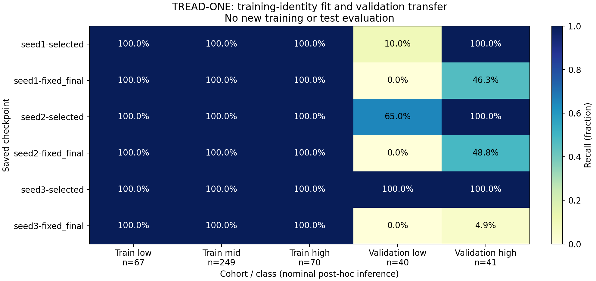
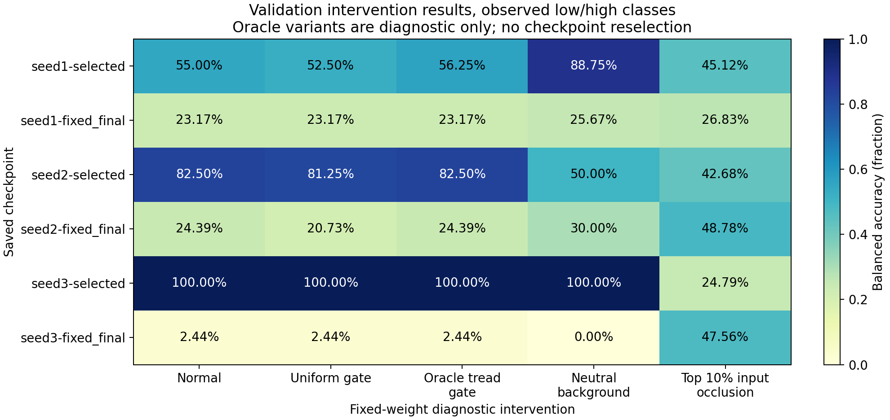
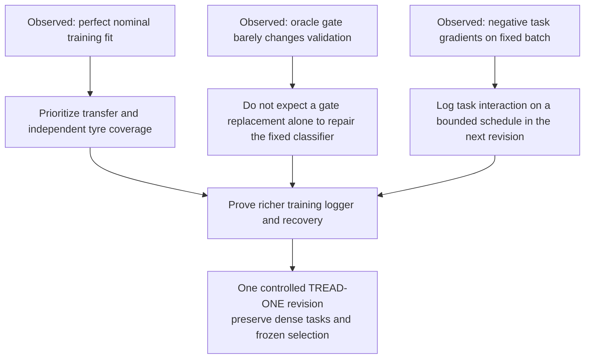

# TREAD-ONE classifier diagnosis — verified results

**Publication update:** the user-executed NB03 and all 27 direct HF files are now
independently verified at `75400f019ba0c6741b5060925b9c956c0a1ca0a8`.
All 14,010 predicted classes agree with these local results; probabilities have
small environment-dependent differences. [Full Kaggle completion audit](phase3NB03Completion.md).
The numerical tables/figures below retain their original local provenance.

**Completed and independently checked on 28 October 2026.** All six saved
checkpoints classify every nominal training image correctly, while validation
transfer varies sharply. Replacing the predicted tread gate with an oracle
barely changes validation accuracy. The diagnostic identifies an identity/transfer
problem and possible shared-task competition; it does not establish a single
causal explanation.

This is **TREAD-ONE NB03**, with fixed r1 weights. No optimizer update, new test
evaluation, new checkpoint selection or model installation occurred.

## 1. Deliverables and completion state

| Item | State / artifact |
|---|---|
| Full local GPU diagnosis | **Complete**, 467 images × 6 saved checkpoints × 5 variants |
| Scientific/source validation | **Passed**: [DIAGNOSTIC_VALIDATION.json](diagnostics/DIAGNOSTIC_VALIDATION.json) |
| Interactive image explorer | [TREAD-ONE explorer](diagnostics/TREAD_ONE_Classifier_Explorer.html), approximately 31.0 MiB, self-contained |
| Kaggle notebook | [Executed NB03](notebooks/phase3_NB03_TREAD_ONE_Classifier_Diagnostic.ipynb), 152,109 bytes; all four code cells succeeded |
| Run contract and instructions | [Diagnostic guide](phase3ClassifierDiagnostic.md) |
| Static figures and matched summaries | [Summary exports](diagnostics/summary_exports) |
| Recovery/fault evidence | [DIAGNOSTIC_TESTS.json](diagnostics/DIAGNOSTIC_TESTS.json) |
| New diagnostic publication on HF | **Complete / independently verified**; 27 files, all hashes checked, writer released; [receipt](diagnostics/nb03_publication/PUBLICATION.json) |
| Browser rendering check | Not completed: local-file browser preview was blocked by policy; source/data checks passed |

The complete local snapshot is recorded in
[DIAGNOSTIC_COMPLETION.json](diagnostics/DIAGNOSTIC_COMPLETION.json).
Contract: `4a15626681359aced6e42b652f3c0638aba76c665a169a54019c7543bd821689`.
It pins the original r1 source revision, data/overlay, exact checkpoint tensor
hashes, diagnostic sources, FP32 recipe and GTX1650/cv_conda environment.

## 2. Identity fit versus validation transfer

Training contains 67 low, 249 mid and 70 high images. Validation contains 40 low
and 41 high images, with no mid examples. The matched low/high training balanced
accuracy is also 100% for every checkpoint, so the gap below is not an artifact
of averaging three training classes against two validation classes.

| Checkpoint | Saved epoch | Nominal train accuracy | Matched train low/high BA | Validation low recall | Validation high recall | Validation BA |
|---|---:|---:|---:|---:|---:|---:|
| Seed 1 selected | 23 | 100% | 100% | 10.00% | 100% | 55.00% |
| Seed 1 final | 60 | 100% | 100% | 0% | 46.34% | 23.17% |
| Seed 2 selected | 30 | 100% | 100% | 65.00% | 100% | 82.50% |
| Seed 2 final | 60 | 100% | 100% | 0% | 48.78% | 24.39% |
| Seed 3 selected | 20 | 100% | 100% | 100% | 100% | 100% |
| Seed 3 final | 60 | 100% | 100% | 0% | 4.88% | 2.44% |

**Supported conclusion:** the classifier can fit the existing training identities.
A failure to optimize the nominal training classification task is not the main
observed limitation. Training identity fit coexists with unstable transfer, and
all epoch-60 checkpoints lose low-class validation recall.

This is post-hoc nominal-image inference. It is **not** a newly discovered
historical augmented-batch training-accuracy curve. More epochs did not improve
this validation transfer. The earlier test result remains separately frozen:
the declared seed-3/epoch-20 export missed the one low test tyre, despite its
100% validation score. NB03 did not reevaluate that test cohort.

## 3. Gate and input interventions

All values below are validation balanced accuracy on the same 40 low / 41 high
images. Oracle/background variants use labels only to define diagnostic
interventions; they are not proposed normal inference pipelines.

| Checkpoint | Normal | Uniform gate | Oracle tread gate | Neutral background | Top-10% input occlusion |
|---|---:|---:|---:|---:|---:|
| Seed 1 selected | 55.00% | 52.50% | 56.25% | 88.75% | 45.12% |
| Seed 1 final | 23.17% | 23.17% | 23.17% | 25.67% | 26.83% |
| Seed 2 selected | 82.50% | 81.25% | 82.50% | 50.00% | 42.68% |
| Seed 2 final | 24.39% | 20.73% | 24.39% | 30.00% | 48.78% |
| Seed 3 selected | 100% | 100% | 100% | 100% | 24.79% |
| Seed 3 final | 2.44% | 2.44% | 2.44% | 0% | 47.56% |

| Finding | Supported implication | Limit |
|---|---|---|
| Oracle gate changes BA by at most 1.25 percentage points | Correcting pooling support alone does not repair the current fixed feature/head decision path | It does not prove every future learned gate/head is equivalent |
| Uniform pooling leaves nominal train classification at 100% | Training fit does not require the particular predicted spatial gate | A fixed-head intervention is not a refitted ablation |
| Neutral background helps seed 1 selected but hurts seed 2 selected | Context sensitivity is checkpoint-dependent | Background removal is not a universal fix or causal physical explanation |
| Seed 3 selected falls from 100% to 24.79% under the declared input occlusion | The selected classifier can be fragile to this targeted perturbation | Occlusion is artificial and does not identify a physical wear mechanism |
| Dense outputs remain unchanged for gate-only variants | Their classification effects come from the declared pooling intervention | Input interventions can change dense outputs and are logged separately |

Exact additive evidence accounting remains valid. It does not guarantee robust
predictions or physically meaningful latent concepts. Latent maps retain numeric
names rather than invented groove/wear semantics.

## 4. Shared-task gradient evidence

The same fixed three nominal training images, one per class and with human point
labels preferred, were used for every checkpoint. The classification expression
is CE + 0.2 ordinal loss; segmentation is the declared BCE/Dice expression.
The following cosine uses only shared parameters.

| Checkpoint | Classification/segmentation gradient cosine |
|---|---:|
| Seed 1 selected | -0.7036 |
| Seed 1 final | -0.7006 |
| Seed 2 selected | -0.8934 |
| Seed 2 final | -0.5062 |
| Seed 3 selected | -0.8152 |
| Seed 3 final | -0.8072 |

All six show opposing gradients on this batch. **Task competition is now a
measured present-batch hypothesis**, rather than an untested suggestion.
It is not yet a demonstrated cause of generalization failure: this is one
three-image batch at saved endpoints, not gradients throughout training or a
controlled optimization intervention. Norms, other task pairs, missing
zero-norm reasons and image IDs are retained in the direct gradient CSV.

## 5. Evidence retained and checked

| Direct scientific table | Rows |
|---|---:|
| Predictions / intervention comparisons | 14,010 |
| Region sufficient statistics and boxes | 28,020 |
| Boundary point observations | 84,060 |
| Latent-map statistics | 168,120 |
| Signed class evidence statistics | 42,030 |
| Fixed-batch gradient observations | 270 |
| Inference-unit timings/resources | 90 |
| **Total across these seven tables** | **336,600** |

The point table includes **17,100 eligible human-point rows**, plus explicitly
weak or unavailable targets. These are repeated checkpoint/intervention records,
not new annotations. The raw gallery contains **78 examples**:
13 capture groups × 6 checkpoints. Those groups include three unresolved video
clips of existing training tyres; they are not 13 independent tyre subjects.

The direct FP32 array has shape **78 × 3 × 19 × 128 × 96**: image, physical input
variant, channel, height and width. It retains masks, 12 latent maps, three signed
class-evidence maps, predicted gate and oracle gate for the fixed gallery.

### Numeric precision check

The verifier independently checks labels, source hashes, probabilities,
classification metrics, segmentation counts, original target coordinates,
parameter identities and raw maps. Per-coordinate residuals were calculated by
FP32 NumPy scalar subtraction. That arithmetic is reproduced exactly. Compared
with subtracting the saved coordinates in float64, the largest discrepancy is
**2.971 × 10⁻⁸ image-width fraction**, or **0.0000642 native pixels**.

The original overly strict float64 checker exposed that precision distinction;
the checker now verifies the actual FP32 arithmetic and records its float64
rounding bound. No saved measurement was rewritten. The per-image point MAE is
calculated separately from the saved coordinate arrays and eligible targets.

### Resource measurements

| Recorded quantity | Local value | Scope |
|---|---:|---|
| Sum of inference-unit compute durations | 848.25 seconds | Excludes startup, gradient diagnostics, commits and final report assembly |
| Data loading/verification portion | 376.93 seconds | Measured unit stage |
| Three physical forward variants combined | 74.71 seconds | Synchronized model-forward time, batch 4, GTX1650 |
| Metrics/gallery portion | 370.41 seconds | Measured unit stage |
| Maximum recorded unit GPU peak | 176,757,760 bytes | Inference-unit peak; not a whole-process/training bound |
| Maximum recorded unit process RSS | 534,642,688 bytes | Unit observation; final snapshot assembly is outside this scope |

Stage sums do not claim complete wall-time attribution; gate construction,
transfers and other orchestration are included in unit compute but not all
separately itemized. This is not an application-speed comparison or a training
benchmark. Continuous power/energy/temperature histories remain unavailable.

## 6. What this changes about the next decision

The richer **training** logger/publisher and optimizer-state/CSV-cursor recovery
tests are now implemented as [NB04](phase3TrainingEvidenceGate.md). Local
real-model acceptance passes; dual-T4/live-HF recovery is the next Kaggle gate.
NB03's inference recovery is separate evidence from these optimizer tests.

A later controlled revision can test a classification/shared-gradient mechanism
while holding data, dense heads and budget fixed. The present gradient evidence
justifies investigating that direction; it does not select or validate a
specific optimizer or architecture. More independent tyre data, especially
robust low-class coverage and appropriate held-out mid/video tyres, remains a
central need. [The user-assisted data-growth plan](phase3DataGrowth.md) preserves
that priority.

## 7. Run, publish and inspect

Use [NB03](notebooks/phase3_NB03_TREAD_ONE_Classifier_Diagnostic.ipynb) with the
prepared Phase 2 dataset, T4 ×2 (GPU 0 used), Internet ON and Kaggle `HF_TOKEN`.
It computes/reuses a compatible diagnostic and publishes direct CSV, native
maps, source and the explorer. It never retrains r1. Local GTX1650 and Kaggle T4
observations have separate environment identities.

**HF publication is complete and independently verified**, alongside the earlier
NB02 CSV publication. [Exact NB03 audit](phase3NB03Completion.md). No NB03 rerun
is needed. The notebook keeps large inline
preview off by default; download/open the self-contained HTML for interactive
images, or opt into its inline preview if the renderer supports it. Browser
rendering was not verified here because the local-file preview action was
blocked by browser security policy. JavaScript syntax, map/image payloads and
scientific records passed their separate checks.

All original project Markdown, r1 runtime/release artifacts, executed training
and NB02 notebooks, labels and workstation models remain preserved.
