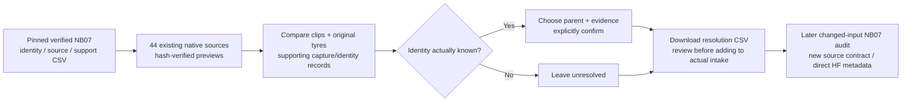
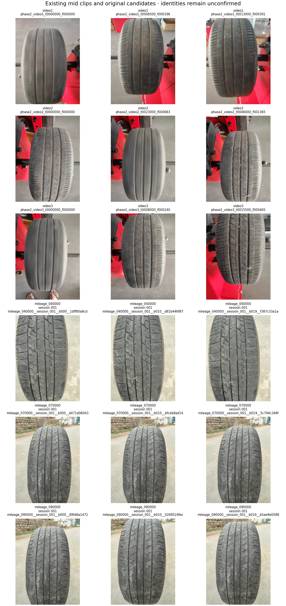

# TREAD-ONE — identity review and independent capture preparation

<!-- STATION CURRENT -->
**Superseded acquisition plan — 29 October 2026.** The user has explicitly
decided to use only existing tyre data and will not collect more tyre photos.
The current authorized work is the [separate TREAD-ONE workstation](phase3TreadOneWorkstation.md).
The identity review and prospective gate below remain historical/optional
evidence. Their unmet prospective criteria do not block current desktop use.
No additional collection, protocol-freeze exercise or NB07 rerun is requested now.
<!-- END STATION CURRENT -->

**29 October 2026.** [NB07 is complete and independently HF-verified](phase3NB07Completion.md).
The next useful work is actual subject identity/collection preparation. This
pack helps review the unresolved parents and record capture priorities. It
performs no training, inference, automatic mapping or physical acquisition.

## Ready to use locally

| Deliverable | Purpose / current state |
|---|---|
| [Interactive identity/capture review](collection_review_outputs/TREAD_ONE_Identity_And_Capture_Review.html) | Compare clips and original tyres; export reviewed resolution CSV |
| [Mid identity contact sheet](collection_review_outputs/NB07_Identity_Review_Contact_Sheet.png) | Eighteen existing images: three frames/views for each clip and original mid candidate |
| [review_images.csv](collection_review_outputs/review_images.csv) | 44 existing source-image selections, IDs/hashes/parents and sampling rule |
| [identity_candidates.csv](collection_review_outputs/identity_candidates.csv) | Nine existing clip × original-mid candidate pairs; no match assigned |
| [capture_priorities.csv](collection_review_outputs/capture_priorities.csv) | Three class priorities, actual historical subject/photo coverage and undeclared future count |
| [Unreviewed resolution control](collection_review_outputs/video_identity_resolutions_UNREVIEWED.csv) | Three unresolved rows, matching current source provenance |
| [Contract](collection_review_outputs/CONTRACT.json), [schema](collection_review_outputs/CSV_SCHEMA.json), [manifest](collection_review_outputs/MANIFEST.json) | Pinned NB07 source and new review-code/output hashes |
| [Validation receipt](data_gate_validation/collection_review/VALIDATION.json) | Exact export logic, existing identity-validator compatibility, preview/file checks |

This is **local preparation, not a new HF publication**. The verified NB07
publication remains immutable. The new pack's three derived CSVs contain
56 review/planning rows; the separate unresolved control has three rows. None
of these rows is an additional physical tyre, collected photo or new measurement.

## Review the unresolved clips

1. Open the interactive HTML in a browser. It is self-contained and makes no
   network requests. View the three clip strips, then compare original tyre
   strips. The three original mid IDs are the only allowed candidates.
2. Use capture records, recognizable individual features and provenance to
   establish a mapping. The displayed hash distances alone do not prove it.
3. For a known mapping, choose the parent, enter an actual supporting record
   reference and tick the confirmation box. All choices begin unresolved.
4. Distinct clips cannot share one original tyre. Missing evidence, an unknown
   candidate or an unconfirmed selection blocks export until corrected/cleared.
5. Download `video_identity_resolutions.csv` to preserve the review. The page
   does not edit project files or upload anything; refreshing clears unsaved
   form entries. Leaving all clips unresolved is a valid export.
6. Retain the downloaded review and evidence. After review, use it in the
   [actual intake pack](data_intake/README.md). Run NB07 again only when inputs
   actually change; it will create a different audit contract. The completed
   original execution requires no rerun.

The viewer includes up to three views for all 12 original tyres plus three
frames for each existing clip: **44 unique sources**. One high training tyre
has only two original photos, so the viewer includes both rather than repeating
an image. First/middle/last source order is transparent review triage, not a
claim that those views establish physical identity or represent capture variation.

## What the next acquisition should resolve

| Class | Historical training tyres | Validation / test tyres | Original training photos per tyre | Priority |
|---|---:|---:|---|---|
| Low | 1 | 1 / 1 | 67 | Additional independent low tyres; both selected NB05 models miss all low test photos |
| Mid | 3 | 0 / 0 | 20 / 20 / 57 | New independent reserved mid subjects; current 152 frames belong to existing tyres |
| High | 4 | 1 / 1 | 3 / 2 / 5 / 60 | Broaden subject/capture coverage; image counts are heavily concentrated in one training tyre |

These observations prioritize collection; they do not prove why the classifier
failed or determine a statistically adequate sample size. New subject targets,
capture/annotation budget and role/class minima remain undecided. Define them
against actual availability and intended claims, then freeze the complete
prospective experiment before reserved predictions.

| At acquisition | Record |
|---|---|
| Subject | Stable physical ID; checked against existing 12; new/existing identity evidence |
| Label | Mileage-proxy rule/source; actual odometer/source reading when available; uncertainty explicit |
| Session | Date, device, lighting, background, view and source-video parent |
| Image | Native file, hash, original/derivative status and parent source |
| Dense truth | Reviewed overlapping tyre/tread masks; native geometry; human truth separate from weak proposals |
| Optional physical measurements | Actual gauge depth and method when supplied; never substitute proxy class/prediction |
| Reserved cohort | Additional independent tyres, all derivatives grouped; labels reviewed and outcomes uninspected until protocol freeze |

Actual sources belong in `data_intake/incoming/` with the three collection
registries. Native new data must be retained for its authorized dataset release;
the evidence-only NB07 publisher does not upload full-resolution intake media.

## Implementation and checks

[build_review_pack.py](collection_review/build_review_pack.py) reads the verified
NB07 manifest/CSVs, verifies selected native hashes and writes the CSV, contact
sheet and 384×512 embedded previews. [review_ui.js](collection_review/review_ui.js)
implements the local evidence/one-to-one/export rules. Outputs are separate
from completed gate source, notebook, historical splits and annotations.

The exact JavaScript export logic is exercised in Node, including default
unresolved output, valid distinct mappings, missing evidence, duplicate/unknown
parents, unconfirmed selection and CSV quoting. Its synthetic export passes the
unchanged NB07 identity validator in an isolated temporary folder; those fixture
mappings are never applied to project inputs. Previews, syntax and file hashes
are checked. All four review/control CSVs (59 rows total) also passed exact
[Artifact Tool import/export checks](data_gate_validation/collection_review/ARTIFACT_CSV_VALIDATION.json).
Browser layout/interaction has not been visually verified.

No new training notebook is required at this stage. The next scientific input
is actual independent tyre acquisition and reviewed identity/annotation data.
