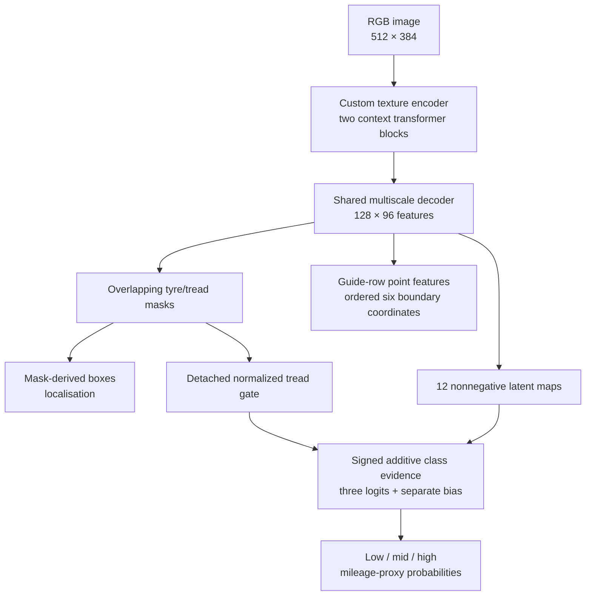
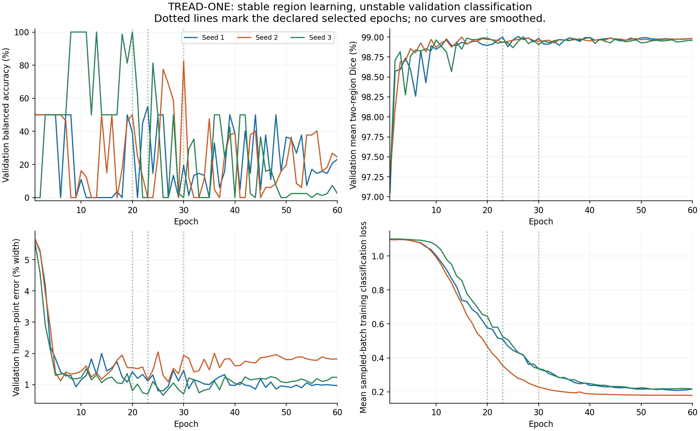
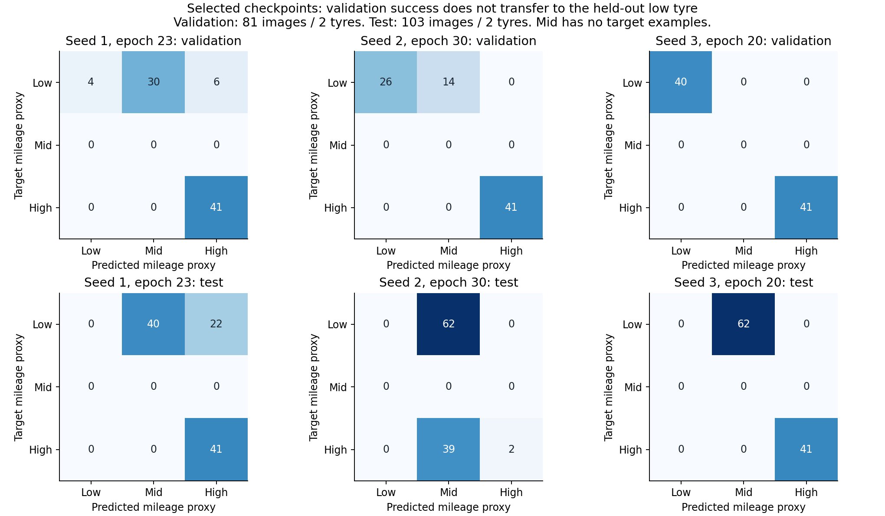

# TREAD-ONE r1 — completed-run audit and insights

**Verified 28 October 2026. All three runs completed 60 epochs. No training rerun is required to recover their records.** This is the current completion authority; the original 27 October delivery guides/validation file remain historical release snapshots.

**Publication update:** repaired NB02 has now completed on Kaggle. Its 18 core CSV tables / 25 direct files are independently verified at HF `91ccd3315bd296a76a8b583a6d0f2515ccb3d370`, with zero ZIP uploads. [Execution, artifact inventory and verification diagrams](phase3NB02Completion.md). This changes evidence accessibility; the measured model results below are unchanged.

## Evidence and checks

- HF dataset: `Shanmuk4622/tyre-wear-study`.
- Immutable final report revision: **`a0296f18e02b12d28f7e51377783d68538032209`**.
- Training protocol: **`371c40c0c6aaedaf5c5970f7721a284b042494db7bb330065f6cbde8fc3a0b8c`**.
- [Pinned report folder](https://huggingface.co/datasets/Shanmuk4622/tyre-wear-study/tree/a0296f18e02b12d28f7e51377783d68538032209/phase3/tread-one-r1/371c40c0c6aaedaf5c5970f7721a284b042494db7bb330065f6cbde8fc3a0b8c/report).
- Local evidence: [AUDIT.json](completion_20261028/AUDIT.json), [export identity](completion_20261028/EXPORT_VERIFICATION.json), [CSV summary](completion_20261028/csv/run_summary.csv), [completed-update checks](completion_20261028/csv/completion_checks.csv).

Exact executed notebooks were archived before analysis. All cells' sources match the delivered originals, and no notebook exception outputs are recorded. The setup cell did print dependency conflicts: the pinned Hub client was older than requirements of installed Gradio/Diffusers/Transformers, and Gradio also complained about Pillow 13. Those libraries were not part of this model's executed training path. The successful run does not make the setup generally clean; future notebooks should retain/isolate compatible dependencies instead of downgrading shared packages unnecessarily.

The audit verified the three source archive SHA-256s against the pinned HF tree/index, every archive member's byte count/hash, model/best-state finiteness and exact 1,372,159-parameter identity. It checked all **8,820 sequential completed updates**, exact epoch/batch cursors, all **180 validation epochs**, sample identities/exposure counts, finite recorded losses/gradient norms, selection arithmetic and both test endpoints. All three actual Tesla-T4 fresh-process resume smoke reports pass with zero loss/model/optimizer/scaler/scheduler/RNG differences. No numerical retry event is recorded in the measured histories.

All 618 saved test-image endpoint records were checked against their raw arrays. Mask metrics were independently recalculated against **309 hash-verified source mask files**. Validation classification/geometry/region aggregates were recalculated from the saved per-image records. Source/config/overlay identities and report/endpoint agreement were verified. The compact published export matches the declared seed-3 validation-best state bitwise; all nine uploaded runtime sources match local protected source blobs.

The supplied execution record is not evidence of a forced-kill/fresh-Kaggle-session restart during long training. The live T4 fresh-process smoke and durable-state/publication integrity checks are established; those are distinct claims. The final lease is released (`owner=null`, `expires=0`).

## Results

Classification is **balanced accuracy on observed low/high classes**, not an unseen three-class benchmark. Geometry is horizontal point MAE as a percentage of native image width; lower is better. Dice is mean two-region Dice at model input resolution, excluding ignored pixels.

| Seed | Selected epoch | Selected validation balanced accuracy | Selected test balanced accuracy | Selected test Dice | Selected human-point error | Epoch-60 test balanced accuracy |
|---|---:|---:|---:|---:|---:|---:|
| 1 | 23 | 55.00% | 50.00% | 97.852% | 1.067% width | 50.00% |
| 2 | 30 | 82.50% | 2.439% | 97.662% | 1.305% width | 21.951% |
| 3 | 20 | 100.00% | 50.00% | 98.419% | 1.196% width | 3.659% |
| **Mean of three selected checkpoints** | — | — | **34.146%** | **97.978%** | **1.189% width** | — |

At fixed epoch 60, the three-seed means are **25.203% balanced accuracy**, **97.829% Dice** and **1.295% width error**. Selected and final endpoints remain separately named. The declared export stays **seed 3, epoch 20**, chosen by validation utility 0.972213, not by test scores.

Test set: 103 photos of **two tyres** (62 low, 41 high); only 25 have human points. Mid/video data are training-only. The many image/point/seed records are dependent, not additional independent subjects.

## How the single model connects its tasks

| Output | What the audit establishes | What it does not establish |
|---|---|---|
| Masks and boundary coordinates | Useful learned dense predictions on this internal holdout | Physical depth, roadworthiness or unseen-field accuracy |
| Mask-derived boxes | Localisation recovered from predicted regions | A separately trained object detector |
| Additive evidence | Exact class-logit accounting within checked numeric precision | Correct physical concepts or causal explanations |
| Mileage-proxy classes | Measured low/high holdout failures, retained per seed | Generalization to unseen mid/video tyres |

## Insights supported by these records

### 1. Dense prediction learned successfully; classification generalization remains weak

Validation Dice rapidly stabilizes near 99% and selected test Dice remains near 98%. Boundary error falls from roughly 5.6% width early to around 1%–2%. This demonstrates useful region and boundary learning by a small shared model from scratch.

However, **every selected seed has 0% recall on the held-out low tyre**. Seed 3 predicts mid on all 62 low photos and high on all 41 high photos. Seed 2 predicts mid on 101/103 test photos. This is not a missing-overlay or incomplete-training issue. It is a classification failure on the observed holdout.

The low test photos belong to one physical tyre; the result is not 62 independent tyre failures. It nevertheless prevents a classification improvement claim for this experiment.

### 2. More epochs did not fix classification

Mean sampled-batch classification loss drops from approximately 1.10 to 0.18–0.22, while validation classification varies sharply and seed-3 final validation balanced accuracy is only 2.439%. Its selected epoch had 100% validation accuracy, yet only 50% test balanced accuracy.

Lower training loss therefore does not establish transfer. The records support an optimization/generalization disconnect; they do not isolate its cause. Training per-image predictions/accuracy were not logged, so an exact retrospective training-accuracy curve cannot be manufactured.

### 3. The small split makes selection fragile

There is one low tyre in training, another in validation and another in test. All three mid tyres plus supplied video views are training-only. Candidate explanations include tyre-identity/appearance shortcuts, limited independent support, representation/head constraints and task-gradient competition. These are hypotheses, not proven causes or grounds for automatically changing weights.

Do not change the selected seed after inspecting these test results. Subsequent work on this already observed holdout is development evidence; a new independent cohort is needed for a fresh generalization claim.

### 4. Exact evidence accounting did not solve correctness

Stored class logits reconstruct from signed evidence plus bias, and the raw-array check agrees within floating-point tolerance. That validates the architecture's accounting property. It does not certify wear-related reasoning or input causality.

For the declared seed-3 export, mean neutral-background probability L1 change is 0.0643 and mean predicted-class probability change after top-10% image occlusion is 0.0140. The other selected seeds are substantially more sensitive to neutralized background (0.6567 and 0.2425 mean L1). These are specific perturbation diagnostics, not causal proofs or robustness guarantees. No selected test image triggers the coarse geometry review flag, despite the clear classification failure; those flags are not a general correctness gate.

Post-hoc ten-bin ECE for the selected export is approximately 3.89%, but its low-tyre recall is zero. An aggregate calibration statistic must be interpreted alongside class/cohort performance; it cannot rescue the classifier or establish physical-wear calibration.

### 5. The compact model is not ready to replace the current workstation models

| Task | Current installed Phase 2 result | Declared TREAD-ONE export |
|---|---:|---:|
| Mileage-proxy balanced accuracy | MobileNet/ResNet: 50.00% each | 50.00% |
| Region Dice | SegFormer: 98.957%; YOLO Medium: 98.790% | 98.419% |
| Human boundary error | HRNet: 0.859% width | 1.196% width |

These are descriptive same-holdout comparisons across different initialization, architecture and selection protocols, not a matched causal ablation. TREAD-ONE's 1.37M-parameter shared implementation is a useful compact research candidate, but it does not improve these installed-model task scores. Whole-workstation latency/energy benefit has not been measured here. Existing workstation weights and paper results remain unchanged.

## CSV recovery and the user's publication correction

The original ZIP publication obscured inspectable records and forced unnecessary archive handling for analysis. **The user is right that this project's metrics should have been published directly as CSV.** The new [standing data-retention policy](phase3DataRetentionPolicy.md) prohibits HF ZIP publication and requires richer direct records for future runs.

Recovered locally without retraining:

| CSV family | Existing/derived rows |
|---|---:|
| Training updates | 8,820 |
| Sample exposure records | 70,560 |
| Validation epochs | 180 |
| Validation image predictions | 14,580 |
| Validation confusion entries | 1,620 |
| Validation/test class metrics | 558 |
| Validation/test calibration bins | 674 |
| Validation/test point predictions | 91,188, including predictions without human truth |
| Test endpoint image predictions | 618 |
| Independently calculated test region confusion counts | 1,236 |

There are **20 local CSV tables** including provenance, comparison and diagnostic summaries, totalling about 32 MiB. This exposes retained evidence; it is not new training data or a new set of independent subjects. NLL/Brier/ECE/QWK/ordinal/class metrics and test segmentation confusion counts are explicitly **post-hoc derived**.

Missing per-image training predictions, per-epoch full validation maps, complete stage/wall timings and continuous utilization/energy were not recorded. They cannot be recovered by relabelling existing scalar logs. Their capture is mandatory to review before the next training revision, within declared storage/compute budgets.

Direct CSV remains at [completion_20261028/csv/](completion_20261028/csv). The [CPU-only NB02](notebooks/phase3_NB02_Audit_And_Direct_CSV.ipynb) successfully re-verified and published the **18 core tables / 25 files** using Kaggle `HF_TOKEN`, at commit `91ccd3315bd296a76a8b583a6d0f2515ccb3d370`. All remote hashes, table schemas and 191,904 scientific records are independently checked. The local 20-table package includes two supplemental comparison tables and optional figures/registry beyond that core publication. [Full count reconciliation and publication proof](phase3NB02Completion.md). No optimizer/model changes or ZIP uploads occurred in NB02.

The earlier local credential/publication restriction is retained in the dated session history. The authorized Kaggle execution has now completed publication; it is no longer a pending action.

## Reproduction and limits

The code is under `analysis/`, separate from frozen `runtime/`. `inspect_run.py` reads/archives notebook outputs; `fetch_completed_results.py` reads pinned artifacts; `audit_and_export_csv.py` verifies/recalculates/exports; `plot_completed_results.py` generates the two figures/comparison; `verify_export_identity.py` checks weights/source identity; `publish_recovered_csv.py` prepares/directly publishes files. Every local Python call uses `run_cv.cmd` to activate `cv_conda`.

The initial SDK-cache read hit Windows long-path error 206. Explicit short local filenames with authenticated-capable, revision-pinned HTTPS reads fixed the audit download path. No TLS verification was disabled. All three old bundles were fully downloaded/hash-checked once; no new archive is uploaded.

No additional training, checkpoint mutation, model installation, paper rewrite or source-label change was performed. The supplied Kaggle NB02 made the additive publication; the subsequent independent audit used read-only public requests. Completion of r1 and its export does not complete every original-project research/physical-validation proposal.
