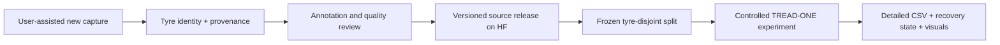

# TREAD-ONE — data growth and evidence retention

<!-- STATION CURRENT -->
**Current scope, 29 October 2026: existing tyre data only. The user will not
collect more tyre photos.** The earlier assumed acquisition campaign is
superseded. The current deliverable is **[TREAD-ONE Studio](phase3TreadOneWorkstation.md)**,
a separate native workstation in [workstation/](workstation/README.md).
It uses the declared r1 seed-3/epoch-20 export, has its own launcher/model/Qt/
cache/evidence, and preserves the original workstation. Real model and UI
checks pass. [User guide](workstation/README.md).

Training and NB02–NB07 audits remain complete. Historical classification and
cohort limits remain; the prospective-readiness=false result is preserved as
research evidence and does not block this authorized desktop implementation.
**Next: use the separate app with existing media. No new photos, NB07 rerun or
retraining is required.**
<!-- END STATION CURRENT -->

**29 October 2026 NB05 update:** the completed paired study retains 47,040
augmented training occurrences and 9,720 validation-image observations, but
adds no independent tyres. Its selected candidate regresses; [findings](phase3NB05Completion.md).
An [empty intake pack](data_intake/README.md) is ready for the user's later
help: physical tyre identity, capture session, source/derivative image hashes,
label provenance and prospective split registration. It contains no invented
records. The [CPU review/publication](phase3NB06Completion.md) is complete; the active next
step was the [prospective data/protocol gate](phase3ProspectiveDataGate.md), now complete/HF-verified as NB07. Actual independent acquisition remains open.

**Standing user priority, 28 October 2026:** keep improving, collect more useful
training data and save it in HF. The user will help with collection later. The
current classification diagnosis remains part of TREAD-ONE.

**Execution update:** [NB03](phase3NB03Completion.md),
[NB04](phase3NB04Completion.md), [NB05](phase3NB05Completion.md) and
[NB06](phase3NB06Completion.md) are complete and independently HF-verified.
NB04's 24 sampled occurrences per full case are engineering telemetry, not
additional photographs or subjects. NB05 completed its controlled gradient
comparison with much denser evidence; NB06 published the post-hoc review.
New acquisition still awaits the user's later help; retain direct, versioned
HF records when it begins.

| Data category | Current action | What it adds |
|---|---|---|
| New independent tyres | Plan collection with the user's help; not acquired yet | Independent support for transfer and evaluation |
| More views/lighting/videos of known tyres | Record parent tyre, clip, timestamp and capture conditions | Coverage and robustness examples, not extra subjects |
| Annotation/reference measurements | Preserve reviewer/source/version; distinguish masks, human points and physical measurements | Appropriate supervision and evaluation truth |
| Training telemetry | Enforce the [retention policy](phase3DataRetentionPolicy.md) before another run | Detailed evidence about optimization, predictions, resources and failures |
| Current post-hoc diagnostic | Fixed-checkpoint train/validation inference and interventions | New diagnostic observations, not reconstructed historical training accuracy |

## Capture fields to retain when collection begins

| Family | Required context |
|---|---|
| Identity | Stable physical tyre ID; all views/derivatives linked; known/uncertain identity explicit |
| Capture | Date, device, resolution/orientation, distance/view, lighting/surface conditions, clip/frame identity |
| Labels | Mileage-proxy source; annotation method/reviewer/version; uncertainty and missing fields |
| Physical truth if available | Instrument, units, position, repeat measurements and calibration/reference; never infer depth from mileage |
| Release | Image/source hashes, access/use rights, release version and immutable HF revision |
| Evaluation | A genuinely independent tyre-disjoint cohort; freeze its use before model selection |

No new image capture, independent tyre or physical measurement is claimed by
the current diagnostic. Input labels/data remain unchanged. Publish future
authorized releases with direct manifests/CSV and appropriate image/native
files, preserving original sources. Do not hide results in external ZIP bundles.

The completed [NB03 diagnosis](phase3ClassifierDiagnosticResults.md) reinforces
this priority: all existing training identities fit, while validation transfer
is unstable. Prioritize additional independent tyre coverage across the proxy
classes and a reserved unseen cohort, rather than counting more bursts of the
same tyre as independent evidence. Exact capture/annotation budgets will depend
on what the user can supply; no new collection or fixed sample count is claimed.

Interactive reports should help inspect evidence/gates, region overlays,
probabilities and failures. Keep their source CSV and hashes beside them so
visual summaries can always be traced to the saved observations.
