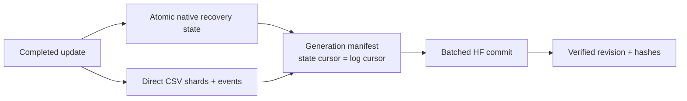

# Training evidence and HF publication policy

<!-- TEXTURE_AGGREGATION_20261102 -->
## Aggregation-analysis retention — 2 November 2026

The new saved-feature assay retains all 18 FP64 counterfactual prediction arrays,
per-image/channel/tile losses, feature representations/eigenspectra, covariance
matrices, train-only template/scaling parameters and full provenance as direct
CSV/NPY/JSON. Primary derivatives are about 769 MB, with no archive envelope.

Native/detail and large image/channel tables remain local and Git-ignored;
compact summaries, source and figures are retained for review. They have **not**
been uploaded to HF in this analysis. Original source science is already pinned
on HF. [Exact methods and file grains](texture_aggregation_20261102/METHODS.md).
<!-- END_TEXTURE_AGGREGATION_20261102 -->

<!-- NB24_VERIFIED_20261102 -->
## Current — NB24 TRACE completed and HF-verified

**2 November 2026:** NB24 completed preparation, actual T4×2/HF continuation,
one seed /60 epochs /2,940 updates, and the saved-evidence review/passport.
All 33 payloads match. **No NB21/NB22/NB23/NB24 rerun needed.**
[Completion and verification scope](phase3NB24Completion.md).

Final validation masked reconstruction beats the strongest declared control by
**21.63%**; local reconstruction improves **36.44%**. Utility passes60/60, but
projector/encoder diversity passes0/60: ranks **1.0225 /1.2296 /1.2489**.
**Selected=None; research-only, unpromoted.**
[Illustrated findings and next research](phase3TreadTwoTRACEFindings.md).

The fit retains **3,553 direct CSVs /47,263,346 rows /6,725 NPY /64 PT /13.507 GB**;
570 existing photos only. Counts include inherited cache rows; no new photos.
Independent audit reconstructs all 2,940 objectives and60 validation gates; the
published full dense audit and the bounded local audit have explicit scopes.
All five owners are released; earlier publications remain unchanged.

Next use saved local texture/component evidence to justify any future revision;
no new fit or NB25 is required to complete this cycle. Preserve executed
notebook/runtime/protocol. Both workstations remain deferred.
<!-- END_NB24_VERIFIED_20261102 -->

<!-- TRACE_BATCH_20261102 -->
## Historical — TRACE batch delivery before NB24 execution

**2 November 2026:** all four self-contained TRACE notebooks are implemented.
**[NB24 Run All master](notebooks/phase3_NB24_TREAD_TWO_TRACE_All_In_One_Batch.ipynb)**
automatically sequences fixed-target preparation, actual dual-T4/HF continuation
and storage gates, one seed / 60 epochs / 2,940 updates, then the saved-evidence
review and interactive passport. Individual NB21/NB22/NB23 files are supplied too.

Use a dedicated Kaggle **T4×2**, Internet ON, the existing expanded
`shanmuk4622/tire-dataset-prepared-phase2` input and **HF_TOKEN**. Start cold with
at least 19 GB free; actual capacity must also preserve the 2 GB reserve. Run one
master, not competing writers. [Full setup/recovery guide](phase3TreadTwoTRACEBatch.md).

Local real-model lifecycle/restart/fault/review and fresh payload tests pass.
All 570 existing photos and 60 source schedules were exercised. The executable
schema has 48 CSV families / 671 fields with native predictions/tokens, all epoch
weights and complete-update recovery. [Acceptance and boundaries](phase3TreadTwoTRACEValidation.md).

**Actual Kaggle/live HF and measured training remain pending user execution.**
The notebooks enforce those live gates automatically. No local token/HF write,
new photo or workstation change. Original GEO remains closed/unselected; no old
completed notebook needs a rerun. Preserve this new source/notebook/protocol
once execution starts.
<!-- END_TRACE_BATCH_20261102 -->

<!-- TRACE_DESIGN_20261102 -->
## Earlier design checkpoint — TRACE prototype checked

**2 November 2026:** the user authorised work on the next design. **TREAD-TWO /
TRACE** now has four prototype modules, 71,022 new trainable parameters, fixed
spatial descriptors and explicit position-sensitive pooling. All 386 train photos
were audited: 197,632 target cells / 1,185,792 values retained. CPU leakage, loss,
gradient, state-restore and frozen-geometry equivalence checks pass.

[Design, findings and interactive examples](phase3TreadTwoTRACEDesign.md) ·
[Detailed rollout](tread_two/trace_design/DELIVERY_PLAN.md).

This is **local design/engineering**, not a measured model, live HF publication,
48 implemented telemetry writers or runnable Kaggle batch. Next build the full
data/transaction/evidence runtime and prove storage/dual-T4/HF continuation, then
deliver all justified notebooks with a sequential master. Existing photos only;
both workstations and every completed experiment remain preserved. NB20/GEO stays
closed and unselected; no old notebook rerun is needed.
<!-- END_TRACE_DESIGN_20261102 -->

<!-- NB20_VERIFIED_GEO_CLOSED_20261102 -->
## Completed prior cycle — NB20 HF-verified; GEO research cycle complete

**2 November 2026:** NB20 completed both NB18 review and NB19 passport stages.
All 19 payloads match; three cells complete without saved errors. Actual HF
revisions **610bdb22… / abfec8d6…** contain **121 logical files, 51 CSVs /
183,812 rows**. All 119 objects, released owners, 48 reference-comparable tables,
exact vector arrays and actual passport provenance check out. Earlier NB13–NB17
selecting manifests are unchanged. **No NB18/NB19/NB20 rerun needed.**
[Completion and numerical/evidence notes](phase3NB20Completion.md).

The current GEO cycle is closed as **unselected, unpromoted research**. Geometry
passes 60/60 epochs; representation eligibility passes 0/60. The original
27,514,418 CSV rows and native/epoch evidence remain on HF.
[Compact research handoff](phase3TreadTwoGEOResearchClosure.md).

**Recommended next direction:** separately design a texture revision with fixed
local targets and batch-compatible diversity, reusing saved geometry and existing
photos. [Design brief](phase3TreadTwoGEONextResearch.md). This is proposed,
not implemented or trained. No new notebook/fit is required to finish this cycle.
Both workstation implementations remain deferred and preserved.
<!-- END_NB20_VERIFIED_GEO_CLOSED_20261102 -->

<!-- GEO_RETENTION_LESSONS -->
## NB17 retention lessons and future requirements — 2 November 2026

The user wants richer evidence from existing data, direct CSV, continuous
documentation and all justified next notebooks delivered together. The 570-photo
boundary remains: richer telemetry is not new independent tyre photography.

| Retained now | Explicit gap | Requirement for a later training protocol |
|---|---|---|
| Complete objective sufficient statistics, raw vectors and masked bodies | Full identity target-map construction cannot be recomputed solely from selected masked bodies | Retain the full mean-building target maps/weights once, with train-only provenance and an explicit space budget |
| 9,867 resource samples | Post-unit samples are not true within-step memory peaks; staging_bytes is blank | Record per-device peak counters, reset intervals and actual staging/unique-byte measurements as direct CSV |
| All 60 epoch weights and complete rolling optimizer/RNG/cursor state | Every historical optimizer state/prefix map is not permanently retained | State exact recovery versus historical-reconstruction coverage; do not promise unlimited checkpoints within 20 GB |
| Ingested HF request/publication rows and pinned server receipt | A selecting snapshot cannot recursively contain its own final commit | Retain an additive transport/publication receipt stream with bounded commits and explicit final-event coverage |
| Full source/native/scientific evidence plus probes | Probe raw texture bodies are absent under the original policy | Declare retention granularity and omissions before a future fit; budget fuller probe capture if justified |

Do not retrofit or invent missing historical measurements. NB18/NB19/NB20 add
derived direct CSVs, native/dense reconstruction, token/component diagnostics,
resource/timing summaries, figures and interactive evidence. They perform no new
training or photo collection. A future fit must retain the existing complete-update
resume, HF every-30-minute / major/stop attempts, server-aware backoff, source/data
identity checks and clear Kaggle instructions.
<!-- END_GEO_RETENTION_LESSONS -->

<!-- NB17_COMPLETE_POSTRUN_BATCH_20261102 -->
## Historical — NB17 verification and batch delivery before NB20 execution

**2 November 2026:** the attachment is completed NB17 (message says NB16).
HF revision `1113bf8a…`: **11,637 logical files / 3,080 direct CSVs /
27,514,418 rows / 8,457 native arrays / 10.31 GB**. One seed,
60 epochs and 2,940 updates; all selected bytes, schemas, native evidence and original masks
independently checked. Owner released; earlier four publication manifests unchanged.
**Do not rerun NB16/NB17 training.** [Completion and illustrated insights](phase3NB17Completion.md).

The geometry floor passes 60/60; human point MAE improves 5.23% retrospectively.
Representation eligibility passes 0/60: final validation projector rank 1.038659,
pooled 96D rank 1.020990; masked gain 4.0337% is below 5%. **Selected unavailable;
final remains research-only, unpromoted.** No new classification/depth/safety claim.

**Next: [NB20 Run All master](notebooks/phase3_NB20_TREAD_TWO_GEO_All_In_One_Postrun.ipynb)**.
It automatically runs/publishes NB18 full review then NB19 evidence passport.
All three notebooks are delivered now; individual stage files are optional.
CPU / None, Internet ON, existing expanded Kaggle input, HF_TOKEN, at least 13 GB free
on a fresh start. One shared verified cache, complete-stage recovery, publication
every 30 minutes and at major/stop boundaries. [Full batch/run guide](phase3TreadTwoGEOPostrunBatch.md).
Local actual-data audit and offline source/handoff/restore checks pass; new
NB18/NB19 Kaggle/HF publication remains pending. Existing photos only, no extra
fit or workstation change. User preference: supply all justified next notebooks
together with an automatic sequential master; preserve scientific gates.
<!-- END_NB17_COMPLETE_POSTRUN_BATCH_20261102 -->

<!-- NB16_COMPLETE_NB17_READY_20261101 -->
## Historical — NB16 HF-verified; NB17 pre-execution delivery

**1 November 2026:** executed NB16 is complete and independently verified at HF revision9f991635…: **174 direct files /60 CSVs /42,217 rows /65 native arrays**, actual two T4s and HF-restored continuation, 96 matching scientific files, released owner. All27 payloads match; earlier context/review/readiness manifests are unchanged. **Do not rerun NB16.** [Completion and insights](phase3NB16Completion.md).

**Next: [NB17 GEO resumable pilot](notebooks/phase3_NB17_TREAD_TWO_GEO_Resumable_Pilot.ipynb)** — T4×2,Internet ON, existing expanded Kaggle input, HF_TOKEN,   fresh kernel and≥19 GBfree for a new run; Run All. The new integrated storage/HF gate runs automatically before one seed / 60 epochs/2,940 updates. Local complete lifecycle, 307-shard recovery, loss/rotation/quota/transport and selected-export provenance tests pass. Actual NB17 live gate/measured results remain pending. [Protocol](phase3TreadTwoGEOProtocol.md) and [run guide](tread_two/geo_pilot/OPERATIONS.md).

Implemented40 CSVfamilies/468executable fields (443 draft +25 pre-fit accounting/provenance fields; 14type corrections), bounded direct NPY/CSV storage, all epoch weights and full rolling recovery. Stable experiment registry prevents accidental refits; source/env/history mismatch stops. Preserve executed notebooks/sources. Existing photos only; no classifier loss, physical-depth/safety claim or workstation change. NB18 follows completed NB17 evidence.
<!-- END_NB16_COMPLETE_NB17_READY_20261101 -->
<!-- GEO_NB16_20261101 -->
## Historical — NB16 preparation delivery before execution

**1 November 2026:** the user approved the complete geometry-first plan and requested notebooks. [NB16 preparation](notebooks/phase3_NB16_TREAD_TWO_GEO_Preparation_And_Contract_Gate.ipynb) is implemented and locally checked: **355,879 trainable / 1,728,038 total parameters**, frozen original selected anchor, isolated geometry/texture/error branches and complete-update native/CSV recovery. Real batch8 four-update restore, loss/leakage/gradient/skip/crash checks pass locally. [Delivery and scope](phase3NB16Preparation.md).

**Next: T4×2, Internet ON, existing expanded Kaggle input, HF_TOKEN,   at least4GBfree; Run All in NB16.** It publishes direct CSV/native engineering evidence, proves actual HF download/continuation in a fresh secret-free worker, and displays32interactive mask cases. No local HF credentials/writes were used. Actual dual-T4/HF proof remains pending.

NB16 is preparation, not the measured60-epoch fit. **NB17/NB18 are not yet delivered**: actual NB16 verification and complete40-family/443-field measured logging, shard/staging and validation integration precede the one measured candidate. The original plan JSON is retained as a dated design snapshot. No new photos, classifier sweep, production promotion or workstation change. Preserve executed notebooks/sources after the user runs them.
<!-- END_GEO_NB16_20261101 -->

<!-- GEO_PLAN_20261101 -->
## Historical — complete geometry-first plan before implementation

**1 November 2026:** the user requested the complete geometry-first development plan. [Master plan](phase3TreadTwoGeometryPlan.md) and [technical package](tread_two/geometry_first/plan/README.md) now define one new **TREAD-TWO / GEO** research candidate: frozen selected TREAD-ONE features, bounded supervised geometry refinements, an isolated masked-texture/self-supervised branch, and experimental annotation-error estimates. No mileage-classification loss in the first pilot.

The plan chooses one seed / 60 epochs / 2,940 updates, exact existing data/anchor, source-coverage scheduling, independent gradient clipping, original-role validation, checkpoint eligibility/selection, full raw-tensor retention and **40 CSV families / 443 declared fields**. New HF namespace, dual-T4 ownership, complete-update restore and 30-minute / major/stop publication are specified. Proposed 15 GB logical / 18 GB peak ceilings require actual fixture measurements within the 20 GB assumption; 1 TB scratch is optional.

**Status: design only; runtime, numerical/live resource gates and training notebooks are pending.** Next: implement isolated data/model/store modules and build planned **NB16 GEO engineering/contract gate**, then one NB17 measured pilot if its gates pass. No existing executed notebook is rerun or regenerated. No new photos, model forward/optimizer update, HF write or workstation change occurred during planning.

The completed ATLAS v1/LC/context series remains closed and unpromoted. This new geometry/representation objective is a separate requested direction; earlier statements about no extra notebook to close the unchanged classifier series remain historical and valid in that scope. Both workstations stay deferred.
<!-- END_GEO_PLAN_20261101 -->

<!-- NB15_CLOSED_20261101 -->
## Historical — NB15 verified; current ATLAS experiments closed as research

**1 November 2026:** executed NB15 is complete and HF-verified at `f4b44d3d…`: **38 direct files / 16 CSVs / 196,905 rows**, three figures and the interactive capability passport. All published bytes, table values, schemas and capability records pass independent checks; owner released. Earlier context fit/review manifests remain unchanged. **No NB13/NB13A/NB14/NB15 rerun is needed.** [Completion and proof](phase3NB15Completion.md).

Scientific readiness remains false as expected: training conservative components low/mid/high = 1/1/4, and two conditional holdouts remove a fit class. All three completed candidate fits remain research-only/unpromoted; historical low recall is 0/62. This is a support/result finding, not an execution error or a claim that every alternative model must fail.

**Next consolidation step is implemented:** [interactive research evidence hub](tread_two/research_release/Evidence_Hub.html), three model cards, original selected/final native pointers, nine pinned publications and seven metadata CSVs. [Research closure and technical handoff](phase3TreadTwoResearchClosure.md). The index is local; its underlying scientific records are already on HF. No NB16 or fourth full classifier fit is needed to close these unchanged studies.

The broader application is not declared complete. Workstation changes remain deferred, both workstations and frozen experiments are preserved, and only existing photos are used. A later experiment needs a distinct supported objective/protocol. Earlier pending-run instructions below are dated history.
<!-- END_NB15_CLOSED_20261101 -->

<!-- NB14_COMPLETED_20261101 -->
## Historical — NB14 verified; NB15 existing-data readiness implemented

**1 November 2026:** executed NB14 is complete and HF-verified at `10c2f16d…`: **80 direct files / 52 CSVs / 585,825 rows**, five figures, 1,854 cases and 206 attention matrices. Every table matches independent local reconstruction exactly; all 1,502 original fit entries remain unchanged; owner released. **Do not rerun NB13/NB13A/NB14.** [Completion and findings](phase3NB14Completion.md).

The classifier remains research-only: historical BA 50%, low recall 0/62 and worse context NLL. Implemented next: [NB15 readiness/evidence passport](notebooks/phase3_NB15_TREAD_TWO_Existing_Data_Readiness_And_Evidence_Passport.ipynb). Local analysis passes; support readiness is false: known training tyres low/mid/high = 1/3/4 form conservative components 1/1/4, so two of six conditional holdouts remove an entire fit class. All 47,040 saved training views were already argmax-correct under the frozen LC prior; context mainly strengthens training confidence. [Detailed evidence and limits](phase3TreadTwoReadiness.md).

**Next: CPU / None, Internet ON, HF_TOKEN,   no image dataset, 2 GiB free / about 4 GB RAM; Run All in NB15.** It retains 16 CSV tables / 196,905 rows, three figures and an interactive capability passport in a separate HF namespace. No fourth full fit, checkpoint reselection, new photos or workstation changes. [Run guide](tread_two/readiness_gate/README.md). Actual NB15 Kaggle/HF publication remains pending. Earlier pending steps below are dated history.
<!-- END_NB14_COMPLETED_20261101 -->

<!-- NB13_COMPLETED_20261101 -->
## Historical — NB13A complete and HF-verified; NB14 CPU review ready

**1 November 2026:** the supplied NB13A restored the newer HF checkpoint at **2,486 updates** and completed the original **60 epochs / 2,940 updates**. All **1,503 direct files / 58,176,066 scientific CSV rows**, the native/CSV ledger and all 60 frozen-prior epoch states are verified; ownership is released. **Do not rerun NB13/NB13A.** [Completion and illustrated findings](phase3NB13Completion.md).

The context branch responds to layout but does not fix classification: selected/final historical BA **50%**, low recall **0/62**, high **41/41**; NLL worsens to **2.174813 / 2.358475**. Keep it unpromoted. These are previously inspected mileage-proxy cohorts, not independent physical wear/depth/safety validation.

**Next: [NB14 saved-data review](notebooks/phase3_NB14_TREAD_TWO_CONTEXT_Completed_Review.ipynb)** — **CPU / None, Internet ON, HF_TOKEN,   no dataset attachment, 4 GiB free and about 8 GB RAM; Run All**. Locally checked: 52 derived CSVs / 585,825 rows, five figures, 1,854 interactive cases and 206 endpoint attention matrices. Zero new fitting/model forwards; additive direct HF review publication. Actual NB14 Kaggle/HF completion remains pending. [Run guide](tread_two/context_review/README.md) · [Review design and checks](phase3TreadTwoContextReview.md).

Preserve all completed notebooks/runtime identities and both workstations. Existing photos only. Earlier recovery positions/pending instructions below are dated history, superseded by this completion proof.
<!-- END_NB13_COMPLETED_20261101 -->

<!-- NB13A_REPAIR_UPDATE_20261031 -->
## Historical — NB13A missing-file error fixed; standalone recovery ready

**31 October 2026:** supplied NB13A failed before recovery because its original local `run/POINTER.json` was unavailable. The executed error is archived (`b5a4dd68…`). Revision 2 now embeds the unchanged runtime and original contract, prefers compatible local/attached saved state, and otherwise restores the full verified HF checkpoint. Latest independently verified HF recovery remains update **1,294**; earlier local notebook output showed **2,467**. Missing unsent progress is recoverable only from surviving files. [Repair, evidence and instructions](phase3NB13ARepair.md).

Next: run the updated [NB13A](notebooks/phase3_NB13A_TREAD_TWO_CONTEXT_Existing_Session_Recovery.ipynb) directly with **Run All**: T4×2, Internet, existing expanded Kaggle input and HF_TOKEN. It can run without the old workspace. Preserve/use the older session or attach its saved output if available. Do not run concurrent writers. The original passed live gate is reused, compatibility is verified and the same experiment resumes; no fresh fit is allowed without a matching recovery snapshot.

Eighteen offline recovery checks and the actual notebook setup in an empty fixture directory pass. Actual revised Kaggle recovery remains pending. All 32 frozen model/runtime entries, original NB13 protocol/source/notebooks and both workstations are preserved. Earlier existing-session-only instructions below describe superseded revision 1.
<!-- END_NB13A_REPAIR_UPDATE -->

<!-- NB13_RECOVERY_UPDATE_20261031 -->
## Historical — NB13 incomplete; preserve the stopped Kaggle session

**31 October 2026:** the user reports an apparent freeze and confirms stopped execution with local files retained. Saved NB13 output reaches **2,467 / 2,940 updates**; the independently verified HF checkpoint is only at **1,294**, phase train. All 33 embedded files match the unchanged 32-file runtime. The actual T4×2/live-HF preflight passed. No final completion or clean owner release is verified. [Status, proof and diagnosis](phase3NB13FreezeAndRecovery.md).

Next: copy the **two code cells** from [NB13A existing-session recovery](notebooks/phase3_NB13A_TREAD_TWO_CONTEXT_Existing_Session_Recovery.ipynb) into the existing stopped Kaggle NB13 and run them in order. Keep its files, same settings/input and HF_TOKEN. Do not reset into a new empty session or run another original training cell concurrently. Recovery verifies local/remote history, publishes ahead local progress before fitting, and resumes the original protocol with phase/status/stack diagnostics. [Original run guide](tread_two/context_pilot/README.md).

Exact stop cause is not established: no traceback was saved. Long snapshot/verification/upload paths lacked continuous status; do not claim a proven numerical/GPU/HF failure. The external orchestration repair and notebook pass local offline checks; actual Kaggle recovery remains pending. Preserve executed NB13 (`e0c714be…`), all frozen sources, protocol `36f473b0…`, native/CSV progress and earlier completed experiments. No model/recipe/data/workstation change. Earlier pending-NB13 delivery text below is historical.
<!-- END_NB13_RECOVERY_UPDATE -->

<!-- NB12_CONTEXT_UPDATE_20261030 -->
## Historical — NB12 verified; NB13 context pilot ready

**30 October 2026. NB12 is complete and independently HF-verified:** all 63 direct files, 40 CSVs / 380,595 rows, four figures and 1,442 review cases checked. All 1,350 original NB11 manifest entries are unchanged; ownership is released. No NB12 or earlier fit rerun is needed. [Completion and insights](phase3NB12Completion.md).

Appearance stability improved, but selected/final LC endpoint BA remains 50% with low recall 0/62; selected NLL improved and ECE worsened. A train-only layout check confirms that the old shared-local/equal-band pooling ignores band/column reordering. This is a structural limitation, not proof of the cause of those errors.

**Next: [NB13 / ATLAS-CONTEXT r3](notebooks/phase3_NB13_TREAD_TWO_ATLAS_CONTEXT_Resumable_Pilot.ipynb).** One new seed-1/60-epoch candidate freezes selected LC epoch 7 and learns a bounded position-aware correction. Initial logits match LC exactly. Local math/recovery/fresh-package/CSV accounting pass; actual T4×2/live-HF preflight, measured fit and accuracy remain pending. Use T4×2, Internet, existing expanded Kaggle input and HF_TOKEN,   then Run All. [Run guide](tread_two/context_pilot/README.md).

Keep all 27 CSV families, native recovery/all epoch weights, separate base/context evidence and full selected/final attention. Per-update matrices are not retained; per-observation summaries are. Existing tyre photos only, no workstation changes or completed-source rewrites. Earlier dated pending instructions below are historical and superseded by this block.

[Architecture](phase3TreadTwoContextArchitecture.md) · [Protocol](phase3TreadTwoContextProtocol.md) · [Schema](phase3TreadTwoContextEvidenceSchema.md) · [Engineering proof](phase3TreadTwoContextValidation.md).
<!-- END_NB12_CONTEXT_UPDATE -->

<!-- STATION CURRENT -->
**Current scope, 29 October 2026: existing tyre data only. The user will not
collect more tyre photos.** The earlier assumed acquisition campaign is
superseded. The current deliverable is **[TREAD-ONE Studio](phase3TreadOneWorkstation.md)**,
a separate native workstation in [workstation/](workstation/README.md).
It uses the declared r1 seed-3/epoch-20 export, has its own launcher/model/Qt/
cache/evidence, and preserves the original workstation. Real model and UI
checks pass. [User guide](workstation/README.md).

Training and NB02–NB07 audits remain complete. Historical classification and
cohort limits remain; the prospective-readiness=false result is preserved as
research evidence and does not block this authorized desktop implementation.
**Next: use the separate app with existing media. No new photos, NB07 rerun or
retraining is required.**
<!-- END STATION CURRENT -->

**Observed NB05 retention, 29 October 2026:** 3,515 direct published files,
23 core CSV families and 1,561,734 rows are independently verified, including
47,040 augmented training occurrences, every validation image at every epoch
and all selected/final native endpoint maps. [Audit and explicit gaps](phase3NB05Completion.md).
The ten post-hoc review tables and interactive atlas are now published and
independently verified through [NB06](phase3NB06Completion.md): 35 direct files,
including 758 derived CSV rows. More evidence rows do not add independent tyres.

User requirement recorded: **28 October 2026**. This is maintained outside the notebook and supersedes the earlier r1 ZIP publication design.

**User reaffirmation:** continue improving data coverage and retention; the user will help acquire more tyre data later. [The data-growth plan](phase3DataGrowth.md) separates new independent tyres, added views and telemetry. Useful interactive image reports accompany directly retained measurement files; they do not replace them.

## Directly readable records

**Never publish HF progress or results as ZIP bundles.** Metrics and tabular records must be directly accessible CSV files with stable columns and schemas. Publish related files together in one commit and record hashes/revisions in JSON manifests; an archive is not required for a consistent commit.

Use CSV for scalar/table records, JSON for contracts/configuration/manifests, native tensor files for weights/full optimizer/RNG recovery state, PNG for images/masks and directly stored documented arrays for non-tabular outputs. Do not relabel ZIPs or use a tensor/NPZ container as the only home for metrics. Binary tensor state supplements CSV; it does not replace it. Local convenience download archives are a separate concern, not the HF publication format.

The r1 archives already published remain immutable historical evidence. Recover their existing contents into direct CSV as an additive post-run export. Do not rerun training just to expose data that were already retained, and do not delete/overwrite source evidence or change the declared selection after seeing test results.

**R1 recovery status:** this additive export is now complete and independently verified: 18 core CSV tables / 25 direct files, zero ZIP uploads, at HF `91ccd3315bd296a76a8b583a6d0f2515ccb3d370`. [Published inventory and provenance](phase3NB02Completion.md).

## More complete future telemetry

The user explicitly judged r1's collected information too limited. Future notebooks must freeze and document a richer retention schema **before** the measured training run. A passing training loop and final score are insufficient.

| Direct CSV family | Required records / purpose |
|---|---|
| `train_steps` and `train_epochs` | Total objective and every weighted/unweighted component; training predictions, confidence, correctness and per-task aggregates; learning rates for all groups, gradient/AMP health, numerical retries, sampling/exposure IDs and exact denominators |
| `validation_epochs` and `validation_predictions` | Every epoch's per-image predictions/probabilities/logits, label/cohort/tyre/source identity, loss/task scores, selection state and confidence/calibration sufficient statistics |
| `class_metrics` and `confusion` | Support, TP/FP/FN/TN, precision/recall/F1, observed/missing classes, macro/balanced and ordinal metrics; no invented held-out mid evidence |
| `segmentation_stats` | Per image/region/epoch intersection, union, confusion counts, pixel supports/ignore counts, Dice/IoU and defined boundary metrics; sufficient information for later aggregation |
| `geometry_points` | Raw coordinates, targets, human/weak/unknown eligibility, guide/side, native dimensions, signed/absolute/squared errors, visibility/coverage and rejection/disagreement flags |
| `explanation_metrics` | Signed evidence/bias accounting, region attribution, concept/latent activations with honest names, image/feature interventions, stability and defined diagnostic failures |
| `resources` and `timings` | Separate data, forward/backward, optimizer, checkpoint, validation, upload and wall durations; device/host/container memory and bounded utilization/power/temperature/energy where supported |
| `gradient_diagnostics` | Per-module gradient/activation statistics and occasional task-gradient alignment on a declared fixed diagnostic schedule; measure its cost before making it a default |
| `events` and `exposures` | UTC events, retries, exceptions, interruptions, resume boundaries, publication revisions and class/domain/tyre/clip exposure; preserve failures as well as successful steps |
| `test_*` | Frozen selected/final endpoints, all per-image/per-group predictions and metrics, reference definitions and compact raw outputs for reanalysis |

Each schema records version, units, aggregation level, missing-value reasons, split/data/protocol/source hashes and the formula/threshold for every metric. Store raw predictions or sufficient statistics where feasible so later questions do not require retraining. Record honestly when a measurement is expensive, unsupported, unlabelled or not captured.

Use immutable CSV shards per seed/epoch/range, atomic local replacement and a single batched HF publisher. Avoid per-row/per-file commits. Respect the existing 30-minute / major-completion/catchable-stop cadence, account-wide server limits, storage/memory guards and complete optimizer-update recovery. Richer logs should not create unbounded in-memory histories or steal most training time.

This diagram is the required **future training design**, not a claim that r1's historical publisher already used direct shards. Implement and validate it before the next measured run.

**Implementation update:** [TREAD-ONE NB04](phase3TrainingEvidenceGate.md) now
exercises this design in a separate three-update engineering protocol. Thirteen
core CSV families retain actual augmented predictions, sufficient statistics,
transformed targets, evidence, module gradients/activations and resource/timing
samples. Full native state and CSV cursors commit together. The local real-model
math/recovery and 22 fault checks pass; actual Kaggle/live-HF acceptance is next.
This does not retroactively add measurements to r1 or claim a full long-run
logger. Full validation task coverage, endpoints and bounded long-run capture
remain explicit gates.

## Recovery and claims

**Next measured implementation:** [NB05](phase3R2PairedPilot.md) keeps the
architecture fixed and supplies one paired seed with two conditions. Every
augmented training occurrence and every image in each full validation epoch
gets scalar evidence; native map capture is bounded in advance. Per condition,
the planned measured budget is 23,520 training occurrences, 4,860 validation image
evaluations and206 selected/final development-test evaluations. These are
exposures, not new independent subjects.

NB05 uses a local atomic observation journal, but publishes normal direct
per-epoch CSV plus native state/maps/JSON. No database is uploaded. A
native-anchored row hash chain protects cursors/observations; immutable HF
objects are staged in batches of at most80, verified, then selected by one
manifest. Both changed paths receive separate local checks and automatic live
preflight. NB04's now-completed two-T4 proof is not reused as automatic proof of
new code.

Existing validation probabilities/labels support post-hoc classification metrics. Existing test arrays support segmentation confusion counts and per-point errors. They cannot recover unlogged per-image training predictions, continuous GPU traces, true wall-stage durations or every validation pixel map. Missing values must remain marked as unavailable; no synthetic reconstruction should be presented as observed telemetry.

Additional rows are evidence records, not additional independent tyres. Preserve the low/high-only holdout interpretation. Keep data-release changes, new experiments, model promotion and paper updates as explicit, separately evidenced decisions.

NB03 applies direct-file persistence to the current fixed-checkpoint diagnostic:
complete inference units, consolidated CSV snapshots, native gallery maps and a
self-contained explorer. It does **not** validate a future training optimizer's
resume path or retroactively expand r1's training-time logger. Those gates remain
required before another measured training run. NB03 publication is now verified
complete; [execution/publication audit](phase3NB03Completion.md). The implemented
training-recovery successor and its remaining gates are documented in
[NB04](phase3TrainingEvidenceGate.md).

## Completed audit / manual review boundary — 29 October 2026

NB07 now has an independently verified direct-file publication. Retain its
executed notebook and published/local contract distinction; quality differences
are recorded per column, not hidden. Human review exports start unresolved,
require actual evidence to confirm and remain distinct from authoritative
project inputs until reviewed. The new local capture-review pack is not yet
published to HF. No repeat model training or invented acquisition is needed
to preserve this continuation evidence.

## Independent desktop retention — 29 October 2026

The user is not collecting additional tyre photos. Existing-data inference now
has its own application-managed sessions/captures under `workstation/data/`.
Each completed inference retains 24 scalar/class/point/region/latent rows, plus
events. Explicit full capture retains every quarter-grid mask/logit/evidence/
texture/gate value: ten CSVs / 245,784 rows plus native arrays, PNGs, schema and
hashes. Unknown reference metrics remain blank. No CSV is hidden in an archive.

Desktop outputs stay local and are distinct from completed HF training/audit
records. The app performs no credential lookup or automatic media upload. Full
video-frame arrays are saved only on explicit capture; session scalars remain
automatic. [Exact definitions](workstation/EVIDENCE_SCHEMA.md).

## ATLAS v1 implementation — 29 October 2026

The [NB08 schema](tread_two/PILOT_EVIDENCE_SCHEMA.md) implements 21 scientific
CSV families and 247 explicit column definitions, plus direct dictionary,
state-version and commit-timing CSV and full native selected/final maps.
Every occurrence retains complete patch/reference comparisons and candidate/
frozen-control scores. Complete update/evaluation recovery and exact source/
bank/role identities are coupled to the scientific rows. Larger telemetry
does not add independent tyres. Live HF acceptance and measured results remain
pending Kaggle execution. [Run/recovery guide](tread_two/PILOT_RUN_GUIDE.md).
