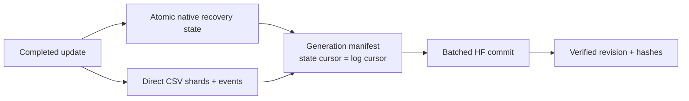

# Training evidence and HF publication policy

<!-- STATION CURRENT -->
**Current scope, 29 October 2026: existing tyre data only. The user will not
collect more tyre photos.** The earlier assumed acquisition campaign is
superseded. The current deliverable is **[TREAD-ONE Studio](phase3TreadOneWorkstation.md)**,
a separate native workstation in [workstation/](workstation/README.md).
It uses the declared r1 seed-3/epoch-20 export, has its own launcher/model/Qt/
cache/evidence, and preserves the original workstation. Real model and UI
checks pass. [User guide](workstation/README.md).

Training and NB02–NB07 audits remain complete. Historical classification and
cohort limits remain; the prospective-readiness=false result is preserved as
research evidence and does not block this authorized desktop implementation.
**Next: use the separate app with existing media. No new photos, NB07 rerun or
retraining is required.**
<!-- END STATION CURRENT -->

**Observed NB05 retention, 29 October 2026:** 3,515 direct published files,
23 core CSV families and 1,561,734 rows are independently verified, including
47,040 augmented training occurrences, every validation image at every epoch
and all selected/final native endpoint maps. [Audit and explicit gaps](phase3NB05Completion.md).
The ten post-hoc review tables and interactive atlas are now published and
independently verified through [NB06](phase3NB06Completion.md): 35 direct files,
including 758 derived CSV rows. More evidence rows do not add independent tyres.

User requirement recorded: **28 October 2026**. This is maintained outside the notebook and supersedes the earlier r1 ZIP publication design.

**User reaffirmation:** continue improving data coverage and retention; the user will help acquire more tyre data later. [The data-growth plan](phase3DataGrowth.md) separates new independent tyres, added views and telemetry. Useful interactive image reports accompany directly retained measurement files; they do not replace them.

## Directly readable records

**Never publish HF progress or results as ZIP bundles.** Metrics and tabular records must be directly accessible CSV files with stable columns and schemas. Publish related files together in one commit and record hashes/revisions in JSON manifests; an archive is not required for a consistent commit.

Use CSV for scalar/table records, JSON for contracts/configuration/manifests, native tensor files for weights/full optimizer/RNG recovery state, PNG for images/masks and directly stored documented arrays for non-tabular outputs. Do not relabel ZIPs or use a tensor/NPZ container as the only home for metrics. Binary tensor state supplements CSV; it does not replace it. Local convenience download archives are a separate concern, not the HF publication format.

The r1 archives already published remain immutable historical evidence. Recover their existing contents into direct CSV as an additive post-run export. Do not rerun training just to expose data that were already retained, and do not delete/overwrite source evidence or change the declared selection after seeing test results.

**R1 recovery status:** this additive export is now complete and independently verified: 18 core CSV tables / 25 direct files, zero ZIP uploads, at HF `91ccd3315bd296a76a8b583a6d0f2515ccb3d370`. [Published inventory and provenance](phase3NB02Completion.md).

## More complete future telemetry

The user explicitly judged r1's collected information too limited. Future notebooks must freeze and document a richer retention schema **before** the measured training run. A passing training loop and final score are insufficient.

| Direct CSV family | Required records / purpose |
|---|---|
| `train_steps` and `train_epochs` | Total objective and every weighted/unweighted component; training predictions, confidence, correctness and per-task aggregates; learning rates for all groups, gradient/AMP health, numerical retries, sampling/exposure IDs and exact denominators |
| `validation_epochs` and `validation_predictions` | Every epoch's per-image predictions/probabilities/logits, label/cohort/tyre/source identity, loss/task scores, selection state and confidence/calibration sufficient statistics |
| `class_metrics` and `confusion` | Support, TP/FP/FN/TN, precision/recall/F1, observed/missing classes, macro/balanced and ordinal metrics; no invented held-out mid evidence |
| `segmentation_stats` | Per image/region/epoch intersection, union, confusion counts, pixel supports/ignore counts, Dice/IoU and defined boundary metrics; sufficient information for later aggregation |
| `geometry_points` | Raw coordinates, targets, human/weak/unknown eligibility, guide/side, native dimensions, signed/absolute/squared errors, visibility/coverage and rejection/disagreement flags |
| `explanation_metrics` | Signed evidence/bias accounting, region attribution, concept/latent activations with honest names, image/feature interventions, stability and defined diagnostic failures |
| `resources` and `timings` | Separate data, forward/backward, optimizer, checkpoint, validation, upload and wall durations; device/host/container memory and bounded utilization/power/temperature/energy where supported |
| `gradient_diagnostics` | Per-module gradient/activation statistics and occasional task-gradient alignment on a declared fixed diagnostic schedule; measure its cost before making it a default |
| `events` and `exposures` | UTC events, retries, exceptions, interruptions, resume boundaries, publication revisions and class/domain/tyre/clip exposure; preserve failures as well as successful steps |
| `test_*` | Frozen selected/final endpoints, all per-image/per-group predictions and metrics, reference definitions and compact raw outputs for reanalysis |

Each schema records version, units, aggregation level, missing-value reasons, split/data/protocol/source hashes and the formula/threshold for every metric. Store raw predictions or sufficient statistics where feasible so later questions do not require retraining. Record honestly when a measurement is expensive, unsupported, unlabelled or not captured.

Use immutable CSV shards per seed/epoch/range, atomic local replacement and a single batched HF publisher. Avoid per-row/per-file commits. Respect the existing 30-minute/major-completion/catchable-stop cadence, account-wide server limits, storage/memory guards and complete optimizer-update recovery. Richer logs should not create unbounded in-memory histories or steal most training time.

This diagram is the required **future training design**, not a claim that r1's historical publisher already used direct shards. Implement and validate it before the next measured run.

**Implementation update:** [TREAD-ONE NB04](phase3TrainingEvidenceGate.md) now
exercises this design in a separate three-update engineering protocol. Thirteen
core CSV families retain actual augmented predictions, sufficient statistics,
transformed targets, evidence, module gradients/activations and resource/timing
samples. Full native state and CSV cursors commit together. The local real-model
math/recovery and 22 fault checks pass; actual Kaggle/live-HF acceptance is next.
This does not retroactively add measurements to r1 or claim a full long-run
logger. Full validation task coverage, endpoints and bounded long-run capture
remain explicit gates.

## Recovery and claims

**Next measured implementation:** [NB05](phase3R2PairedPilot.md) keeps the
architecture fixed and supplies one paired seed with two conditions. Every
augmented training occurrence and every image in each full validation epoch
gets scalar evidence; native map capture is bounded in advance. Per condition,
the planned measured budget is 23,520 training occurrences, 4,860 validation image
evaluations and206 selected/final development-test evaluations. These are
exposures, not new independent subjects.

NB05 uses a local atomic observation journal, but publishes normal direct
per-epoch CSV plus native state/maps/JSON. No database is uploaded. A
native-anchored row hash chain protects cursors/observations; immutable HF
objects are staged in batches of at most80, verified, then selected by one
manifest. Both changed paths receive separate local checks and automatic live
preflight. NB04's now-completed two-T4 proof is not reused as automatic proof of
new code.

Existing validation probabilities/labels support post-hoc classification metrics. Existing test arrays support segmentation confusion counts and per-point errors. They cannot recover unlogged per-image training predictions, continuous GPU traces, true wall-stage durations or every validation pixel map. Missing values must remain marked as unavailable; no synthetic reconstruction should be presented as observed telemetry.

Additional rows are evidence records, not additional independent tyres. Preserve the low/high-only holdout interpretation. Keep data-release changes, new experiments, model promotion and paper updates as explicit, separately evidenced decisions.

NB03 applies direct-file persistence to the current fixed-checkpoint diagnostic:
complete inference units, consolidated CSV snapshots, native gallery maps and a
self-contained explorer. It does **not** validate a future training optimizer's
resume path or retroactively expand r1's training-time logger. Those gates remain
required before another measured training run. NB03 publication is now verified
complete; [execution/publication audit](phase3NB03Completion.md). The implemented
training-recovery successor and its remaining gates are documented in
[NB04](phase3TrainingEvidenceGate.md).

## Completed audit / manual review boundary — 29 October 2026

NB07 now has an independently verified direct-file publication. Retain its
executed notebook and published/local contract distinction; quality differences
are recorded per column, not hidden. Human review exports start unresolved,
require actual evidence to confirm and remain distinct from authoritative
project inputs until reviewed. The new local capture-review pack is not yet
published to HF. No repeat model training or invented acquisition is needed
to preserve this continuation evidence.

## Independent desktop retention — 29 October 2026

The user is not collecting additional tyre photos. Existing-data inference now
has its own application-managed sessions/captures under `workstation/data/`.
Each completed inference retains 24 scalar/class/point/region/latent rows, plus
events. Explicit full capture retains every quarter-grid mask/logit/evidence/
texture/gate value: ten CSVs / 245,784 rows plus native arrays, PNGs, schema and
hashes. Unknown reference metrics remain blank. No CSV is hidden in an archive.

Desktop outputs stay local and are distinct from completed HF training/audit
records. The app performs no credential lookup or automatic media upload. Full
video-frame arrays are saved only on explicit capture; session scalars remain
automatic. [Exact definitions](workstation/EVIDENCE_SCHEMA.md).

## ATLAS v1 implementation — 29 October 2026

The [NB08 schema](tread_two/PILOT_EVIDENCE_SCHEMA.md) implements 21 scientific
CSV families and 247 explicit column definitions, plus direct dictionary,
state-version and commit-timing CSV and full native selected/final maps.
Every occurrence retains complete patch/reference comparisons and candidate/
frozen-control scores. Complete update/evaluation recovery and exact source/
bank/role identities are coupled to the scientific rows. Larger telemetry
does not add independent tyres. Live HF acceptance and measured results remain
pending Kaggle execution. [Run/recovery guide](tread_two/PILOT_RUN_GUIDE.md).
