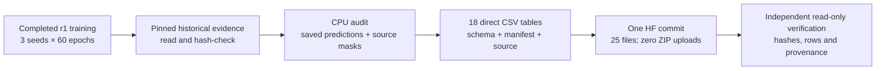
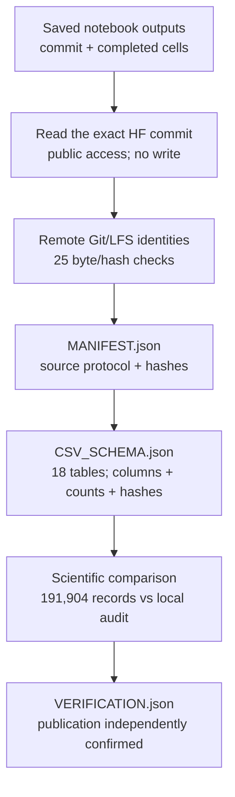

# NB02 completed — direct CSV publication and verification

**Complete and independently verified on 28 October 2026.** The repaired CPU
notebook finished all five code cells and published the recovered records to
Hugging Face. Every published file hash was checked again at the immutable
commit. **No notebook rerun is needed for this completion.**

| Completion measure | Verified result |
|---|---:|
| Executed code cells | 5 / 5 |
| Recorded notebook exception outputs | 0 |
| Published files | 25 |
| Directly readable CSV tables | 18 |
| Scientific CSV records compared with the local audit | 191,904 |
| Published bytes, including manifests/source | 33,630,232 bytes, approximately 32.1 MiB |
| ZIP files uploaded by NB02 | 0 |
| New training updates performed by NB02 | 0 |

## 1. What this notebook completed

NB02 exposes information already retained by r1 and calculates additional
metrics from saved records. It does not train, change the model, select a
different seed, modify labels or install anything in Tread Station. The original
archives remain historical source material; NB02 reads them locally and publishes
its new output as individual files.

## 2. Exact evidence identity

| Artifact | Identity |
|---|---|
| HF dataset | `Shanmuk4622/tyre-wear-study` |
| Immutable training/report source | `a0296f18e02b12d28f7e51377783d68538032209` |
| Immutable direct-CSV publication | `91ccd3315bd296a76a8b583a6d0f2515ccb3d370` |
| Frozen training protocol | `371c40c0c6aaedaf5c5970f7721a284b042494db7bb330065f6cbde8fc3a0b8c` |
| Publication suffix | `posthoc-csv/2026-10-28/` under the original protocol |
| Executed NB02 SHA-256 | `fa3a7c70154a9fabb828ea46dd8dc31b3eb4f1b7ae6d97b792a13a78950b9180` |
| Repair revision used | `r2-fresh-session-directories` |
| Independent verification time | 28 October 2026, 09:29:18 IST |

[Browse the pinned published folder](https://huggingface.co/datasets/Shanmuk4622/tyre-wear-study/tree/91ccd3315bd296a76a8b583a6d0f2515ccb3d370/phase3/tread-one-r1/371c40c0c6aaedaf5c5970f7721a284b042494db7bb330065f6cbde8fc3a0b8c/posthoc-csv/2026-10-28).

| Local evidence | Purpose |
|---|---|
| [Executed notebook archive](completion_20261028/nb02_publication/executed.ipynb) | Exact supplied execution, preserved without regenerating |
| [Publication receipt](completion_20261028/nb02_publication/CSV_PUBLICATION.json) | Commit/destination/count reported by Kaggle |
| [Independent verification](completion_20261028/nb02_publication/VERIFICATION.json) | Remote identities, per-file hashes, row counts and comparison result |
| [Published manifest](completion_20261028/nb02_publication/remote/MANIFEST.json) | Source protocol and complete published file manifest |
| [Published schema](completion_20261028/nb02_publication/remote/CSV_SCHEMA.json) | Columns, units, missing-value interpretation and table hashes |

## 3. Cell-by-cell execution

| Order | Stage | Observed outcome |
|---:|---|---|
| 1 | Setup | Extracted three embedded sources, initialized directories, loaded Kaggle `HF_TOKEN` without displaying it |
| 2 | Retrieve | Read pinned metadata and verified all three historical bundle hashes |
| 3 | Audit and prepare | Verified every seed's completed state, 60 validation epochs and both raw test endpoints; prepared 25 direct files |
| 4 | Publish | Printed `published_and_verified`, commit `91ccd331…`, 25 files and zero ZIP uploads |
| 5 | Inspect | Displayed the run summary and printed the local CSV output folder |

The original failure was a missing parent before writing `remote_tree.json`.
Repair r2 initialized required directories in setup and the standalone stages.
The completed notebook embeds those corrected sources exactly. The
[repair record](phase3NB02Repair.md) retains the original failure and regression
history; this completion supersedes its pending-execution state.

## 4. Published CSV inventory

| CSV file | Rows | Meaning |
|---|---:|---|
| `training_steps.csv` | 8,820 | Completed optimizer updates, losses and retained diagnostics |
| `training_samples.csv` | 70,560 | Training sample occurrences; repeated views are not independent data |
| `validation_epochs.csv` | 180 | Three seeds × 60 validation summaries |
| `validation_predictions.csv` | 14,580 | 81 validation images × 180 epochs |
| `validation_confusion.csv` | 1,620 | Three-by-three confusion entries per validation epoch |
| `class_metrics.csv` | 558 | Per-class validation/test supports and calculated metrics |
| `calibration_bins.csv` | 674 | Populated bins for the declared calibration calculation |
| `point_predictions.csv` | 91,188 | Boundary predictions; targets exist only where eligible human truth exists |
| `review_flags.csv` | 1,813 | Recorded diagnostic flags; an absent flag does not establish correctness |
| `test_predictions.csv` | 618 | 103 test images × 3 seeds × selected/final endpoints |
| `test_region_stats.csv` | 1,236 | Two-region pixel statistics for test endpoint records |
| `test_group_metrics.csv` | 12 | Two test tyres × three seeds × two endpoints |
| `run_summary.csv` | 6 | Three seeds × selected/final summaries |
| `sample_exposures.csv` | 33 | Sampling/group exposure summaries |
| `gpu_resume_checks.csv` | 3 | Actual T4 fresh-process smoke results |
| `completion_checks.csv` | 3 | Epoch/update/source-bundle completion checks |
| `numerical_events.csv` | 0 | Header retained; no numerical retries recorded |
| `artifact_manifest.csv` | 17 | Byte counts/hashes for the other 17 CSV files |

The 17 scientific tables contain **191,904 records**. The 18th is the artifact
manifest. The other seven published files are `AUDIT.json`, `CSV_SCHEMA.json`,
`README.md`, `MANIFEST.json`, and three readable analysis sources. No ZIP, NPZ or
tensor checkpoint was uploaded by NB02.

### Why earlier notes say 20 CSV tables

| Scope | CSV tables | Total files | Explanation |
|---|---:|---:|---|
| Actual Kaggle NB02 publication | **18** | **25** | Core recovery, metadata and three embedded sources |
| Earlier local review package | 20 | 30 prepared | Two additional comparison tables, two figures and a Phase 2 registry snapshot |

The local supplements are `baseline_comparison.csv` and
`selection_and_loss_diagnostics.csv`. They are accounted for separately; all
core training/validation/test records are published. The earlier 30-file local
preparation was never the observed 25-file remote publication.

## 5. Independent verification chain

[verify_nb02_publication.py](analysis/verify_nb02_publication.py) parses notebook
data without executing cells. It confirms five executed code cells, no recorded
errors, and exact equality of all embedded sources with repaired local sources.
It reads the immutable published folder, verifies every remote file identity and
manifest entry, then checks CSV columns, row counts and hashes against schema.

Every scientific row agrees with the previous local recovery within documented
numeric tolerance. One derived entropy value differs in its final decimal:

| Location | Published value | Local value | Absolute difference |
|---|---:|---:|---:|
| `validation_epochs.csv`, data row 179, `entropy_nats` | 0.7392906757971748 | 0.7392906757971749 | 1.11 × 10⁻¹⁶ |

This is consistent with floating-point rounding across environments; its precise
cause was not isolated. The verifier records it and permits `1e-12`
absolute/relative tolerance for differing decimal numeric values. Text,
identities, integer values, schema and remote file hashes remain exact checks.
No published value was rewritten to force agreement.

## 6. Implications for the model and application

| Question | Result |
|---|---|
| Are direct records available on HF? | **Yes**, at the verified commit above |
| Did the repair work on Kaggle? | **Yes**, in the supplied execution |
| Were new training observations collected? | No; recovery plus explicitly post-hoc calculations |
| Did accuracy improve through publication? | No; weights/predictions are unchanged |
| Is more training the immediate next step? | First diagnose the classifier and verify the next logger |
| Should the workstation models be replaced? | Current task scores do not support promotion |

The scientific result remains mean selected balanced accuracy **34.146%**,
Dice **97.978%**, human boundary error **1.189% image width**. Every selected seed
misses the held-out low tyre. The declared export remains seed 3 / epoch 20.
[Model results and figures](phase3CompletionAudit.md).

## 7. Evidence gaps and next action

| Gap | Treatment |
|---|---|
| Unlogged per-image training predictions | Cannot become historical observations; label new inference as post-hoc |
| Full per-epoch validation masks and continuous resource traces | Unavailable from r1; capture explicitly in the next logger |
| Long-run forced-kill/fresh-Kaggle-session continuation | Not established by this export; retain the narrower passed T4 fresh-process claim |
| Held-out mid/video and measured wear/depth | Need appropriate independent data/ground truth |
| Classification failure mechanism | Diagnose fixed saved checkpoints with controlled interventions |

**Next: inference-only classification diagnosis using existing weights.** The
[next-step plan](phase3NextSteps.md) defines hypotheses, measurements, retained
outputs and gates before a model revision.
