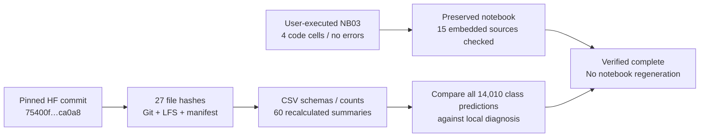

# TREAD-ONE NB03 — completed Kaggle diagnosis and publication

**28 October 2026. Status: complete and independently verified.** The supplied
executed NB03 contains four successfully executed code cells and no recorded
errors. Its published CSV, native gallery arrays, sources and interactive report
were fetched from a pinned HF revision and checked independently. No NB03 rerun
is needed.

| Proof | Verified result |
|---|---|
| Hugging Face repository | `Shanmuk4622/tyre-wear-study` |
| Immutable final revision | `75400f019ba0c6741b5060925b9c956c0a1ca0a8` |
| Direct published files | **27**, plus the separate `OWNER.json` control file |
| Core CSV records | **336,600** across seven tables |
| Cohort summaries recomputed | **60**; all agree within the audit tolerance |
| Native gallery | **78** examples; float32 arrays `[78, 3, 19, 128, 96]` |
| Upload format | Direct CSV / JSON / NPY / HTML / source files; **zero ZIP/NPZ** |
| Final cursor | 96 completed units; complete |
| Ownership | Writer released: `owner=null`, `expires=0` |
| Audit actions | Public read-only verification; zero optimizer updates or remote writes |

[Open the immutable published directory](https://huggingface.co/datasets/Shanmuk4622/tyre-wear-study/tree/75400f019ba0c6741b5060925b9c956c0a1ca0a8/phase3/tread-one-r1/371c40c0c6aaedaf5c5970f7721a284b042494db7bb330065f6cbde8fc3a0b8c/diagnostics/classifier-r1/975c08501981976bb992620aba89478dda90d18505f05d3bbe43376baff3fa0d).
The exact audit is [VERIFICATION.json](diagnostics/nb03_publication/VERIFICATION.json);
the compact publication receipt is [PUBLICATION.json](diagnostics/nb03_publication/PUBLICATION.json).

## Provenance and independent checks

| Identity | Value |
|---|---|
| Executed notebook SHA-256 | `fb00b911ec46ee1aefa3203d112d8bb22f66d152e5b923cdd9e502468fdf994f` |
| Executed notebook size | 152,109 bytes |
| Original clean delivery SHA-256 | `9459d1e01c548f3ec71c48763f674767c384cca47e6146acb85618d26f798691` |
| Original r1 training protocol | `371c40c0c6aaedaf5c5970f7721a284b042494db7bb330065f6cbde8fc3a0b8c` |
| Local diagnostic contract | `4a15626681359aced6e42b652f3c0638aba76c665a169a54019c7543bd821689` |
| Kaggle diagnostic contract | `975c08501981976bb992620aba89478dda90d18505f05d3bbe43376baff3fa0d` |

The contracts differ because they include their execution environments. The
Kaggle run reports Python 3.13.15, Torch 2.11.0+cu128, NumPy 2.1.3, Pillow 13.0,
HF Hub 1.29.0 and two visible Tesla T4 GPUs. The local run used GTX1650/cv_conda.
Visibility of two T4s does not itself prove both were used for diagnostic compute.
All six checkpoint tensor identities and the 15 embedded source files agree
with the preserved local diagnostic.

Across **14,010** matched prediction/intervention rows, there are **zero class
prediction disagreements**. Maximum absolute probability difference is
**0.0007585883140563965**. The runs support the same classification findings;
cross-hardware probabilities are not bitwise identical.

The retained Kaggle output contains three publication milestone lines. It is a
truncated console stream, not a complete publication history. Completion is
established by the pinned final cursor, manifests, tables and hashes.

## What was retained

| Core table | Rows | Purpose |
|---|---:|---|
| `predictions.csv` | 14,010 | Image/class probabilities and intervention outputs |
| `regions.csv` | 28,020 | Two overlapping regions per prediction |
| `points.csv` | 84,060 | Six boundary points, targets and eligibility |
| `latents.csv` | 168,120 | Twelve latent-channel statistics per prediction |
| `evidence.csv` | 42,030 | Three classes' exact additive evidence accounting |
| `gradients.csv` | 270 | Fixed-batch task/module gradient diagnosis |
| `timings.csv` | 90 | Recorded inference/analysis unit timings |
| **Total** | **336,600** | Core scientific table records; summaries are additional |

The remaining files include four directly readable summary CSVs, JSON
contracts/schema/events/results, the native gallery, HTML report and the five
diagnostic source files. The full seven-table/27-file inventory and exact hashes
are in the verification receipt. No new tyre or annotation was collected.

## Scientific interpretation and next action

| Observation | Interpretation / action |
|---|---|
| All six checkpoints classify all 386 nominal training images correctly | Identity fit is established; this does not recover historical augmented training accuracy |
| Validation balanced accuracy ranges from 2.44% to 100% | Transfer is unstable across endpoints; retain tyre/class support and existing test boundaries |
| Oracle gate gain is at most 1.25 percentage points | Gate replacement alone is not an established remedy |
| Background interventions have checkpoint-dependent effects | Keep matched perturbation records; no universal context-removal solution is proven |
| Class/segmentation gradients oppose on one fixed batch | Task interaction warrants investigation; this is not causal proof of failed generalization |

[Detailed results, tables and figures](phase3ClassifierDiagnosticResults.md)
remain the scientific interpretation. The [interactive explorer](diagnostics/TREAD_ONE_Classifier_Explorer.html)
offers image, mask, gate, point and signed-evidence inspection. Its data and code
were checked; browser rendering was blocked by local policy and is not claimed
verified.

The next deliverable is **TREAD-ONE NB04**, a short real-model evidence and
recovery gate. It collects richer training observations and tests native-state
plus CSV recovery before a later controlled revision. It does not start another
60-epoch study or change the installed workstation models. See the
[NB04 technical guide](phase3TrainingEvidenceGate.md) and [current roadmap](phase3NextSteps.md).
