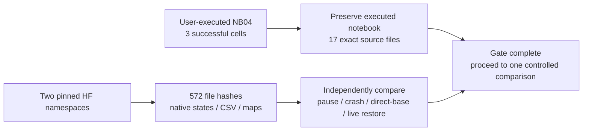
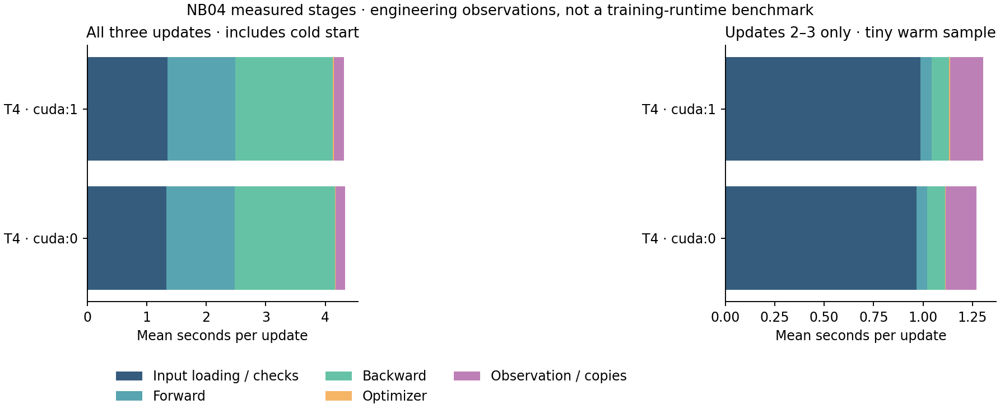

# TREAD-ONE NB04 — both T4 recovery gates independently verified

**28 October 2026. Complete. No NB04 rerun is needed.** All three code cells
executed without recorded errors. Both T4 conditions restored a published
update-1 checkpoint into a new base and continued to update 3 with exactly the
same model, optimizer, scheduler, scaler, RNG, losses and cursor as uninterrupted
execution. The independent audit downloaded and verified the actual artifacts.

| Device | Diagnostic contract | Final immutable HF revision | Published files |
|---|---|---|---:|
| `cuda:0` | `acbfc1f71305b36d07d5ed24b1d03e91e37f57c1cc02653e6b5b71e4fd62c9ce` | `6922039ee7a5bb0ea75c9f0827c650aea0c99807` | 285 |
| `cuda:1` | `da71929d8ae2443fdb334cd59cbfcb729e75ef856e68a76a321829b682caa388` | `2878662661a364afc06be0627128adfd0d197b13` | 287 |
| **Total** | Separate device/environment identities | Both writer leases released | **572** |

The published-file counts include each selecting manifest and exclude its
separate owner control file. Every file was checked against the pinned Git/LFS
object and manifest SHA-256. No ZIP/NPZ was published. The audit made zero remote
writes or optimizer updates. [Exact independent verification](training_gates/nb04_publication/VERIFICATION.json).

[GPU 0 published directory](https://huggingface.co/datasets/Shanmuk4622/tyre-wear-study/tree/6922039ee7a5bb0ea75c9f0827c650aea0c99807/phase3/tread-one/engineering/evidence-gate-r1/acbfc1f71305b36d07d5ed24b1d03e91e37f57c1cc02653e6b5b71e4fd62c9ce),
[GPU 1 published directory](https://huggingface.co/datasets/Shanmuk4622/tyre-wear-study/tree/2878662661a364afc06be0627128adfd0d197b13/phase3/tread-one/engineering/evidence-gate-r1/da71929d8ae2443fdb334cd59cbfcb729e75ef856e68a76a321829b682caa388).

## What the audit established

| Check | Result |
|---|---|
| Executed notebook | 121,228 bytes; SHA-256 `800be1c9ed01d3b6e071035535667e4ebd8968779fbfd14b6b99394d8dbfd3fa` |
| Original clean notebook | Historical SHA-256 `d46768d62cbc2e51347e4f65aa87787a1441cc8fb7c9e54ff44058b0a3710619`; retained in its delivery receipt |
| Embedded code | All 17 files match the frozen delivered sources |
| Original update vs instrumented update | Exact model/optimizer/scheduler/scaler/RNG/loss/cursor equality on each T4 |
| Fresh-process pause | Exact equality after continuation |
| Native crash after CSV before pointer | Last durable update retained; replay agrees exactly |
| Direct snapshot installation | Native state and complete CSV base agree after continuation |
| Live published-state recovery | Independent source-state hash and update-1 provenance agree with the actual restored base |
| Scientific records | Eleven tables agree across each full recovery path after excluding timing and native-file metadata |
| Native image/target/output arrays | Nine array files agree byte-for-byte across each full recovery path |
| Writer control | Released in both pinned final commits |
| Session boundary | Fresh processes and new local recovery bases were exercised; a forced full Kaggle-container restart was not part of the supplied execution |

The published recovery sources are:

| Device | Pinned update-1 source revision |
|---|---|
| `cuda:0` | `87d3a9605006ab1c35d5779eb1ea456c9803eb89` |
| `cuda:1` | `6922039ee7a5bb0ea75c9f0827c650aea0c99807` |

A repository commit can contain another namespace's source snapshot as well as
one device's final snapshot. A revision is interpreted together with its exact
destination and manifest, never by commit hash alone.

## Retained evidence and its limits

| Per-device case | Scientific rows | Interpretation |
|---|---:|---|
| Uninterrupted | 705 | Three actual updates, 24 augmented sample occurrences |
| Fresh-process pause/resume | 705 | Same scientific computation, independent recovery path |
| Abrupt-write crash/replay | 705 | Same complete computation after replay |
| Direct-base install/resume | 705 | Same native/CSV base recovery |
| Live HF install/resume | 705 | Same computation recovered from a pinned remote source |
| One-update published fixture | 237 | Eight augmented occurrences |
| Unlogged frozen-math reference | 0 | Native numerical reference; no reconstructed telemetry |
| **Per device** | **3,762** | Repeated engineering evidence |
| **Both devices** | **7,524** | Not new independent training images or tyres |

The local-versus-T4 resource-count distinction is explicit: a complete T4
case has five resource rows because the scheduled snapshots report both visible
GPUs; the earlier single-GPU local case has three. Every native state and its
CSV cursor were checked. All source hashes, full arrays and zero-difference
comparisons are in the verification receipt.

The saved timing observations show that image loading and telemetry are material
parts of this small model's workload. The first update includes substantial cold
start overhead; the figure separates it from the two later observations. Three
updates are too few for a reliable throughput forecast. They are fixture measurements, not app
latency, a full-run wall-time benchmark or a T4 runtime guarantee. Instantaneous
power samples do not establish energy use. [Stage measurements and visual audit](training_gates/nb04_publication/SUMMARY.json).

Interactive, self-contained audited examples:
[GPU 0 viewer](training_gates/summary_exports/TREAD_ONE_NB04_Kaggle_GPU0.html),
[GPU 1 viewer](training_gates/summary_exports/TREAD_ONE_NB04_Kaggle_GPU1.html).
Their embedded data and JavaScript can be checked locally; browser rendering
remains unverified because local-file preview was previously blocked by policy.

## What is next

The recovery requirement has passed for the NB04 implementation. Its short
surrogate epochs cannot demonstrate classifier quality or solve the observed
transfer failure.

The next deliverable is [NB05](notebooks/phase3_NB05_TREAD_ONE_Shared_Gradient_Paired_Pilot.ipynb):
an unchanged custom TREAD-ONE architecture, one predeclared paired seed, and one
training-mechanism change. A matched summed-gradient baseline is compared with
shared-only conflict projection, retaining every task's outputs. The
[r2 protocol and run guide](phase3R2PairedPilot.md) explains the hypothesis,
source/math, expanded evidence and automatic preflight. More independent tyres
remain necessary for stronger generalization claims.

The new longer-run journal/publisher are separate sources. NB04 does not prove
those new implementations automatically: they receive their own local fault and
real-model checks, and NB05 runs a short live recovery preflight before its
measured training. This avoids treating an earlier gate as proof for changed
recovery code. The original training study, app models and executed notebooks
remain preserved.
