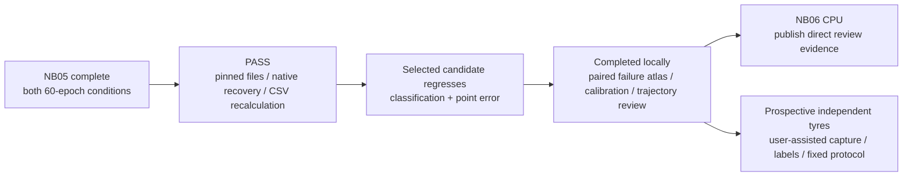
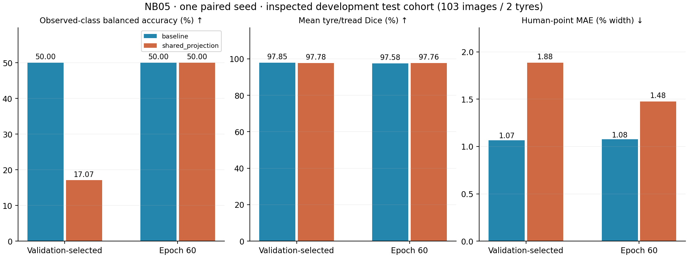
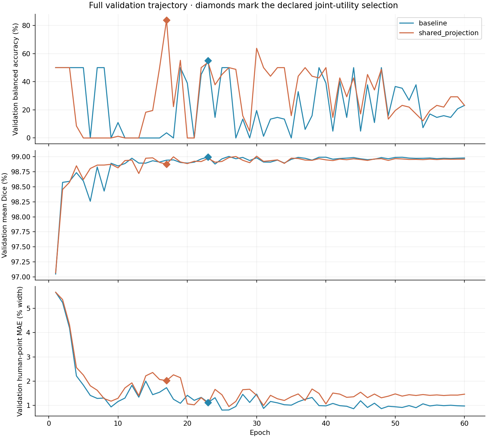
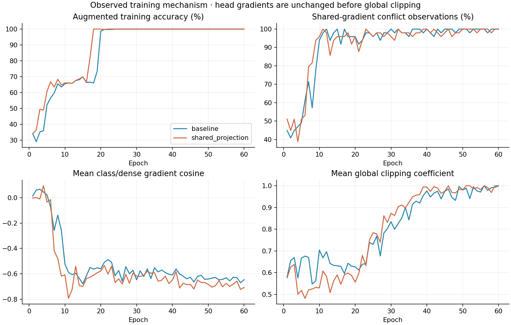

# NB05 completed — paired TREAD-ONE result and independent audit

**29 October 2026 — Asia/Calcutta.** Both matched seed-1 conditions completed 60 epochs and 2,940 optimizer updates each on the two Kaggle T4s. Both actual live preflights passed. The independent audit passes. **The projected candidate does not improve the declared selected development endpoint and is not supported for promotion.**

The next step has already been implemented locally: a full saved-evidence review, ten derived CSV tables, scientific figures, and an interactive atlas. [NB06 CPU review/publication instructions](phase3NB06Review.md). Independent tyre collection remains the next data gate; [empty intake templates](data_intake/README.md) are ready for the user’s later help. No additional model was trained here.

## What completed, and what the result means

| Gate | State | Evidence |
|---|---|---|
| Notebook execution | Three code cells, counts 1/2/3; zero saved errors | [Archived execution](revision2_validation/nb05_publication/executed.ipynb), [inspection](revision2_validation/nb05_publication/NOTEBOOK_INSPECTION.json) |
| Measured pair | Both 60 epochs / 2,940 updates complete | Native states, 60 histories/condition and update-by-update CSV |
| Direct HF retention | **3,515 published logical files**, including two manifests; zero ZIP/NPZ/database uploads | [Download/hash receipt](revision2_validation/nb05_publication/DOWNLOAD.json) |
| Scientific recalculation | **1,561,734 core rows**, both selections, all 412 native endpoint maps | [Independent scientific checks](revision2_validation/nb05_publication/SCIENTIFIC_VERIFICATION.json) |
| Live recovery | Both update-1 pinned sources continue to identical update-4 states; 20 scientific CSV families equal | [Independent preflight verification](revision2_validation/nb05_publication/PREFLIGHT_VERIFICATION.json) |
| Model quality / promotion | Candidate fails this paired selected-endpoint comparison; installed app unchanged | Endpoint / class / tyre tables below |
| New subjects | Zero; richer telemetry does not add physical tyres | Original 12-tyre dataset, 8/2/2 train/validation/test grouping |

## Declared selected and final development-test endpoints

These are **103 existing photographs / two physical tyres**, low/high only. Twenty-five images have human point labels. The mid class has zero target support, although predictions may choose mid. All endpoints were already part of the frozen protocol; the test did not choose checkpoints.

| Condition | Endpoint | Epoch | Accuracy | Balanced accuracy, observed classes | Mean Dice | Human-point MAE, % width | NLL |
|---|---|---:|---:|---:|---:|---:|---:|
| baseline | selected | 23 | 39.806% | 50.000% | 97.852% | 1.067% | 1.1868 |
| baseline | final | 60 | 39.806% | 50.000% | 97.579% | 1.076% | 1.7830 |
| shared_projection | selected | 17 | 13.592% | 17.073% | 97.782% | 1.885% | 1.7083 |
| shared_projection | final | 60 | 39.806% | 50.000% | 97.756% | 1.477% | 2.2177 |

Selected balanced accuracy drops **32.927 percentage points**, from 50% to 17.073%. Mean Dice changes by only −0.070 percentage points, while human-point error rises from 1.067% to 1.885% width, about **76.6% higher**. At epoch 60 both classifiers reach the same 50% balanced accuracy, and projection still has higher point error and NLL. The final endpoint is not substituted for the selected one. Neither endpoint resolves the low-tyre failure.

## The validation gain did not transfer

| Condition | Selected epoch | Validation BA | Validation Dice | Validation human-point MAE | Frozen joint utility |
|---|---:|---:|---:|---:|---:|
| baseline | 23 | 55.000% | 98.997% | 1.120% width | 0.737886139 |
| shared_projection | 17 | 83.750% | 98.877% | 2.021% width | 0.854203833 |

The original utility selected epoch 23 for baseline and epoch 17 for projection. Projection’s 83.75% validation BA looks better than baseline’s 55%, but its selected test BA is much worse. Its validation NLL/Brier also do not improve. The full 60-epoch curve shows unstable class transfer alongside consistently strong segmentation. This supports caution about validation representativeness and selection stability in a very small tyre cohort; it does **not** isolate a causal shortcut or prove that all gradient-projection methods fail.

## Class and tyre failures are explicit

| Selected endpoint | True class | Support | Predicted as this class | Correct | Recall |
|---|---|---:|---:|---:|---:|
| baseline | low | 62 | 0 | 0 | 0.000% |
| baseline | mid | 0 | 40 | 0 | unavailable: no target support |
| baseline | high | 41 | 63 | 41 | 100.000% |
| shared_projection | low | 62 | 0 | 0 | 0.000% |
| shared_projection | mid | 0 | 89 | 0 | unavailable: no target support |
| shared_projection | high | 41 | 14 | 14 | 34.146% |

Both selected models predict **zero low** cases and miss all 62 low-class photos. Baseline correctly recognizes all 41 high-class photos. Projection recognizes 14/41 high photos and predicts mid for 89/103 images overall. Mid predictions on this cohort are errors; absence of mid ground truth is not a reason to remove them from the confusion matrix.

Per-tyre records and paired-image deltas are retained directly: [tyre metrics](revision2_validation/nb05_publication/analysis/endpoint_tyre_metrics.csv), [class metrics](revision2_validation/nb05_publication/analysis/endpoint_class_metrics.csv), [paired image deltas](revision2_validation/nb05_publication/analysis/paired_image_deltas.csv). No photo-level confidence interval or p-value is used to pretend that 103 correlated photos are 103 independent tyres.

## What the mechanism actually did

| Condition | Task-gradient observations | Negative shared dot products | Projection applied | Head-gradient change at routing |
|---|---:|---:|---:|---:|
| baseline | 2,940 | 2693 (91.599%) | 0 | zero |
| shared_projection | 2,940 | 2700 (91.837%) | 2700 | zero |

The two trajectories diverge after intervention. Their later conflict counts therefore measure different evolving models; they are not paired samples of the same gradient vector. Projection acted on 91.84% of candidate updates, so this was a frequent change to the optimization path. A zero head-gradient change at routing does not preserve head weight updates: the subsequent **global clipping coefficient** can differ, as can the shared representation. Dense quality is not guaranteed by routing only shared gradients.

## Exact provenance and audit boundaries

Executed NB05: **1,424,770 bytes**, SHA-256 `f756dffaea87271d764b57e425be4a7529e87e1d7d2d99075de8fd1da60b4d6a`. The original clean delivery and earlier failed execution remain separately preserved. [Original repair history](phase3NB05Repair.md). No NB05 rebuild or repeat training is required.

| Condition | Final pinned HF revision | Runtime contract |
|---|---|---|
| baseline | `705d8a2ca48c72becebf2265057a174e60a633b2` | `764bbdb1b127407122b4029f774212cd21c34f342494c7dc487ca51bd331ccac` |
| shared_projection | `f59d6bc4bb5e747b12999c7fbbd0684c8bc360a5` | `df20a0b9342024ed5685a75543c1bf24912d8b534eb3a88581506cde56a479b9` |

Actual Kaggle paired initialization hash: `6f5f47c8f34da08e32af191b9c2591d2ab91012b821b66758df563e77eb96e00`. Both conditions match each other in initialization, every scheduled sample/augmentation identity, and captured native input/target arrays. This actual Tensor hash differs from the earlier local GTX1650 fixture hash; identical seeds across different software environments are not a guarantee of identical initialized tensors. The actual T4 baseline original-math preflight is independently exact.

All 27 embedded experiment files equal the readable frozen sources. Both final native states are at phase completed / epoch 60 / update 2,940. The 3,628-unit ledger per condition has matching native tail/cursor anchors. CSV schemas/counts match native row cursors. All 124 cohort summaries across validation/endpoints are independently recalculated. Every selected/final native mask map agrees with saved region counts and prepared source masks; signed evidence reconstructs logits with maximum residual below 4.8×10⁻⁷. Loss sufficient-statistic reconstruction differs by less than 3.6×10⁻⁷.

A numerical audit initially used an overly strict scalar point tolerance. The frozen NumPy-2 per-point subtraction rounds in FP32, while annotation MAE uses an explicit FP64 target array; observed maximum scalar discrepancy is 2.95×10⁻⁸ width. The audit now checks the appropriate precision and recomputes human MAE from saved prediction/target coordinates. No training data, stored metric, selection rule or checkpoint was changed. The separate frozen Torch selection field remains preserved.

The independent live preflight check downloads both pinned update-1 sources, original/reference and restored update-4 native states, and compares 20 scientific CSV families. The original baseline update matches frozen math. It does not prove a forced whole-Kaggle-container restart during the 60-epoch run. Raw SQLite is intentionally local-only; its complete SQL hash chain is not independently replayed from CSV strings. Published hashes, native tail anchors and all row cursors are checked.

## Retained evidence and measured cost

| Scope | Both conditions combined |
|---|---:|
| Completed optimizer updates | 5,880 |
| Augmented training occurrences | 47,040 |
| Validation-image observations | 9,720 |
| Selected/final development-test predictions | 412 |
| Core CSV records, 23 families | 1,561,734 |
| Declared selected/final native image maps checked | 412 |
| Independent additional tyres | 0 |

There are 1,325 CSV files per condition including auxiliary files; 23 denotes schema families, not files. The compatibility validation_predictions family stays header-only; real validation is in eval_predictions and companions. Full continuous power/energy, every validation pixel map at every epoch and every historical gradient tensor were not collected.

| Condition | Reported worker-active minutes | Retained process intervals | Sampled CUDA peak | Minimum sampled free disk |
|---|---:|---:|---:|---:|
| baseline | 85.78 | 3 | 1.177 GiB | 16.22 GiB |
| shared_projection | 86.40 | 3 | 1.177 GiB | 16.01 GiB |

These are retained main-process intervals and resource samples, not complete notebook wall time, continuous peak process usage, energy or workstation latency. The conditions ran concurrently; summing their active minutes does not give elapsed notebook time. Publication waiting is separate.

## Next step already carried out locally

The [interactive comparison explorer](revision2_validation/nb05_publication/analysis/TREAD_ONE_NB05_Comparison_Explorer.html) contains **all 103 test source images and 412 endpoint records**, with selectable condition/endpoint, wrong-case filters, predicted/labelled overlapping masks, six predicted/human points and signed evidence for all three classes. It is self-contained, about 19.2 MB. Heat opacity is scaled per image/class and numerical maxima are shown. Intrinsic additive evidence does not establish physical or input-level causality.

Ten directly readable derived CSV tables record endpoint/class/tyre metrics, validation trajectories and stability, actual training gradient/clipping history, calibration bins, descriptive confidence-risk curves and paired image deltas. Confidence thresholds are descriptive post-hoc diagnostics, not a calibrated abstention/deployment policy.

The [NB06 CPU notebook](notebooks/phase3_NB06_TREAD_ONE_Paired_Review_And_Failure_Atlas.ipynb) has now reproduced and published this audit directly to a separate HF namespace using the user's Kaggle secret. Its later execution and all 35 published review files are independently verified in the [NB06 completion](phase3NB06Completion.md). It trained no model and ran no new inference. The [run guide](phase3NB06Review.md) preserves the original procedure; no repeat execution is needed.

The next **data** action is independent tyre acquisition with capture/label provenance, including the missing held-out mid-class/domain coverage if those claims are intended. The [intake pack](data_intake/README.md) contains empty templates only. Do not replace the installed models, pick another checkpoint using these test scores, or add more seeds just to seek a favorable score. A later architecture/training change needs a declared hypothesis and evaluation protocol.
