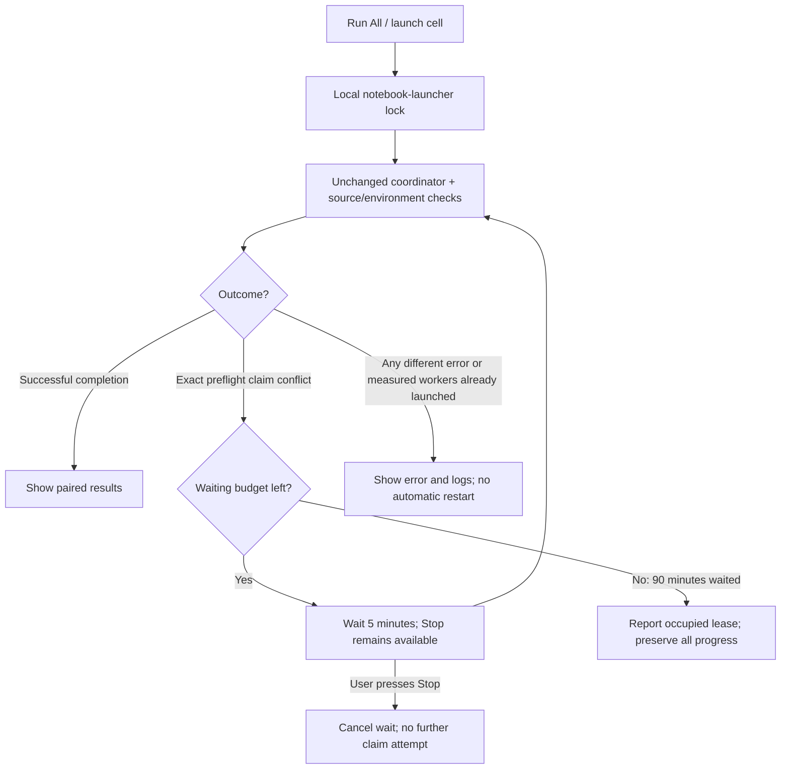

# NB05 preflight writer-lease repair

**Completion supersedes rerun guidance:** the later NB05 execution completed
both conditions and is independently verified. [Completion and findings](phase3NB05Completion.md).
No NB05 rerun is needed. The repair/failure records below remain historical;
the next portable step is [NB06 CPU review/publication](phase3NB06Review.md).

**29 October 2026 — Asia/Calcutta.** The supplied NB05 execution stopped during
the baseline automatic preflight's HF ownership claim. The repaired notebook
now waits and safely retries that specific temporary conflict. The model,
training recipe, source contract, HF namespaces and recovery data are preserved.

**Use:** [repaired NB05](notebooks/phase3_NB05_TREAD_ONE_Shared_Gradient_Paired_Pilot.ipynb).
The repair passed local regression checks. A new Kaggle/live-HF execution has
not been performed here; measured study results remain pending.

## What the supplied execution actually shows

| Observation | Evidence / implication |
|---|---|
| Setup completed | Saved output: secret loaded without displaying it |
| Failing stage | `Automatic live preflight: baseline` → `publisher()` → `Hub.claim()` |
| Underlying exception | `Another live gate owns this namespace; stop it cleanly or wait for its 45-minute lease expiry.` |
| Notebook's outer exception | Generic `Run failed or paused`; this hid the useful recovery action |
| Ownership meaning | At the claim's read, a different writer ID had an unexpired lease |
| What is unknown | Whether that other session was still working or had terminated without releasing its lease |
| Training scope | The supplied execution stopped before launching either measured condition; this does not establish the global state of another session |
| Preserved failure | [Executed notebook](revision2_validation/nb05_repair/c49292d397d0/executed.ipynb), 164,154 bytes |
| Failure SHA-256 | `c49292d397d03d1d9aac67f4c5f87721955fb220c86db4aa07d5f30ed68b1256` |
| Parsed evidence | [INSPECTION.json](revision2_validation/nb05_repair/c49292d397d0/INSPECTION.json); cells/output inspected as data, never executed locally |

The ownership check was protecting the run from concurrent writers. A lease
does not prove that the old process is alive: a hard-killed process can leave
the same temporary record. Conversely, deleting the record could let a second
session write while the original session is still active. The repair retains
the existing ownership rules and waits for a valid claim.

## Repaired control flow

| Rule | Exact behavior |
|---|---|
| Retry trigger | Last nonempty error line exactly matches the observed lease exception, with `preflight` and `claim` stack frames |
| Excluded trigger | An attempt that printed `Measured paired condition:`; incompatible contracts, data/CUDA/training errors and other failures |
| Retry interval | 300 seconds, in interruptible sleeps of at most 5 seconds |
| Waiting budget | 5,400 accumulated waiting seconds; coordinator/preflight work is separate wall time |
| Natural expiry | 2,700 seconds from the other writer's last renewal; a working session may renew again |
| Claim implementation | Original frozen coordinator and compare-and-swap ownership logic on every attempt |
| Namespace/owner edits | The launcher performs no remote deletion, forced takeover or namespace change |
| Duplicate local launch | `NB05_LAUNCHER.lock` covers execution and waiting |
| Stop during execution | Existing process-group SIGINT/flush path; wait up to 300 seconds for cleanup, then report if still flushing |
| Stop during waiting | Cancel before any further attempt; no running measured worker is created by the wait |
| Attempt evidence | Full coordinator `.log` files and timestamped `.jsonl` events in `WORK/launcher_logs/`, plus displayed notebook output |

The launcher makes no HF requests itself. Each retry uses the existing
coordinator, including its authentication, repository reads, compatibility
check and ownership claim. Five-minute spacing limits repeated conflicting
claims; existing server-delay/backoff handling remains active. Request counts
are not a universal account quota, and a successful attempt performs additional
preflight/publication requests.

## Compatibility and exact delivery

The repair lives in the notebook launcher, outside the 27 source files used by
the experiment's contract. This is an execution-control change, not a new
training implementation. It calls the original coordinator again rather than
altering it at runtime.

| Identity / property | Result |
|---|---|
| Current notebook | 168,270 bytes |
| Current notebook SHA-256 | `5bd1855e04fbac4abbeb0b96b6a023b15419c21c96954828bb9c7fb9715ec3a2` |
| Readable launcher | [nb05_launcher.py](analysis/nb05_launcher.py), embedded verbatim in setup |
| Launcher SHA-256 | `422c9c6ca8bc627a1a67761556e86a38998292480a82872344c08d95077fed5f` |
| Frozen experiment payload | All 27 files byte-for-byte equal to the failed notebook and prior accepted delivery |
| Stable measured study intent | `16dfddd7672e70c3b321cc6adc4044d5a6c4453a75d7b84a29f72fdd6ab6c1dc` |
| Existing native recovery proof | Remains bound to the identical training/runtime source hashes |
| Changed environments | Still require compatibility review; this repair does not bypass the source/environment contract |
| Original clean delivery | [ORIGINAL_DELIVERY.json](revision2_validation/nb05_repair/c49292d397d0/ORIGINAL_DELIVERY.json) |
| Current delivery | [DELIVERY.json](revision2_validation/DELIVERY.json) |

The builder now requires a matching archived copy before replacing an executed
NB05. Earlier executed NB02–NB04 notebooks, frozen r1 sources, datasets, model
selection and installed workstation models are untouched.

## Verification and limits

[Regression script](analysis/test_nb05_lease_repair.py) and
[REGRESSION.json](revision2_validation/nb05_repair/REGRESSION.json) cover:

**17 local regression checks passed.** The original 16 training-runtime checks
remain a separate acceptance suite; these 17 checks concern this repair.

| Verification group | Result covered |
|---|---|
| Actual saved failure | Recognizes the supplied preflight traceback |
| Original ownership behavior | Frozen `Hub.claim()` rejects a second unexpired owner without committing; permits a normal claim after expiry in an offline Git/CAS fixture |
| Lease released / expired | Retry invokes the identical coordinator after the configured wait |
| Continuously renewed lease | Stops at the waiting budget without takeover |
| Cancellation | Stop while waiting cancels retries; Stop with a running coordinator invokes its flush signal path |
| Error discrimination | Different errors, incomplete lease messages and attempts that started measured workers are not automatically retried |
| Local duplicate / successful run | Concurrent launch is fenced; success has no retry or wait |
| Real subprocess transport | Fresh-workspace coordinator fixture writes the original failure, then succeeds; actual output capture, status handling and retry invocation verified |
| Provenance | Clean notebook schema/syntax, exact embedded launcher, all 27 source hashes and original failed-notebook hash verified |
| Prior model acceptance | Existing actual-model validation still matches the unchanged experiment sources |

These are offline regression checks with simulated coordinator outcomes and a
fake HF service. They make zero network requests or optimizer updates. They do
not demonstrate that the user's remote lease has already expired, that a new
live Kaggle run passed, or that training quality improved. The original 16
journal/projector/publisher checks and both actual-model recovery fixtures
remain separate prior acceptance evidence.

## Run the corrected notebook

1. Import the repaired NB05 into Kaggle. If an older copy is still running and
   is no longer needed, stop it cleanly and allow its flush to finish.
2. Keep **T4 ×2**, Internet **ON**, the single prepared Phase2 input and enabled
   **HF_TOKEN** secret. Follow the [full run guide](phase3R2PairedPilot.md).
3. **Run All**. An occupied preflight lease now produces a waiting status and
   safe retries. Leave the cell running during the wait, or press Stop to cancel.
4. Once ownership is available, the normal live recovery preflight must pass
   before the matched measured pair starts. Compatible saved state is restored
   by the original coordinator. Do not delete HF ownership/checkpoint files.
5. Preserve the executed notebook and `launcher_logs/` if any different error
   appears; that error remains visible and is not silently retried.

No package installation/downgrade, credential fallback, local training run or
remote write was required for this repair.
