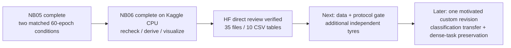
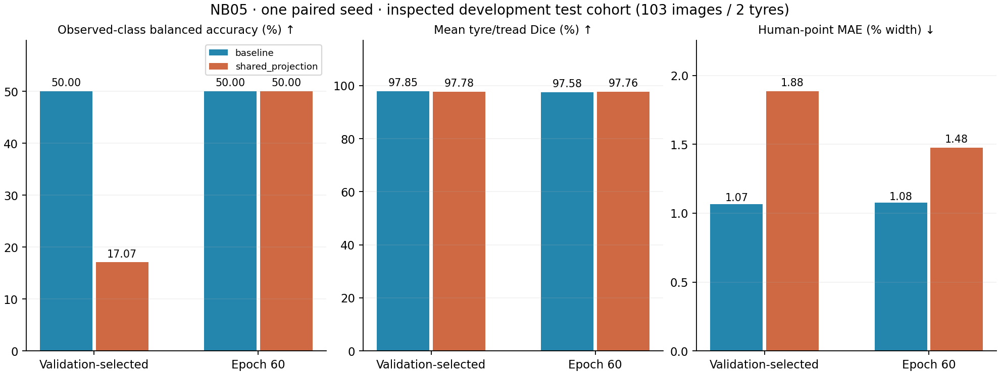

# NB06 complete — published TREAD-ONE review and next milestone

**29 October 2026 — Asia/Calcutta.** All six code cells completed successfully.
The independent read-only audit verifies **35 published files**, including
**10 directly readable CSV tables / 758 derived rows**, three figures and the
complete interactive image atlas. The HF writer is released at the pinned
publication. **No NB06 rerun is needed.**

[Open the published review](https://huggingface.co/datasets/Shanmuk4622/tyre-wear-study/tree/0a8bfa370792d61f89cd7622a49b002f3117e98b/phase3/tread-one/r2/review/paired-seed1/460613ddb46d06e7148c3834ef1f65dc3e035d955e3f99701212aa8b196e4d56) or the cached
[published explorer](revision2_validation/nb06_publication/remote/TREAD_ONE_NB05_Comparison_Explorer.html).
The completed notebook is preserved exactly; no training source, checkpoint,
test selection or installed model was changed.

## Completed workflow and evidence

| Gate | Verified result | Evidence |
|---|---|---|
| Notebook | Execution counts 1–6; zero saved errors | [Exact archive](revision2_validation/nb06_publication/executed.ipynb) |
| Embedded input/source files | All 36 equal the accepted delivery/readable files | [Independent verifier](analysis/verify_nb06_publication.py) |
| HF publication | 35 logical files including selecting manifest; all SHA-256 and Git/LFS identities checked | [VERIFICATION.json](revision2_validation/nb06_publication/VERIFICATION.json) |
| Direct tables | 10 tables / 758 rows; headers/order/counts and all numeric values agree with the local audit | [Publication receipt](revision2_validation/nb06_publication/PUBLICATION.json) |
| Ownership | Released at the pinned revision; no forced takeover | Published OWNER.json checked independently |
| Original measured evidence | NB05's pinned publications, 3,515 files and 1,561,734 core rows rechecked by the executed review | Published verification/ and source_metadata/ records |
| Image atlas | 103 source test images, 412 endpoint records, 1,854 image blocks, valid JS syntax | Cached published HTML; mask/heat decoded pixels match local exactly |
| New model/data | Zero optimizer updates, zero model forward passes, zero new independent tyres | Review scope and frozen original inputs |

## Exact publication identity

| Item | Identity |
|---|---|
| Repository | Shanmuk4622/tyre-wear-study |
| Pinned revision | `0a8bfa370792d61f89cd7622a49b002f3117e98b` |
| Review contract | `460613ddb46d06e7148c3834ef1f65dc3e035d955e3f99701212aa8b196e4d56` |
| Namespace | `phase3/tread-one/r2/review/paired-seed1/460613ddb46d06e7148c3834ef1f65dc3e035d955e3f99701212aa8b196e4d56` |
| Executed notebook | 534,809 bytes |
| Executed SHA-256 | `b4d124aa282df7fc1b1da5239fe2a0dbcfe9143c1629e804bcfee735340029c4` |
| Clean delivery SHA-256, historical | `6817b3a5d53ae42ca2430d29cfd2d78083e75475b53c008fa41a100f58cd718c` |
| Public-read audit remote writes | 0 |

The Kaggle review contract differs from the earlier local prepared contract
because it includes the actual software environment. The published run used
CPU, Python 3.13.15, Torch 2.11.0+cu128, NumPy 2.1.3 and Pillow 13.0.0. A CUDA
build being installed does not mean this review ran GPU inference. The six
analysis-source hashes and original NB05 publication/checkpoint identities
agree exactly with the accepted source payload.

## Published table inventory

| Direct CSV | Rows | Main purpose |
|---|---:|---|
| endpoint_metrics | 4 | Declared selected/final condition endpoints |
| validation_trajectory | 120 | All 60 validation epochs per condition |
| epoch_training_gradient | 120 | Sampled training accuracy, objectives, conflicts, projection, clipping and timings |
| endpoint_class_metrics | 12 | Class support/predictions/recall/precision |
| endpoint_tyre_metrics | 8 | Physical test-tyre outcomes per endpoint |
| calibration_reliability | 40 | Ten confidence-bin sufficient-statistic rows per endpoint |
| selective_risk | 84 | Descriptive fixed-threshold coverage/error; no fitted deployment rule |
| validation_prediction_stability | 162 | Per-image 60-epoch correctness and prediction flips |
| paired_image_deltas | 206 | Per-image candidate/baseline endpoint deltas |
| resource_timing_summary | 2 | Retained worker-active intervals and sampled resource limits |

Probabilities/accuracy/Dice and error divided by image width are fractions;
durations are seconds and memory is bytes. Blank means unavailable/not
applicable. Repeated images/epochs/points and the 758 derived rows are not new
independent subjects. Raw measured NB05 tables remain in their original pinned
namespaces; this additive review does not replace them.

## Model insight remains the same

NB06 publishes and verifies evidence; it does not train an improved model.
The original validation selections remain fixed:

| Selected endpoint | Epoch | Test balanced accuracy | Mean two-region Dice | Human-point error (% width) |
|---|---:|---:|---:|---:|
| Baseline | 23 | 50.000% | 97.852% | 1.067% |
| Shared projection | 17 | 17.073% | 97.782% | 1.885% |

Both selected models miss all 62 low-class test photos. Projection predicts mid
on 89/103 images and correctly recognizes only 14/41 high-class photos. Its
83.75% selected validation BA did not transfer. This one paired development
result does not establish universal optimizer behavior or a causal shortcut.
The test cohort remains two already inspected tyres, low/high only; human point
truth is available on 25 photos. [Full NB05 interpretation](phase3NB05Completion.md).

## Published visuals and audit limits

The published HTML is **19,840,337 bytes**, with condition,
selected/final endpoint, wrong-case and human-label filters, masks, points,
signed class evidence and the full validation trajectory. Heat color scale is
per image/class and the numerical maximum is shown. Intrinsic additive
accounting is not physical wear/depth/safety or input-level causal validation.

Its byte size differs from the locally rendered HTML because the rendering
environments differ. All ten CSV tables match numerically with maximum
difference **0.0**, and corresponding decoded predicted-mask and
signed-heat pixels match exactly. All 1,854 embedded blocks have the expected
image shapes. JavaScript syntax passes. The published static figure was
inspected; browser interaction/layout has not been visually verified.

The original study's limitations remain: one paired seed, few independent
tyres, no held-out mid cohort, local-only SQL history, bounded rather than
continuous resources/maps, and no new physical measurements. An audit receipt
does not turn the inspected development cohort into an independent blind test.

## What is next

The next scientific milestone was the
[classification generalization/data-and-protocol gate](phase3ProspectiveDataGate.md), now implemented locally as [NB07](phase3NB07DataGate.md):

1. Reconcile physical tyre/parent-video identity and mileage-label provenance.
2. With the user's planned later help, register additional independent tyres
   and varied sessions, including low/mid/high coverage for intended claims.
3. Freeze a prospective tyre-disjoint evaluation protocol before inspecting
   reserved-cohort model outputs; retain native sources and direct HF metadata.
4. Use that evidence to choose one focused custom-model revision with explicit
   segmentation/geometry preservation criteria.

[Empty intake templates](data_intake/README.md) are already prepared. No new
tyre count, acquisition budget, training date or r3 architecture is claimed or
frozen here. Current installed models remain unchanged. No additional model or
review notebook was launched by the NB06 documentation update. NB07 subsequently
implemented the CPU source/intake audit; [NB07 completion](phase3NB07Completion.md) now verifies its Kaggle/HF publication. Actual identity/collection work follows.
