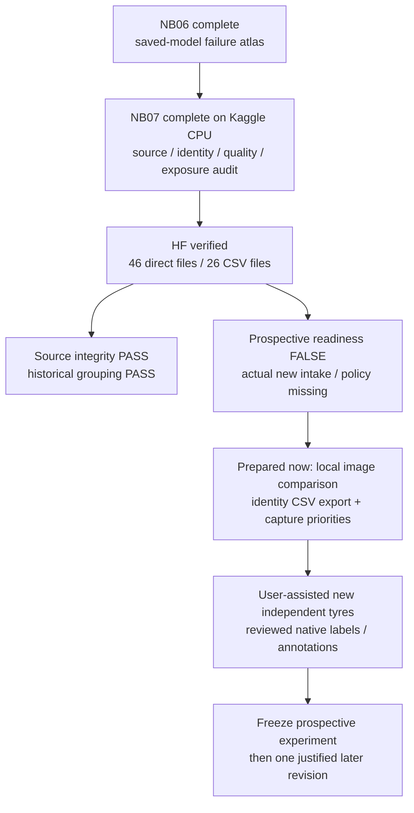
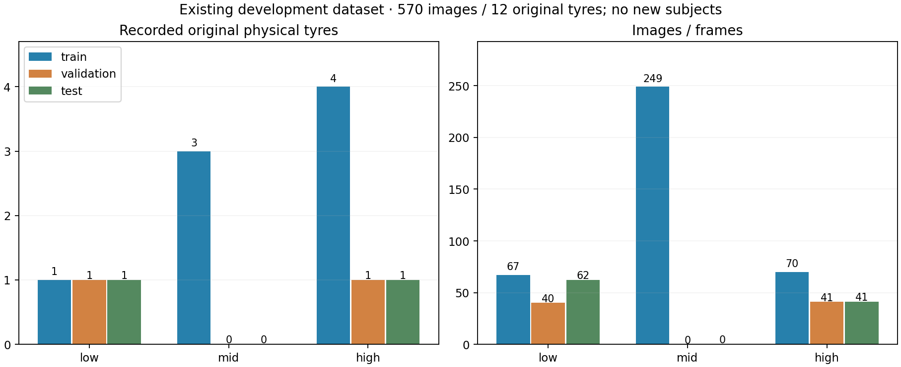
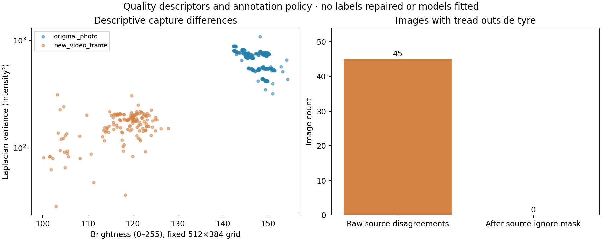

# NB07 complete — verified data audit and next collection work

**Repeat checked, 29 October 2026:** the latest supplied NB07 also passes.
All 45 payload files are unchanged and HF uploaded zero new payload objects.
**No further NB07 run is needed now.** A false readiness flag requires actual
new intake/protocol work, not another identical execution. [Repeat check](phase3NB07RepeatCheck.md).

**29 October 2026 · Asia/Calcutta.** All five NB07 code cells completed without
saved errors. The independent read-only audit verifies **46 direct files**,
including **22 structured CSV tables / 7,614 rows** plus four raw/control CSVs.
HF ownership is released. **No NB07 rerun is needed for these unchanged inputs.**

[Published snapshot](https://huggingface.co/datasets/Shanmuk4622/tyre-wear-study/tree/1b6d7122ed47350a9623476975912aff54c690a1/phase3/tread-one/data-gate/v1/dbb3cf3634d1c2b19034b32e7182a4deaab1fdb5dc094a605f733514009d6f91) ·
[Independent verification](data_gate_validation/nb07_publication/VERIFICATION.json) ·
[Final preservation/link checks](data_gate_validation/nb07_publication/HANDOFF_VALIDATION.json) ·
[Published source explorer](data_gate_validation/nb07_publication/remote/TREAD_ONE_Data_Gate.html) ·
[Next identity/capture review](phase3CollectionReview.md)

## Completed gates

| Gate | Verified result | Scope |
|---|---|---|
| First notebook | Cells 1–5, zero saved errors; 232,871 bytes | Exact supplied execution archived; 42 embedded files match accepted delivery |
| HF | 46 logical direct files including selecting manifest | Git/LFS identities and every payload SHA-256 checked at pinned revision |
| CSV | 22 structured tables, 7,614 rows including 206 dictionary rows | Four input/control CSVs add three unresolved control rows; 26 CSV files total |
| Existing data | 570 images / 12 original tyres | 418 original photos + 152 frames of existing tyres |
| Historical grouping | Pass | Ten conservative co-assignment components; no historical split crossing |
| Annotation provenance | 720 human / 912 weak point rows | Weak proposals remain separate from human truth |
| Mask conflict handling | 45 raw disagreement images; zero unignored | Existing masks/ignore policy retained; no repair invented |
| Training exposure | 47,040 saved occurrences | 23,520 per condition from 120 pinned previous CSV shards; no new training |
| Prospective readiness | **False, expected** | Zero new intake, 12 explicit gaps, draft policy and subject minima undeclared |
| Intake errors | 0 | Empty intake is not a passing prospective cohort |
| Publication format | Zero ZIP/NPZ/database uploads | Native CSV/JSON/PNG/HTML/source |

## Exact publication identity

| Item | Identity |
|---|---|
| HF repository | Shanmuk4622/tyre-wear-study |
| Pinned revision | `1b6d7122ed47350a9623476975912aff54c690a1` |
| Publication contract | `dbb3cf3634d1c2b19034b32e7182a4deaab1fdb5dc094a605f733514009d6f91` |
| Kaggle data run | `3eb4068aed9df65760f6e0629d147546a5c3ff71bbb1486619a75ef58bbc085c` |
| First executed notebook SHA-256 | `6bc422b8fd91984a1a3482b9fde2d4b66e63f50ff0e1865ce0939d5068bbd559` |
| Clean delivery SHA-256, historical | `aabf20e532daeaa8d349fd5ac66be5bd1d9ee2d2f739ca30f994becda5b85220` |
| Local preflight run, retained | `a0df0c048f177fddd64622f648a214d56f621584f0ec13900297abc75f432263` |
| Local prepared publication, retained | `6f5306b473bd29f59de4184362ddc08e1acf38d9e3364afc6632bffe53ce8522` |
| Verifier's remote writes | 0 |

The Kaggle contract differs from local preparation because environment is part
of the identity. Source code, source data/overlay, raw inputs and policy agree.
Do not overwrite the local contract to disguise this distinction.

## Published CSV inventory

| Tables | Rows | Meaning |
|---|---:|---|
| source_images / source_tyres / source_clips | 570 / 12 / 3 | Existing image, physical tyre and existing clip registries |
| video_parent_review | 9 | Three clips × three possible original mid parents, unconfirmed |
| image_quality | 570 | Fixed-grid capture descriptors and native conflicts |
| region_geometry | 1,140 | Image × overlapping tyre/tread native geometry |
| point_geometry / point_coverage | 1,632 / 570 | Human/weak source points and coverage, including no-point images |
| similarity_candidates / exact_duplicates | 1,710 / 0 | Three directed neighbours per source / byte-identical pairs |
| leakage_components / historical_class_support | 10 / 9 | Conservative split constraints / role × class support |
| capture_descriptors | 7 | Nonempty historical role × class descriptive means |
| training_image_exposure | 1,140 | Condition × source image, aggregated from saved occurrences |
| intake_tyres / intake_sessions / intake_images / intake_issues | 0 / 0 / 0 / 0 | No actual new intake supplied |
| prospective_support / readiness_gaps / gate_checks | 9 / 12 / 5 | Declared role/class support, missing requirements and scoped results |
| csv_schema | 206 | Column metadata; not new empirical subjects/images |

[Complete direct table links and schemas](data_gate_outputs/CSV_INDEX.md).
Empty tables retain headers. Unknown/unavailable values remain blank; observed
zero remains zero. The four separately published input/control CSVs are the
three empty collection registries and three-row unresolved clip control.

## Cross-environment comparison and visuals

| Check | Result |
|---|---|
| Byte-equal tables | **20 of 22**; identities, source hashes, geometry/truth, support, similarity, exposure and readiness agree exactly |
| image_quality | 3,430 changed numeric cells; no text/identity changes |
| Largest image-quality brightness difference | 0.001900 intensity units for foreground; foreground-minus-background maximum 0.002007 |
| Focus descriptor maximum difference | 0.125977 intensity squared; this is a capture descriptor, not model accuracy |
| capture_descriptors | 26 changed numeric cells; maximum 0.009059 in mean focus variance |
| Embedded previews | 570 decoded 144×192 JPEGs; maximum pixel difference from local = **0** |
| HTML | JavaScript syntax valid; browser interaction/layout not verified |

These numerical differences are environment-sensitive descriptors; the exact
implementation cause was not isolated. The published environment is CPU,
Python 3.13.15, NumPy 2.1.3, Pillow 13.0.0, Torch 2.11.0+cu128,
huggingface_hub 1.29.0 and filelock 3.32.5. The local preflight uses different
package versions. No descriptor threshold or new model was fitted here.
Native truth, identity and all readiness conclusions agree exactly.

Both published figures were inspected. The CPU run uses no optimizer updates
or neural forward passes; the presence of a CUDA Torch build is not GPU use.

## Insights and continuation

| Evidence | Next implication |
|---|---|
| Only one low training tyre | Collect additional independent low identities, not repeated old views alone |
| Mid held-out support is zero | Obtain additional reserved mid subjects before claiming unseen-mid transfer |
| High train photos are 3 / 2 / 5 / 60 across four tyres | Subject counts alone hide uneven appearance coverage; broaden capture/identity support |
| Three mid clip parents remain unresolved | Use actual capture records; similarity and visual resemblance cannot confirm parent identity |
| No new intake or frozen policy | A correct completed audit remains training-not-ready |

Continued work is already prepared as the [identity/capture review pack](phase3CollectionReview.md):
44 existing source previews, an 18-image mid contact sheet, 56 planning/review
CSV rows plus three unresolved controls, and evidence-based resolution export.
Ten export/validator checks pass. This new pack is **local preparation, not
another HF publication**. No mapping is assigned by the agent.

Actual independent acquisition still awaits the user's planned help. No new
tyre target, split ratio, r3 architecture or training date is invented. Keep
the current workstation and validation selections. After actual collection,
review identity/annotations, declare meaningful class/role minima and freeze
full model-selection/task/failure rules before the next fit.
