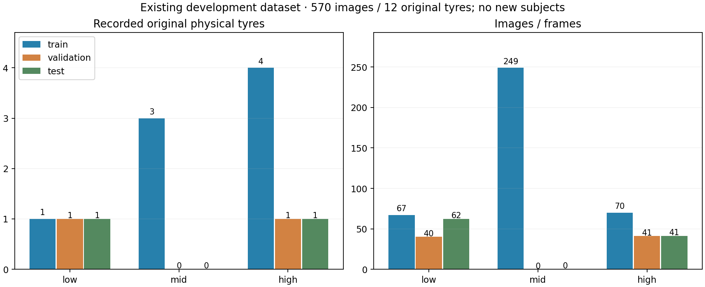
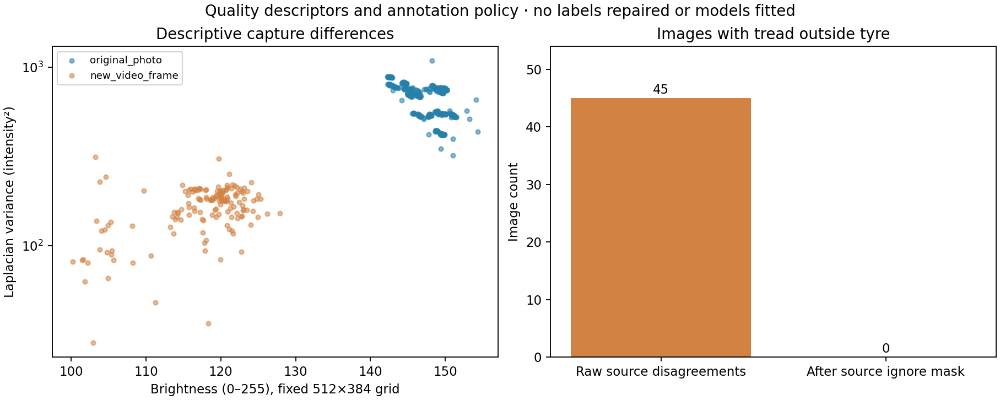
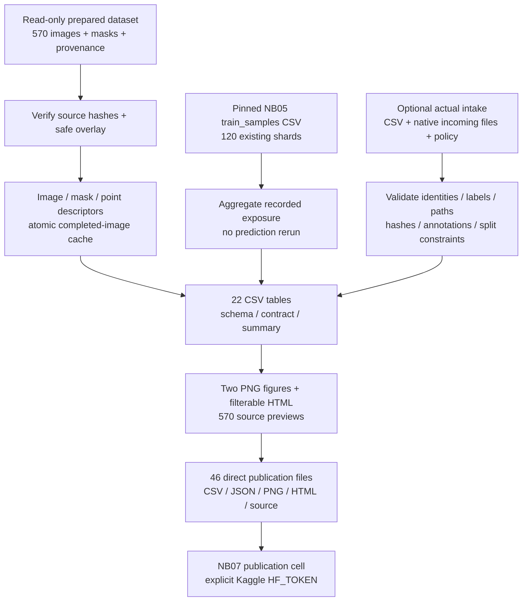
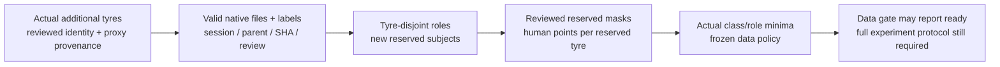

# TREAD-ONE NB07 — data and protocol gate

**Repeat checked, 29 October 2026:** the latest supplied NB07 also passes.
All 45 payload files are unchanged and HF uploaded zero new payload objects.
**No further NB07 run is needed now.** A false readiness flag requires actual
new intake/protocol work, not another identical execution. [Repeat check](phase3NB07RepeatCheck.md).

**Complete on Kaggle and independently HF-verified, 29 October 2026.**
[Completion audit, publication and insights](phase3NB07Completion.md). This is the next
TREAD-ONE milestone after [completed NB06](phase3NB06Completion.md).
It collects richer CSV evidence, validates future supplied data and reports
whether a prospective cohort is ready. It performs no neural inference or
training. All five Kaggle cells and the 46-file direct publication are now independently verified. No unchanged-input rerun is needed.

| Deliverable / state | Current evidence |
|---|---|
| Run notebook | [NB07](notebooks/phase3_NB07_TREAD_ONE_Data_And_Protocol_Gate.ipynb), CPU only, self-contained sources |
| Direct structured exports | [22-table CSV index](data_gate_outputs/CSV_INDEX.md), 7,614 rows including 206 dictionary rows |
| Existing data audited | 570 images: 418 original photos + 152 frames; 12 original physical tyres |
| Past training evidence summarized | 120 pinned CSV shards; 47,040 saved augmented occurrences, 23,520 per condition |
| Additional independent tyres / images supplied | **0 / 0**; derived records do not increase the cohort |
| Source integrity / historical grouping | Pass / pass; zero byte-identical source-image duplicates |
| Prospective training readiness | **False**, correctly: new intake, subject minima and frozen protocol are missing |
| Publication | **Complete / independently HF-verified**: 46 direct files at `1b6d7122ed47350a9623476975912aff54c690a1` |

NB07 is a data milestone, not a new architecture or an r3 fit. The model remains
TREAD-ONE with the completed NB05 optimization comparison.

## Why this implementation follows the model evidence

| Earlier observation | NB07 action | Interpretation boundary |
|---|---|---|
| Both NB05 selected models miss all 62 low test photos | Count independent class support, not just photographs | One low training tyre limits the evidence; it does not prove the sole cause |
| Projection validation BA 83.75%, selected test BA 17.073% | Separate historical development splits from future reserved subjects | The inspected old test set cannot become a fresh blind cohort |
| Dense predictions remain useful | Record native mask geometry, ignore policy and human/weak point provenance | Descriptors are not new segmentation accuracy measurements |
| Videos add many repeated views | Record source clips, possible parents and conservative leakage constraints | Three existing clips add zero new subjects |
| User requires substantially richer CSV | Retain registries, quality, similarities, exposure, support, issues and gaps | More rows are not physical wear measurements |

## Actual coverage and findings

| Historical split | Low: photos / tyres | Mid: images / tyres | High: photos / tyres |
|---|---:|---:|---:|
| Train | 67 / **1** | 249 / 3 | 70 / 4 |
| Validation | 40 / 1 | **0 / 0** | 41 / 1 |
| Test | 62 / 1 | **0 / 0** | 41 / 1 |

Mid training comprises 97 original photos and 152 frames. Video-to-original
mapping remains unresolved, but source provenance states that the three clips
show three distinct **existing** mid tyres. They are not counted again.

The gate reports **10 conservative leakage components**, retaining **12 physical
tyres**. The three original mid tyres and three unmapped clips share one
co-assignment constraint until parent links are established. This prevents
separating plausible derivatives across splits; it does not assert that those
mid tyres are the same tyre. All components stay within one historical split.

There are **45 raw tread-outside-tyre disagreement images**, and **zero** with
such pixels remaining after the source ignore masks. Labels and ignore masks
were preserved. There are 720 human point records on 120 images and 912 weak
polygon-derived records on 152 frames. Weak points remain ineligible as
independent human evaluation truth.

Original photos and video frames occupy different brightness/focus ranges in
this descriptive audit. This supports capture review, not a causal shortcut
claim or physical wear measurement. Three directed nearest neighbours per
image produce 1,710 similarity-review rows, without automatic identity labels.
Zero exact duplicates does not prove absence of visually related images.

## Data flow and source ownership

| Source | Responsibility |
|---|---|
| [common_gate.py](data_gate/common_gate.py) | Confined paths, strict CSV parsing, hashes and column metadata |
| [features_gate.py](data_gate/features_gate.py) | PIL/NumPy quality descriptors, dHash, native mask/point geometry |
| [intake_gate.py](data_gate/intake_gate.py) | Cohort validation, annotation provenance, identity/split checks and readiness |
| [exposure_gate.py](data_gate/exposure_gate.py) | Hash-verified saved training occurrence aggregation |
| [run_gate.py](data_gate/run_gate.py) | Source audit, snapshots, cache, identity review, CSV contracts and finalization |
| [report_gate.py](data_gate/report_gate.py) | Scientific figures and self-contained source explorer |
| [publish_gate.py](data_gate/publish_gate.py) | Immutable direct files, bounded existing HF publisher and receipts |
| [protocol_policy.json](data_gate/protocol_policy.json) | Explicit **draft** eligibility/coverage policy |
| [exposure_sources.json](data_gate/exposure_sources.json) | Pinned training CSV identities and hashes |

The notebook embeds 42 files, including unchanged runtime/training/r2
dependencies for verification/publication. Embedding these files does not
execute a training entry point. Gate code/config and data/environment hashes
bind the new run identity.

## CSV contract, units and missing values

The [CSV index](data_gate_outputs/CSV_INDEX.md) gives every table, count and
record grain. [csv_schema.csv](data_gate_outputs/csv/csv_schema.csv) records
206 column definitions and units. [CSV_SCHEMA.json](data_gate_outputs/CSV_SCHEMA.json)
binds exact bytes, columns, row counts and SHA-256 values. Empty tables retain
headers. Four raw input/control CSVs are retained separately: three empty
collection templates and three unresolved clip rows. The prepared snapshot
therefore has **26 CSV files**; the 7,614-row total excludes those raw clip rows.

| Measurement | Definition / limitation |
|---|---|
| Brightness / RGB means | Fixed height 512 × width 384 bilinear grid, stored orientation, intensity 0–255 |
| Contrast / entropy | Gray standard deviation / 256-bin Shannon entropy in bits |
| Focus | Interior four-neighbour discrete Laplacian variance, intensity squared; resize-dependent |
| Foreground / background | Tyre/tread union vs complement, excluding ignore pixels; missing if unsupported |
| Mask area | Positive native pixels after ignore / all valid native pixels |
| Native boxes | Zero-based x/y; right/bottom exclusive; missing for empty regions |
| Point / centroid fractions | Native coordinate divided by width−1 or height−1; source point order retained |
| dHash | 64 horizontal gray comparisons; XOR population count 0–64; review radius 6 |
| Exposure accuracy / NLL | **Saved pre-update augmented occurrences**, not nominal image accuracy or a new evaluation |
| Missing value | Blank means unknown/not applicable; observed zero remains zero |

Historical mileage/depth values stay blank without independently supplied
measurements. Folder/group mileage-proxy labels are retained without invented
odometer readings. Classes do not measure wear, depth, safety or alignment.

## Prospective intake and readiness

Use the [intake guide](data_intake/README.md) for CSV fields and annotation JSON.
Native images/masks/annotations go under `incoming/`; each referenced file is
checked and hashed. The audit does not automatically upload full-resolution
incoming files. Arrange their authorized native dataset release separately.

The shipped policy has `frozen=false` and undeclared minima. This run correctly
records **12 readiness gaps**: undeclared minima, nine role/class checks,
unfrozen protocol and no new intake. Zero intake errors means no actual rows
were supplied; it does not mean the empty cohort is ready. Training may include
existing training tyres only. Reserved validation/test require new independent
tyres, reviewed masks on every image and at least one human six-point image
per tyre.

After acquisition, declare positive integer minima for train/validation/test;
each applies to every required class in that role. Choose them against the
actual study budget and desired precision. A synthetic unit fixture with one
subject per class/role tests code, not scientific sample-size adequacy.
The gate cannot prove identity claims or statistical adequacy from metadata.

`frozen=true` alone does not specify checkpoint selection, endpoint metrics,
dense-task preservation or the model hypothesis. Review that complete experiment
protocol separately before any fit. The gate never starts training automatically.

## Historical Kaggle instructions — rerun only for changed inputs

1. Open [NB07](notebooks/phase3_NB07_TREAD_ONE_Data_And_Protocol_Gate.ipynb).
2. Set accelerator **None / CPU**, Internet **ON**; attach
   `shanmuk4622/tire-dataset-prepared-phase2` directly from Kaggle.
3. No new intake is required for the current audit. Later, optionally attach
   **one** intake dataset with `INTAKE_VERSION.json`, the CSVs, `incoming/` and
   optional actual `protocol_policy.json`. Multiple matching roots stop for
   explicit selection.
4. Enable Kaggle Secret **HF_TOKEN** for `Shanmuk4622/tyre-wear-study`.
   No project `.env` or alternate credential file is read.
5. Keep **1 GiB free** and **Run All**. No installs, GPU allocation, source-data
   duplication or 1 TB scratch assumption are needed.
6. Save the executed notebook/output; inspect summary, support, readiness gaps
   and HTML. **False readiness is expected with the current empty intake.**

Five code cells unpack/setup, collect, render/prepare, publish and inspect.
The HTML has 570 embedded 144×192 previews with class/split/domain, raw-conflict
and unmapped-video filters. It explores source data; NB06 remains the model
prediction/failure atlas.

## Recovery, resources and publication

| Event | Behavior / boundary |
|---|---|
| Stop during descriptors | Completed image records are atomic; incomplete/corrupt units recompute |
| Changed code/input/environment | Incompatible caches invalidate through hashes |
| Repeated exposure download | Reuse verified local CSV; missing/corrupt files refetch from pinned URLs |
| Input changes mid-audit | Snapshot CSV plus final referenced-media hash closure prevents mixed completion |
| Repeated audit | Versioned identity; LATEST advances only after tables/contracts complete |
| Setup rerun | Preserve edited working intake; local session locks prevent competing stages |
| HF upload | Existing r2 ownership/CAS, bounded immutable batches, verified deduplication and server backoff |
| Catchable Stop/error while publishing | Immediate consistent flush/retry attempt; pending receipt if unsuccessful |
| Forced kernel/process death | Cleanup cannot run; preserve Kaggle output before temporary storage disappears |

This finite CPU audit publishes at its completed major stage. It does **not**
promise periodic remote partial-image-cache backup during collection or remote
restoration of an unfinished audit after deleting the Kaggle session. A fresh
session can recompute from immutable inputs. Future training still requires
completed-update recovery and 30-minute/major-completion/catchable-stop pushes.

Only CSV/JSON/PNG/HTML/source files are staged: no ZIP, NPZ, database or weights.
The additive namespace is `phase3/tread-one/data-gate/v1/<publication-contract>`.
Local publication contract:
`6f5306b473bd29f59de4184362ddc08e1acf38d9e3364afc6632bffe53ce8522`.
That is the historical local preparation identity. The actual Kaggle publication
is independently verified at revision `1b6d7122ed47350a9623476975912aff54c690a1`
with contract `dbb3cf3634d1c2b19034b32e7182a4deaab1fdb5dc094a605f733514009d6f91`.
[The completion report](phase3NB07Completion.md) explains the environment-bound identities.

| Trouble | Action |
|---|---|
| Missing/wrong prepared input | Attach the exact dataset; preserve logs; do not bypass hashes |
| Missing token/write access | Enable the notebook secret, then rerun publication with completed files retained |
| HF busy/429/transient error | Respect bounded retries/server delays; inspect receipts; avoid concurrent Run All |
| Intake errors | Correct actual input using intake_issues.csv, then rerun collection/report/publication |
| Empty-intake readiness false | Expected; obtain actual independent subjects and declare policy |
| Local activation hook noise | Use run_cv.cmd; preserve the existing cv_conda/CUDA environment |

## Validation and next action

The [final receipt](data_gate_validation/VALIDATION.json) records targeted unit
checks, exact notebook payload, extracted-source fresh CPU replay, CSV equality,
HTML syntax/previews and offline publication recovery. Nineteen unit checks
cover valid synthetic intake, path/hash errors, identity/split leakage, reviews,
human/weak truth, masks, measurements, media closure and clip mappings.
Synthetic fixtures are isolated and excluded from scientific counts.

All 22 CSVs passed Artifact Tool import/recalculation/export with exact headers,
values, blanks and bytes. Fresh extracted-source replay disables network/CUDA,
reuses verified caches and recomputes four actual source images. Offline HF
fixtures are not live publication. Figures and the CSV preview were visually
inspected. HTML syntax and 570 embedded JPEGs are checked; interactive browser
rendering is not verified. Original 103 Markdown files, 27 frozen experiment
sources and executed NB05/NB06 remain unchanged.

Next: use the [identity/capture review pack](phase3CollectionReview.md), then
populate actual user-assisted independent tyre intake. NB07 is complete; rerun
only for changed inputs. Freeze the prospective experiment before a later fit.
