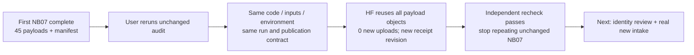

# NB07 repeat checked — no further run needed now

**29 October 2026.** The latest supplied notebook completed successfully.
All five code cells passed and the independently verified HF publication has
the same results as the first execution. **Do not rerun NB07 again with the
current inputs.** Earlier setup/run instructions are historical instructions
for executing the audit, not a request to repeat a completed one.

The user reran after interpreting earlier guidance as requiring another run.
This record makes the next action explicit: review identities and obtain actual
independent intake; rerun the audit only when those inputs or its policy change.

## First execution versus supplied repeat

| Item | First verified execution | Latest verified repeat |
|---|---|---|
| Saved notebook bytes | 232,871 | 231,052 |
| Notebook SHA-256 | `6bc422b8fd91984a1a3482b9fde2d4b66e63f50ff0e1865ce0939d5068bbd559` | `6cadf6be5ee79391c475c41574a5607bbc4fcf6ba4f8163a52e3c5c7b8729d8e` |
| Code cells | Five successful cells | Five successful cells; code exactly identical |
| HF revision | `1b6d7122ed47350a9623476975912aff54c690a1` | `fe3d125a74ab1039b1ac34b503b01a495711e0ab` |
| Publication contract | `dbb3cf3634d1c2b19034b32e7182a4deaab1fdb5dc094a605f733514009d6f91` | Same contract |
| Data run | `3eb4068aed9df65760f6e0629d147546a5c3ff71bbb1486619a75ef58bbc085c` | Same run identity |
| Scientific payload | 45 files + selecting manifest | All 45 payload hashes unchanged; 46 logical files verified |
| Newly uploaded payload objects | 45 | **0 — verified reuse** |
| Structured CSV | 22 tables / 7,614 rows | Identical to the first publication |
| Total published CSV files | 26, including raw controls | 26 |
| New data / model fitting | None | None |

The new revision records another publication/ownership cycle; it is not
additional training, new metrics or another set of unique payload files.
Notebook bytes differ because execution outputs/metadata differ. Code,
environment, input hashes, source contract, summary and payload are unchanged.

## Verification and preservation

| Evidence | Result |
|---|---|
| [Repeat comparison](data_gate_validation/nb07_reruns/6cadf6be5ee7/COMPARISON.json) | All 45 payload SHA-256 values unchanged; new receipt and notebook archived separately |
| [Independent remote check](data_gate_validation/nb07_reruns/6cadf6be5ee7/VERIFICATION.json) | Manifest, every Git/LFS identity, all file SHA-256 values and released writer verified at the new revision |
| [Latest published snapshot](https://huggingface.co/datasets/Shanmuk4622/tyre-wear-study/tree/fe3d125a74ab1039b1ac34b503b01a495711e0ab/phase3/tread-one/data-gate/v1/dbb3cf3634d1c2b19034b32e7182a4deaab1fdb5dc094a605f733514009d6f91) | Pinned repeat receipt; original publication remains available |
| First archive | Preserved byte-for-byte in the original completed-audit folder |
| Current notebook | Preserved as supplied; no cells executed or regenerated locally |

Public reads reused verified cached files, then checked them against the new
pinned remote tree. The verifier made zero remote writes and read no alternate
credentials. Earlier and repeated execution receipts are kept separately.

## Readiness=false is not a request to rerun

The audit passes source integrity and historical grouping. It still reports
**prospective_training_ready=false** because no new independent tyre intake,
actual subject minima or frozen prospective policy were supplied. There are
12 explicit readiness gaps, just as before. Repeating the same inputs cannot
fill these gaps.

| Situation | Next action |
|---|---|
| Current notebook and inputs | **No more NB07 execution needed** |
| Known clip identity with supporting records | Use the [review/export tool](phase3CollectionReview.md); keep uncertain parents unresolved |
| Actual additional independent tyres/images | Register native files, labels, sessions and annotations using the [intake guide](data_intake/README.md) |
| Reviewed mappings / intake / policy actually change | Preserve this completed audit; run NB07 once against the changed inputs and retain its new contract |
| Considering another model fit | First freeze actual cohort, role/class minima, selection and task/failure criteria |

The local comparison/capture pack remains usable. No new notebook or model run
is required to inspect it. [Original completion and scientific insights](phase3NB07Completion.md).
