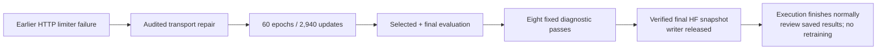
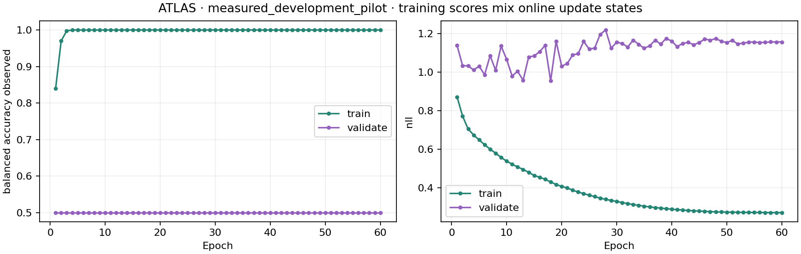

# NB08 — completed normally; no new execution error

<!-- NB09_GATE_UPDATE_20261030 -->
**Latest:** NB09's completed review is [HF-verified](phase3NB09Completion.md).
The next [training-only gate](phase3TreadTwoAppearanceGate.md) is implemented
and locally complete. Current executed NB08/NB09 are archived without
regeneration; original source/checkpoint science is preserved.

**Subsequent review completed locally:** [full findings](phase3TreadTwoFindings.md)
and the [new CPU NB09](notebooks/phase3_NB09_TREAD_TWO_ATLAS_Completed_Review.ipynb)
are ready. The review corrects the earlier all-high prose, explains low→mid
through saved reference evidence and checks every fixed probe. Original
completion evidence below remains unchanged; no NB08 rerun is needed.

**30 October 2026 · TREAD-TWO / ATLAS · existing data only.** The user reported
that the notebook stopped running, then clarified that **no error appeared**.
Direct public HF inspection finds the measured run **completed and published**.
There is no reason to restart training or change the model/runtime.

## What is actually saved

| Item | Verified result |
|---|---|
| Measured fit | Seed 1; **60 epochs / 2,940 optimizer updates** |
| Final durable cursor | `phase=completed`, `status=completed`, updates 2,940 |
| Endpoints | Selected epoch **18**, final epoch **60**; 103 images each |
| Declared diagnostics | Worker lifecycle reaches completed after all eight endpoint/variant passes |
| Publication | **1,203 manifest objects**, 4,123,061,147 bytes, about 4.12 GB |
| Retention | All 60 epoch checkpoints; direct CSVs, complete native recovery state, source and repair provenance |
| Scientific tables | 21 families; manifest cursor declares **35,502,696 rows** |
| Writer | Owner null / expiry zero: cleanly released |
| New error / repair | No error reported or reproduced; notebook and frozen runtime remain unchanged |

The worker's last recorded diagnostic finished at **03:03:02 IST on 30 October
2026**. Publication completed afterward. This worker timestamp is not the
publication timestamp. The earlier hourly HTTP timeout was a separate incident,
preserved in the [repair record](phase3NB08Repair.md).

## Independent verification scope

| Check | Actual scope / result |
|---|---|
| Snapshot identity | Pinned to HF revision `82e7e1c5774f54c786571cdef7b3b60c1e96630f` |
| Fit protocol | Original `fe7dc763fe6d4b64ce8ccf2f22c4222b6da28ca7975c925d56ba70c3e09d19dd` preserved |
| All published objects | 827 Git objects downloaded and checked against size, SHA-256 and Git blob hash; 376 LFS objects checked against HF SHA-256 metadata |
| Final native state | Bytes downloaded and SHA-256 matched to manifest and cursor; not deserialized or executed |
| Metrics / selection | All **40,330 metric rows**, 60 selection rows and declared selection rule checked |
| Endpoint predictions | Both 103-image sets checked for identity/counts, targets, raw-logit argmax, correctness and recomputed balanced accuracy |
| Explanation projection | All 618 selected/final class checks read; maximum absolute residual below 2e-6 |
| Final display | Notebook's metrics loading/filtering reproduced successfully using byte-verified saved tables |
| Report | PNG validates; HTML payload has 206 endpoint records, 18 literal references and no missing endpoint/image pairs |
| Limits | Not every large CSV was independently recounted/reanalysed; no new browser interaction or fresh full-model restore test in this follow-up |
| Permissions | Public reads only; no credential lookup, remote writes, model forward passes or training |

[Audit receipt](tread_two/pilot_validation/nb08_followup/82e7e1c5774f/PUBLIC_AUDIT.json),
[verification receipt](tread_two/pilot_validation/nb08_followup/82e7e1c5774f/VERIFICATION.json),
[pinned manifest](tread_two/pilot_validation/nb08_followup/82e7e1c5774f/fit_MANIFEST.json).
The 35.5-million-row figure is the saved cursor total, not a claim that every
large telemetry table was independently rescanned here. It represents richer
measurements of existing data, **not additional independent tyres**.

## First checked model result

| Existing low/high endpoint | Selected, epoch 18 | Final, epoch 60 | Frozen original-frame control |
|---|---:|---:|---:|
| Balanced accuracy over observed target classes | **50.0%** | **50.0%** | **50.0%** at both endpoints |
| Low-class recall | 0 / 62 | 0 / 62 | Saved control scores retained |
| High-class recall | 41 / 41 | 41 / 41 | Saved control scores retained |
| Original-image projection maximum residual | 7.72e-8 | 1.15e-7 | Different explanation method; no equality implied |

**Correction from the full prediction review:** the candidate predicts **mid
for all 62 low images** and high for all 41 high images at both checkpoints.
The earlier statement that all 103 predictions were high was an interpretation
error in this note; the saved rows and 50% balanced accuracy were unchanged.
**Execution success does not establish a classification improvement.** The
declared validation rule selected epoch 18; no test result was used to replace
it. Detailed analysis of the already-saved probes, training trajectories,
reference evidence and failure cases remains the next scientific task.
Validation/test have no mid targets; the old endpoint has been inspected before.
These are mileage proxies, not measured depth, safety or physical wear truth.

## Retained visuals

These are the original published curves, copied without regeneration. Training
scores combine online update states, as labeled in the source report.

[Open the saved interactive ATLAS explorer](tread_two/completion_report/ATLAS_Evidence_Explorer.html).
It includes both endpoints, every image, predicted atlases, signed patch tiles,
and supporting/opposing literal reference cases. Its content is byte-verified;
interactive rendering was not newly browser-tested in this follow-up.

## What to do now

1. **Do not restart training.** Keep the Kaggle output and completed publication.
2. In the existing session, the final display cell may be run by itself to view
   the saved report; it performs no training. The local explorer above is also available.
3. Preserve the latest executed Kaggle notebook when available. The workspace
   NB08 is still the clean repaired delivery, so its latest execution cannot
   be reconstructed from local notebook outputs alone.
4. Review the retained failure/probe evidence before proposing any new fit.
   Both workstations, original models and the existing-data-only scope stay unchanged.

[Pinned HF run files](https://huggingface.co/datasets/Shanmuk4622/tyre-wear-study/tree/82e7e1c5774f54c786571cdef7b3b60c1e96630f/phase3/tread-two/atlas-v1/fit/fe7dc763fe6d4b64ce8ccf2f22c4222b6da28ca7975c925d56ba70c3e09d19dd).
