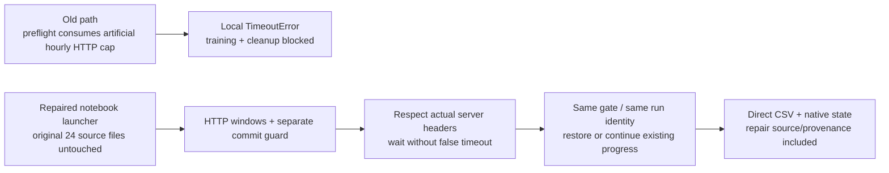

# NB08 repair — local HTTP budget timeout

**Follow-up, 30 October 2026:** the repaired measured run has now completed
and published. The user's latest report involved no displayed error.
**No training rerun is required.** [Current completion/status](phase3NB08CompletionStatus.md).
The original failure, repair validation and then-current rerun advice below
remain a dated record of the preceding incident.

**30 October 2026 · TREAD-TWO / ATLAS.** The supplied executed notebook is
preserved. The repaired notebook corrects transport handling outside the
frozen model/runtime, preserving its source inventory, configuration and run
namespace. No checkpoint, CSV history, original workstation or prior study is reset.

## What actually ran

| Stage | Saved notebook / pinned evidence |
|---|---|
| Source and bank extraction | Passed; original 24 frozen source/assets loaded |
| Data / exact anchor preparation | Passed |
| Actual dual-T4 engineering gate | Passed, including pause, abrupt termination and pinned-HF fresh-process restore |
| Measured training launch | Raised TimeoutError; no normal saved-training progress appeared in the notebook |
| Attempted error flush | Also hit the local timeout |
| Published measured checkpoint at inspected revision | **Absent**; fit namespace contains only its writer lease |

The published engineering proof identifies two Tesla T4s, Torch 2.11.0+cu128,
Python 3.13.15, NumPy 2.1.3 and Pillow 13.0.0. Its bytes/hash and selected
request histories were fetched independently using **public reads only**.
This is not a completed measured-model audit or a claim that every remote
scientific file has been independently reanalysed.

| Identity | Preserved value |
|---|---|
| Failed executed notebook SHA | `5bb076e30cd8651b352281fffdfd38d38f91f1ec04c8bd9f1e58d8cf0d7fc862` |
| Earlier clean delivery SHA | `81a10f06207f42dcf13060b04669a9107fdbf90cf1b2117d2cb2b2cb6fbcbbac` |
| Frozen FILES inventory SHA | `5f29f62840452059ae0c3acdfc7703a4022d9b011ce0b66b0b558cce8511d493` |
| Inspected HF revision | `8df18a09cde949a4a44e97d89cdf7131bf29ea5c` |
| Engineering protocol | `0bb5f3d6cd71255011a8b4ca841a6d487076336273a64ad0a482f231cf5407d5` |
| Measured protocol | `fe7dc763fe6d4b64ce8ccf2f22c4222b6da28ca7975c925d56ba70c3e09d19dd` |

[Archived execution](tread_two/pilot_validation/nb08_repair/5bb076e30cd8/executed.ipynb),
[safe inspection](tread_two/pilot_validation/nb08_repair/5bb076e30cd8/INSPECTION.json),
[pinned public audit](tread_two/pilot_validation/nb08_repair/5bb076e30cd8/REMOTE_FAILURE_AUDIT.json).

## Cause and correction

The old local limiter applied **96 API HTTP requests per hour**, then raised
TimeoutError when its predicted wait exceeded 300 seconds. Preflight
publication/restoration consumed that artificial budget. The saved server
history contains no HTTP 429; its last captured authenticated API header still
reported **984 remaining**, with policy **1,000 per 300 seconds**. The pipeline
treated its own waiting policy as a network failure and repeated the same
failure during cleanup.

HF distinguishes API and resolver traffic and advertises window/remaining/reset
information in response headers; its documented main windows are five minutes.
Granular action limits can differ. The historic approximately 128/hour concern
must not become an assumed universal HTTP quota.
[Official HF rate-limit documentation](https://huggingface.co/docs/hub/en/rate-limits).

| Traffic | Repaired local guard | Additional authority |
|---|---|---|
| API HTTP | 96 / 300 seconds | Can decrease with advertised quota/remaining; actual reset/backoff wins |
| Resolver HTTP | 400 / 300 seconds | Same server-aware handling |
| Transfer HTTP | 1,000 / 300 seconds | Actual server delay remains authoritative |
| Repository commit attempts | **Separate 96 / hour** | Counted only for commit POSTs, not every HTTP request; action 429 still respected |

These are conservative **local policies**, not claimed HF quotas. The same
shared on-disk budget and locks remain. The repair preserves the before-ledger,
never deletes a server block, and waits in at most 30-second increments instead
of turning a legitimate longer wait into a fake network timeout. Other-host
account traffic cannot be atomically counted by this session; observed server
remaining/reset values remain authoritative.

## Repair boundary and provenance

The [external launcher](analysis/nb08_transport_launcher.py) installs the
transport override in the coordinator process. It does not edit anything
listed by the original `pilot/FILES.json`, change model math/data/optimizer/
sampling/selection, or produce a new experiment identity. The one-owner lease,
CAS checks, normal 30-minute publication cadence and completed-update recovery
remain in place. Training workers still receive no HF token.

Every new snapshot includes the launcher, policy and safe repair event history
under `TRANSPORT_REPAIR/`; prior repair records survive restored sessions.
Error diagnostics name the stage, stack frame locations and last durable
cursor without printing token values or raw network exception bodies.

The original notebook's pip dependency messages were nonfatal: data preparation
and the live gate completed afterward. This repair keeps the tested Hub pin;
it does not change Torch, NumPy, Pillow or the existing Kaggle environment to
solve an unrelated package warning.

## Checks and limits

| Check | Result / scope |
|---|---|
| Original self-timeout | Reproduced deterministically without network |
| Transport regression | 13 passing checks: HTTP windows, hourly commit attempts, lower advertised quota, remaining/reset, long/date Retry-After, real request dispatch |
| Snapshot/restart | Native state and direct CSV unchanged; repair provenance survives installation |
| Publication fixture | Immutable uploads, lost successful response and pinned restore verified without live writes |
| Frozen identity | All 24 source/assets and original FILES inventory remain byte-identical |
| Packaged worker | Rebuilt notebook extracted; actual batch-eight update matches reference model/optimizer/RNG/scientific rows |
| Actual repaired Kaggle execution | **Pending rerun**; the earlier live gate passed before this transport repair |

[Transport test receipt](tread_two/pilot_validation/nb08_repair/TRANSPORT_TESTS.json),
[packaged-worker receipt](tread_two/pilot_validation/NOTEBOOK_VALIDATION.json).
The original local full-model/CSV acceptance remains evidence for the unchanged
training runtime. No new measured model fit or live repair upload is claimed.

## What to run now

1. Use the repaired [NB08 notebook](notebooks/phase3_NB08_TREAD_TWO_ATLAS_Resumable_Pilot.ipynb).
2. Keep the existing Kaggle working files if the session is still available;
   keep T4×2, the same expanded input, Internet and HF_TOKEN.
3. **Run All.** Source bytes are verified; a compatible completed live gate is
   reused, and existing native/CSV progress is restored or continued.
4. If an earlier writer lease is still active, allow the built-in wait for its
   release/expiry. The inspected failed-run lease was scheduled to expire at **01:52:16 IST on
   30 October 2026**. No owner is deleted or stolen by this repair.

Do not edit source hashes or change the HF namespace to make the notebook run.
Quota waits retain saved progress and print their reason. Any remaining failure
has stage/cursor diagnostics in
`/kaggle/working/tread_two_atlas/NB08_TRANSPORT_REPAIR/EVENTS.jsonl`.
