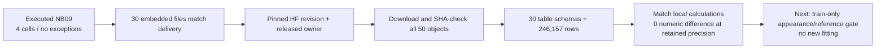

# NB09 — completed on Kaggle and independently HF-verified

**30 October 2026. No NB09 rerun is needed.** All four code cells completed
without a notebook exception. The direct-file review is published and its
writer lease is released. The next work is the separate training-only
appearance/reference gate; no new model fit or workstation change follows
automatically from this publication.

## Execution and identities

| Item | Verified value |
|---|---|
| Executed notebook SHA-256 | `5aa7e27dd416c0e3f93f302a065022150d75bd889c818caff308890d62c6dc5f` |
| Earlier clean delivery SHA-256 | `29b41a79fa3692cd807e5a2a0f6f806a5fe7d1395ee5201b8a0a22b602d9b678` |
| Embedded source/assets | All **30 files** match the delivered payload |
| Kaggle review contract | `49e2f589866852cc7ad2d92d393b572de5d625d906f274ccf406830baf6186dd` |
| Pinned HF publication | `93d7ea34c5539769d122330141f96b1a23083b7a` |
| Published content | **50 verified objects + manifest = 51 direct files**, 70,104,685 object bytes |
| Tables | **30 CSV tables / 246,157 derived rows** |
| Explorer | 1,030 unique image/checkpoint/intervention records; 18 literal references |
| Model work | Zero forward passes or optimizer updates in NB09 |
| New independent tyres | Zero; this is derived evidence from the existing cohort |

[Preserved execution](tread_two/nb09_completion/5aa7e27dd416/executed.ipynb),
[safe inspection](tread_two/nb09_completion/5aa7e27dd416/INSPECTION.json),
[independent verification](tread_two/nb09_completion/5aa7e27dd416/VERIFICATION.json).

## What was independently verified

| Check | Result / exact boundary |
|---|---|
| Direct object bytes | Every object size and SHA-256 matches the pinned manifest |
| Contract/source | Canonical contract hash matches the namespace; all three review code files match the local delivery |
| Scientific CSVs | All 30 row counts and column orders checked; text columns agree; maximum absolute numeric difference from local tables **0** at saved precision |
| Endpoint interpretation | Both identity endpoints retain BA50%, 62 low→mid / 41 high→high |
| Figures | All three PNG files pass image-integrity checks |
| Interactive payload | 1,030 unique endpoint/variant/image keys and 18 references; no new browser-render claim |
| Owner/publication | Published receipt and independently fetched owner agree: owner null, expiry zero |
| Formats | No ZIP, NPZ or database in the published manifest |
| Audit access | Public reads only; no local token lookup, secret-file read or remote write |

The Kaggle review environment is Python **3.13.15**, NumPy **2.1.3**, pandas
**2.3.3**. The local derivation used Python 3.11.15 / NumPy 2.4.6 / pandas
3.0.3. Review contracts intentionally include environment and artifact hashes,
so the Kaggle contract differs from the local prepared `feb83056…` contract.
This is not a new training protocol or unexplained scientific result change.
The CSV comparisons agree at the retained precision. The setup pip messages
about unused Gradio/Diffusers/Transformers dependencies were nonfatal; no
model-package repair is required for this completed notebook.

## Original fit: distinguish science from restored-session metadata

At the NB09 publication revision, the fit's current manifest differs from the
earlier `82e7e1c…` manifest in administrative/history entries. **All 1,177
scientific/source/native-state objects compared are unchanged**, including
CSV families, native checkpoints, source code and `state.pt`.

| Observed difference | Interpretation |
|---|---|
| Current cursor/status, capacity and preparation/receipt metadata | Completion/restore verification can refresh administrative records |
| Previous lifecycle, HTTP, remote and repair logs under `session_history/` | Prior records survive with content-addressed names |
| Previous top-level commit timing CSV now under its hashed history name | Original bytes retained; do not interpret its absence at the top level as lost training measurements |
| State-version local-presence flags | A fresh installation has different local retention locations; native science is unchanged |

The audit records every actual manifest difference. It does **not** claim the
entire current fit manifest is byte-identical. NB09 itself reads its declared
pinned original revision, and its publication code writes only the new review
namespace. No additional model fit is indicated by these metadata differences.

## Retained scientific conclusion

The [full findings](phase3TreadTwoFindings.md) remain unchanged: training online
accuracy is perfect from epoch four, validation BA stays 50%, and the low tyre
is mapped to mid references. Grayscale and final-checkpoint dimming expose
appearance sensitivity. Selected NLL1.17830 improves on the frozen control's
1.38694, while final NLL1.42830 is worse; class choices remain unchanged.
Exact additive reconstruction establishes accounting, not causal wear reasoning.

## Next action

Proceed with the **training-only appearance/reference gate**, preserving the
frozen selected classifier and original dense anchor. Examine fixed appearance
changes, a local-contrast representation, distinct-view reference proposals and
remaining query coverage. No validation/test pixels choose a proposed bank or
feature rule. The proposal is not installed in v1, and any later training gets
a separately frozen source/recipe/namespace. Existing data only; no new photos.

[Published HF review](https://huggingface.co/datasets/Shanmuk4622/tyre-wear-study/tree/93d7ea34c5539769d122330141f96b1a23083b7a/phase3/tread-two/atlas-v1/review/49e2f589866852cc7ad2d92d393b572de5d625d906f274ccf406830baf6186dd).
