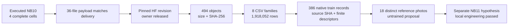
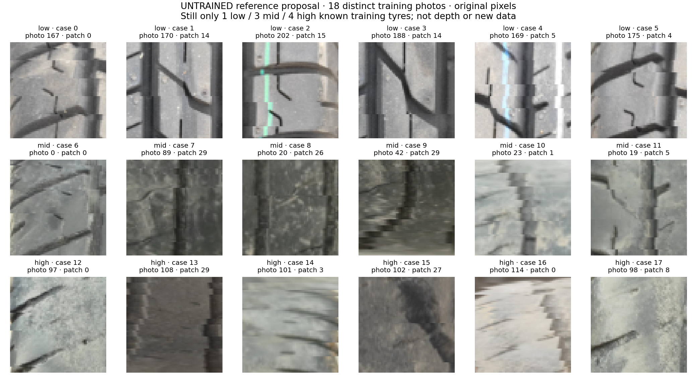

# NB10 — completed, independently verified, and closed

**30 October2026. No NB10 rerun is needed.** The user-executed notebook completed
all four code cells without an exception. Its training-only gate is published
on HF with released ownership. Independent public reads verified every object,
all raw scientific row counts and all386 native training records. The next step
is the separately frozen **ATLAS-LC r2 / NB11**; r2 accuracy is still unmeasured.

## Exact evidence identities

| Item | Verified value |
|---|---|
| Executed notebook SHA-256 | `499c84cf128a7b857ec97b9525b1bdf5bac623d9ee4f0206327cd38a92a72d26` |
| Pinned HF revision | `62929d235027d3f188174d7f080a034c394afab3` |
| Kaggle gate contract | `e6111242ddccc489ec9b138fc4202c19fe880a1da68a36244a92872179351844` |
| Objects / direct files including manifest | **494 / 495** |
| Verified object bytes | **1,910,152,183** |
| Scientific records | **1,918,052 rows / eight atomic CSV families** |
| Images / frozen-model observations | **386 / 2,702** |
| Devices | Dense anchor cuda:0 / patch head cuda:1; actual **Tesla T4 ×2** |
| Optimizer updates / held-out forwards / new independent tyres | **0 / 0 / 0** |
| Candidate bank |18 unique source-photo SHAs,six/class; known physical-tyre support1/3/4 |
| Publication ownership | Released; no ZIP/NPZ/database artifact |
| Independent audit access | Public read only; no local credentials or remote writes |

[Pinned HF publication](https://huggingface.co/datasets/Shanmuk4622/tyre-wear-study/tree/62929d235027d3f188174d7f080a034c394afab3/phase3/tread-two/atlas-v1/appearance-gate/e6111242ddccc489ec9b138fc4202c19fe880a1da68a36244a92872179351844), [preserved execution](tread_two/nb10_completion/499c84cf128a/executed.ipynb),
[safe inspection](tread_two/nb10_completion/499c84cf128a/INSPECTION.json), [independent verification](tread_two/nb10_completion/499c84cf128a/VERIFICATION.json),
[remote manifest](tread_two/nb10_completion/499c84cf128a/REMOTE_MANIFEST.json), [local/Kaggle distinction](tread_two/nb10_completion/499c84cf128a/LOCAL_COMPARISON.json).

## What the audit checked

The audit recomputed the canonical contract digest, checked source-code hashes,
cursor/state hash, probability normalization/argmax/correctness, seven probes per
image, role/source consistency, native descriptor finiteness, candidate array
shape/finite values and the complete386-case/18-reference report payload.
Hash verification is exhaustive for the publication. This audit does **not**
claim an independent rerun of every T4 forward, every feature statistic or every
logit reconstruction; the earlier local full gate reconstructed8,106 logits.
The newly downloaded Kaggle viewer's controls are separately checked in handoff.

| Scientific family | Independently recounted rows |
|---|---:|
| `source_train` | 386 |
| `patch_quality` | 12,352 |
| `predictions` | 2,702 |
| `patch_evidence` | 259,392 |
| `affinities` | 1,556,352 |
| `feature_consistency` | 86,464 |
| `execution` | 386 |
| `candidate_bank` | 18 |

No fitting occurred. `epoch_0000…0008` partition names are reusable-store image
blocks here, not training epochs. Nonfatal setup dependency warnings did not
stop execution; no Torch/CUDA/package repair is needed for completed NB10.

## Scientific reading: train probes are not held-out success

| Cohort | Probe | Images | Accuracy | Observed-class BA | NLL |
|---|---|---:|---:|---:|---:|
| support_photo | grayscale_both | 8 | 75.000% | 83.333% | 0.759870 |
| support_photo | identity | 8 | 100.000% | 100.000% | 0.442092 |
| v1_query | grayscale_both | 378 | 99.206% | 98.485% | 0.594621 |
| v1_query | identity | 378 | 100.000% | 100.000% | 0.424041 |

These are the frozen v1 head's **training-only** probes. The earlier preserved
selected/final development endpoint still has BA50%,62low→mid/41high→high.
Strong training-probe scores do not repair that transfer failure. Training low
support remains one physical tyre; neither seven views nor repeated draws adds
independent subjects. The18-photo bank passes structural rules, not a human
artifact-free or clinically meaningful texture assessment.

## Fixed LC representation probe

Relative L2 is summarized only over the explicitly **unclipped patch subset**.
The low brightening subset is small; do not extend it to every patch. These are
fixed-feature stability measurements, not a trained LC classifier's scores.

| Probe | Proxy class | Unclipped / all patches | RGB median relative L2 | LC median relative L2 |
|---|---|---:|---:|---:|
| brightness_080 | 0 | 2,144/2,144 | 0.20000 | 0.04434 |
| brightness_080 | 1 | 7,875/7,968 | 0.20000 | 0.06989 |
| brightness_080 | 2 | 2,240/2,240 | 0.20000 | 0.05434 |
| brightness_120 | 0 | 337/2,144 | 0.20000 | 0.02304 |
| brightness_120 | 1 | 6,329/7,968 | 0.20000 | 0.05164 |
| brightness_120 | 2 | 1,630/2,240 | 0.20000 | 0.01993 |
| gamma_080 | 0 | 2,144/2,144 | 0.11698 | 0.03821 |
| gamma_080 | 1 | 7,875/7,968 | 0.16861 | 0.02615 |
| gamma_080 | 2 | 2,240/2,240 | 0.16289 | 0.01695 |
| gamma_120 | 0 | 2,144/2,144 | 0.10022 | 0.03238 |
| gamma_120 | 1 | 7,875/7,968 | 0.14231 | 0.02193 |
| gamma_120 | 2 | 2,240/2,240 | 0.13920 | 0.01313 |
| grayscale_both | 0 | 2,144/2,144 | 0.02803 | 0.00000 |
| grayscale_both | 1 | 7,875/7,968 | 0.03214 | 0.00000 |
| grayscale_both | 2 | 2,240/2,240 | 0.03896 | 0.00000 |
| identity | 0 | 2,144/2,144 | 0.00000 | 0.00000 |
| identity | 1 | 7,875/7,968 | 0.00000 | 0.00000 |
| identity | 2 | 2,240/2,240 | 0.00000 | 0.00000 |
| query_grayscale | 0 | 2,144/2,144 | 0.02803 | 0.00000 |
| query_grayscale | 1 | 7,875/7,968 | 0.03214 | 0.00000 |
| query_grayscale | 2 | 2,240/2,240 | 0.03896 | 0.00000 |

[Interactive386-image Kaggle gate explorer](tread_two/nb10_completion/499c84cf128a/remote/report/Training_Gate_Explorer.html).
The local and Kaggle candidate source-SHA/patch order match: **True**.
Numeric environments differ; no cross-environment byte-identity claim is made.
See the retained report CSVs for exact environment-specific measurements.

## Decision and next action

The gate justifies testing a separately versioned representation/reference
policy. Simply excluding all18photos would reduce queries378→368 and leave two
high groups with one original query photo. r2 instead keeps all386 train images,
uses full-source SHA self exclusion with6/n support normalization, sqrt-size
group sampling and paired appearance losses. This combines motivated changes;
it is not an isolated causal ablation or a promised accuracy improvement.

| Work item | Current state |
|---|---|
| NB08 measured fit / NB09 review / NB10 gate | Completed and independently HF-verified |
| ATLAS-LC r2 model,data,loss,telemetry,recovery | Implemented in a separate source/namespace |
| Local actual batch8 recovery | Four updates; uninterrupted/pause/abrupt/native restore equal across24CSV families |
| Packaged notebook |31embedded files; actual extracted worker matches reference; five unexecuted code cells |
| Local output projection |15,015,649,644bytes,passes16GB guard; Kaggle must remeasure |
| Actual r2 T4×2/live-HF preflight and60epoch fit | Pending user Kaggle execution |
| Workstations | Preserved; no candidate installed |

Run [NB11](notebooks/phase3_NB11_TREAD_TWO_ATLAS_LC_Resumable_Pilot.ipynb) with
T4×2,Internet,existing expanded Kaggle input and HF_TOKEN. Details:
[architecture and illustrated motivation](phase3TreadTwoLCArchitecture.md),
[protocol/recovery/storage](phase3TreadTwoLCProtocol.md),
[run guide](tread_two/lc_pilot/README.md), [24-family/285-column schema](tread_two/lc_pilot/SCHEMA.md).
