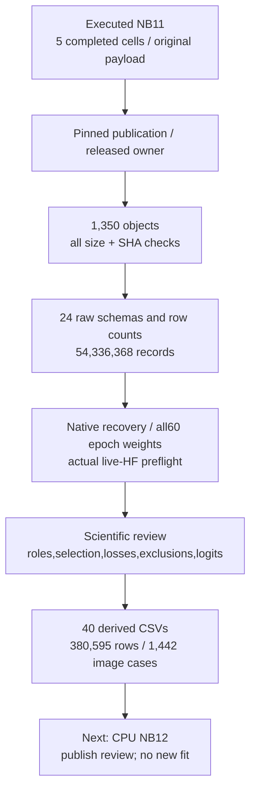
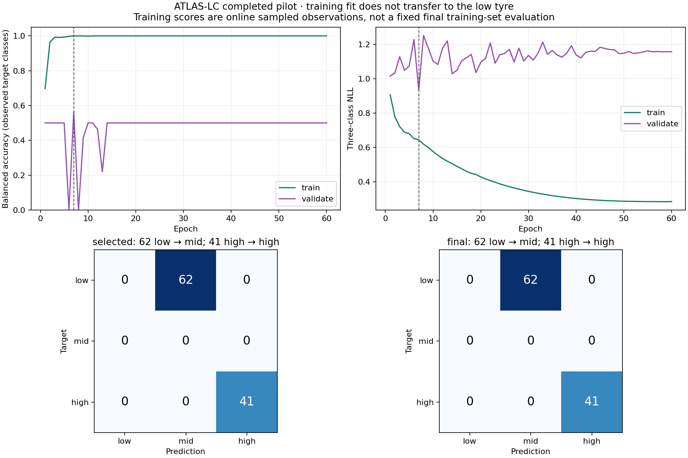
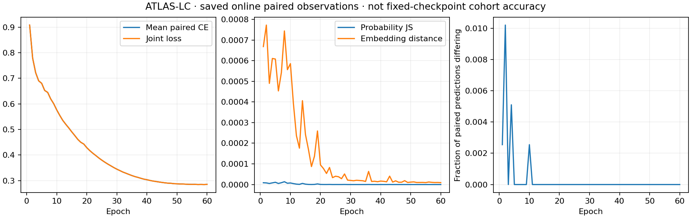

# NB11 — completed ATLAS-LC r2, independently HF-verified

**30 October 2026. The fit is complete; no NB11 rerun is needed.** All five
notebook cells completed without a notebook exception. The actual dual-T4/live-HF
recovery preflight passed, followed by 60 epochs / 2,940 optimizer updates,
selected/final evaluation and all six diagnostics. The publication owner is released.

**The scientific outcome is mixed:** validation BA reached **56.25%**, selecting
epoch **7** by the frozen rule. The historical endpoint still has **50% BA**,
with **62 low→mid / 41 high→high** at both selected and final checkpoints.
Stability and probability loss improved over v1, while low-tyre recognition did
not. The candidate is not promoted or installed in either workstation.

## Execution and publication identities

| Item | Independently checked value |
|---|---|
| Supplied executed notebook SHA-256 | `16fa0443f902bc29c1995da93bbb0bff6b54731001a9da2a38b2cd82576d8c18` |
| Pinned HF revision | `3d5ae39602c3b25caa6af65c1e8d45f53a08e1c8` |
| Measured protocol | `ae918ce787775192ce38031936cbfd8285b51b72fbbedb1da570c9271018eb28` |
| Publication | **1,350 objects + manifest = 1,351 direct files** |
| Object bytes | **5,284,498,352**; all downloaded bytes checked by size and SHA-256 |
| Scientific rows | **54,336,368** across all 24 raw CSV families |
| Classifier observations | 53,342, including 47,040 online training views |
| Training | One seed; 60 epochs / 2,940 completed updates; all 60 epoch weights retained |
| Actual devices | Tesla T4 ×2; optimizer on GPU0, immutable evaluation on GPU1 |
| State | Completed; native state hash/cursors/orders/fixed bank/finite values checked |
| Independent subjects | No new tyres; training known low/mid/high support remains 1/3/4 |
| Audit access | Public reads only; no local credential lookup or remote writes |

[Pinned HF publication](https://huggingface.co/datasets/Shanmuk4622/tyre-wear-study/tree/3d5ae39602c3b25caa6af65c1e8d45f53a08e1c8/phase3/tread-two/atlas-lc-r2/fit/ae918ce787775192ce38031936cbfd8285b51b72fbbedb1da570c9271018eb28),
[preserved execution](tread_two/nb11_completion/16fa0443f902/executed.ipynb), [inspection](tread_two/nb11_completion/16fa0443f902/INSPECTION.json),
[full verification](tread_two/nb11_completion/16fa0443f902/VERIFICATION.json), [manifest](tread_two/nb11_completion/16fa0443f902/REMOTE_MANIFEST.json).

All 31 embedded files match the delivered payload; all 30 frozen runtime/assets
remain unchanged. Initial unused-package dependency warnings were nonfatal.
No speculative repair, environment replacement or training restart is needed.

## What was checked

Every raw CSV header and row count was independently read and compared with its
native cursor. The native completed state has all 60 deterministic epoch orders,
all 570 deduplicated dense-image identities, exact reference buffers and matching
scientific cursors. All 60 checkpoint objects exist and their bytes were hashed.
This does not mean all 60 models were rerun locally; no new model forward was used.

| Raw family | Recounted rows |
|---|---:|
| `source_images` | 570 |
| `bank_cases` | 18 |
| `bank_pixels` | 221,184 |
| `predictions` | 53,342 |
| `sample_exposures` | 47,040 |
| `affinities` | 30,724,992 |
| `patch_support` | 1,706,944 |
| `patch_evidence` | 5,120,832 |
| `coefficients` | 170,578 |
| `reference_embeddings` | 107,136 |
| `train_updates` | 2,940 |
| `parameter_gradients` | 64,680 |
| `dense_pixels` | 14,008,320 |
| `atlas_rows` | 291,840 |
| `dense_regions` | 1,140 |
| `dense_points` | 3,420 |
| `metrics` | 40,882 |
| `confusion` | 15,876 |
| `calibration_bins` | 17,640 |
| `selection` | 60 |
| `explanation_checks` | 618 |
| `case_rules` | 960,156 |
| `view_pairs` | 23,520 |
| `view_patch_consistency` | 752,640 |

The separate [scientific analysis receipt](tread_two/lc_analysis_report/ANALYSIS.json)
checks its 696 consumed objects / 295,152,277 bytes. It reconstructs every paired
objective and all endpoint/probe logits. That consumed-subset scope is distinct
from the exhaustive publication-byte and raw-row audit above.

## Results: distinguish scores, recognition and calibration

All rows below use the same previously inspected 103-image low/high endpoint.
The v1 and r2 recipes differ in representation, bank/query policy, sampler and
objective. This is a descriptive comparison, not an isolated-factor experiment.

| Metric | v1 selected, epoch18 | r2 selected, epoch7 | r2 final, epoch60 |
|---|---:|---:|---:|
| Accuracy | 0.398058 | 0.398058 | 0.398058 |
| Observed-class BA | 0.500000 | 0.500000 | 0.500000 |
| NLL ↓ | 1.178296 | 0.961273 | 1.369872 |
| Brier ↓ | 0.711430 | 0.568355 | 0.854731 |
| 10-bin ECE ↓ | 0.162204 | 0.425969 | 0.538923 |

NLL and Brier improve for selected r2, but raw-score ECE worsens from about
0.162 to 0.426. Lower probability loss is not a calibrated-confidence claim.
Neither selected nor final recovers a low endpoint target. Mid recall is
unavailable because this endpoint has no mid targets; it is not recorded as zero.

The frozen dense anchor retains mean two-region Dice **98.418%** and human-point
MAE **1.196% of image width** on the comparable annotated subset. These are
TREAD-ONE outputs; classifier training did not improve the frozen dense model.

## What the new telemetry shows

| Question | Measured answer | Interpretation |
|---|---|---|
| Did both views train consistently? | All 23,520 paired objectives and 2,940 update losses reconstruct; late online accuracy is 100% | Fits repeated, correlated training observations; not fixed-checkpoint generalization |
| Were self references actually suppressed? | **4,882** blocked view/reference rows; all 960,156 permission/scaling rows match full source SHA | Identical-photo support was blocked without query labels; same-tyre similarity remains possible |
| Did all queries participate? | All **386** eligible images were drawn; **423** is the largest observed per-image draw count | Softer repetition succeeded operationally; no new independent subjects |
| Are fixed appearance probes more stable? | Zero prediction flips across all **1,236** diagnostics | Preserves predictions, including the same wrong low predictions |
| Does grayscale stability prove learned invariance? | Changes are only FP32-scale; LC already uses channel-mean luminance | Largely a construction property; do not credit the paired loss alone |
| Are explanations arithmetically valid? | All **1,442** endpoint/probe logits reconstruct within 2e−6; occlusion indices and saved reference sums agree | Exact signed evidence is model accounting, not physical causal-wear proof |

The weighted consistency terms were already small relative to CE at the start.
The plotted joint/CE curves nearly overlap. Their separate contribution cannot
be isolated from LC, the new bank and changed sampling in this bundled pilot.
The persistent train/held-out gap is observed; a unique causal explanation such
as paint, camera, identity or groove texture has not been established.

## Decision and next step

1. Close the measured NB11 fit and preserve its exact source, checkpoints and
   namespace. Do not train longer or choose another test-scoring epoch.
2. Keep this candidate as a completed research result; do not promote its
   classifier or change either workstation.
3. Run [CPU NB12](notebooks/phase3_NB12_TREAD_TWO_ATLAS_LC_Completed_Review.ipynb)
   to reproduce and publish the saved-evidence review in a separate HF namespace.
   It makes no model forwards and needs no tyre dataset attachment or GPU.
4. Review the complete failure/reference evidence before freezing any third fit.
   No additional tyre photography is required or planned for this scope.

[Interactive 1,442-case review](tread_two/lc_analysis_report/ATLAS_Failure_Explorer.html),
[40-table CSV inventory](tread_two/lc_analysis_report/CSV_INDEX.md),
[calculation methods](tread_two/lc_analysis_report/METHODS.md),
[CPU run guide](tread_two/lc_review/README.md),
[local/package validation](tread_two/lc_review_validation/PACKAGE_VALIDATION.json).

NB12 is implemented and locally checked, including fresh extracted-code equality,
cache corruption recovery, viewer controls and offline publication/release/rerun.
Actual NB12 Kaggle execution and its HF review publication remain pending.
The raw NB11 evidence is already published; this next step adds readable derived
records rather than repeating training.
