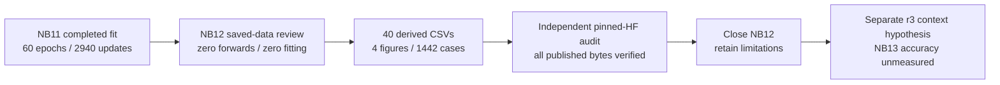
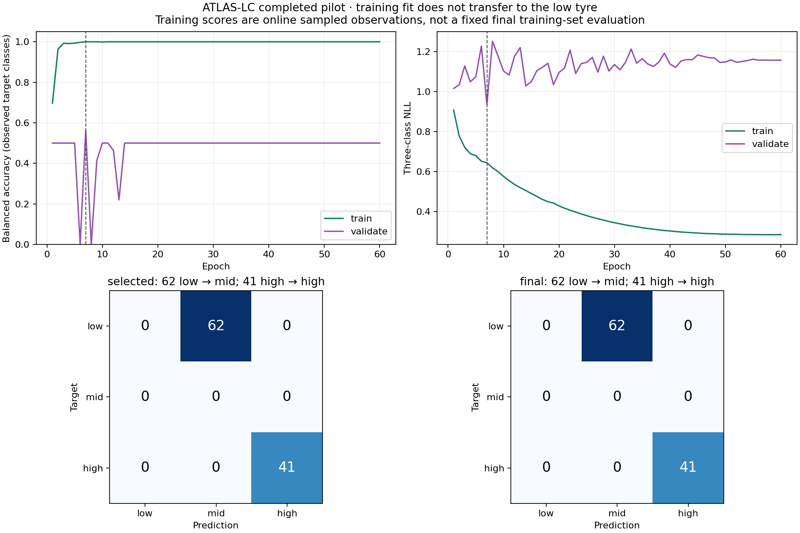
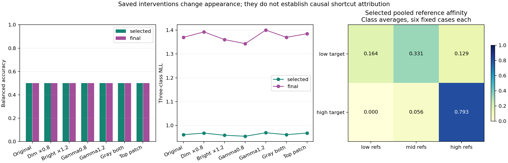
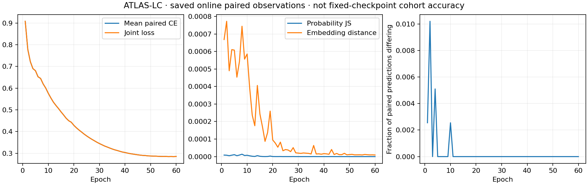
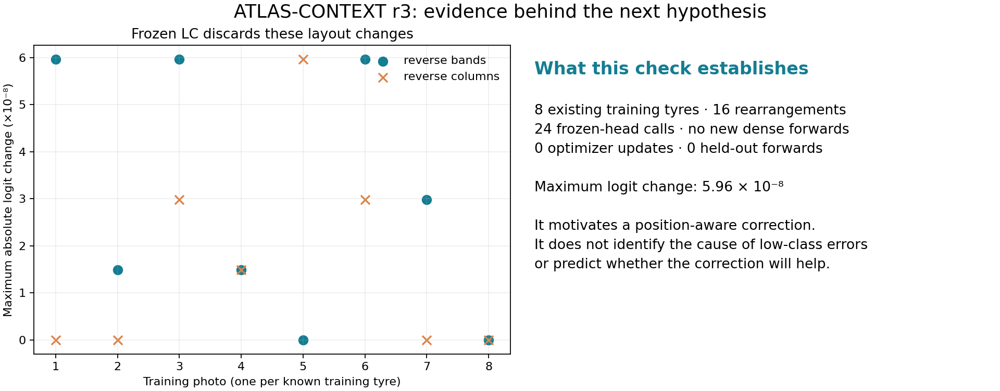

# NB12 completed — ATLAS-LC saved-evidence review

<!-- NB13_COMPLETED_20261101 -->
## Later status — 1 November 2026

NB12 remains completed and preserved. Its proposed NB13 hypothesis has now been trained and independently verified through NB13A: 60 epochs / 2,940 updates, no low-class improvement and worse probability loss. [Measured completion](phase3NB13Completion.md). Current next action is [NB14 CPU review](notebooks/phase3_NB14_TREAD_TWO_CONTEXT_Completed_Review.ipynb), [run guide](tread_two/context_review/README.md). The NB13 unmeasured/next statements below describe the 30 October decision, not today's status.
<!-- END_NB13_COMPLETED_20261101 -->

**30 October 2026. The supplied executed NB12 is complete and independently HF-verified. No rerun is needed.** Its four cells finished without errors. The review adds derived evidence; it performs zero model forwards and zero training updates. The original 60-epoch NB11 fit is preserved.

## Publication receipt

| Check | Verified result |
|---|---|
| Executed notebook | `0361322540878593f7e16066bd28c7d21899b01576936da33f1c389582937980` |
| Embedded delivery | All 39 payload files match; all four code cells completed |
| Pinned HF revision | `77d03303a9d42f89bfd3fbc567faedf86b09a855` |
| Review contract | `7e2856500bbd1a9dd76e0057d82642dd7601cb9e23d02f9f52afebc784c4af7e` |
| Direct publication | 63 files including manifest; all 62 object sizes and SHA-256 values checked |
| Verified payload | 112,895,999 bytes |
| Scientific tables | 40 CSVs / 380,595 rows |
| Visual review | Four PNG figures; 1,442 endpoint/probe cases and 18 reference cards |
| Independent table comparison | Every table's rows/columns/text/numbers checked; maximum numeric difference 0 at retained precision |
| Original fit preservation | All 1,350 NB11 manifest entries unchanged at the review revision |
| Writer | Released ownership |
| Local audit | Public reads only; no credential files read and no remote writes |

[Machine verification](tread_two/nb12_completion/036132254087/VERIFICATION.json), [input inspection](tread_two/nb12_completion/036132254087/INSPECTION.json), [published manifest](tread_two/nb12_completion/036132254087/REMOTE_MANIFEST.json), [HF tree at verified revision](https://huggingface.co/datasets/Shanmuk4622/tyre-wear-study/tree/77d03303a9d42f89bfd3fbc567faedf86b09a855/phase3/tread-two/atlas-lc-r2/review/7e2856500bbd1a9dd76e0057d82642dd7601cb9e23d02f9f52afebc784c4af7e).

The remote review used Python 3.13.15 / NumPy 2.1.3 / pandas 2.3.3; local reconstruction used Python 3.11.15 / NumPy 2.4.6 / pandas 3.0.3. Exact retained-precision table agreement was checked rather than assumed across those environments. The review reads 696 saved scientific inputs. Exhaustive verification of the original 54,336,368 raw rows belongs to the separate [NB11 audit](phase3NB11Completion.md), not to a claim that NB12 recomputed every raw family.

## What the completed evidence says

The local-contrast revision solved a particular appearance-sensitivity problem in the saved probes. It did not solve low-class recognition. At both selected and final endpoints, all 62 low images still become mid and all 41 high images remain high. There are no mid ground-truth endpoint images, so observed-class balanced accuracy averages only low/high recall.

| Historical endpoint metric | v1 selected | LC selected, epoch 7 | LC final, epoch 60 |
|---|---:|---:|---:|
| Observed-class balanced accuracy | 50.00% | 50.00% | 50.00% |
| Accuracy | 39.806% | 39.806% | 39.806% |
| Low recall | 0/62 | 0/62 | 0/62 |
| High recall | 41/41 | 41/41 | 41/41 |
| Three-class NLL, lower is better | 1.178296 | 0.961273 | 1.369872 |
| Brier, lower is better | 0.711430 | 0.568355 | 0.854731 |
| ECE, 10 equal-width bins | 0.162204 | 0.425969 | 0.538923 |

LC's selected NLL/Brier are better; selected ECE is worse. These results support distinct conclusions about probability loss and raw-score calibration. They do not justify promotion. Validation selected epoch 7 / update 343 using the declared BA→NLL→earliest rule, with validation BA 56.25% and NLL 0.934841. Final weights must not replace it based on a test preference.

All six predeclared probe types produced zero argmax flips at both LC endpoints. Their scores still move: final gamma 1.2 changed a class probability by up to 0.03686; selected top-patch occlusion by up to 0.00987. Grayscale stability follows from the representation by construction. Small perturbation sensitivity and useful discrimination are different questions.

The sampling evidence is also stronger than v1: all 386 training queries were drawn, with 23,520 draws / 47,040 correlated view observations. The largest image exposure was 423 draws, versus 1,948 in v1. Full source-SHA exclusion blocked 4,882 view-reference rows, equivalent to 2,441 paired draws. Better coverage and correct self exclusion did not remove cohort/identity shortcuts or create more independent tyres.

Use the [40-table dictionary](tread_two/lc_analysis_report/CSV_INDEX.md), [methods](tread_two/lc_analysis_report/METHODS.md), and [interactive failure explorer](tread_two/lc_analysis_report/ATLAS_Failure_Explorer.html) for the full evidence. The large explorer/row tables are published on HF and excluded from Git; compact summaries and curated figures stay versioned.

## Next hypothesis and decision

The previous classifiers aggregate patch/reference evidence through a shared local encoder and equal-band pooling. That calculation cannot distinguish arbitrary reordering of bands or columns within a band when the corresponding local features/support move together. A new training-only check used one saved photo from each of eight known training tyres: 16 rearrangements changed LC logits by at most 5.96×10⁻⁸. This identifies a representational limitation, not the cause of the endpoint failures.

The next isolated candidate is **ATLAS-CONTEXT r3 / NB13**. It freezes the original validation-selected LC epoch 7 and learns a bounded position-aware residual. Initial predictions match LC exactly. [Architecture](phase3TreadTwoContextArchitecture.md), [frozen protocol](phase3TreadTwoContextProtocol.md), [CSV schema](phase3TreadTwoContextEvidenceSchema.md), [engineering checks](phase3TreadTwoContextValidation.md), [Kaggle instructions](tread_two/context_pilot/README.md).

Its accuracy is unmeasured. No new photos, repeated old fit, test-selected base, or workstation change was introduced. The old historical test has already informed development and remains development evidence, not an independent confirmation set. Proxy classes are not physical wear, depth or safety labels.
