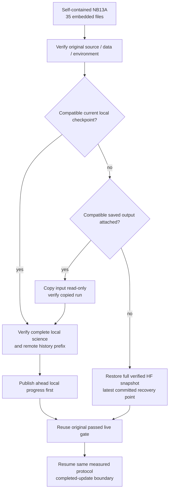

# NB13A repair — recover when local working files are unavailable

<!-- NB13_COMPLETED_20261101 -->
## Superseding measured outcome — 1 November 2026

**NB13A completed and independently HF-verified:** actual recovery restored update **2,486** and reached **60 epochs / 2,940 updates** under the original protocol. All 1,503 direct files / 58,176,066 raw CSV rows, native/CSV history and all 60 unchanged frozen-prior epoch states verified; writer released. [Completion, figures and findings](phase3NB13Completion.md).

Do not rerun NB13/NB13A. Context did not repair low recall and worsened NLL; candidate remains unpromoted. Next is [NB14 CPU saved-data review](notebooks/phase3_NB14_TREAD_TWO_CONTEXT_Completed_Review.ipynb), [run guide](tread_two/context_review/README.md). Actual NB14 execution/publication pending. Earlier partial positions and pending gates in this document are dated history, preserved to explain the experiment and repair.
<!-- END_NB13_COMPLETED_20261101 -->

**31 October 2026. The supplied error is identified and fixed in the same NB13A filename, revision 2.** Run the revised notebook directly with **Run All** on Kaggle. The original 32-file model/runtime, measured protocol, scientific CSV schema and HF namespace remain unchanged.

## Actual failure and cause

| Observed item | Evidence |
|---|---|
| Supplied executed NB13A | SHA `b5a4dd68b4c1882ac5723c4ce0e0bdba5d1733b71ff1ac72fd599c14fdb0bdda` |
| First cell error | `AssertionError: Existing NB13 working files are required. Keep the old session; do not reset it.` |
| Second cell error | `AssertionError: Do not start a new empty session.` |
| Missing path | `/kaggle/working/tread_two_atlas_context_r3/run/POINTER.json` |
| Cause | Revision 1 required the original session's local checkpoint; that checkpoint is not accessible at the expected path in this execution |
| Execution boundary | Both assertions happened before recovery, fitting, credential retrieval or HF publication |
| What this establishes | A local-file availability error in NB13A, not a model/optimizer failure |
| What remains unresolved | The precise cause of the earlier NB13 freeze; its saved output has no traceback |

The evidence does not establish whether the older working files still exist in another session or saved output. They must not be assumed lost or remotely saved. [Archived inspection](tread_two/context_validation/nb13_status/nb13a_errors/b5a4dd68b4c1/INSPECTION.json) preserves both errors; the supplied notebook, old launcher, old generator and prior delivery/check receipts are archived alongside it. The requested notebook was then replaced by a clean repaired delivery. Original executed NB13 remains preserved.

## Verified recovery position

The latest bounded public HF check at **31 October 2026, 14:34 IST** still reports revision `2d148d17346f7bf0e2404127a5f88b212bfcb52a`, with the same partial fit manifest. The [verified native/control checkpoint](tread_two/context_validation/nb13_status/e0c714be2aba/CHECKPOINT_VERIFICATION.json) is at **1,294 / 2,940 updates**, epoch 27, cursor 20, phase train. Model/optimizer tensors are finite; the actual dual-T4/live-HF engineering preflight passed. The earlier notebook output printed local update 2,467, which is not the remotely verified recovery point.

The local audit verified 15 diagnostic/native/control objects, not all 798 snapshot objects. During actual remote recovery, the original downloader/Store verify the complete selected snapshot, native state, raw CSV chunks, artifacts, ledger and row cursors before continuing. Unsent updates after 1,294 can only be recovered from a surviving local or saved output tree. No missing progress or metrics are fabricated.

## Revision 2 behavior

| Area | Revision 1 | Revision 2 |
|---|---|---|
| Startup without local pointer | Assertion stops execution | Rebuild frozen source/bootstrap, then recover from a saved output or HF |
| Distribution | Small companion dependent on old workspace | Self-contained 35-file payload: 33 original runtime/inventory files, launcher and original contract |
| Current local state | Required | Preferred and verified; ahead state published before more fitting |
| Attached saved notebook output | Not discovered | Compatible complete `run/` tree is found by pointer/contract/native identity and copied into writable output |
| No accessible local/saved run | Refused | Full verified remote snapshot restored; absence of a matching remote checkpoint still refuses a fresh fit |
| Existing unanchored partial directory | Not handled by bootstrap | Preserved under a uniquely named `NB13_RECOVERY/PRESERVED_PARTIAL_RUN_*` before restore |
| Environment / model changes | Rejected | Still rejected; environment mismatch JSON explains differing fields |
| Preflight | Expected already-local receipt | Original hash-verified passed HF gate receipt reused, without another fit fixture |

The external launcher is `nb13-recovery-20261031-r2`, stored separately from frozen model source. It keeps the prior 15-second phase heartbeat, three-minute local thread stacks, bounded otherwise-unconfigured HTTP timeouts, existing shared rate/commit budgets, server backoff, ownership fencing and direct CSV/native publication. No ZIP/NPZ/database payload is introduced. Native recovery still restores model, optimizer, scheduler, scaler, RNG, deterministic sample order, partial statistics and completed-update cursors.

## Run the repaired file

1. Open/upload the updated [NB13A](notebooks/phase3_NB13A_TREAD_TWO_CONTEXT_Existing_Session_Recovery.ipynb). Its historical filename is retained; revision 2 can run as a standalone recovery.
2. Select **GPU T4 ×2**, **Internet ON**, and enable Kaggle Secret **HF_TOKEN** with write access to `Shanmuk4622/tyre-wear-study`.
3. Attach the same **expanded** `shanmuk4622/tire-dataset-prepared-phase2` input. The images stay read-only on Kaggle. No additional photos are needed.
4. If the original session is available, use it to retain newer local progress. Alternatively attach a saved original notebook output containing its complete `run/` directory; the recovery can discover that input. A lone weights file or screenshot is not a full recovery state.
5. Ensure at least **12 GiB free** working output, then choose **Run All**. Do not run a concurrent writer for the same NB13 experiment.
6. Wait through full HF restore/verification. Messages identify the current operation, saved cursor and free disk. Keep this session alive during publication; catchable Stop attempts an immediate flush subject to server backoff.

Cell 1 extracts/verifies frozen runtime and reports whether local state exists. Cell 2 verifies exact original environment/data/upstream weights, selects a compatible recovery path, reuses the passed gate and resumes the original experiment. It does not select a new checkpoint by test score or create a new model/namespace to evade compatibility checks.

## Checks and limits

| Check | Actual result |
|---|---|
| [Recovery checks](tread_two/context_validation/nb13_status/recovery_validation/VALIDATION.json) | **18 offline checks passed**, including empty-session native/CSV restore, missing-remote refusal, saved-output import, partial-tree preservation, gate integrity and environment drift |
| [Actual package setup](tread_two/context_validation/nb13_status/recovery_validation/PACKAGE_VALIDATION.json) | Executed the actual extracted setup cell in an empty fixture directory; succeeds without a pointer; idempotent rerun and retained-pointer handling pass |
| Frozen sources | All original 32 entries/33 payload files byte-identical; source drift rejected without overwrite |
| Model/CSV preservation | Native values and scientific CSV bytes unchanged by local-prefix recovery; corruption/divergence/failed-first-flush checks pass |
| Notebook | Two code cells; 35 embedded files; SHA `9beacdc64b84c69f33131c18c6dfaefaa66739b718f7c934a006afad0e938549` |
| Launcher | SHA `bc74ea98e637575c2b457e59278da712b07fbc3c5c23c54ff981a2910a4b952b` |
| Local fitting/network in recovery tests | Zero model forwards, zero optimizer updates, zero network requests |
| Actual revised Kaggle recovery | Pending user execution; not claimed from local fixtures |

Save the executed repaired NB13A. If it stops, keep `run/console.log`, `NB13_RECOVERY/STATUS.json`, `EVENTS.jsonl`, `THREAD_STACKS.txt`, and any `ENVIRONMENT_MISMATCH.json`. A forced kernel/session loss cannot publish unsent state. Full completion still requires 2,940 updates, declared endpoint/diagnostic evidence, verified final publication and owner release.

[Original NB13 status and audit limits](phase3NB13FreezeAndRecovery.md) · [Frozen protocol](phase3TreadTwoContextProtocol.md) · [27-family CSV dictionary](phase3TreadTwoContextEvidenceSchema.md).
