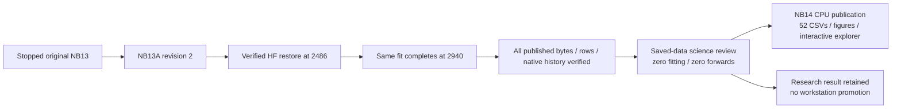
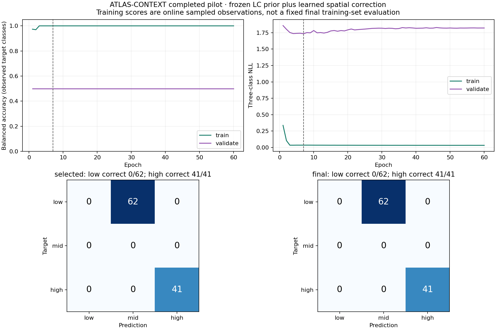
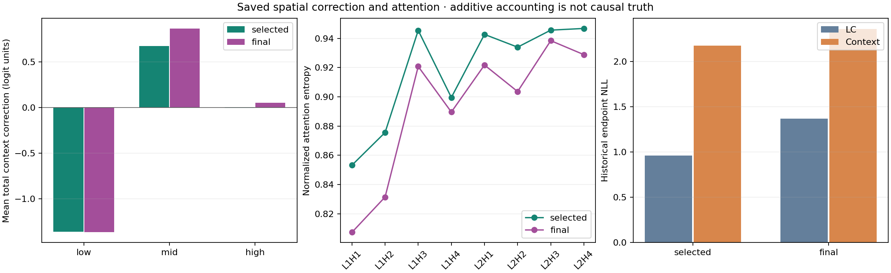
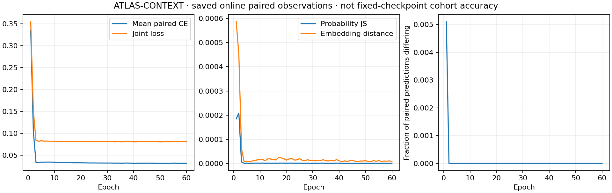

# NB13 / NB13A completed — ATLAS-CONTEXT r3

<!-- NB14_COMPLETED_20261101 -->
## Later measured status — 1 November 2026

**NB14 is completed and independently HF-verified**, not pending: all80directfiles,52CSVs/585,825rows, released owner and unchanged original fit. [Completion](phase3NB14Completion.md). Do not regenerate or rerun its executed notebook. Next is [NB15 existing-data readiness](phase3TreadTwoReadiness.md), [run guide](tread_two/readiness_gate/README.md); actual NB15 publication remains pending. Older pending-NB14 wording below records the prior delivery.
<!-- END_NB14_COMPLETED_20261101 -->

**1 November 2026. The supplied executed NB13A completed recovery and the original fit. Independently verified on Hugging Face; no NB13 or NB13A rerun is needed.** The context candidate remains a research result and is not promoted to either workstation.

## Completion and recovery proof

| Item | Verified evidence |
|---|---|
| Executed NB13A | `8bdf46ec2040a5e69999d38a5d077e8f337702e52f46254efc31e8937e2cf5fa`; two code cells completed, no saved errors |
| Embedded source | All 35 payload files match; all 32 frozen model/runtime entries preserved |
| Measured protocol | `36f473b0886d6c2f49c416436d270198af3982230e3045da9969b0bf42169625` |
| Pinned HF revision | `a44418844ba3f1c98adee2cae76a8bbf9f5f4e9e` |
| Publication | 1,503 direct files including manifest; all 1,502 scientific/control object sizes and SHA-256 values verified |
| Payload | 5,645,673,072 verified bytes; no ZIP publication |
| Scientific CSV | 27 families / **58,176,066 rows**; every raw schema and count verified |
| Completed fit | 60 epochs / **2,940 optimizer updates**; selected epoch 7, update 343 |
| Recovery actually used | HF checkpoint at **2,486 updates**, then 454 remaining updates; original protocol and passed gate reused |
| Native recovery | Model, optimizer, RNG/order/cursors, dense cache and finite-state checks passed; all 60 epoch checkpoints retained |
| Append-only history | 3,913 linked units / 45,852 CSV chunks; hashes, offsets and update sequence 0–2,940 checked |
| Frozen prior | Original validation-selected LC epoch 7 remains bit-identical in every epoch state and final state |
| Ownership | Released: `owner=null`, `expires=0` |
| Actual environment | Tesla T4×2; Python 3.13.15; Torch 2.11.0+cu128; CUDA 12.8; NumPy 2.1.3; Pillow 13.0.0 |
| Independent audit | Public reads, zero local credential reads, zero remote writes, zero model forwards or fitting |

The prior repair documents verified HF update 1,294 on 31 October. That was a dated partial snapshot. The **executed recovery** explicitly restored a newer verified revision at update 2,486. Do not claim that this execution restored 1,294, lost 1,173 updates or started a new experiment. Original freeze cause remains unestablished; the repaired recovery did complete.

[Full byte/raw-row receipt](tread_two/nb13_completion/8bdf46ec2040/VERIFICATION.json) · [ledger/native receipt](tread_two/nb13_completion/8bdf46ec2040/LEDGER_VERIFICATION.json) · [executed output inspection](tread_two/nb13_completion/8bdf46ec2040/INSPECTION.json) · [scientific findings](tread_two/nb13_completion/8bdf46ec2040/SCIENTIFIC_FINDINGS.json) · [published manifest](tread_two/nb13_completion/8bdf46ec2040/REMOTE_MANIFEST.json) · [HF tree at the verified revision](https://huggingface.co/datasets/Shanmuk4622/tyre-wear-study/tree/a44418844ba3f1c98adee2cae76a8bbf9f5f4e9e/phase3/tread-two/atlas-context-r3/fit/36f473b0886d6c2f49c416436d270198af3982230e3045da9969b0bf42169625).

## What the model achieved

The context branch was motivated by the observed order invariance of the previous local-reference pooling. It now responds to token layout, but **this did not improve the measured classification failure**. The unchanged LC branch provides a useful internal comparison: on validation its BA remains 56.25% and NLL 0.934841, while every trained context epoch has BA 50%. The original selection rule chose context epoch 7 with NLL 1.734916. Do not retrospectively replace this with epoch zero or a test-favored epoch.

| Previously inspected historical endpoint | LC selected, epoch 7 | Context selected, epoch 7 | Context final, epoch 60 |
|---|---:|---:|---:|
| Images | 103 | 103 | 103 |
| Observed-class balanced accuracy | 50.00% | 50.00% | 50.00% |
| Accuracy | 39.806% | 39.806% | 39.806% |
| Low recall | 0/62 | 0/62 | 0/62 |
| High recall | 41/41 | 41/41 | 41/41 |
| NLL, lower is better | 0.961273 | 2.174813 | 2.358475 |
| Brier, lower is better | 0.568355 | 1.105581 | 1.129997 |
| ECE, 10 equal-width bins | 0.425969 | 0.552019 | 0.561834 |

All 62 low images become mid; all 41 high images remain high. Selected/final context mean confidence is 95.01% / 95.99%. The learned correction therefore strengthens the existing wrong low→mid decision while improving confidence on already-correct high cases. This is descriptive evidence of harmful probability behavior; it does not identify a specific physical or acquisition shortcut as its cause.

## What the extra evidence tells us

| Question | Saved evidence / interpretation |
|---|---|
| Did sampling cover the training inputs? | All 386 queries were drawn; 23,520 paired draws / 47,040 view observations; maximum 423 draws per image. Repeated views do not create independent tyres. |
| Was self-reference blocked? | All 967,572 permission rows verified; 4,882 view-reference rows blocked, equivalent to 2,441 paired draws; source-SHA rules and 6/n scaling checked independently of target labels. |
| Does context respond to layout? | All 412 reverse-band/column cases preserve frozen prior logits within tolerance. Learned correction changes; maximum final column-reversal class-probability change is 0.087466. |
| Does stable argmax imply unchanged scores? | No. All 16 endpoint/probe groups have zero flips, while layout/occlusion scores move. Final top-patch occlusion changes a probability by up to 0.078925. |
| Is attention a physical explanation? | No. All 1,687,552 saved endpoint values and 1,648 head summaries pass probability/entropy/masking checks. Mean normalized entropy is broad, roughly 0.81–0.95. This records internal attention, not causal wear truth. |
| Is the accounting faithful? | All 53,754 logit/correction observations checked; 1,854 endpoint/probe decompositions reconstruct logits within 3.39e-7, combined patch values within 6.49e-9. |
| Does the paired loss match? | All 23,520 paired objectives, 752,640 patch distances, 47,040 seeded appearance factors and 2,940 update means checked; maximum pair-loss residual 2.59e-7. |
| Was dense geometry retrained? | No. Frozen dense branch retained for all 570 images. Historical endpoint tyre/tread Dice is 0.98485 / 0.98352; human-point MAE is 0.01196 image widths on 150 points from 25 images. These are retained branch results, not context improvements. |

Online sampled training BA reaches 100% from epoch 3. These predictions come from changing pre-update states and repeated paired draws, not one fixed final-model evaluation of all training images. Do not compare them as an independent train/test experiment.

## Retention, scope and missingness

| Scope | Result |
|---|---|
| Exhaustive original publication audit | All 1,502 objects, all 27 raw CSV schemas/counts, all committed chunk/unit hashes, all 60 native epoch identities and frozen prior equality |
| Independent science reconstruction | 876 consumed inputs / 636,534,073 bytes; **52 derived CSVs / 585,825 rows**, five PNGs, 1,854 explorer cases and 206 full endpoint attention matrices |
| Not independently recalculated | Every training affinity value; full raw bytes and counts were audited, while detailed affinity/logit reconstruction covers all selected/final/probe cases |
| Not saved / not invented | Full per-update or probe attention matrices, unmeasured physical wear/depth/safety labels, unseen independent tyres |
| Cohort limits | 570 existing images; 386 train / 81 validation / 103 historical test. Training known-tyre low/mid/high counts 1/3/4; held-out cohorts have no mid targets. |
| Interpretation | Historical held-out data has already informed development; observed-class BA covers low/high only. Attention/evidence accounting and token interventions are not causal validation. |

Raw families and columns: [frozen schema](phase3TreadTwoContextEvidenceSchema.md). Derived tables/columns/units: [CSV index](tread_two/context_analysis_report/CSV_INDEX.md), [dictionary](tread_two/context_analysis_report/table_dictionary.csv), [methods](tread_two/context_analysis_report/METHODS.md). [Interactive explorer](tread_two/context_analysis_report/ATLAS_Failure_Explorer.html) filters endpoint/probe/class/error and separates frozen LC, context and combined evidence; attention layer/head is selectable for the 206 saved identity cases. Large local tables/HTML/cache stay outside Git; NB14 publishes them directly to HF.

## Next: NB14, without another fit

The isolated [NB14 completed review](notebooks/phase3_NB14_TREAD_TWO_CONTEXT_Completed_Review.ipynb) is implemented and locally validated. Use **CPU / None, Internet ON, HF_TOKEN enabled, no image dataset, 4 GiB free and about 8 GB RAM; Run All**. It reads pinned evidence and publishes the new review namespace without touching the completed fit. [Detailed run guide](tread_two/context_review/README.md), [review design and local proof](phase3TreadTwoContextReview.md).

Actual NB14 Kaggle execution and HF review publication remain pending. After verification, close the review and use its evidence to decide whether another explicitly frozen experiment is justified. This result does not justify another blind seed/epoch run or workstation installation. Existing photos only; both workstations preserved.
