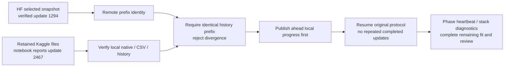

# NB13 — interrupted run, HF verification and retained-session recovery

<!-- NB13_COMPLETED_20261101 -->
## Superseding measured outcome — 1 November 2026

**NB13A completed and independently HF-verified:** actual recovery restored update **2,486** and reached **60 epochs / 2,940 updates** under the original protocol. All 1,503 direct files / 58,176,066 raw CSV rows, native/CSV history and all 60 unchanged frozen-prior epoch states verified; writer released. [Completion, figures and findings](phase3NB13Completion.md).

Do not rerun NB13/NB13A. Context did not repair low recall and worsened NLL; candidate remains unpromoted. Next is [NB14 CPU saved-data review](notebooks/phase3_NB14_TREAD_TWO_CONTEXT_Completed_Review.ipynb), [run guide](tread_two/context_review/README.md). Actual NB14 execution/publication pending. Earlier partial positions and pending gates in this document are dated history, preserved to explain the experiment and repair.
<!-- END_NB13_COMPLETED_20261101 -->

> Superseding recovery update, 31 October 2026: revision 1 failed because local working files were unavailable. [NB13A revision 2](phase3NB13ARepair.md) is now self-contained, prefers retained/attached saved state and otherwise restores the verified HF checkpoint. Use the updated notebook with Run All. Earlier existing-session-only instructions below are historical.

**31 October 2026. NB13 is partially trained, not complete.** The user reports that it becomes unresponsive after some time and confirms the execution is now stopped while the Kaggle session/files remain. Keep those files. The precise cause of the stop is not established by the saved output; no notebook traceback was saved.

## What was actually verified

| Evidence | Observed result | Boundary |
|---|---|---|
| Supplied NB13 | SHA `e0c714be2ababb69f965572e9698d1e2145a90340ab2aa5ad3f7614a786c2f3e` | Preserved byte-identically; no regeneration |
| Frozen payload | All 33 embedded files match the original source inventory | All 32 source/asset entries unchanged |
| Setup / prepare / preflight | First three code cells completed; preflight reused a verified completed proof | Setup pip warnings did not prevent later training |
| Last saved training-cell message | **2,467 / 2,940 updates**, stage train | Notebook output, not direct verification of the current Kaggle native state |
| Last display cell | Not executed | No completion receipt or final endpoint report |
| HF pinned repository revision | `2d148d17346f7bf0e2404127a5f88b212bfcb52a` | Read-only public inspection |
| Measured protocol | `36f473b0886d6c2f49c416436d270198af3982230e3045da9969b0bf42169625` | Same source/data/recipe and active experiment |
| Selected remote recovery snapshot | **1,294 / 2,940 updates**, epoch 27 / within-epoch cursor 20, phase train | Verified native checkpoint and control records |
| HF snapshot manifest | 798 scientific/control/source objects | Full 798-object snapshot was not downloaded or exhaustively audited |
| Diagnostic download | 15 objects / 11,973,539 bytes, every size/SHA checked | Includes native model/optimizer state, source contract, cursors, preflight and recent update/log records |
| Native recovery state | Model and optimizer tensors finite; 27 CSV row-cursor families; 22,810 observations | Does not establish final accuracy or later local tensor state |
| Actual Kaggle preflight | Passed on **Tesla T4 ×2**; native/optimizer/scheduler/scaler/RNG and all 27 CSV families agree; live pinned-HF restore passed | Real engineering proof, not measured fit completion |
| Latest heartbeat | 31 October **10:48:19 IST** | No later commit in the pinned inspected head |
| Recorded owner lease expiry | 31 October **11:33:19 IST**; expired at inspection | Not a clean owner release or proof of a live process; no lease was deleted |

The public inspection was around **14:06 IST**. [Inspection](tread_two/context_validation/nb13_status/e0c714be2aba/INSPECTION.json), [public status](tread_two/context_validation/nb13_status/e0c714be2aba/PUBLIC_STATUS.json), [checkpoint verification](tread_two/context_validation/nb13_status/e0c714be2aba/CHECKPOINT_VERIFICATION.json), [pinned HF run](https://huggingface.co/datasets/Shanmuk4622/tyre-wear-study/tree/2d148d17346f7bf0e2404127a5f88b212bfcb52a/phase3/tread-two/atlas-context-r3/fit/36f473b0886d6c2f49c416436d270198af3982230e3045da9969b0bf42169625).

**The distinction matters:** 1,173 additional update numbers appear in local progress after the remote checkpoint. They must not be treated as remotely protected. A current local native checkpoint may be at 2,467 or later; the first recovery cell reads the actual retained cursor. A new empty Kaggle session would only have the older verified HF recovery point.

## Diagnosis: confirmed gaps and unresolved cause

The original coordinator reports saved training progress while its worker runs. It does not continuously report progress while constructing/verifying a large snapshot, exporting tables/native artifacts, restoring an entire remote snapshot, or waiting inside an HF commit. Those operations can therefore look frozen. Restarting the original launcher also downloads the entire older remote snapshot even when a verified newer local prefix is available.

The saved output contains upload progress and continued training through update 2,467. The pinned HF state remains at 1,294, and no final clean release is present. These observations establish incomplete publication and poor visibility; they do **not** prove a particular HTTP timeout, Xet fault, GPU deadlock, out-of-memory event or numerical failure. The retained local logs/stacks are needed to identify the exact waiting stage if it recurs. The recovery does not claim to have repaired an unobserved model defect.

The actual preflight capacity estimate was 14,372,539,305 bytes below the 16 GB guard. The published update-1,294 snapshot recorded about 1.97 GB logical output and 18.96 GB free at that earlier time. Neither value describes disk/memory at the later stop. The recovery cell reports current free disk and local log tails.

## Recovery delivery and exact instructions

Open [NB13A — existing-session recovery](notebooks/phase3_NB13A_TREAD_TWO_CONTEXT_Existing_Session_Recovery.ipynb). **Copy its two code cells into the bottom of the existing stopped Kaggle NB13 and run them in order.** Keep the same T4×2, expanded Kaggle input, Internet and HF_TOKEN. Do not reset the session or run the original training cell concurrently. Opening NB13A as a new separate Kaggle session will not preserve the old working files; this recovery deliberately refuses an empty run.

| Cell | Behavior |
|---|---|
| 1 — lightweight diagnostic | Read current local pointer/unit, last remote receipt, free disk and bounded safe log tails; no source/data/training mutation |
| 2 — recovery / resume | Verify the exact frozen source and audited protocol; request safe exit of leftover owned run scripts; acquire existing controller/owner locks; verify local science and remote history prefix; flush ahead local progress before fitting; resume original experiment |

Expected directory is `/kaggle/working/tread_two_atlas_context_r3`. If local files are missing or the contract/source/history differs, stop and preserve the diagnostic output. Do not erase state or force a new namespace to bypass the check. An expired remote lease is handled by the inherited CAS claim; live owners are never stolen.

The external [recovery launcher](analysis/nb13_recovery_launcher.py) does not edit any of the 32 frozen runtime/assets, native model values, recipe, sampler, objective, scientific schemas or measured identity. It adds:

- A verified local-history-prefix path that avoids downloading the complete old remote snapshot when compatible local data are already present. Each local committed CSV chunk/native artifact is still verified by the original Store. Remote history/cursor object hashes and exact prefix equality are required; divergent branches are rejected.
- An initial HF publication of ahead local state before the worker resumes. Failure at that step stops further optimizer work; current local evidence remains.
- Phase/status messages every 15 seconds through local verification/export and HF operations, with saved update/stage, elapsed operation time and free disk.
- Read/connect timeouts of 20/150 seconds only for HTTP sends that otherwise had no timeout; existing explicit timeouts, request/commit budgets, server backoff, 80-object batches and ownership fencing remain.
- Local thread stacks every three minutes, without local variables; repair identity/logs included as direct snapshot provenance and retained across verified restores.
- Catchable Stop forwarding and the inherited immediate flush attempt. Forced kernel/session death still cannot publish unsent updates.

This is visibility/recovery orchestration. It does not impose a blanket timeout on the whole multi-file publication, disable safety checks or guarantee HF availability.

## Validation and remaining work

[Offline recovery checks](tread_two/context_validation/nb13_status/recovery_validation/VALIDATION.json) passed: verified local-ahead/equal-prefix paths, publication before fitting, unchanged native/CSV bytes, divergence rejection, failed-first-flush preservation, provenance retention, heartbeat reporting, bounded-default/unchanged-explicit HTTP timeouts, and run-specific stop requests without process killing. No network requests, model forwards or optimizer updates were made by those tests.

[NB13A package](tread_two/context_validation/nb13_status/recovery_validation/NOTEBOOK.json): two code cells; launcher SHA `5421d570b6583c05bc9a63e4e82bd7f1e813fc9cd29b92e08593198a68bb1543`. Actual Kaggle recovery/resume remains pending. Save the executed NB13A and original NB13. If waiting recurs, preserve `NB13_RECOVERY/STATUS.json`, `EVENTS.jsonl`, `THREAD_STACKS.txt`, and `run/console.log`.

After recovery, verify an HF receipt at least as new as the retained local cursor, then allow the remaining original fit/validation/selected/final/diagnostic stages to finish. Only a final completed manifest, 2,940 updates, endpoint evidence and owner release can close NB13. No new model, additional seed, photo acquisition or workstation change is authorized by this status check.
