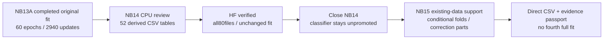
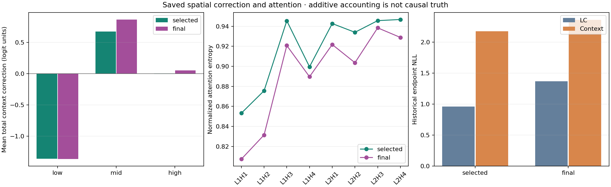

# NB14 complete — ATLAS-CONTEXT saved-results review

<!-- NB15_CLOSED_20261101 -->
## Later closure — 1 November 2026

The proposed NB15 has now completed and is independently HF-verified. [NB15 completion](phase3NB15Completion.md). No NB14/NB15 rerun is needed. The current v1/LC/context experimental series is consolidated in the [research handoff](phase3TreadTwoResearchClosure.md); classifier transfer remains unresolved. Earlier next-NB15 wording below is historical.
<!-- END_NB15_CLOSED_20261101 -->

**1 November 2026. Executed NB14 is complete and independently HF-verified. No rerun is needed.** All four code cells completed without saved errors; all 44 embedded source/metadata payloads match the delivered package. The original NB13 fit remains unchanged.

## Exact publication and verification

| Item | Independently verified result |
|---|---|
| Executed notebook SHA-256 | `356dc7893cc5bfe67368fae758962cd6759afe6f9aa5eecc9d2b5be7d3679c63` |
| HF repository revision | `10c2f16ddf669ca6454cd27ebb306d699dba3d92` |
| Review contract | `793525de3180a2f9025333c4afec219162aaca9a819474c1e60f208bf3e9a5bc` |
| Direct publication | **80 files**, including manifest; all 79 objects verified by size and SHA-256 |
| Verified payload | **217,059,186 bytes**; zero ZIP/NPZ/database artifacts |
| Scientific review | **52 CSVs / 585,825 rows**; all tables byte-identical to independent local reconstruction |
| Numeric comparison | Maximum difference **0** at saved precision; nullable/text values and schemas also checked |
| Visual evidence | Five PNG figures, **1,854** endpoint/probe cases, 18 literal references |
| Attention | 206 full identity endpoint matrices, each 2 layers × 4 heads × 32×32; raw matrices/interactive controls verified |
| Preserved original fit | All **1,502** original manifest entries identical at the review revision |
| Owner | Released; no active writer |
| New work performed by NB14 | Zero model forwards, zero optimizer updates, zero new independent tyres |
| Independent verification | Public reads only; no local credential files read, no remote writes |
| Actual review environment | Python 3.13.15 / NumPy 2.1.3 / pandas 2.3.3 |

[Verification receipt](tread_two/nb14_completion/356dc7893cc5/VERIFICATION.json) · [executed inspection](tread_two/nb14_completion/356dc7893cc5/INSPECTION.json) · [published manifest](tread_two/nb14_completion/356dc7893cc5/REMOTE_MANIFEST.json) · [HF review at the verified revision](https://huggingface.co/datasets/Shanmuk4622/tyre-wear-study/tree/10c2f16ddf669ca6454cd27ebb306d699dba3d92/phase3/tread-two/atlas-context-r3/review/793525de3180a2f9025333c4afec219162aaca9a819474c1e60f208bf3e9a5bc).

Local reconstruction used Python 3.11.15 / NumPy 2.4.6 / pandas 3.0.3. Exact table agreement across these environments was measured, not assumed. Figure files decode correctly. Explorer controls were checked against the actual published JavaScript using a synthetic DOM; this is functional testing, not a claim of native browser screenshot verification.

## Scientific conclusion

The review confirms the prior findings; it does not provide a new accuracy experiment. The spatial branch responds to layout but does not recover low recognition. The frozen LC prior is unchanged and all signed reference/context/combined evidence reconstructs saved predictions. Correct accounting and attention visualization do not establish physical explanation or unseen-tyre transfer.

| Historical endpoint metric | LC selected prior | Context selected | Context final |
|---|---:|---:|---:|
| Observed-class balanced accuracy | 50.00% | 50.00% | 50.00% |
| Low recall | 0/62 | 0/62 | 0/62 |
| High recall | 41/41 | 41/41 | 41/41 |
| NLL | 0.961273 | 2.174813 | 2.358475 |
| Brier | 0.568355 | 1.105581 | 1.129997 |
| ECE, ten equal-width bins | 0.425969 | 0.552019 | 0.561834 |

The context candidate stays research-only/unpromoted. The original validation rule still selects context epoch 7; no alternate checkpoint or blend is chosen from test. The already-inspected historical endpoint has no mid targets and is development evidence. Mileage proxies are not depth, physical wear or safety labels.

All 16 saved endpoint/probe groups have zero argmax flips, while scores move. Final reverse-column probability change reaches 0.087466. This demonstrates learned layout sensitivity; it does not establish that useful wear geometry was learned. Full attention exists only for the 206 identity endpoints. Training/probe matrices remain unavailable; they are not invented from summaries.

The exhaustive **58,176,066 raw training-row / 60-native-epoch audit** belongs to [NB13 completion](phase3NB13Completion.md). NB14 reconstructs its consumed saved-evidence subset and adds the 52 derived tables; it must not be described as rerunning the original fit or independently recalculating every training affinity.

## Execution note and next step

NB14 successfully used HF SDK 0.36.2. Its setup output also contained dependency-conflict warnings for unrelated preinstalled libraries; all four cells nevertheless completed. Preserve this executed notebook/source. New NB15 installs the same tested SDK in a private publication directory and exposes it only to the publishing subprocess, avoiding replacement of Kaggle's global HF SDK. No Torch/CUDA installation changes are introduced; this does not claim to repair unrelated preinstalled-library requirements.

Implemented next: [NB15 existing-data readiness and evidence passport](notebooks/phase3_NB15_TREAD_TWO_Existing_Data_Readiness_And_Evidence_Passport.ipynb). It uses training rows only, quantifies conservative component support and algebraic correction utility, and publishes a structured capability record. [Findings/methods](phase3TreadTwoReadiness.md) · [Kaggle guide](tread_two/readiness_gate/README.md).

Use **CPU / None, Internet ON, HF_TOKEN enabled, no image dataset, 2 GiB free and about 4 GB RAM; Run All**. Local acceptance passes; actual NB15 Kaggle/HF completion is pending. Both workstations remain unchanged, and this step requires no additional photos.
