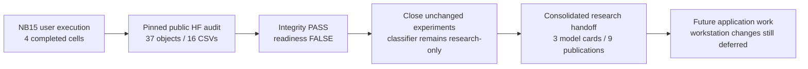
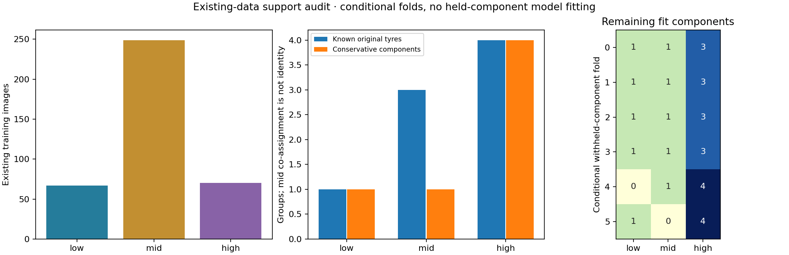
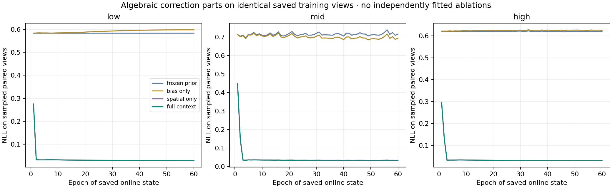

# NB15 complete — verified existing-data readiness and evidence passport

**1 November 2026. The supplied executed NB15 is complete and independently HF-verified. No rerun is needed.** All four code cells completed without saved errors; all 40 source/metadata payload files match the accepted delivery. The expected scientific readiness result is **false**, while execution and evidence integrity **pass**.

## Exact publication and audit

| Item | Verified result |
|---|---|
| Executed notebook SHA-256 | `98837b907abc332fd2eaf745b578656f1c70df594ede28e13c02ca678b43aa07` |
| Pinned HF revision | `f4b44d3d8e309db28d42171f1c5210881aa7b079` |
| Gate contract | `1bbb0142fc67619b74b3fda9f8ad8924d836f1ba6eaf67c53ca58fa02fe58f49` |
| Direct publication | **38 logical files**, including manifest; all **37 objects** checked by byte count and SHA-256 |
| Verified payload | **58,797,180 bytes**; no ZIP/NPZ/database publication |
| Scientific tables | **16 CSVs / 196,905 rows**, including 188,160 algebraic correction records |
| Independent reconstruction | All 16 schemas/counts/text/missing values/numbers compared; all byte-identical: **False**; maximum numeric difference **9.99978e-13** |
| Visual artifacts | Three valid PNGs and interactive passport with 1,440 component/epoch/variant summaries |
| Capability record | Exact SUMMARY.json and CAPABILITIES.json agreement with independent local analysis |
| Previous publications | All **1,502** context-fit entries and **79** context-review entries unchanged at the new revision |
| Ownership | Released, `owner=null`, `expires=0` |
| Actual environment | Python 3.13.15 / NumPy 2.1.3 / pandas 2.3.3; private HF SDK publication completed |
| Analysis scope | Zero model forwards, zero optimizer updates, zero new independent tyres, zero held-out prediction rows used |
| Verifier scope | Public reads only; no local credential files read or remote writes |

[Independent verification](tread_two/nb15_completion/98837b907abc/VERIFICATION.json) · [executed inspection](tread_two/nb15_completion/98837b907abc/INSPECTION.json) · [published manifest](tread_two/nb15_completion/98837b907abc/REMOTE_MANIFEST.json) · [HF gate at the verified revision](https://huggingface.co/datasets/Shanmuk4622/tyre-wear-study/tree/f4b44d3d8e309db28d42171f1c5210881aa7b079/phase3/tread-two/readiness-gate/v1/1bbb0142fc67619b74b3fda9f8ad8924d836f1ba6eaf67c53ca58fa02fe58f49).

The private SDK installation ran successfully from the delivered setup. Kaggle used NumPy 2.1.3 / pandas 2.3.3; local reconstruction used NumPy 2.4.6 / pandas 3.0.3. The largest retained numeric difference is approximately 1e-12, while table schemas, counts, text and missingness agree. All published object bytes match their own pinned SHA-256 records. The actual published passport JavaScript passes epoch/class/variant/weighted-curve checks in a synthetic DOM. Figure files decode correctly. These are functional/artifact checks; no native browser screenshot claim is made. The original local held-out perturbation and training-SHA rejection tests remain preserved in [package acceptance](tread_two/readiness_validation/PACKAGE_VALIDATION.json).

## What false readiness means

| Training proxy class | Existing images | Known original tyres | Conservative components |
|---|---:|---:|---:|
| Low | 67 | 1 | 1 |
| Mid | 249, including 152 existing video frames | 3 | 1 |
| High | 70 | 4 | 4 |

Withholding the only low component leaves zero low fit images. Withholding the conservative mid component leaves zero mid fit images. These are two of six conditional holdouts. No fold model was trained, and the available grouping does not support a complete class-supported leave-component-out comparison. The mid co-assignment preserves unresolved clip-parent constraints; it does **not** assert that three known mid tyres are physically identical.

This is a support limitation, not a notebook failure or proof that every alternative model must fail. Existing photos were sufficient for this completed audit. More views, repetitions or CSV rows do not increase independent tyre support, and an identical rerun cannot change that fact.

The frozen LC prior already predicts all **47,040 sampled training views** correctly. Full context rescues **0** prior errors and transiently spoils **44** prior-correct view observations early in training. On the same final-epoch 784 views / 214 distinct images, prior NLL is 0.636877 versus context 0.031365, with confidence rising from 0.530181 to 0.969124. The spatial term supplies almost all that loss/confidence change; removing the global bias barely changes it. These are algebraic parts of saved changing online states, not independently trained ablations or a fixed final-model cohort test.

The historical low failure remains: all 62 low images become mid and all 41 high images remain high. Original validation-selected epochs are preserved. The held-out endpoint has already informed development and lacks mid targets. Labels remain mileage proxies; physical wear, depth and safety targets are unavailable.

## Completed next step: consolidated research handoff

Built and checked the [interactive evidence hub](tread_two/research_release/Evidence_Hub.html), [handoff guide](tread_two/research_release/README.md) and [technical closure](phase3TreadTwoResearchClosure.md). The handoff contains three model cards, seven metadata CSVs / 134 rows, six selected/final metric records, nine verified publications, fourteen pinned checkpoint/explorer/figure descriptors and a comparison figure. It references all original HF science without loading, altering or republishing native weights.

The handoff is a **local report/index**; its indexed scientific evidence is already on HF, and the new index itself has not been uploaded. [Release manifest](tread_two/research_release/RELEASE.json), [validation](tread_two/research_release_validation/VALIDATION.json).

**No NB16 or repeat training/publication notebook is needed to close this unchanged experimental series.** ATLAS v1/LC/context remain completed research candidates, not a deployable classification claim. Application changes remain deferred under the user's earlier instruction, and both workstations are preserved. A later existing-data experiment needs a distinct supported objective and protocol; no new-photo prerequisite is introduced here.
