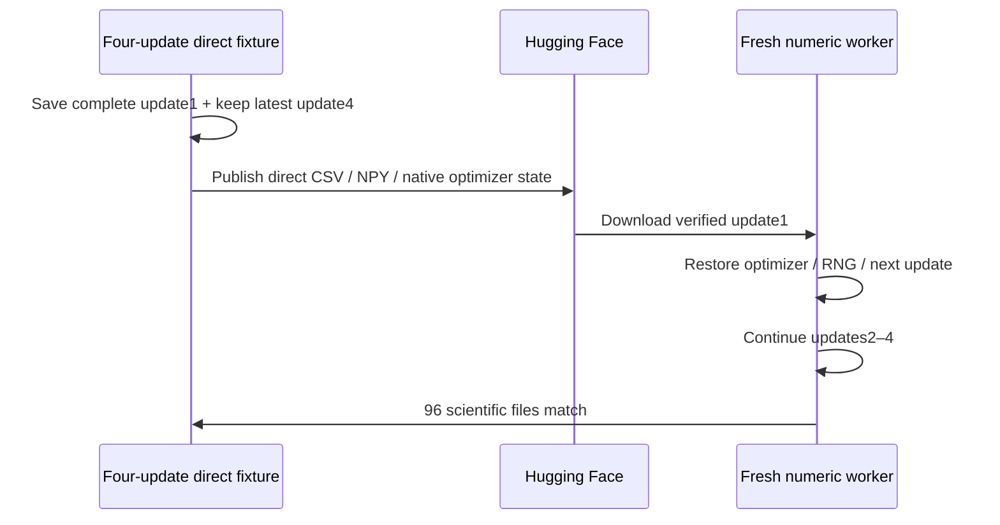
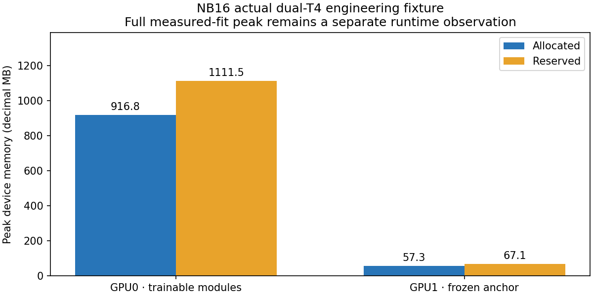

# NB16 completed — independently verified on Hugging Face

**1 November 2026. NB16 passes; no rerun is required.** All three code cells
completed without saved errors. The executed notebook is preserved unchanged:
`ea4f6784588f41611b632b705291481973c5c4daa12ae33a2f670221a89e066a`. Its27 embedded files match the original new
GEO runtime exactly. [Inspection](tread_two/nb16_completion/ea4f6784588f/INSPECTION.json)
and [independent verification](tread_two/nb16_completion/ea4f6784588f/VERIFICATION.json).

## Published evidence

| Check | Verified result |
|---|---|
| HF revision | `9f991635f1d333e4e48eb6f932a9c704ca5eeb39` |
| Contract | `c8d91064beec55898208953811dfe75ec63bfe067ec2a4f19cf96e358b616979` |
| Direct publication |174 logical files /173 selected objects /24,341,191 bytes |
| CSV inventory |60 direct CSV files /42,217 rows, including source/schedule and repeated seam/progress paths |
| Native evidence |65 uncompressed finite NPY arrays; original unit1 and latest unit4 chains verified |
| Exact recovery |96 scientific files identical after actual HF restore/continuation; model/moments/counters/RNG checks pass |
| Devices | Actual Tesla T4 ×2, Torch2.11.0+cu128, Python3.13.15 |
| Interactive gallery |32 predicted-mask cases; actual script/filter controls and PNG payloads checked |
| Ownership | Released |
| Earlier experiments |1,502 context-fit,79 context-review and37 readiness manifest entries unchanged |

The CSV row count includes the retained unit1 seam in addition to the latest
four-unit history and duplicate source metadata paths. These are retained
engineering views/copies, not42,217 independent photos. Only existing training
images entered the disposable optimizer checks; no measured candidate fit ran.

## What we learned

The new geometry/texture/error paths run deterministically on the real two-T4
setup, including native/CSV restore. GPU0 owns the trainable modules; GPU1 owns
the frozen anchor. Parameter counts remain355,879 trainable /1,728,038 total.
These are engineering facts, not an accuracy or physical-wear improvement.

The visible wait was budget handling and completed normally. Saved headers
actually advertised API1,000 and resolvers5,000 per300seconds; NB16's local API
cap96 per300seconds was substantially more conservative. NB17 keeps the96/hour
commit guard, uses conservative defaults until a header is observed, then at
most80% of that observed bucket with fixed ceilings. Server backoff/remaining
still governs. [HF's separate bucket/action policy](https://huggingface.co/docs/hub/en/rate-limits).
The completed NB16 transport itself is unchanged.

All four VIC/covariance/masked-Huber losses independently reconstruct from CSV
projector values and raw native targets/predictions/weights within FP32 reduction
tolerances. The largest unreduced-sum difference is0.000347; normalized objectives
agree within the declared tolerance. Scalar-conversion warnings are diagnostic
warnings, with no failed check or saved error; later logging detaches values.

The14.334 GB forecast in NB16 explicitly excludes full40-family/staging acceptance.
`measured_fit_ready=false` was correct. It is not evidence of a failed notebook.

## Next implementation

The isolated `tread_two/geo_pilot/` branch implements the full40-family measured
pipeline, bounded native prefixes/shards, original validation/selection,
train-only mean predictor, all epoch checkpoints and selected/final diagnostics.
It preserves the completed NB16 runtime and notebook. New disposable storage/
resume acceptance and actual live checks must pass before NB17's first measured
update. Current delivery status is recorded in [GEO pilot](tread_two/geo_pilot/README.md).

No new photos, independent tyres, mileage classifier, depth/safety claim,
workstation edit or rewrite of the completed ATLAS/NB16 evidence is introduced.
