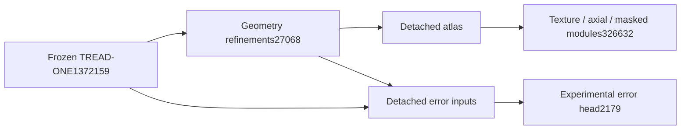

# NB16 — TREAD-TWO / GEO preparation delivered

<!-- NB16_DONE_STATUS -->
**Current update,1November2026:** [NB16 is complete and HF-verified](phase3NB16Completion.md); no rerun. NB17 is delivered in the isolated geo_pilot branch. Earlier pending/preparation statements below are dated history.
<!-- END_NB16_DONE_STATUS -->

**1 November 2026.** The approved geometry-first model is implemented for the
next engineering gate. [Open NB16](notebooks/phase3_NB16_TREAD_TWO_GEO_Preparation_And_Contract_Gate.ipynb)
with **T4×2, Internet ON, the existing expanded Kaggle input and HF_TOKEN**, then
Run All. Start with4GBfree output. [Exact runbook](tread_two/geometry_first/RUNBOOK.md).

## Delivered versus pending

| State | Evidence |
|---|---|
| Implemented | Strict original anchor, bounded geometry heads, detached atlas, custom texture/axial/masked branches, experimental error head |
| Locally checked | Exact four-update restored model/moments/counters/RNG, independent loss math, leakage/isolation/skip tests and crash rollback |
| Notebook ready | Three code cells,27 embedded matching files, private HF SDK, visible coordinator, direct CSV/native publication and32-case interactive gallery |
| Actual Kaggle/HF | Pending NB16 execution; no local credentials or remote write used during delivery |
| Measured fit | Not started; NB17 awaits actual gate and remaining40-family shard/staging integration |
| Completed model review | NB18 follows a completed measured candidate; no new model result exists today |

Total **1,728,038 parameters**, of which **355,879 trainable**. Texture/error
losses cannot reshape geometry through gradients. The first pilot has no mileage
classification objective. Existing labels remain proxies, not physical wear,
depth or safety measurements.

The finite engineering fixture saves more than scalar loss: all mask logits,
pre/post-context tokens, masked predictions/targets/weights, all global/projected
coordinates, tensor/group gradients, point/region/error records, tile support,
view factors, full schedule/source identities and complete recovery state.
All tabular evidence is directly browsable CSV. The approved future40-family /
443-field schema stays separate from the actual11-family unit engineering schema.
See [retention scope](tread_two/geometry_first/CSV_AND_NATIVE_SCOPE.md).

The actual hidden-RGB test exposed the need for tile-local photometric contrast
means as well as tile-local LC kernels. That clarification is implemented before
measured freeze and verified exactly. No prior experiment source was modified.

Local acceptance uses CPU in `cv_conda`; the installed GTX1650 is not passed off
as dual-T4 evidence. [Delivery receipt](tread_two/geometry_first/validation/DELIVERY.json)
and [technical validation](tread_two/geometry_first/VALIDATION_AND_RECOVERY.md).
Both workstations,103 original Markdown files and all executed prior notebooks
are preserved. No new photos or independent tyres were added.

**Next:** run NB16, independently verify its public HF revision, inspect actual
two-GPU/storage results, finish the complete measured telemetry/shard protocol,
then deliver/freeze NB17 for one60-epoch fit. No old notebook rerun is required.
