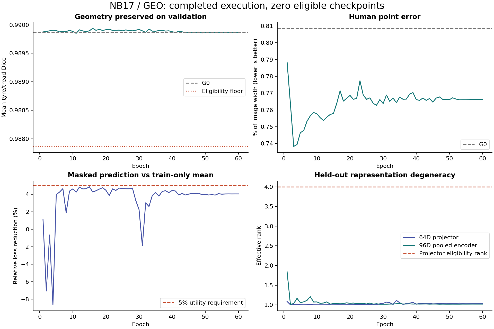
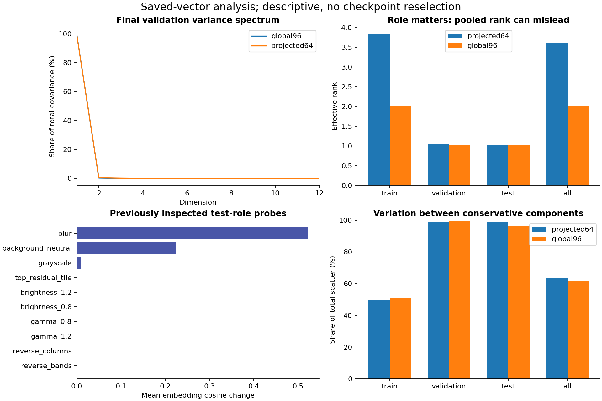
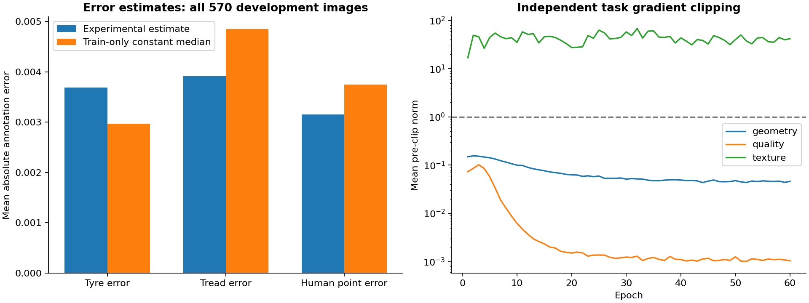
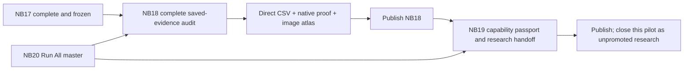

# NB17 complete — GEO evidence and research outcome

<!-- NB20_VERIFIED_GEO_CLOSED_20261102 -->
## Current — NB20 HF-verified; GEO research cycle complete

**2 November 2026:** NB20 completed both NB18 review and NB19 passport stages.
All 19 payloads match; three cells complete without saved errors. Actual HF
revisions **610bdb22… / abfec8d6…** contain **121 logical files, 51 CSVs /
183,812 rows**. All 119 objects, released owners, 48 reference-comparable tables,
exact vector arrays and actual passport provenance check out. Earlier NB13–NB17
selecting manifests are unchanged. **No NB18/NB19/NB20 rerun needed.**
[Completion and numerical/evidence notes](phase3NB20Completion.md).

The current GEO cycle is closed as **unselected, unpromoted research**. Geometry
passes 60/60 epochs; representation eligibility passes 0/60. The original
27,514,418 CSV rows and native/epoch evidence remain on HF.
[Compact research handoff](phase3TreadTwoGEOResearchClosure.md).

**Recommended next direction:** separately design a texture revision with fixed
local targets and batch-compatible diversity, reusing saved geometry and existing
photos. [Design brief](phase3TreadTwoGEONextResearch.md). This is proposed,
not implemented or trained. No new notebook/fit is required to finish this cycle.
Both workstation implementations remain deferred and preserved.
<!-- END_NB20_VERIFIED_GEO_CLOSED_20261102 -->

**2 November 2026. The attached notebook is NB17, although the message says NB16.**
Its three code cells completed without saved errors. All 29 embedded files
match the frozen measured runtime. NB16 was already verified; neither notebook
needs a training rerun. The executed NB17 is preserved unchanged.

## Independent publication verification

| Evidence | Verified value |
|---|---|
| Executed NB17 SHA-256 | `4b92d8fd70814283879d3a76af229d19a69b4458129c804e5a30e926e3282304` |
| HF revision | `1113bf8a9dd69687b23570fe985ed3a979a5f0e1` |
| Original fit protocol | `7d1bc8554813ae16ba3d73d5d4af2d8c05c977e9282d1bf324ff9dbef6e89bdb` |
| Logical publication files | 11,637, including the selecting manifest |
| Selected content objects | 11,636; all local downloaded bytes/SHA verified |
| Retained content bytes | 10,307,839,796 (10.31 decimal GB) |
| Direct CSV | 3,080 files / 27,514,418 rows |
| Executable scientific schema | 40 families / 468 fields |
| Native arrays | 8,457: 8,455 indexed measured shards + 2 controls |
| Native checkpoint files | 63: all 60 epoch weights, final export, anchor and selected recovery state |
| Measured fit | One seed / 60 epochs / 2,940 updates |
| Training observations | 23,520 = 23,160 primary + 360 scheduled padding draws |
| All source observations | 30,447, including controls, validation, endpoint and probes |
| Final complete unit | 9,877; complete cursor, optimizer/RNG state and final digest verified |
| Publication owner | Released |
| Original NB13/NB14/NB15/NB16 publications | Exact selecting manifests unchanged |

[Verification receipt](tread_two/nb17_completion/4b92d8fd7081/VERIFICATION.json),
[executed-notebook inspection](tread_two/nb17_completion/4b92d8fd7081/INSPECTION.json),
[pinned manifest](tread_two/nb17_completion/4b92d8fd7081/REMOTE_MANIFEST.json),
[file/schema proof](tread_two/nb17_report/FILE_VERIFICATION.json) and
[native proof](tread_two/nb17_report/NATIVE_VERIFICATION.json).
The verification used public HF reads, no local credentials and zero remote writes.

## What the model actually achieved

| Original validation metric | G0 baseline | Final epoch 60 | Interpretation |
|---|---:|---:|---|
| Mean tyre/tread Dice | 0.989865874 | 0.989862296 | Floor preserved; delta -0.000003578 |
| Human point MAE / image width | 0.008085361 | 0.007662197 | 5.2337% lower retrospectively |
| Invalid atlas fraction | 0 | 0 | Support remained available |
| Masked Huber | — | 0.034621991 | Same final masked observations |
| Train-mean control Huber | — | 0.036077252 | Train-only identity control |
| Relative masked loss gain | — | 4.0337% | Below declared 5% utility requirement |
| Paired embedding cosine distance | — | 0.000118557 | Strong consistency alone is insufficient |
| 64D projector rank | 11.028566 | 1.038659 | Original eligibility requires rank ≥ 4 |
| 96D pooled encoder rank | 14.780426 | 1.020990 | Separate descriptive audit also near rank one |
| Projector median std | 0.003818 | 0.441106 | Scale improved; diversity did not follow |

**All 60 epochs meet the geometry floor; zero meet representation eligibility.**
At the model's 384-pixel input width, the mean human point error changes from
3.1048 to 2.9423 pixels:
about 0.1625 pixels lower.
The 5.23% figure is a relative error reduction, not a physical tread-depth gain.
The projector validation rank ranges 1.001634–1.114739.
The final leading covariance direction explains 99.44% of projector variance and
99.71% of pooled-encoder variance. These are specific held-out-vector findings;
they do not prove every per-tile tensor is constant or identify a unique cause.
The original checkpoint-selection rule correctly leaves `selected=None`.

The 570-image pooled rank is 3.607015 for the projector and 2.025142 for the
pooled encoder. Test-only ranks are 1.015306 / 1.029422. Pooling roles can hide
held-out degeneracy; none of these descriptive values can replace the original
validation rule. No test-based reselection or promotion is performed.
The native pre/post-context tokens and component scatter are also audited:
99.0481%/99.3859% of validation projector/pooled variation lies between its two
conservative components, and local encoder diversity is already limited.
[Detailed postmortem, tables and mathematical constraints](phase3TreadTwoGEOLessons.md).

## Further insights and limits

| Finding | Evidence and implication |
|---|---|
| Strong pixel segmentation | Native coarse logits and all 14,008,320 final dense CSV rows checked against existing PNG masks; full-grid confusion counts reconstruct exactly |
| Human-only point evaluation | Validation human count 25; weak/absent targets stay excluded. A point MAE improvement on this small development cohort is not an independent deployment result |
| Error head has a weak control result | On final validation all three learned error estimates have higher MAE than the train-only constant median. Do not describe them as calibrated confidence |
| Appearance sensitivity remains | Mean embedding change under blur ≈0.522342, background-neutral ≈0.223975, grayscale ≈0.009521; brightness/gamma changes are much smaller |
| Spatial reversals have small pooled changes | Band reversal ≈0.000086; column reversal ≈0.000145. This measures the saved collapsed pooled representation, not proof of a causal architectural defect |
| Full source exposure | Every one of 386 training images appears once per epoch before six explicit padding draws; all 23,520 draws SSL-valid |
| Limited independent support | 570 photos: 386 train / 81 validation / 103 test; only six conservative train components, low/mid/high = 1/1/4; no middle-class held-out cohort |
| No new class/depth/safety evidence | GEO fitted no mileage-classification head; no measured physical-depth/safety targets exist in this run |

The generated [interactive local atlas](tread_two/nb17_report/GEO_Review_Atlas.html)
contains 570 source images, 3,420 predicted point markers and 720 human-target markers.
Filter by original role/component, sort by mask Dice, human error or masked-control
ratio, search an image, page through cases and export the filtered metrics as CSV.
Pink circles are predictions; green rings appear only for actual human targets.
The HTML is a generated local/HF artifact; Git retains its source and curated figures.

The completed 2,940 objectives reconstruct from retained sufficient statistics
and raw CSV vectors (maximum total difference about 6.93e-6, within declared
FP32/FP64 tolerances). Native patch predictions/targets/weights reconstruct
masked and mean-control losses, native pooling matches CSV vectors, and all
60 epoch weights are finite. The final export equals epoch 60 and the last state;
the frozen anchor remains unchanged.

Explicit gaps remain: historical optimizer states are rolling, not all permanently
retained; historical ledger link continuity is verified, but not every historical
unit digest can be re-derived without its discarded prefix maps. The final unit
digest and complete semantic state are independently verified. Anchor drift uses
retained sums/counts; there are no new anchor forwards. The original mean map
was built from full train-only targets, while only selected masked target bodies
are retained per observation; its entire construction cannot be independently
recomputed without additional forwards. Probe raw texture bodies were deliberately
not retained; their compact geometry, CSV vectors/statistics and metadata remain.

Resource telemetry contains 9,867 sampled observations:

| Quantity | Maximum sampled bytes | Interpretation |
|---|---:|---|
| GPU 0 allocated / reserved | 201,397,760 / 723,517,440 | Completed-unit samples, not within-step peaks |
| GPU 1 allocated / reserved | 58,809,344 / 96,468,992 | Completed-unit samples, not within-step peaks |
| Host RSS | 2,327,363,584 | Sampled resident process memory |
| Logical artifacts | 10,300,607,571 | Sampled local artifact total |

These are **not true within-step peaks**. The
`staging_bytes` field is blank throughout; do not invent a measured staging
series. The publication total is 10,307,839,796 bytes.
Component timing summaries are not end-to-end wall
time. Transport rows capture events ingested before the selecting snapshot;
its own final commit/verification cannot recursively be included in that same
snapshot. The pinned server revision and released owner establish publication.

## What happens next

All justified postrun notebooks are supplied together. **Run
[NB20](notebooks/phase3_NB20_TREAD_TWO_GEO_All_In_One_Postrun.ipynb) once**; it
chains NB18 and NB19 automatically. Separate stage notebooks are also available.
Use CPU / None, Internet ON, existing expanded prepared Kaggle input and HF_TOKEN.
Fresh start needs at least 13 GB free; the 10.31 GB input is shared once.
[Full instructions](phase3TreadTwoGEOPostrunBatch.md).

Local full-data analysis, fresh notebook setup, stage interruption/hash detection,
offline publication/handoff/restore and interactive-script controls are checked.
**Actual new NB18/NB19 Kaggle/HF publication remains pending.** No new fit,
photo collection or workstation change is launched. This closes the GEO pilot,
not every future research direction or the broader application.
