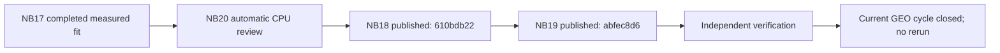
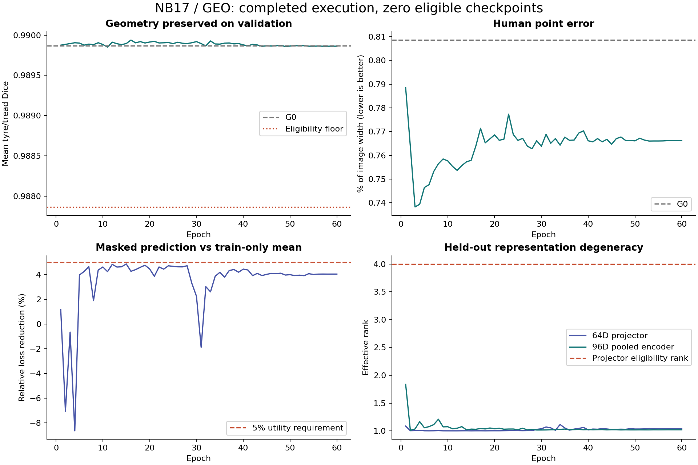

# NB20 completed — review and passport independently HF-verified

**2 November 2026. NB20 passes. No NB18, NB19 or NB20 rerun is needed.**
The master completed both dependent stages on Kaggle CPU. All three code cells
completed without saved errors; all 19 embedded files match the frozen runtime.
The executed notebook is preserved unchanged:
`8c9c2991e1bbc249f723a552918af3871ede7cfadc940cb2479180fa9f02a0c5`.

## Actual publications

| Stage | HF revision | Files including manifest | CSV files / rows | Content bytes | Owner |
|---|---|---:|---:|---:|---|
| NB18 review, through NB20 | `610bdb223ca1212bbca9d42463ae427db98e5d6f` | 77 | 34 / 147,869 | 70,863,609 | Released |
| NB19 passport, through NB20 | `abfec8d65fe0066e415df47407370e0159255223` | 44 | 17 / 35,943 | 3,784,988 | Released |
| Combined postrun publications | Two pinned revisions | 121 | 51 / 183,812 | 74,648,597 | Both released |

[Review](https://huggingface.co/datasets/Shanmuk4622/tyre-wear-study/tree/610bdb223ca1212bbca9d42463ae427db98e5d6f/phase3/tread-two/geo-r1/review/a756786db07c44005c1f8f8174a8bdd71e697aded10608bfe7b759638f223b6d) · [passport](https://huggingface.co/datasets/Shanmuk4622/tyre-wear-study/tree/abfec8d65fe0066e415df47407370e0159255223/phase3/tread-two/geo-r1/passport/a756786db07c44005c1f8f8174a8bdd71e697aded10608bfe7b759638f223b6d) ·
[independent verification](tread_two/nb20_completion/8c9c2991e1bb/VERIFICATION.json) ·
[notebook inspection](tread_two/nb20_completion/8c9c2991e1bb/INSPECTION.json).
All 119 selected content objects were downloaded and checked by size/SHA.
Both selecting manifests are unchanged at the latest checked repository revision.
Verification read no local credentials and made zero HF writes. There are no
ZIP/NPZ/database envelopes.

The 183,812 rows include inventories, derived statistics, copied tables and live
transport records. They add no independent tyres or new training observations.
The notebook's local-root CSV counter has a different scope: publication adds
transport CSVs to the selected HF snapshots. Published manifests are the count
authority. The original fit remains **3,080 CSVs / 27,514,418 rows / 8,457 native
arrays / 10.31 GB**.

## Verification coverage

| Check | Verified result |
|---|---|
| Execution and source | Three completed cells, zero saved errors, all 19 payload hashes match |
| Content and ownership | All 119 objects; both manifests and released owners |
| Tables | 48 reference-comparable tables checked; actual provenance checked separately; published transport CSVs inventoried |
| Derived vectors | 64D and 96D arrays exactly match independent reconstruction |
| Recovery stages | All seven completed review receipts bind their exact outputs |
| Original evidence | Published proof covers all 27,514,418 original rows and 8,455 measured native shards plus two controls |
| Original epoch weights | All 60 file hashes checked; 4,020 parameter norms independently recomputed in FP64 |
| Interactive evidence | 570 images, 3,420 predicted point markers, 720 human targets; filtering/sorting/paging/CSV controls pass |
| Passport provenance | Actual review revision replaces the earlier local pending-publication marker |
| Preservation | NB13/NB14/NB15/NB16/NB17 selecting manifests unchanged |
| New model/data work | Zero optimizer updates, image/model forwards or new photos |

### Numerical precision is documented

The largest cross-platform difference in a weight-norm diagnostic is
**1.4901161e-8, one FP32 ULP**. Only that column uses its explicit field-specific
tolerance. Other numeric columns retain the tight original comparison checks;
raw model weights and derived vectors remain unchanged.

For all 4,020 norms, comparison with independent FP64 sums of squares gives at
most **2.2200368e-5 absolute / 1.1799424e-6 relative error**, or 12 FP32 ULPs from
the rounded FP64 value. Every norm satisfies a conservative FP32 reduction error
bound. This concerns diagnostic precision, not altered predictions/weights.
[Direct audit](tread_two/nb20_completion/8c9c2991e1bb/FP64_WEIGHT_NORM_AUDIT.csv).

The HF atlas is seven bytes shorter than the local HTML, but its parsed data,
embedded images, page structure and JavaScript are identical. This is text
serialization, not a scientific discrepancy.
[Comparison](tread_two/nb20_completion/8c9c2991e1bb/HTML_COMPARISON.json).
Interactive controls were tested in a DOM fixture; no native-browser rendering
claim is added. All three published PNGs are curated for these records.

## Scientific findings remain unchanged

| Original validation result | Value | Interpretation |
|---|---:|---|
| Geometry floor | 60/60 epochs pass | Baseline geometry retained |
| Human point MAE / image width | 0.007662197 | 5.23% relative reduction from G0, about 0.1625 input pixels |
| Representation eligibility | 0/60 epochs pass | Selected joint checkpoint unavailable |
| Final projector / pooled rank | 1.038659 / 1.020990 | Near-rank-one held-out vectors |
| Masked prediction gain | 4.0337% | Below the 5% utility requirement |
| Error head vs constant control | Worse validation MAE for all three quantities | Experimental error estimates lack a demonstrated control advantage |

Publication success does not change the scientific gate. The final model remains
an **unselected, unpromoted research artifact**. These small validation/test roles
were already inspected, contain two conservative components each and have no
middle-class cohort. No physical-depth, safety or new GEO-classification claim
is established.

[Published interactive atlas](https://huggingface.co/datasets/Shanmuk4622/tyre-wear-study/resolve/610bdb223ca1212bbca9d42463ae427db98e5d6f/phase3/tread-two/geo-r1/review/a756786db07c44005c1f8f8174a8bdd71e697aded10608bfe7b759638f223b6d/evidence/GEO_Review_Atlas-6276edd1da07881b2921.html) ·
[published capability passport](https://huggingface.co/datasets/Shanmuk4622/tyre-wear-study/resolve/abfec8d65fe0066e415df47407370e0159255223/phase3/tread-two/geo-r1/passport/a756786db07c44005c1f8f8174a8bdd71e697aded10608bfe7b759638f223b6d/evidence/GEO_Evidence_Passport-bc618f1931a796b77df9.html) ·
[published model card](https://huggingface.co/datasets/Shanmuk4622/tyre-wear-study/resolve/abfec8d65fe0066e415df47407370e0159255223/phase3/tread-two/geo-r1/passport/a756786db07c44005c1f8f8174a8bdd71e697aded10608bfe7b759638f223b6d/evidence/MODEL_CARD-16e777c7663202962d05.md).

## What now

The current cycle is complete: preparation → one measured fit → full review →
passport → independent verification. **There is no remaining notebook to run for
this cycle.** The [compact research handoff](phase3TreadTwoGEOResearchClosure.md)
records actual publications, native pointers and capability limits.

My recommendation is a **separate revision of texture learning**, using fixed
local targets and a diversity objective compatible with the effective batch
size, while reusing saved geometry and existing photos.
[Next-design brief](phase3TreadTwoGEONextResearch.md) explains the reasoning and
required gates. It is proposed, not implemented or trained. No automatic extra
fit starts, and workstation changes remain deferred as requested.
