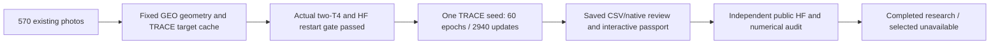
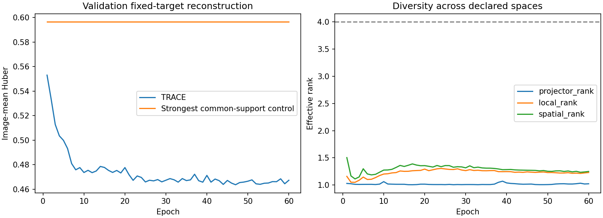

# NB24 complete — TRACE fit and review verified with Hugging Face

**2 November 2026. Execution is complete; no checkpoint passed selection.**
The supplied master completed preparation, real two-T4/HF continuation gates,
one seed / **60 epochs / 2,940 updates**, and the CPU review/passport. Three code
cells completed without saved errors. All **33 embedded files** match the frozen
delivery. **No NB21, NB22, NB23 or NB24 rerun is needed.**

The original rule accepts **0/60 checkpoints**. `selected=None` remains intact;
the final epoch is an unpromoted research artifact. [Observed scientific findings](phase3TreadTwoTRACEFindings.md).

## Pinned identities and publications

| Identity | Exact value |
|---|---|
| Executed NB24 SHA256 | `23e081e52454a617be134dbf9c6de9eb3e339ba5fa9e07a8164c4d66bf67da20` |
| Frozen package digest | `050f71ae540b387e33795144cf97894934cbccfad239fed9078a0c9140315356` |
| Actual Kaggle fit protocol | `ef8c68133a8a060c47792f7e02a84a953b783cf71653e1c87eff596f8172ad2f` |
| Review protocol | `37a7b701e9d9c3ca39b6966a427d306d5e23b3d2fc3f451f91f5d5c892ac069b` |
| Fixed cache scientific hash | `da29d65c43fb05d608c3c1ff6e784d7b975c3fe029548992890130b6564ad9ae` |

| Stage | Checked HF revision | Logical files incl. manifest | CSV files | Selected content bytes | Owner |
|---|---|---:|---:|---:|---|
| engineering | `7672729fdb1ccd0f55b565c1d60e8a50c6be078e` | 1,097 | 420 | 1,128,388,379 | Released |
| fit | `510cbc827337cbc963562c798811226326dc7c0c` | 10,348 | 3,553 | 13,506,978,062 | Released |
| preparation | `7672729fdb1ccd0f55b565c1d60e8a50c6be078e` | 803 | 222 | 1,094,133,421 | Released |
| review | `7672729fdb1ccd0f55b565c1d60e8a50c6be078e` | 14 | 4 | 34,763,606 | Released |
| transport_tail | `7672729fdb1ccd0f55b565c1d60e8a50c6be078e` | 5 | 3 | 1,881,626 | Released |

Preparation, engineering and transport-tail are checked at the final repository
revision; that is not presented as their original selecting-commit timestamp.
Fit/review revisions also match the notebook's saved completed result. All five
selecting manifests remain unchanged at the checked latest revision.

[Pinned fit publication](https://huggingface.co/datasets/Shanmuk4622/tyre-wear-study/tree/510cbc827337cbc963562c798811226326dc7c0c/phase3/tread-two/trace-r1/fit/ef8c68133a8a060c47792f7e02a84a953b783cf71653e1c87eff596f8172ad2f) · [Published interactive residual passport](https://huggingface.co/datasets/Shanmuk4622/tyre-wear-study/resolve/7672729fdb1ccd0f55b565c1d60e8a50c6be078e/phase3/tread-two/trace-r1/review/37a7b701e9d9c3ca39b6966a427d306d5e23b3d2fc3f451f91f5d5c892ac069b/evidence/TRACE_Evidence_Passport-f6a9456cd701e252c91f.html) ·
[Audit receipt](tread_two/nb24_completion/23e081e52454/VERIFICATION.json) · [Object-level methods](tread_two/nb24_completion/23e081e52454/OBJECT_VERIFICATION.json).

## What was independently checked

| Check | Result | Scope |
|---|---|---|
| Notebook identity/source | Pass | Exact executed bytes archived; all 33 payloads match; no notebook regeneration |
| All selected HF objects | 12,262 objects / five stages | Pinned existence and size for every object; LFS SHA256 identities; full body + Git SHA1/SHA256 for bounded Git objects |
| Large remaining Git CSVs | Metadata tier explicitly recorded | Full body was not independently downloaded for every dense CSV; do not call this an all-byte local audit |
| Native science inputs | 946 files /16,130,192 bytes, full checksums | All projected vectors needed for every update; all original validation and final-cohort diagnostic spaces |
| Training objectives | All 2,940 reconstructed | All six recorded terms match, maximum absolute difference 2.05e-07 |
| Original validation gates | All 60 independently reconstructed | SVD spectra rather than the trainer's covariance eigensolver; identical rejection and selected=None |
| Final complete state | Pass |3,809 contiguous ledger units and chain; optimizer step 2940; final weights and epoch 60/export identical |
| Retained RNG | Pass | Python, NumPy, CPU and both CUDA states; FP32; no scheduler/scaler |
| Actual source coverage | Pass |386 primary images each epoch;8 distinct source hashes per batch;6 padding draws separated |
| Earlier HF publications | Seven selecting manifests unchanged | NB13/14/15/16/17 plus both NB20 stages |
| Interactive viewer | Pass |570 cases; actual JavaScript role/search/paging, PNG signatures and missingness branch; DOM fixture, not a native screenshot |

The original published CPU review records **361,795,584 prediction values** and
**14,132,640 moment values** matching native arrays exactly, all raw local/masked
losses reconstructed, all 2,940 objectives checked, and original selection
reproduced. That full dense audit is preserved and its file inventory matches
the selected complete state. This local pass independently reconstructs all
objectives/gates; it does **not** repeat every dense prediction/moment comparison.
These two scopes are deliberately distinguishable.

[Independent science](tread_two/nb24_completion/23e081e52454/SCIENTIFIC_VERIFICATION.json) ·
[Every validation epoch](tread_two/nb24_completion/23e081e52454/VALIDATION_GATE_AUDIT.csv) ·
[Every training objective](tread_two/nb24_completion/23e081e52454/INDEPENDENT_OBJECTIVES.csv).

## Retention and meaning of the counts

| Evidence retained in the fit publication | Count / meaning |
|---|---|
| Existing photos |570:386 train /81 validation /103 test; **zero new photos** |
| Per-image observations |29,443; two views each |
| Training draws |23,520 =23,160 primary +360 padding; no extra independent tyres |
| Main fit CSV records |46,966,325 committed rows |
| Fixed-cache CSV records inherited by fit |297,021 |
| Full fit publication |**3,553 direct CSV files / 47,263,346 rows**,13.507 GB selected content |
| Dense prediction rows |30,149,632, each carrying six local +six masked values |
| Spatial moment coordinates |14,132,640 CSV rows |
| Native arrays |6,725 NPY =6,149 observation shards +576 fixed-cache arrays |
| Weights/recovery |60 epoch weights +initial control +target statistics +final export +selected rolling state =64 PT |
| Executable schema |48 families /671 fields;46 families populated in fit; errors and review-verification placeholders remain header-only there |

Row totals use the native complete-state counters and preparation chunk/source
counts. They are not described as a fresh independent reparse of every dense CSV.
The all-stage15.766 GB logical sum includes repeated references/copies of the
fixed cache across preparation, engineering and fit; it is not unique new data.

[Family counts and exact basis](tread_two/trace_completion_report/CSV_FAMILY_INVENTORY.csv).
Files remain direct CSV/JSON/NPY/PT/PNG/HTML. No ZIP/NPZ/database envelope.
Historical optimizer snapshots for every update and full preprocessed inputs
were not promised or retained: rolling complete recovery plus all epoch weights,
native predictions/tokens, seeds/cache/plans and explicit artifact-gap records
define the actual boundary.

## Actual engineering and resources

The published readiness certificate reports actual Tesla T4×2, a checkpoint
published/downloaded into a fresh worker, exact model/optimizer/RNG/cursor
continuation,244 exact scientific files, and two CUDA RNG states. Its nested
worker-only `actual_HF_download_asserted_by_parent=false` is a scope marker;
the parent certificate independently records `actual_HF_restore_continue=true`.
It is not treated as a worker having authenticated to HF.

The live storage gate projected 14.468 GB logical /17.496 GB peak with a2 GB reserve,
within the declared 20 GB working-space assumption. Measured fit samples show
at least 7.224 GB free, maximum sampled host RSS 2.331 GB, GPU0 peak allocated
586.503 MB /reserved765.460 MB. These are recorded samples/allocator peaks, not
an assertion about every instant or the entire Kaggle VM. GPU1 constructs the
fixed geometry cache; GPU0 trains TRACE. This is **not** data-parallel training
across two T4s. No measured numerical event is nonfinite; saved error table is empty.

All five owners are released. The finite transport tail states zero pending
numeric updates and explicitly excludes its own upload/later review requests
from its event boundary. Thirty-minute and major-stage publication remains the
frozen recipe; no claim of recovery from an uncatchable hard session kill is added.

## Visual record and next action

**No additional training is needed to finish this TRACE run.** Preserve this
executed notebook, source package, registry and all HF evidence. The useful next
research step is saved-evidence analysis of local texture utility and component
dependence before choosing another objective. That proposal is detailed in the
[findings and next-step record](phase3TreadTwoTRACEFindings.md); no NB25 is
implemented or required here. Existing photos only; both workstations remain deferred.
