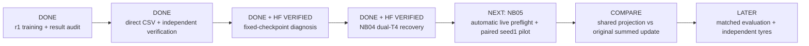
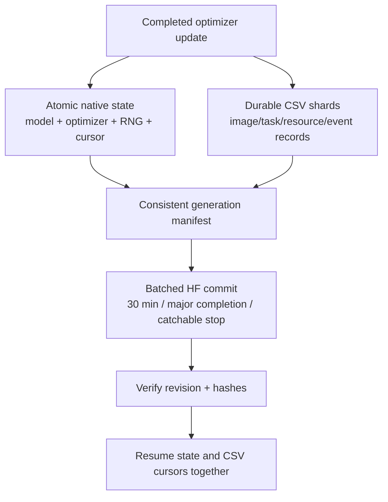

# Phase 3 — next steps: manuscript author review

<!-- IEEE_ACCESS_PAPER_20261103 -->
## Latest — separate IEEE Access author-review paper

**3 November 2026:** [Paper and handoff](phase3PaperIEEEAccess.md),
[PDF](ACCESS_latex_template_20260513/main.pdf), and [editable source](ACCESS_latex_template_20260513/README.md)
are prepared from completed Phase 3 evidence. The focused contribution is local
texture utility versus global aggregation, with all failed gates and data limits
retained. No new fit, photo, workstation change, HF publication or Git push.

Next is author review and the [submission checklist](ACCESS_latex_template_20260513/SUBMISSION_CHECKLIST.md),
not another notebook. Original manuscript, measured sources and selections remain unchanged.

Earlier notebook/design directions below are historical for this completed cycle.
<!-- END_IEEE_ACCESS_PAPER_20261103 -->

<!-- TEXTURE_AGGREGATION_20261102 -->
## Latest — saved texture aggregation investigation complete

**2 November 2026:** [Full investigation](phase3TextureAggregationInvestigation.md)
traces actual TRACE local/context features, nine predeclared aggregations,
two recorded views and unchanged decoder weights across the existing 570 images.
No image/geometry inference, optimizer updates, new photos or workstation edits.
Frozen decoder/projector readouts are explicitly counted; this is not a
zero-computation review or a newly trained candidate.

One average preserves 61.14% of local validation advantage over the position
control; a train-position template plus five residual moments preserves 81.76%.
Orientation/contrast suffer disproportionately. Averaging preferentially
removes within-component variation, while context already changes diversity.
Invertible scaling and mask placement can inflate rank without useful new
texture information. Original gates/selections, including selected=None, stay intact.

[Interactive explorer](texture_aggregation_20261102/Aggregation_Explorer.html) ·
[Methods and direct-file dictionary](texture_aggregation_20261102/METHODS.md).
New raw/derived CSV and FP64 NPY evidence is local, not HF-published. Large
native/detail tables are ignored by Git; compact summaries/figures remain visible.
The supported next design question is incremental local spatial-residual utility
beyond global/position controls. No new architecture/objective or fit is selected here.
<!-- END_TEXTURE_AGGREGATION_20261102 -->

<!-- PROJECT_RETROSPECTIVE_20261102 -->
## Latest analysis — whole-project retrospective through NB24

**2 November 2026:** [Full project analysis](phase3ProjectRetrospective.md)
connects original research, Phase 2, TREAD-ONE, ATLAS/LC/context, GEO, TRACE,
both workstations and manuscript scope. The inventory covers 236 maintained
Markdown documents. Phase 3 measured bookkeeping is 7 fit families /10 fit
executions /600 epochs /29,400 updates, excluding engineering and avoiding
double-counting NB13A or notebook masters.

A new saved-only [TRACE component review](phase3TRACEComponentReview.md)
checks 570 image records /10 conservative components from 444 verified CSV
inputs. Every image beats all 3 masked controls for final clean view 0 and its
recorded plan; validation gain 21.63%, historical-test gain 17.85%. Per-position
local tokens are more varied than pooled summaries. This does not alter
selected=None, establish a pooling cause or validate physical wear.

[Interactive evidence explorer](retrospective_20261102/Project_Evidence_Explorer.html)
and 10 direct CSV inventories/derived tables are local; no new HF publication,
fit, forward, photo or workstation change. Next investigate local evidence and
aggregation under existing-data controls before justifying another model.
The completed NB24 status below remains authoritative for that run.
<!-- END_PROJECT_RETROSPECTIVE_20261102 -->

<!-- NB24_VERIFIED_20261102 -->
## Current — NB24 TRACE completed and HF-verified

**2 November 2026:** NB24 completed preparation, actual T4×2/HF continuation,
one seed /60 epochs /2,940 updates, and the saved-evidence review/passport.
All 33 payloads match. **No NB21/NB22/NB23/NB24 rerun needed.**
[Completion and verification scope](phase3NB24Completion.md).

Final validation masked reconstruction beats the strongest declared control by
**21.63%**; local reconstruction improves **36.44%**. Utility passes60/60, but
projector/encoder diversity passes0/60: ranks **1.0225 /1.2296 /1.2489**.
**Selected=None; research-only, unpromoted.**
[Illustrated findings and next research](phase3TreadTwoTRACEFindings.md).

The fit retains **3,553 direct CSVs /47,263,346 rows /6,725 NPY /64 PT /13.507 GB**;
570 existing photos only. Counts include inherited cache rows; no new photos.
Independent audit reconstructs all 2,940 objectives and60 validation gates; the
published full dense audit and the bounded local audit have explicit scopes.
All five owners are released; earlier publications remain unchanged.

Next use saved local texture/component evidence to justify any future revision;
no new fit or NB25 is required to complete this cycle. Preserve executed
notebook/runtime/protocol. Both workstations remain deferred.
<!-- END_NB24_VERIFIED_20261102 -->

<!-- TRACE_BATCH_20261102 -->
## Historical — TRACE batch delivery before NB24 execution

**2 November 2026:** all four self-contained TRACE notebooks are implemented.
**[NB24 Run All master](notebooks/phase3_NB24_TREAD_TWO_TRACE_All_In_One_Batch.ipynb)**
automatically sequences fixed-target preparation, actual dual-T4/HF continuation
and storage gates, one seed / 60 epochs / 2,940 updates, then the saved-evidence
review and interactive passport. Individual NB21/NB22/NB23 files are supplied too.

Use a dedicated Kaggle **T4×2**, Internet ON, the existing expanded
`shanmuk4622/tire-dataset-prepared-phase2` input and **HF_TOKEN**. Start cold with
at least 19 GB free; actual capacity must also preserve the 2 GB reserve. Run one
master, not competing writers. [Full setup/recovery guide](phase3TreadTwoTRACEBatch.md).

Local real-model lifecycle/restart/fault/review and fresh payload tests pass.
All 570 existing photos and 60 source schedules were exercised. The executable
schema has 48 CSV families / 671 fields with native predictions/tokens, all epoch
weights and complete-update recovery. [Acceptance and boundaries](phase3TreadTwoTRACEValidation.md).

**Actual Kaggle/live HF and measured training remain pending user execution.**
The notebooks enforce those live gates automatically. No local token/HF write,
new photo or workstation change. Original GEO remains closed/unselected; no old
completed notebook needs a rerun. Preserve this new source/notebook/protocol
once execution starts.
<!-- END_TRACE_BATCH_20261102 -->

<!-- TRACE_DESIGN_20261102 -->
## Earlier design checkpoint — TRACE prototype checked

**2 November 2026:** the user authorised work on the next design. **TREAD-TWO /
TRACE** now has four prototype modules, 71,022 new trainable parameters, fixed
spatial descriptors and explicit position-sensitive pooling. All 386 train photos
were audited: 197,632 target cells / 1,185,792 values retained. CPU leakage, loss,
gradient, state-restore and frozen-geometry equivalence checks pass.

[Design, findings and interactive examples](phase3TreadTwoTRACEDesign.md) ·
[Detailed rollout](tread_two/trace_design/DELIVERY_PLAN.md).

This is **local design/engineering**, not a measured model, live HF publication,
48 implemented telemetry writers or runnable Kaggle batch. Next build the full
data/transaction/evidence runtime and prove storage/dual-T4/HF continuation, then
deliver all justified notebooks with a sequential master. Existing photos only;
both workstations and every completed experiment remain preserved. NB20/GEO stays
closed and unselected; no old notebook rerun is needed.
<!-- END_TRACE_DESIGN_20261102 -->

<!-- NB20_VERIFIED_GEO_CLOSED_20261102 -->
## Completed prior cycle — NB20 HF-verified; GEO research cycle complete

**2 November 2026:** NB20 completed both NB18 review and NB19 passport stages.
All 19 payloads match; three cells complete without saved errors. Actual HF
revisions **610bdb22… / abfec8d6…** contain **121 logical files, 51 CSVs /
183,812 rows**. All 119 objects, released owners, 48 reference-comparable tables,
exact vector arrays and actual passport provenance check out. Earlier NB13–NB17
selecting manifests are unchanged. **No NB18/NB19/NB20 rerun needed.**
[Completion and numerical/evidence notes](phase3NB20Completion.md).

The current GEO cycle is closed as **unselected, unpromoted research**. Geometry
passes 60/60 epochs; representation eligibility passes 0/60. The original
27,514,418 CSV rows and native/epoch evidence remain on HF.
[Compact research handoff](phase3TreadTwoGEOResearchClosure.md).

**Recommended next direction:** separately design a texture revision with fixed
local targets and batch-compatible diversity, reusing saved geometry and existing
photos. [Design brief](phase3TreadTwoGEONextResearch.md). This is proposed,
not implemented or trained. No new notebook/fit is required to finish this cycle.
Both workstation implementations remain deferred and preserved.
<!-- END_NB20_VERIFIED_GEO_CLOSED_20261102 -->

<!-- NB17_COMPLETE_POSTRUN_BATCH_20261102 -->
## Historical — NB17 verification and batch delivery before NB20 execution

**2 November 2026:** the attachment is completed NB17 (message says NB16).
HF revision `1113bf8a…`: **11,637 logical files / 3,080 direct CSVs /
27,514,418 rows / 8,457 native arrays / 10.31 GB**. One seed,
60 epochs and 2,940 updates; all selected bytes, schemas, native evidence and original masks
independently checked. Owner released; earlier four publication manifests unchanged.
**Do not rerun NB16/NB17 training.** [Completion and illustrated insights](phase3NB17Completion.md).

The geometry floor passes 60/60; human point MAE improves 5.23% retrospectively.
Representation eligibility passes 0/60: final validation projector rank 1.038659,
pooled 96D rank 1.020990; masked gain 4.0337% is below 5%. **Selected unavailable;
final remains research-only, unpromoted.** No new classification/depth/safety claim.

**Next: [NB20 Run All master](notebooks/phase3_NB20_TREAD_TWO_GEO_All_In_One_Postrun.ipynb)**.
It automatically runs/publishes NB18 full review then NB19 evidence passport.
All three notebooks are delivered now; individual stage files are optional.
CPU / None, Internet ON, existing expanded Kaggle input, HF_TOKEN, at least 13 GB free
on a fresh start. One shared verified cache, complete-stage recovery, publication
every 30 minutes and at major/stop boundaries. [Full batch/run guide](phase3TreadTwoGEOPostrunBatch.md).
Local actual-data audit and offline source/handoff/restore checks pass; new
NB18/NB19 Kaggle/HF publication remains pending. Existing photos only, no extra
fit or workstation change. User preference: supply all justified next notebooks
together with an automatic sequential master; preserve scientific gates.
<!-- END_NB17_COMPLETE_POSTRUN_BATCH_20261102 -->

<!-- NB16_COMPLETE_NB17_READY_20261101 -->
## Historical — NB16 HF-verified; NB17 pre-execution delivery

**1 November 2026:** executed NB16 is complete and independently verified at HF revision9f991635…: **174 direct files /60 CSVs /42,217 rows /65 native arrays**, actual two T4s and HF-restored continuation, 96 matching scientific files, released owner. All27 payloads match; earlier context/review/readiness manifests are unchanged. **Do not rerun NB16.** [Completion and insights](phase3NB16Completion.md).

**Next: [NB17 GEO resumable pilot](notebooks/phase3_NB17_TREAD_TWO_GEO_Resumable_Pilot.ipynb)** — T4×2,Internet ON, existing expanded Kaggle input, HF_TOKEN,  fresh kernel and≥19 GBfree for a new run; Run All. The new integrated storage/HF gate runs automatically before one seed / 60 epochs/2,940 updates. Local complete lifecycle, 307-shard recovery, loss/rotation/quota/transport and selected-export provenance tests pass. Actual NB17 live gate/measured results remain pending. [Protocol](phase3TreadTwoGEOProtocol.md) and [run guide](tread_two/geo_pilot/OPERATIONS.md).

Implemented40 CSVfamilies/468executable fields (443 draft +25 pre-fit accounting/provenance fields; 14type corrections), bounded direct NPY/CSV storage, all epoch weights and full rolling recovery. Stable experiment registry prevents accidental refits; source/env/history mismatch stops. Preserve executed notebooks/sources. Existing photos only; no classifier loss, physical-depth/safety claim or workstation change. NB18 follows completed NB17 evidence.
<!-- END_NB16_COMPLETE_NB17_READY_20261101 -->
<!-- GEO_NB16_20261101 -->
## Historical — NB16 preparation delivery before execution

**1 November 2026:** the user approved the complete geometry-first plan and requested notebooks. [NB16 preparation](notebooks/phase3_NB16_TREAD_TWO_GEO_Preparation_And_Contract_Gate.ipynb) is implemented and locally checked: **355,879 trainable / 1,728,038 total parameters**, frozen original selected anchor, isolated geometry/texture/error branches and complete-update native/CSV recovery. Real batch8 four-update restore, loss/leakage/gradient/skip/crash checks pass locally. [Delivery and scope](phase3NB16Preparation.md).

**Next: T4×2, Internet ON, existing expanded Kaggle input, HF_TOKEN,  at least4GBfree; Run All in NB16.** It publishes direct CSV/native engineering evidence, proves actual HF download/continuation in a fresh secret-free worker, and displays32interactive mask cases. No local HF credentials/writes were used. Actual dual-T4/HF proof remains pending.

NB16 is preparation, not the measured60-epoch fit. **NB17/NB18 are not yet delivered**: actual NB16 verification and complete40-family/443-field measured logging, shard/staging and validation integration precede the one measured candidate. The original plan JSON is retained as a dated design snapshot. No new photos, classifier sweep, production promotion or workstation change. Preserve executed notebooks/sources after the user runs them.
<!-- END_GEO_NB16_20261101 -->

<!-- GEO_PLAN_20261101 -->
## Historical — complete geometry-first plan before implementation

**1 November 2026:** the user requested the complete geometry-first development plan. [Master plan](phase3TreadTwoGeometryPlan.md) and [technical package](tread_two/geometry_first/plan/README.md) now define one new **TREAD-TWO / GEO** research candidate: frozen selected TREAD-ONE features, bounded supervised geometry refinements, an isolated masked-texture/self-supervised branch, and experimental annotation-error estimates. No mileage-classification loss in the first pilot.

The plan chooses one seed / 60 epochs / 2,940 updates, exact existing data/anchor, source-coverage scheduling, independent gradient clipping, original-role validation, checkpoint eligibility/selection, full raw-tensor retention and **40 CSV families / 443 declared fields**. New HF namespace, dual-T4 ownership, complete-update restore and 30-minute / major/stop publication are specified. Proposed 15 GB logical / 18 GB peak ceilings require actual fixture measurements within the 20 GB assumption; 1 TB scratch is optional.

**Status: design only; runtime, numerical/live resource gates and training notebooks are pending.** Next: implement isolated data/model/store modules and build planned **NB16 GEO engineering/contract gate**, then one NB17 measured pilot if its gates pass. No existing executed notebook is rerun or regenerated. No new photos, model forward/optimizer update, HF write or workstation change occurred during planning.

The completed ATLAS v1/LC/context series remains closed and unpromoted. This new geometry/representation objective is a separate requested direction; earlier statements about no extra notebook to close the unchanged classifier series remain historical and valid in that scope. Both workstations stay deferred.
<!-- END_GEO_PLAN_20261101 -->

<!-- NB15_CLOSED_20261101 -->
## Historical — NB15 verified; current ATLAS experiments closed as research

**1 November 2026:** executed NB15 is complete and HF-verified at `f4b44d3d…`: **38 direct files / 16 CSVs / 196,905 rows**, three figures and the interactive capability passport. All published bytes, table values, schemas and capability records pass independent checks; owner released. Earlier context fit/review manifests remain unchanged. **No NB13/NB13A/NB14/NB15 rerun is needed.** [Completion and proof](phase3NB15Completion.md).

Scientific readiness remains false as expected: training conservative components low/mid/high = 1/1/4, and two conditional holdouts remove a fit class. All three completed candidate fits remain research-only/unpromoted; historical low recall is 0/62. This is a support/result finding, not an execution error or a claim that every alternative model must fail.

**Next consolidation step is implemented:** [interactive research evidence hub](tread_two/research_release/Evidence_Hub.html), three model cards, original selected/final native pointers, nine pinned publications and seven metadata CSVs. [Research closure and technical handoff](phase3TreadTwoResearchClosure.md). The index is local; its underlying scientific records are already on HF. No NB16 or fourth full classifier fit is needed to close these unchanged studies.

The broader application is not declared complete. Workstation changes remain deferred, both workstations and frozen experiments are preserved, and only existing photos are used. A later experiment needs a distinct supported objective/protocol. Earlier pending-run instructions below are dated history.
<!-- END_NB15_CLOSED_20261101 -->

<!-- NB14_COMPLETED_20261101 -->
## Historical — NB14 verified; NB15 existing-data readiness implemented

**1 November 2026:** executed NB14 is complete and HF-verified at `10c2f16d…`: **80 direct files / 52 CSVs / 585,825 rows**, five figures, 1,854 cases and 206 attention matrices. Every table matches independent local reconstruction exactly; all 1,502 original fit entries remain unchanged; owner released. **Do not rerun NB13/NB13A/NB14.** [Completion and findings](phase3NB14Completion.md).

The classifier remains research-only: historical BA 50%, low recall 0/62 and worse context NLL. Implemented next: [NB15 readiness/evidence passport](notebooks/phase3_NB15_TREAD_TWO_Existing_Data_Readiness_And_Evidence_Passport.ipynb). Local analysis passes; support readiness is false: known training tyres low/mid/high = 1/3/4 form conservative components 1/1/4, so two of six conditional holdouts remove an entire fit class. All 47,040 saved training views were already argmax-correct under the frozen LC prior; context mainly strengthens training confidence. [Detailed evidence and limits](phase3TreadTwoReadiness.md).

**Next: CPU / None, Internet ON, HF_TOKEN,  no image dataset, 2 GiB free / about 4 GB RAM; Run All in NB15.** It retains 16 CSV tables / 196,905 rows, three figures and an interactive capability passport in a separate HF namespace. No fourth full fit, checkpoint reselection, new photos or workstation changes. [Run guide](tread_two/readiness_gate/README.md). Actual NB15 Kaggle/HF publication remains pending. Earlier pending steps below are dated history.
<!-- END_NB14_COMPLETED_20261101 -->

<!-- NB13_COMPLETED_20261101 -->
## Historical — NB13A complete and HF-verified; NB14 CPU review ready

**1 November 2026:** the supplied NB13A restored the newer HF checkpoint at **2,486 updates** and completed the original **60 epochs / 2,940 updates**. All **1,503 direct files / 58,176,066 scientific CSV rows**, the native/CSV ledger and all 60 frozen-prior epoch states are verified; ownership is released. **Do not rerun NB13/NB13A.** [Completion and illustrated findings](phase3NB13Completion.md).

The context branch responds to layout but does not fix classification: selected/final historical BA **50%**, low recall **0/62**, high **41/41**; NLL worsens to **2.174813 / 2.358475**. Keep it unpromoted. These are previously inspected mileage-proxy cohorts, not independent physical wear/depth/safety validation.

**Next: [NB14 saved-data review](notebooks/phase3_NB14_TREAD_TWO_CONTEXT_Completed_Review.ipynb)** — **CPU / None, Internet ON, HF_TOKEN,  no dataset attachment, 4 GiB free and about 8 GB RAM; Run All**. Locally checked: 52 derived CSVs / 585,825 rows, five figures, 1,854 interactive cases and 206 endpoint attention matrices. Zero new fitting/model forwards; additive direct HF review publication. Actual NB14 Kaggle/HF completion remains pending. [Run guide](tread_two/context_review/README.md) · [Review design and checks](phase3TreadTwoContextReview.md).

Preserve all completed notebooks/runtime identities and both workstations. Existing photos only. Earlier recovery positions/pending instructions below are dated history, superseded by this completion proof.
<!-- END_NB13_COMPLETED_20261101 -->

<!-- NB13A_REPAIR_UPDATE_20261031 -->
## Historical — NB13A missing-file error fixed; standalone recovery ready

**31 October 2026:** supplied NB13A failed before recovery because its original local `run/POINTER.json` was unavailable. The executed error is archived (`b5a4dd68…`). Revision 2 now embeds the unchanged runtime and original contract, prefers compatible local/attached saved state, and otherwise restores the full verified HF checkpoint. Latest independently verified HF recovery remains update **1,294**; earlier local notebook output showed **2,467**. Missing unsent progress is recoverable only from surviving files. [Repair, evidence and instructions](phase3NB13ARepair.md).

Next: run the updated [NB13A](notebooks/phase3_NB13A_TREAD_TWO_CONTEXT_Existing_Session_Recovery.ipynb) directly with **Run All**: T4×2, Internet, existing expanded Kaggle input and HF_TOKEN. It can run without the old workspace. Preserve/use the older session or attach its saved output if available. Do not run concurrent writers. The original passed live gate is reused, compatibility is verified and the same experiment resumes; no fresh fit is allowed without a matching recovery snapshot.

Eighteen offline recovery checks and the actual notebook setup in an empty fixture directory pass. Actual revised Kaggle recovery remains pending. All 32 frozen model/runtime entries, original NB13 protocol/source/notebooks and both workstations are preserved. Earlier existing-session-only instructions below describe superseded revision 1.
<!-- END_NB13A_REPAIR_UPDATE -->

<!-- NB13_RECOVERY_UPDATE_20261031 -->
## Historical — NB13 incomplete; preserve the stopped Kaggle session

**31 October 2026:** the user reports an apparent freeze and confirms stopped execution with local files retained. Saved NB13 output reaches **2,467 / 2,940 updates**; the independently verified HF checkpoint is only at **1,294**, phase train. All 33 embedded files match the unchanged 32-file runtime. The actual T4×2/live-HF preflight passed. No final completion or clean owner release is verified. [Status, proof and diagnosis](phase3NB13FreezeAndRecovery.md).

Next: copy the **two code cells** from [NB13A existing-session recovery](notebooks/phase3_NB13A_TREAD_TWO_CONTEXT_Existing_Session_Recovery.ipynb) into the existing stopped Kaggle NB13 and run them in order. Keep its files, same settings/input and HF_TOKEN. Do not reset into a new empty session or run another original training cell concurrently. Recovery verifies local/remote history, publishes ahead local progress before fitting, and resumes the original protocol with phase/status/stack diagnostics. [Original run guide](tread_two/context_pilot/README.md).

Exact stop cause is not established: no traceback was saved. Long snapshot/verification/upload paths lacked continuous status; do not claim a proven numerical/GPU/HF failure. The external orchestration repair and notebook pass local offline checks; actual Kaggle recovery remains pending. Preserve executed NB13 (`e0c714be…`), all frozen sources, protocol `36f473b0…`, native/CSV progress and earlier completed experiments. No model/recipe/data/workstation change. Earlier pending-NB13 delivery text below is historical.
<!-- END_NB13_RECOVERY_UPDATE -->

<!-- NB12_CONTEXT_UPDATE_20261030 -->
## Historical — NB12 verified; NB13 context pilot ready

**30 October 2026. NB12 is complete and independently HF-verified:** all 63 direct files, 40 CSVs / 380,595 rows, four figures and 1,442 review cases checked. All 1,350 original NB11 manifest entries are unchanged; ownership is released. No NB12 or earlier fit rerun is needed. [Completion and insights](phase3NB12Completion.md).

Appearance stability improved, but selected/final LC endpoint BA remains 50% with low recall 0/62; selected NLL improved and ECE worsened. A train-only layout check confirms that the old shared-local/equal-band pooling ignores band/column reordering. This is a structural limitation, not proof of the cause of those errors.

**Next: [NB13 / ATLAS-CONTEXT r3](notebooks/phase3_NB13_TREAD_TWO_ATLAS_CONTEXT_Resumable_Pilot.ipynb).** One new seed-1/60-epoch candidate freezes selected LC epoch 7 and learns a bounded position-aware correction. Initial logits match LC exactly. Local math/recovery/fresh-package/CSV accounting pass; actual T4×2/live-HF preflight, measured fit and accuracy remain pending. Use T4×2, Internet, existing expanded Kaggle input and HF_TOKEN,  then Run All. [Run guide](tread_two/context_pilot/README.md).

Keep all 27 CSV families, native recovery/all epoch weights, separate base/context evidence and full selected/final attention. Per-update matrices are not retained; per-observation summaries are. Existing tyre photos only, no workstation changes or completed-source rewrites. Earlier dated pending instructions below are historical and superseded by this block.

[Architecture](phase3TreadTwoContextArchitecture.md) · [Protocol](phase3TreadTwoContextProtocol.md) · [Schema](phase3TreadTwoContextEvidenceSchema.md) · [Engineering proof](phase3TreadTwoContextValidation.md).
<!-- END_NB12_CONTEXT_UPDATE -->

<!-- NB10_LC_UPDATE_20261030 -->
## Historical — NB10 closed; NB11 ready, 30 October2026

NB10 is completed and independently HF-verified:495 direct files,1,918,052 scientific rows,386native training records,T4×2,zero fitting/held-out forwards and released ownership. No NB10 rerun is needed. [Completion proof](phase3NB10Completion.md).

1. Run NB11 unchanged on Kaggle:T4×2,Internet,expanded prepared input,HF_TOKEN.
2. Allow its actual live recovery/storage gate before the60epoch measured candidate. Preserve executed notebook and direct CSV/native evidence.
3. Audit the pinned completed publication,exposure,reference exclusions,loss accounting and selected/final failures before promotion.

No new photo collection or workstation work. Next is [NB11 / ATLAS-LC r2](notebooks/phase3_NB11_TREAD_TWO_ATLAS_LC_Resumable_Pilot.ipynb): one separately versioned seed,paired LC views,18-photo source-SHA exclusions,all386queries and sqrt-size group sampling. Local batch8 recovery/package checks pass; actual Kaggle/live-HF preflight and measured accuracy remain pending. Use T4×2,Internet,the existing expanded Kaggle dataset and HF_TOKEN. [Architecture](phase3TreadTwoLCArchitecture.md), [protocol](phase3TreadTwoLCProtocol.md).

<!-- END_NB10_LC_UPDATE -->
<!-- NB09_GATE_UPDATE_20261030 -->
**Current, 30 October 2026:** [NB09 is complete and HF-verified](phase3NB09Completion.md).
No NB08/NB09 rerun is needed.

Open [NB10](notebooks/phase3_NB10_TREAD_TWO_Train_Only_Appearance_And_Reference_Gate.ipynb),
select **T4×2**, attach exactly one expanded
**shanmuk4622/tire-dataset-prepared-phase2**, enable **Internet + HF_TOKEN**,
leave at least **4 GiB free** and choose **Run All**.
[Full run/resume guide](tread_two/appearance_gate/README.md).

The gate is implemented and complete locally, retaining 1,918,052 scientific
rows and full native image state. It uses frozen weights and publishes in a
new namespace, with image-unit recovery. Actual dual-T4/HF gate execution
remains pending. [Findings/tradeoffs](phase3TreadTwoAppearanceGate.md) distinguish
brightness-feature consistency from classification, and reference diversity
from remaining query scarcity. After actual gate review, freeze a new recipe
before any measured v2 fit. No new photos or workstation changes are needed.
The previous NB09 publication instructions below are historical.

**Current, 30 October 2026:** the saved-data review is complete. Open
[NB09](notebooks/phase3_NB09_TREAD_TWO_ATLAS_Completed_Review.ipynb), select
**None / CPU**, enable **Internet** and **HF_TOKEN**, leave at least **2 GiB
free**, and choose **Run All**. **No dataset attachment, T4 session, new tyre
photos or NB08 rerun is needed.** [Complete guide](tread_two/review/README.md).

The notebook verifies about 147 MB of existing evidence, regenerates the
30-table / 246,157-row analysis and full interactive report, and publishes them
directly to a separate HF review namespace. Local extracted-code and offline
publication checks pass; actual Kaggle NB09/publication remain pending.
Then independently audit the executed NB09 and its final HF revision.

[Findings and proposed model gate](phase3TreadTwoFindings.md) explain the
low-to-mid transfer failure, appearance probes and training-only checks needed
before another recipe is frozen. No new model has been fitted or promoted.
The earlier launch/review directions below are dated history.

**Current status, 30 October 2026:** NB08 completed all 60 epochs / 2,940
updates, selected/final evaluation, diagnostics and publication. The user
clarified that no error appeared. **Do not restart training.**
[Completion and retained reports](phase3NB08CompletionStatus.md).

Next, review the retained classification failures, selection, reference and
patch evidence, and fixed appearance/occlusion probes. Compare the candidate
with its saved original-frame frozen control; keep the existing cohort and
absent held-out mid-class limits explicit. Archive the latest executed Kaggle
notebook when available. No new fit, new photos or workstation changes are
required. The original launch instructions below are historical recovery guidance.

**30 October repair:** use the current notebook below and Run All. The live
T4/HF gate already passed, but the old local hourly HTTP policy blocked the
training launcher. [Repair, regression and rerun details](phase3NB08Repair.md).
The model/runtime/recipe/namespace stay unchanged; compatible gates and saved
progress are reused, while existing ownership is respected.

**Use existing data only. Workstation changes stay deferred.**

The isolated training implementation is ready with local engineering acceptance.
Open [NB08](notebooks/phase3_NB08_TREAD_TWO_ATLAS_Resumable_Pilot.ipynb), select
**T4×2**, attach expanded **shanmuk4622/tire-dataset-prepared-phase2**, enable
Internet and **HF_TOKEN**, then **Run All**. [Complete run/restart guide](tread_two/PILOT_RUN_GUIDE.md).

| Next execution | Meaning |
|---|---|
| Notebook preparation | Verify attached release, frozen anchor, environment and actual free space |
| Automatic live engineering gate | Reuse the verified compatible T4/HF proof; require any genuinely missing acceptance before the fit |
| One measured fit | Seed 1, 60 epochs / 2,940 updates; 378 queries plus fixed support; full direct CSV/native evidence |
| Selected/final review | All endpoint images, frozen baseline scores, signed patch/reference evidence, full projections and fixed diagnostics |
| Independent completion audit | Preserve the executed notebook; verify pinned remote files, selections, counts, raw metrics and failure cases |

Local checks establish engineering mechanics, not better classification. The
old low/high endpoint remains inspected development evidence, with no held-out
mid subjects. No NB02–NB07 rerun or additional data campaign is required.
See [implemented module/state flow](tread_two/PILOT_IMPLEMENTATION.md) and
[evidence schema](tread_two/PILOT_EVIDENCE_SCHEMA.md).

## Completed separate app, available for existing media

| Current action | Ready deliverable |
|---|---|
| Open the special separate model window | [TREAD-ONE Studio user guide](workstation/README.md); launch the independent app in phase3/workstation |
| Inspect existing photos or videos | Single-model classification, overlapping masks/boxes, six boundaries and signed evidence; native playback/freeze/seek |
| Retain results | Automatic session CSV; explicit full capture with ten CSV tables / 245,784 rows, native arrays/PNGs and hashes |
| Restore/compare captures | Verified saved outputs; class/texture/layer/wipe controls render without retraining |
| Refine the application later | Deferred by the user; keep both workstation sources/models preserved now |

[Implementation, isolation and tests](phase3TreadOneWorkstation.md).
No new data campaign or NB07 rerun is scheduled. The future TREAD-TWO fit remains
behind the engineering gates above. NB07's false
prospective-readiness result describes the unfulfilled new-cohort protocol;
the desktop faithfully exposes the already completed model on existing media.
The model's classification failure remains in its record; app integration is
not a new accuracy or deployment-superiority claim.

The [old identity/capture pack](phase3CollectionReview.md) is optional historical
support, not a required collection step. The original application remains
available independently; no source/model/launcher was replaced.

The remaining sections preserve the **pre-NB05 rationale and execution history**.
Their next-run wording is superseded by the completed audit and NB07 actions above;
do not rerun NB05 or choose another checkpoint using the observed test scores.

**29 October 2026:** use the [repaired NB05](notebooks/phase3_NB05_TREAD_ONE_Shared_Gradient_Paired_Pilot.ipynb).
The supplied run stopped at an occupied preflight HF lease. The notebook now
waits/retries that exact temporary conflict without changing the 27 experiment
files or overwriting another owner. [Repair, checks and rerun instructions](phase3NB05Repair.md).
Live preflight and the measured pair are still the next execution gates.

**Updated: 28 October 2026. Training and direct-CSV publication are complete.** NB02's 25-file / 18-CSV commit `91ccd3315bd296a76a8b583a6d0f2515ccb3d370` is independently verified. No export or training rerun is needed. [Publication evidence](phase3NB02Completion.md).

**NB03 is complete on Kaggle and independently HF-verified:** 27 direct files at `75400f019ba0c6741b5060925b9c956c0a1ca0a8`; [completion audit](phase3NB03Completion.md), [measured findings](phase3ClassifierDiagnosticResults.md). No NB03 rerun is needed.

**NB04 is now complete on both T4s and independently verified:**572 direct files, exact native/CSV recovery and both released writers. [Completion audit](phase3NB04Completion.md). No rerun is needed.

**The next controlled implementation is NB05:** [paired pilot notebook](notebooks/phase3_NB05_TREAD_ONE_Shared_Gradient_Paired_Pilot.ipynb), [protocol and run guide](phase3R2PairedPilot.md). It keeps the architecture/data fixed and tests one shared-gradient projection mechanism against a matched summed-gradient baseline. One paired seed, two 60-epoch conditions; new measured outcomes are pending. Its longer-run recovery/publisher changes have separate checks and an automatic live preflight in the same notebook.

| Work item | State | Completion gate |
|---|---|---|
| Three seeds × 60 epochs | Complete | Pinned source and full saved-state audit |
| Direct CSV on HF | Complete | 25 remote hashes, 18 table schemas and 191,904 scientific records verified |
| Classifier diagnosis | **Complete locally and on Kaggle** | 14,010 predictions/interventions, per-tyre/domain metrics, native maps and fixed-batch gradients verified |
| Diagnostic HF sync | **Complete / independently verified** | 27 file hashes, 336,600 core rows, 60 summaries and released owner checked |
| Next logger/publisher / NB04 | Implemented; locally accepted | 13 CSV families, original optimizer math exact, consistent native/CSV recovery and 22 offline faults |
| NB04 live HF acceptance | **Complete / independently verified** | Both pinned source/final states and572 files checked;7,524 repeated engineering rows |
| Controlled revision / NB05 | Implemented: one paired optimization comparison | Architecture, weighted objectives, sampler and selection fixed; only conflicting shared gradients change |
| NB05 measured execution | Next Kaggle Run All after local acceptance | Automatic new-path live preflight, then baseline/candidate60 epochs each; direct CSV, full validation and bounded native maps |
| Workstation promotion | Not supported now | Task/failure and same-machine latency/memory comparison |

## 1. Completed diagnosis and remaining hypothesis refinement

| Measured result | Consequence |
|---|---|
| All six checkpoints fit all 386 nominal train images | Basic training-identity fit is established; historical augmented accuracy remains unlogged |
| Validation BA varies from 2.44% to 100% | Prioritize identity/transfer behavior; retain matched class supports and the old test boundary |
| Oracle gate changes BA by at most 1.25 points | Do not expect a fixed-feature gate replacement alone to solve the failure |
| Background/occlusion effects differ sharply across checkpoints | Preserve context/input-intervention evidence; no universal background-removal fix is established |
| Class/segmentation gradients oppose on the same three-image batch | Instrument task interaction in the next logger; one batch does not establish the cause of generalization failure |

The protocol below is the implemented diagnosis specification and a record of possible follow-up refinements. [The results record](phase3ClassifierDiagnosticResults.md) identifies exactly what was measured.

Keep the current workstation model selection. The immediate model issue is the held-out low tyre: every selected TREAD-ONE seed misses all 62 photos, while segmentation remains strong.

NB03 used fixed selected/final weights for a **post-hoc inference-only diagnostic** on train and validation cohorts, with cohort-specific class probabilities, per-tyre confusion, evidence/gate maps and input interventions. Nominal inference is distinct from unrecorded augmented-batch accuracy; the observed failure is primarily transfer, while every training identity is classified correctly.

Inspect train/validation loss-component scales and, if needed, measure task-gradient alignment on a fixed diagnostic batch without optimizer updates. Compare the predicted gate with declared evaluation-only alternatives to test the bottleneck hypothesis; oracle masks would be a diagnostic, not the normal inference path. Label every intervention and keep its raw evidence.

Hypotheses to distinguish: limited independent low-class support/appearance shortcut; narrow evidence pooling; from-scratch representation; shared-task gradient competition. The present run does not isolate these causes. Increasing model size or changing every component at once would not answer which one matters.

| Hypothesis | Measurement / possible refinement | Interpretation boundary |
|---|---|---|
| Tyre-identity or appearance shortcut | Per-class and per-tyre train/validation probabilities, confusion and margins; retain photo/video domain | Strong fit to training identities with holdout failure supports a transfer concern, but does not isolate lighting/design/capture effects |
| Gate/pooling limitation | Compare normal inference with predefined gate/pooling interventions while recording all task outputs | Ground-truth-mask alternatives are oracle diagnostics, not deployable inference |
| Background/context sensitivity | Neutralization and region occlusion; record probability/margin deltas and examples | Perturbation sensitivity does not prove causal physical reasoning |
| Shared-task competition | Retained loss scales; optional task-gradient alignment on fixed batches without optimizer updates | Present gradients cannot reconstruct unlogged historical gradient behavior |
| Shared representation versus decision path | Fixed feature/evidence distributions by class and identity | Training a diagnostic probe would be a separate fitted experiment requiring its own split/protocol |

| Diagnostic artifact | Required content |
|---|---|
| `predictions.csv` | Seed/endpoint/checkpoint hash, source/image hash, split, tyre/domain, label, probabilities/logits, prediction/margin/correctness |
| Class/tyre/confusion CSV | Supports/denominators, absent-class handling, class/tyre/domain aggregates |
| `interventions.csv` | Named intervention/parameters, original/changed probabilities and margins, dense-task changes, timing/errors |
| Gradient CSV if computed | Fixed batch IDs, task/parameter definitions, norms/alignment, missing reasons and cost |
| Direct images/arrays | Bounded evidence/gate/mask examples and failure overlays |
| Contract/manifest/event CSV | Source/data/model identities, environment/configuration, hashes and resumable inference cursor |

NB03 keeps weights frozen and uses deterministic inference under its declared recipe, a separate diagnostic namespace and a self-contained Kaggle `.ipynb`. Any further use of the observed test cohort is development analysis, not a fresh blind selection result. **Exit gate:** the [results](phase3ClassifierDiagnosticResults.md) document supported, contradicted and unresolved hypotheses; no specific architecture/optimizer improvement is established.

## 2. Completed recovery gate and new long-run observability

The [NB04 implementation](phase3TrainingEvidenceGate.md) now exercises the [direct-CSV retention policy](phase3DataRetentionPolicy.md) with actual pre-update augmented predictions/losses, class/region/point sufficient statistics, stage timing, bounded resources, module gradients/activations and explicit gaps. Atomic local generations and direct epoch CSV/native snapshots replace the historical ZIP mechanism for this separate engineering protocol.

NB04's local and actual dual-T4/live-HF proofs pass. Its short fixture is not a long measured protocol. The new [NB05 implementation](phase3R2PairedPilot.md) freezes the longer-run recipe, all 81 validation images per epoch, selected/final endpoints, actual task-gradient observations and a bounded map schedule. A transactional local journal avoids tiny-file accumulation; HF receives normal direct CSV/native files through bounded immutable batches. New local acceptance and automatic live preflight cover these changed paths.

The completed r1 runtime and generated/executed notebooks remain preserved. Logger/publisher improvements get a new source/protocol identity; no resume-identity bypass or renaming of the completed experiment.

| Gate | Required evidence |
|---|---|
| Coverage | Every requested family stored or an explicit missing/unsupported/cost reason |
| Storage | Measured working/scratch capacity and bounded shards under the output budget |
| Resume | Fresh-process completed-update equivalence and matching state/CSV cursors |
| Partial writes | Interrupted state/shard/manifest recovers to the last complete generation |
| HF faults | Server delay, transport failure, ambiguous commit, stale writer and cached restore checks |
| Cost | Separate telemetry/checkpoint/upload overhead from training/validation timing |

## 3. Selected controlled change: shared-only gradient conflict projection

The selected pilot keeps the architecture and weighted forward objectives fixed. It compares the original summed shared update against symmetric two-objective projection only when the shared dot product is negative. All task-specific head gradients retain the original total backward. Both conditions log the same task-gradient observations, with matched initialization/data/augmentation and one predeclared seed 1. [Math, sources, limits and exact run instructions](phase3R2PairedPilot.md).

This isolates a motivated training mechanism; it does not establish that gradient conflict caused the old classifier's transfer failure. One paired seed is not a robustness study. Preserve task losses/failures and the old test boundary, then inspect the actual comparison before choosing any later study or app integration.

| Supported finding | Candidate next action, not a selected implementation |
|---|---|
| Head/gate limitation | Change one classification path while preserving the dense paths |
| Task competition | Change one objective/optimization mechanism while preserving architecture |
| Data/identity limitation | Plan independent tyre coverage and a declared generalization evaluation |
| Inconclusive evidence | Run a targeted diagnostic before spending another training budget |

No new measured training has run locally; NB05 delivers the declared paired study for Kaggle. Existing test use is iterative development evidence. Strong generalization claims require a genuinely independent tyre-disjoint cohort, including mid/video examples if those claims are desired. Additional frames from the existing tyres cannot provide that independence.

## Promotion boundary

Consider installation only after the candidate's accuracy, failure behavior and actual same-machine latency/memory are compared against current models under declared criteria. R1 does not improve the installed task scores, so no replacement is made now. Physical wear/depth and calibrated alignment remain separate data/validation problems.
