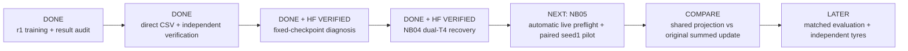
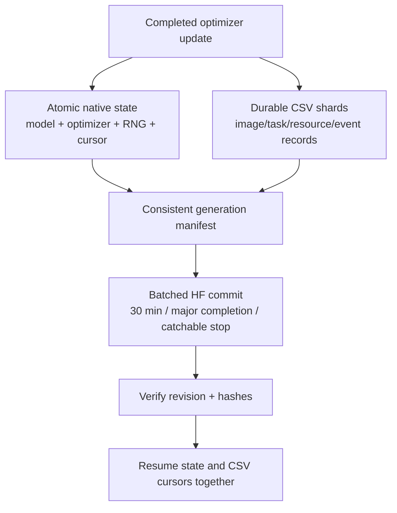

# Next steps — publish the completed ATLAS-LC evidence review

<!-- NB11_COMPLETE_UPDATE_20261030 -->
## Current — NB11 complete; NB12 review ready

**30 October 2026. NB11 is complete and independently HF-verified:** 60 epochs / 2,940 updates, 1,351 direct files and 54,336,368 raw scientific rows. The actual T4×2/live-HF preflight passed; ownership is released. No NB11 rerun is needed. [Full completion and findings](phase3NB11Completion.md).

Next: [NB12 saved-evidence review](notebooks/phase3_NB12_TREAD_TWO_ATLAS_LC_Completed_Review.ipynb), **CPU / Internet / HF_TOKEN / no dataset attachment**, then Run All. It adds 40 derived CSVs / 380,595 rows, four figures and a 1,442-case explorer with zero fitting or model forwards. Local recovery/cache/publication/package checks pass; actual NB12/HF review publication is pending. [Run guide](tread_two/lc_review/README.md).

After publication, audit the pinned review and use the saved failures/reference structure to decide a separately frozen next hypothesis. Do not repeat NB08–NB11, add a measured seed, choose by test score, collect new photos or modify workstations as an automatic next step.

<!-- END_NB11_COMPLETE_UPDATE -->
<!-- NB10_LC_UPDATE_20261030 -->
## Latest status — NB10 closed; NB11 ready, 30 October2026

NB10 is completed and independently HF-verified:495 direct files,1,918,052 scientific rows,386native training records,T4×2,zero fitting/held-out forwards and released ownership. No NB10 rerun is needed. [Completion proof](phase3NB10Completion.md).

1. Run NB11 unchanged on Kaggle:T4×2,Internet,expanded prepared input,HF_TOKEN.
2. Allow its actual live recovery/storage gate before the60epoch measured candidate. Preserve executed notebook and direct CSV/native evidence.
3. Audit the pinned completed publication,exposure,reference exclusions,loss accounting and selected/final failures before promotion.

No new photo collection or workstation work. Next is [NB11 / ATLAS-LC r2](notebooks/phase3_NB11_TREAD_TWO_ATLAS_LC_Resumable_Pilot.ipynb): one separately versioned seed,paired LC views,18-photo source-SHA exclusions,all386queries and sqrt-size group sampling. Local batch8 recovery/package checks pass; actual Kaggle/live-HF preflight and measured accuracy remain pending. Use T4×2,Internet,the existing expanded Kaggle dataset and HF_TOKEN. [Architecture](phase3TreadTwoLCArchitecture.md), [protocol](phase3TreadTwoLCProtocol.md).

<!-- END_NB10_LC_UPDATE -->
<!-- NB09_GATE_UPDATE_20261030 -->
**Current, 30 October 2026:** [NB09 is complete and HF-verified](phase3NB09Completion.md).
No NB08/NB09 rerun is needed.

Open [NB10](notebooks/phase3_NB10_TREAD_TWO_Train_Only_Appearance_And_Reference_Gate.ipynb),
select **T4×2**, attach exactly one expanded
**shanmuk4622/tire-dataset-prepared-phase2**, enable **Internet + HF_TOKEN**,
leave at least **4 GiB free** and choose **Run All**.
[Full run/resume guide](tread_two/appearance_gate/README.md).

The gate is implemented and complete locally, retaining 1,918,052 scientific
rows and full native image state. It uses frozen weights and publishes in a
new namespace, with image-unit recovery. Actual dual-T4/HF gate execution
remains pending. [Findings/tradeoffs](phase3TreadTwoAppearanceGate.md) distinguish
brightness-feature consistency from classification, and reference diversity
from remaining query scarcity. After actual gate review, freeze a new recipe
before any measured v2 fit. No new photos or workstation changes are needed.
The previous NB09 publication instructions below are historical.

**Current, 30 October 2026:** the saved-data review is complete. Open
[NB09](notebooks/phase3_NB09_TREAD_TWO_ATLAS_Completed_Review.ipynb), select
**None / CPU**, enable **Internet** and **HF_TOKEN**, leave at least **2 GiB
free**, and choose **Run All**. **No dataset attachment, T4 session, new tyre
photos or NB08 rerun is needed.** [Complete guide](tread_two/review/README.md).

The notebook verifies about 147 MB of existing evidence, regenerates the
30-table / 246,157-row analysis and full interactive report, and publishes them
directly to a separate HF review namespace. Local extracted-code and offline
publication checks pass; actual Kaggle NB09/publication remain pending.
Then independently audit the executed NB09 and its final HF revision.

[Findings and proposed model gate](phase3TreadTwoFindings.md) explain the
low-to-mid transfer failure, appearance probes and training-only checks needed
before another recipe is frozen. No new model has been fitted or promoted.
The earlier launch/review directions below are dated history.

**Current status, 30 October 2026:** NB08 completed all 60 epochs / 2,940
updates, selected/final evaluation, diagnostics and publication. The user
clarified that no error appeared. **Do not restart training.**
[Completion and retained reports](phase3NB08CompletionStatus.md).

Next, review the retained classification failures, selection, reference and
patch evidence, and fixed appearance/occlusion probes. Compare the candidate
with its saved original-frame frozen control; keep the existing cohort and
absent held-out mid-class limits explicit. Archive the latest executed Kaggle
notebook when available. No new fit, new photos or workstation changes are
required. The original launch instructions below are historical recovery guidance.

**30 October repair:** use the current notebook below and Run All. The live
T4/HF gate already passed, but the old local hourly HTTP policy blocked the
training launcher. [Repair, regression and rerun details](phase3NB08Repair.md).
The model/runtime/recipe/namespace stay unchanged; compatible gates and saved
progress are reused, while existing ownership is respected.

**Use existing data only. Workstation changes stay deferred.**

The isolated training implementation is ready with local engineering acceptance.
Open [NB08](notebooks/phase3_NB08_TREAD_TWO_ATLAS_Resumable_Pilot.ipynb), select
**T4×2**, attach expanded **shanmuk4622/tire-dataset-prepared-phase2**, enable
Internet and **HF_TOKEN**, then **Run All**. [Complete run/restart guide](tread_two/PILOT_RUN_GUIDE.md).

| Next execution | Meaning |
|---|---|
| Notebook preparation | Verify attached release, frozen anchor, environment and actual free space |
| Automatic live engineering gate | Reuse the verified compatible T4/HF proof; require any genuinely missing acceptance before the fit |
| One measured fit | Seed 1, 60 epochs / 2,940 updates; 378 queries plus fixed support; full direct CSV/native evidence |
| Selected/final review | All endpoint images, frozen baseline scores, signed patch/reference evidence, full projections and fixed diagnostics |
| Independent completion audit | Preserve the executed notebook; verify pinned remote files, selections, counts, raw metrics and failure cases |

Local checks establish engineering mechanics, not better classification. The
old low/high endpoint remains inspected development evidence, with no held-out
mid subjects. No NB02–NB07 rerun or additional data campaign is required.
See [implemented module/state flow](tread_two/PILOT_IMPLEMENTATION.md) and
[evidence schema](tread_two/PILOT_EVIDENCE_SCHEMA.md).

## Completed separate app, available for existing media

| Current action | Ready deliverable |
|---|---|
| Open the special separate model window | [TREAD-ONE Studio user guide](workstation/README.md); launch the independent app in phase3/workstation |
| Inspect existing photos or videos | Single-model classification, overlapping masks/boxes, six boundaries and signed evidence; native playback/freeze/seek |
| Retain results | Automatic session CSV; explicit full capture with ten CSV tables / 245,784 rows, native arrays/PNGs and hashes |
| Restore/compare captures | Verified saved outputs; class/texture/layer/wipe controls render without retraining |
| Refine the application later | Deferred by the user; keep both workstation sources/models preserved now |

[Implementation, isolation and tests](phase3TreadOneWorkstation.md).
No new data campaign or NB07 rerun is scheduled. The future TREAD-TWO fit remains
behind the engineering gates above. NB07's false
prospective-readiness result describes the unfulfilled new-cohort protocol;
the desktop faithfully exposes the already completed model on existing media.
The model's classification failure remains in its record; app integration is
not a new accuracy or deployment-superiority claim.

The [old identity/capture pack](phase3CollectionReview.md) is optional historical
support, not a required collection step. The original application remains
available independently; no source/model/launcher was replaced.

The remaining sections preserve the **pre-NB05 rationale and execution history**.
Their next-run wording is superseded by the completed audit and NB07 actions above;
do not rerun NB05 or choose another checkpoint using the observed test scores.

**29 October 2026:** use the [repaired NB05](notebooks/phase3_NB05_TREAD_ONE_Shared_Gradient_Paired_Pilot.ipynb).
The supplied run stopped at an occupied preflight HF lease. The notebook now
waits/retries that exact temporary conflict without changing the 27 experiment
files or overwriting another owner. [Repair, checks and rerun instructions](phase3NB05Repair.md).
Live preflight and the measured pair are still the next execution gates.

**Updated: 28 October 2026. Training and direct-CSV publication are complete.** NB02's 25-file / 18-CSV commit `91ccd3315bd296a76a8b583a6d0f2515ccb3d370` is independently verified. No export or training rerun is needed. [Publication evidence](phase3NB02Completion.md).

**NB03 is complete on Kaggle and independently HF-verified:** 27 direct files at `75400f019ba0c6741b5060925b9c956c0a1ca0a8`; [completion audit](phase3NB03Completion.md), [measured findings](phase3ClassifierDiagnosticResults.md). No NB03 rerun is needed.

**NB04 is now complete on both T4s and independently verified:**572 direct files, exact native/CSV recovery and both released writers. [Completion audit](phase3NB04Completion.md). No rerun is needed.

**The next controlled implementation is NB05:** [paired pilot notebook](notebooks/phase3_NB05_TREAD_ONE_Shared_Gradient_Paired_Pilot.ipynb), [protocol and run guide](phase3R2PairedPilot.md). It keeps the architecture/data fixed and tests one shared-gradient projection mechanism against a matched summed-gradient baseline. One paired seed, two 60-epoch conditions; new measured outcomes are pending. Its longer-run recovery/publisher changes have separate checks and an automatic live preflight in the same notebook.

| Work item | State | Completion gate |
|---|---|---|
| Three seeds × 60 epochs | Complete | Pinned source and full saved-state audit |
| Direct CSV on HF | Complete | 25 remote hashes, 18 table schemas and 191,904 scientific records verified |
| Classifier diagnosis | **Complete locally and on Kaggle** | 14,010 predictions/interventions, per-tyre/domain metrics, native maps and fixed-batch gradients verified |
| Diagnostic HF sync | **Complete / independently verified** | 27 file hashes, 336,600 core rows, 60 summaries and released owner checked |
| Next logger/publisher / NB04 | Implemented; locally accepted | 13 CSV families, original optimizer math exact, consistent native/CSV recovery and 22 offline faults |
| NB04 live HF acceptance | **Complete / independently verified** | Both pinned source/final states and572 files checked;7,524 repeated engineering rows |
| Controlled revision / NB05 | Implemented: one paired optimization comparison | Architecture, weighted objectives, sampler and selection fixed; only conflicting shared gradients change |
| NB05 measured execution | Next Kaggle Run All after local acceptance | Automatic new-path live preflight, then baseline/candidate60 epochs each; direct CSV, full validation and bounded native maps |
| Workstation promotion | Not supported now | Task/failure and same-machine latency/memory comparison |

## 1. Completed diagnosis and remaining hypothesis refinement

| Measured result | Consequence |
|---|---|
| All six checkpoints fit all 386 nominal train images | Basic training-identity fit is established; historical augmented accuracy remains unlogged |
| Validation BA varies from 2.44% to 100% | Prioritize identity/transfer behavior; retain matched class supports and the old test boundary |
| Oracle gate changes BA by at most 1.25 points | Do not expect a fixed-feature gate replacement alone to solve the failure |
| Background/occlusion effects differ sharply across checkpoints | Preserve context/input-intervention evidence; no universal background-removal fix is established |
| Class/segmentation gradients oppose on the same three-image batch | Instrument task interaction in the next logger; one batch does not establish the cause of generalization failure |

The protocol below is the implemented diagnosis specification and a record of possible follow-up refinements. [The results record](phase3ClassifierDiagnosticResults.md) identifies exactly what was measured.

Keep the current workstation model selection. The immediate model issue is the held-out low tyre: every selected TREAD-ONE seed misses all 62 photos, while segmentation remains strong.

NB03 used fixed selected/final weights for a **post-hoc inference-only diagnostic** on train and validation cohorts, with cohort-specific class probabilities, per-tyre confusion, evidence/gate maps and input interventions. Nominal inference is distinct from unrecorded augmented-batch accuracy; the observed failure is primarily transfer, while every training identity is classified correctly.

Inspect train/validation loss-component scales and, if needed, measure task-gradient alignment on a fixed diagnostic batch without optimizer updates. Compare the predicted gate with declared evaluation-only alternatives to test the bottleneck hypothesis; oracle masks would be a diagnostic, not the normal inference path. Label every intervention and keep its raw evidence.

Hypotheses to distinguish: limited independent low-class support/appearance shortcut; narrow evidence pooling; from-scratch representation; shared-task gradient competition. The present run does not isolate these causes. Increasing model size or changing every component at once would not answer which one matters.

| Hypothesis | Measurement / possible refinement | Interpretation boundary |
|---|---|---|
| Tyre-identity or appearance shortcut | Per-class and per-tyre train/validation probabilities, confusion and margins; retain photo/video domain | Strong fit to training identities with holdout failure supports a transfer concern, but does not isolate lighting/design/capture effects |
| Gate/pooling limitation | Compare normal inference with predefined gate/pooling interventions while recording all task outputs | Ground-truth-mask alternatives are oracle diagnostics, not deployable inference |
| Background/context sensitivity | Neutralization and region occlusion; record probability/margin deltas and examples | Perturbation sensitivity does not prove causal physical reasoning |
| Shared-task competition | Retained loss scales; optional task-gradient alignment on fixed batches without optimizer updates | Present gradients cannot reconstruct unlogged historical gradient behavior |
| Shared representation versus decision path | Fixed feature/evidence distributions by class and identity | Training a diagnostic probe would be a separate fitted experiment requiring its own split/protocol |

| Diagnostic artifact | Required content |
|---|---|
| `predictions.csv` | Seed/endpoint/checkpoint hash, source/image hash, split, tyre/domain, label, probabilities/logits, prediction/margin/correctness |
| Class/tyre/confusion CSV | Supports/denominators, absent-class handling, class/tyre/domain aggregates |
| `interventions.csv` | Named intervention/parameters, original/changed probabilities and margins, dense-task changes, timing/errors |
| Gradient CSV if computed | Fixed batch IDs, task/parameter definitions, norms/alignment, missing reasons and cost |
| Direct images/arrays | Bounded evidence/gate/mask examples and failure overlays |
| Contract/manifest/event CSV | Source/data/model identities, environment/configuration, hashes and resumable inference cursor |

NB03 keeps weights frozen and uses deterministic inference under its declared recipe, a separate diagnostic namespace and a self-contained Kaggle `.ipynb`. Any further use of the observed test cohort is development analysis, not a fresh blind selection result. **Exit gate:** the [results](phase3ClassifierDiagnosticResults.md) document supported, contradicted and unresolved hypotheses; no specific architecture/optimizer improvement is established.

## 2. Completed recovery gate and new long-run observability

The [NB04 implementation](phase3TrainingEvidenceGate.md) now exercises the [direct-CSV retention policy](phase3DataRetentionPolicy.md) with actual pre-update augmented predictions/losses, class/region/point sufficient statistics, stage timing, bounded resources, module gradients/activations and explicit gaps. Atomic local generations and direct epoch CSV/native snapshots replace the historical ZIP mechanism for this separate engineering protocol.

NB04's local and actual dual-T4/live-HF proofs pass. Its short fixture is not a long measured protocol. The new [NB05 implementation](phase3R2PairedPilot.md) freezes the longer-run recipe, all 81 validation images per epoch, selected/final endpoints, actual task-gradient observations and a bounded map schedule. A transactional local journal avoids tiny-file accumulation; HF receives normal direct CSV/native files through bounded immutable batches. New local acceptance and automatic live preflight cover these changed paths.

The completed r1 runtime and generated/executed notebooks remain preserved. Logger/publisher improvements get a new source/protocol identity; no resume-identity bypass or renaming of the completed experiment.

| Gate | Required evidence |
|---|---|
| Coverage | Every requested family stored or an explicit missing/unsupported/cost reason |
| Storage | Measured working/scratch capacity and bounded shards under the output budget |
| Resume | Fresh-process completed-update equivalence and matching state/CSV cursors |
| Partial writes | Interrupted state/shard/manifest recovers to the last complete generation |
| HF faults | Server delay, transport failure, ambiguous commit, stale writer and cached restore checks |
| Cost | Separate telemetry/checkpoint/upload overhead from training/validation timing |

## 3. Selected controlled change: shared-only gradient conflict projection

The selected pilot keeps the architecture and weighted forward objectives fixed. It compares the original summed shared update against symmetric two-objective projection only when the shared dot product is negative. All task-specific head gradients retain the original total backward. Both conditions log the same task-gradient observations, with matched initialization/data/augmentation and one predeclared seed 1. [Math, sources, limits and exact run instructions](phase3R2PairedPilot.md).

This isolates a motivated training mechanism; it does not establish that gradient conflict caused the old classifier's transfer failure. One paired seed is not a robustness study. Preserve task losses/failures and the old test boundary, then inspect the actual comparison before choosing any later study or app integration.

| Supported finding | Candidate next action, not a selected implementation |
|---|---|
| Head/gate limitation | Change one classification path while preserving the dense paths |
| Task competition | Change one objective/optimization mechanism while preserving architecture |
| Data/identity limitation | Plan independent tyre coverage and a declared generalization evaluation |
| Inconclusive evidence | Run a targeted diagnostic before spending another training budget |

No new measured training has run locally; NB05 delivers the declared paired study for Kaggle. Existing test use is iterative development evidence. Strong generalization claims require a genuinely independent tyre-disjoint cohort, including mid/video examples if those claims are desired. Additional frames from the existing tyres cannot provide that independence.

## Promotion boundary

Consider installation only after the candidate's accuracy, failure behavior and actual same-machine latency/memory are compared against current models under declared criteria. R1 does not improve the installed task scores, so no replacement is made now. Physical wear/depth and calibrated alignment remain separate data/validation problems.
