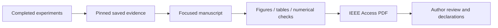

# Phase 3 IEEE Access paper

**3 November 2026 — complete, checked author-review draft: 15 pages, seven figures,
five tables, 18 research references and one AI-system citation.** No training or
notebook rerun is required. Numeric and visual receipts are in the audit folder.

> **Local Texture Evidence and Aggregation in Compact Tyre Inspection:
> A Reproducible Limited-Data Study**

Open the [paper PDF](paper_ieee_access/main.pdf) or the
[editable source and package guide](paper_ieee_access/README.md).
The new folder is separate from the original September manuscript.

## What the paper contributes

| Question | Evidence presented | Conclusion |
|---|---|---|
| Do good dense outputs ensure useful proxy predictions? | TREAD-ONE and serial ATLAS revisions | No; internal geometry/mask agreement coexists with poor cross-tyre transfer |
| Can TRACE learn observable texture? | Fixed local fields, controls and all 60 epochs | Local/masked utility improves, but global diversity fails every epoch |
| Does aggregation preserve the useful local evidence? | Nine fixed interventions with unchanged decoder | Retention depends on spatial structure, descriptor and component |
| Does higher rank prove better evidence? | Invertible scaling and exploratory mask-layout CKA | No; rank needs utility and nuisance controls |

The primary local validation result is **61.14% retained advantage for a mean**
versus **81.76% for a position template plus five residual moments**. These are
fixed-decoder reconstruction comparisons, not classification accuracy or physical
wear measurements. TRACE remains **selected=None**.

## Package and review

| Deliverable | Link |
|---|---|
| PDF / LaTeX / figures | [Package guide](paper_ieee_access/README.md) |
| Scientific claims and boundaries | [Claim ledger](paper_ieee_access/CLAIMS_AND_LIMITATIONS.md) |
| Source / citation checking | [Citation audit](paper_ieee_access/CITATION_AUDIT.md) |
| Reproduction and provenance | [Reproduction guide](paper_ieee_access/REPRODUCIBILITY.md) |
| Remaining author decisions | [Submission checklist](paper_ieee_access/SUBMISSION_CHECKLIST.md) |
| Preparation history | [Writing log](paper_ieee_access/WRITING_LOG.md) |
| Numeric/PDF checks | [Validation](paper_ieee_access/audit/VALIDATION.json) |
| Latest visual inspection | [Visual review](paper_ieee_access/audit/VISUAL_REVIEW.md) |

Working authors follow the previously recorded Edara–Bonala line. The authors
still need to confirm authorship/contributions, approval, funding/conflicts,
permissions, related-manuscript status and the final availability statement.
There is no journal submission or guarantee of acceptance.

No new photographs, model fit, checkpoint selection, scientific-source rewrite,
workstation change, HF upload or Git push occurred. The paper assets are local;
existing fit/review evidence remains on the previously verified HF revisions.
