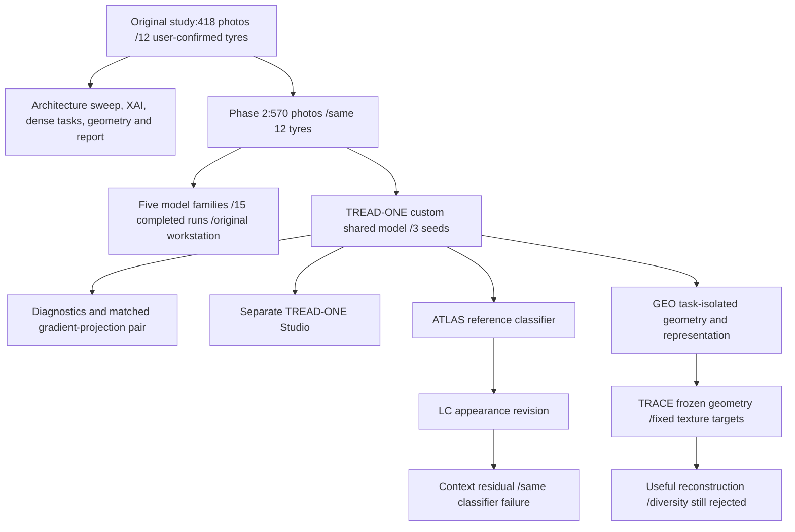
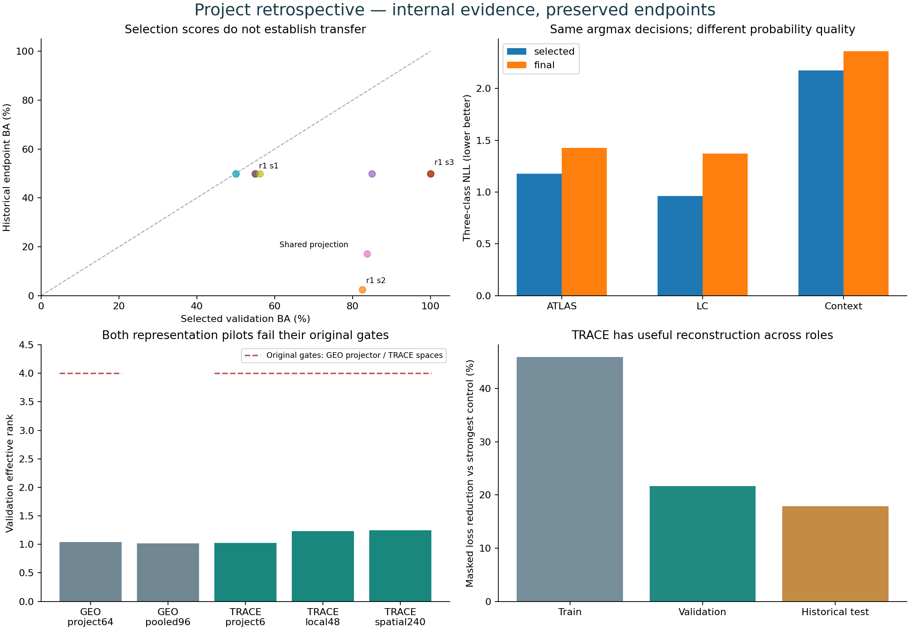

# Whole-project retrospective — what the evidence now supports

**2 November 2026 · through completed NB24 / TREAD-TWO TRACE.**

The project has built a substantial tyre-vision research system: prepared data,
multiple completed model studies, custom architectures, dense geometry, evidence
visualization, resumable Kaggle/HF execution, two desktop interfaces and a manuscript.
Its strongest measured capabilities are internal region segmentation, image-space
boundary localization and, most recently, fixed-texture reconstruction. Reliable
transfer of the mileage classifier remains unresolved.

The next useful direction is **local geometry and texture evidence whose utility
can be checked on the existing data**, followed by a separately justified model
objective. A larger architecture or another unchanged classifier fit is not the
default next step supported by these results.

This review inventories **236 maintained Markdown documents** and links the
controlling evidence. Detailed synthesis uses 40 source records and a new analysis
of 444 checksum-verified scientific files,59,176,731 bytes. It makes no fresh HF
availability claim: the earlier pinned HF audits remain the verification authority.
No model forward, training, new photo, source-label change or remote write occurred.

[Interactive project/TRACE explorer](retrospective_20261102/Project_Evidence_Explorer.html) ·
[New component analysis](phase3TRACEComponentReview.md) ·
[Evidence inventory](retrospective_20261102/SOURCE_EVIDENCE.csv) ·
[All-document inventory](retrospective_20261102/MARKDOWN_INVENTORY.csv).

## 1. The project has several distinct completed layers

| Layer | Completed work | Main scientific boundary |
|---|---|---|
| Original study |153 retained architecture-sweep runs;108 OFAT runs;18 confirmation runs;81 manual-supervised dense runs; geometry studies and saved-result reviews | Different protocols/roles; suspected old fold overlap, few capture groups, proxy labels and selection effects |
| Original geometry / paper | Matched 3-seed HRNet and SegFormer study;28 pipelines ×9-image visual replay; revised manuscript with 34 references | HRNet 1.312% vs SegFormer 1.721% width error is an internal, differently supervised comparison; no external physical validation or submission claim |
| Phase 2 |418 originals +152 frames from existing mid tyres; all 15 combined-data runs and final NB06 complete; five original installed selections retained | More views of existing tyres; held-out mid absent; original-data-only controls not performed |
| Phase 3 TREAD-ONE | Custom 1,372,159-parameter multitask model;3 seeds; masks, derived boxes, six points and additive class evidence; independent Studio | Internal dense quality; poor mileage transfer; evidence accounting does not validate semantic reasoning |
| Phase 3 TREAD-TWO | ATLAS, LC, context, GEO and TRACE studies, engineering gates and postrun reviews complete | Different revisions answer different hypotheses; no unselected model is promoted |
| Applications | Original Tread Station and isolated TREAD-ONE Studio; evidence export/restore; target-assisted alignment software | Implemented software is separate from field accuracy, physical calibration and reliable classification |

Original-study counts describe named tracks, not a deduplicated grand total of
all training in the repository. [Original sweep](../docs/18_STAGE_A_RESULTS.md),
[confirmation](../docs/23_S4B_CONFIRMATION.md), [dense study](../docs/24_S5_MANUAL_DENSE_TASKS.md),
[paper revision](../ACCESS_latex_template_20260513/SUBMISSION_REVISION_20260924.md).

The original study already showed checkpoint sensitivity and strong trivial
colour/texture baselines on some folds. Two folds carried suspected overlap
flags; later user identity confirmation and recorded-group disjointness do not
turn those historical flags into independently proven physical identity. Its
same-fold S4b confirmation found that random initialization hurt both added
architectures (selected macro-F1 deltas−0.428566 /−0.371504), while sampling
directions did not repeat across both models. Architecture breadth, pretrained
versus custom initialization, sampling and checkpoint choice must therefore be
treated as different experimental questions, not one leaderboard.

## 2. What Phase 3 actually trained

There are **seven measured fit families /ten fit executions /600 epochs /
29,400 optimizer updates** through NB24. This excludes disposable engineering
updates. A continuation does not count as a new fit: NB13A finished NB13. Masters
do not double the fit count: NB24 executed the NB22 training stage, and NB20
executed the GEO postrun stages. Reviews and diagnostics are not extra models.

| Family | Fit executions | Training notebook / orchestration | Measured outcome | Authority |
|---|---:|---|---|---|
| TREAD-ONE r1 | 3 | NB01 | classification transfer weak; internal dense outputs useful | [Record](phase3CompletionAudit.md) |
| TREAD-ONE paired r2 | 2 | NB05 | projection selected BA 17.073% vs baseline 50%; point error worse | [Record](phase3NB05Completion.md) |
| ATLAS v1 | 1 | NB08 | low recall 0/62; appearance-sensitive | [Record](phase3TreadTwoFindings.md) |
| ATLAS-LC | 1 | NB11 | appearance stability and selected NLL improve; low recall unchanged | [Record](phase3NB12Completion.md) |
| ATLAS-CONTEXT | 1 | NB13 + NB13A same fit | layout-sensitive; NLL worse; low recall unchanged | [Record](phase3NB13Completion.md) |
| GEO | 1 | NB17 | geometry maintained; representation 0/60 eligible; learned error heads lose to controls | [Record](phase3NB17Completion.md) |
| TRACE | 1 | NB24 wraps NB22 | masked gain 21.63%; local gain 36.44%; broad diversity 0/60 | [Record](phase3NB24Completion.md) |

The two paired conditions are fit executions, not two new architectures or new
independent tyre cohorts. One seed for each later candidate gives a measured
result for that configuration; it does not establish seed stability.
[Fit ledger](retrospective_20261102/PHASE3_FIT_LEDGER.csv).

The figure is descriptive. The cohorts, tasks, architectures and selection rules
are not interchangeable. No pooled significance test, architecture ranking,
test-selected checkpoint or matched GEO-versus-TRACE effect is inferred.
GEO pooled96 rank is a diagnostic, not an additional original rank gate; the
red threshold is drawn only over the spaces constrained by their actual rules.

## 3. Dense vision is the strongest established part

| Existing selected artifact | Historical task result | Interpretation |
|---|---|---|
| Phase 2 SegFormer seed 2 /epoch 29 |98.957% mean two-region Dice | Strong internal tyre/tread masks |
| Phase 2 YOLO26 Medium seed 1 /epoch 10 |98.790% Dice | Strong internal region prediction under its recipe |
| Phase 2 HRNet seed 3 /epoch 2 |0.859% image-width point MAE,25 human-labelled test photos | Useful image-space boundaries; not millimetres or alignment degrees |
| TREAD-ONE seed 3 /epoch 20 |98.419% Dice /1.196% point MAE | Compact shared implementation; no demonstrated dense-score improvement over installed models |
| GEO final, validation only |98.986% Dice /0.7662% point MAE | Geometry floors pass60/60; point error5.23% below G0 retrospectively; original joint selection still unavailable |

GEO's validation row must not be ranked against the other rows' historical test
scores. Dice uses overlapping tyre/tread channels at model-input resolution,
excluding ignore pixels. Point error uses eligible human labels and image width;
derived weak targets are not new independent human truth. Boxes obtained from
masks are localization outputs, not a separately human-validated damage detector.
[Phase 2 selections](retrospective_20261102/PHASE2_SELECTIONS.csv),
[TREAD-ONE audit](phase3CompletionAudit.md), [GEO audit](phase3NB17Completion.md).

## 4. Classification failure persists through several different designs

| Preserved selected endpoint | Validation BA | Historical observed-class BA | Main finding |
|---|---:|---:|---|
| Phase 2 MobileNetV4 seed 1 |100% |50% | A perfect selected validation score did not transfer |
| Phase 2 ResNet50 seed 2 |85% |50% | Same limitation in a different family |
| TREAD-ONE r1 seeds1/2/3 |55% /82.5% /100% |50% /2.439% /50% | Strong seed/selection instability; selected-seed mean 34.146% |
| Paired shared projection seed 1 |83.75% |17.073% | Worse than matched baseline 50%; point error also worse |
| ATLAS v1 |50% |50% |62 low→mid;41 high→high; appearance sensitivity |
| ATLAS-LC |56.25% |50% | Same low failure; selected NLL improves to 0.961273 |
| ATLAS-CONTEXT |50% |50% | Same low failure; selected NLL worsens to 2.174813 |

The historical endpoint has 103 photos but only **two known tyres**,62 low and 41
high, with no mid targets. Observed-class BA averages low/high recall while mid
predictions still count as errors. The repeated50% result here is specifically
low recall 0% /high recall 100%; it is not a three-class success rate or a calibrated
chance benchmark. Mid recall is unavailable, not a measured zero.

Selection is preserved. MobileNet seed 3's94.35% test BA does not authorize
substituting it for the original validation-tied seed 1. An attractive late or
test-favoured checkpoint is not a new independent result. These endpoints have
already influenced development; they are historical development evidence.
[Endpoint CSV](retrospective_20261102/CLASSIFICATION_ENDPOINTS.csv).

### The revisions were motivated; their fixes answered narrower questions

| Observation → design response | What improved | What remained unresolved |
|---|---|---|
| Opposing task gradients → shared-gradient projection | Intervention occurred on 91.84% of candidate updates; shared/head accounting retained | Selected classification regressed32.93 percentage points; human point error rose about 76.6% |
| v1 brightness/grayscale sensitivity → LC representation +paired views | Saved appearance probes stabilized; all 386 train queries covered; exact-source self-reference blocked | Low recall remained0/62; selected ECE worsened despite better NLL/Brier |
| Equal-band pooling ignored order → bounded positional context | Model became layout-sensitive; corrections and attention were fully recorded | Training confidence increased; low predictions remained wrong and NLL worsened |
| Shared-task concerns → GEO task isolation | Geometry remained useful without shared trainable task gradients | Texture representation failed gates; learned error heads lost to constant controls |
| Correlated/self targets and 64D/batch8 issue → TRACE fixed local targets and 6D diversity head | Reconstruction beats fixed controls; local tokens retain more variation than pooled summaries | Original projector/encoder gates still reject all 60 epochs |

These are completed hypothesis tests, not evidence that every proposed remedy
worked or that a single failure proves the mechanism causing all later errors.

## 5. TRACE provides real local utility despite failing its global gate

The new saved-only analysis partitions final-epoch reconstruction into individual
images and all ten conservative components. It does not fit or select a model.

| Role | Images | Masked gain vs strongest aggregate control | Local gain vs position control | Images beating all 3 controls | Images with ≥5% gain vs all 3 |
|---|---:|---:|---:|---:|---:|
| Train |386 |45.93% |53.63% |386/386 |386/386 |
| Validation |81 |21.63% |36.44% |81/81 |81/81 |
| Historical test |103 |17.85% |37.80% |103/103 |98/103 |

Both validation and both test components improve descriptively; the gain is not
confined to one component. This is encouraging for image-derived texture
inspection. It is **not** a claim that all 570 images satisfy every selection
criterion or that570 independent tyres were evaluated. The calculation uses
final epoch 60, clean view0 and its recorded hidden-tile plan, on common support.

The global representation remains dominated by between-component variation:
96.78% for validation local pooling and 96.56% for spatial moments. Yet the saved
per-position local encoder rank has median 2.899 on validation, compared with
global local-pooling rank 1.230; within-component pooled rank is 9.782. Local
texture information can exist while aggregate vectors remain narrow. This
motivates investigation of local evidence-preserving aggregation; it does not
prove that a replacement pooling rule would fix classification.

[Complete new diagnostics and caveats](phase3TRACEComponentReview.md).

## 6. The dataset constrains the claims and evaluation

| Quantity | Current fact | Consequence |
|---|---|---|
| Photos |570 =418 originals +152 frames of existing mid tyres | The152 frames add views, not new tyres |
| Known identities |12 user-confirmed tyres; no independent identity audit | Preserve source/group constraints and confidence of identity claims |
| Fixed roles |386 train /81 validation /103 historical test | Keep these roles and provenance; no hidden relabelling or random frame split |
| Training proxy classes |67 low /249 mid /70 high images | Image counts do not describe independent support |
| Known train tyres by class |1 low /3 mid /4 high | Low-class diversity is particularly limited |
| Conservative train components |1 low /1 unresolved-mid component /4 high | Withholding low or mid component removes a fit class; two of six conditional holdouts lack full class support |
| Human point truth |70 train /25 validation /25 test images |152 weak derived proposals and 164 train images without point targets remain distinguishable |
| Targets |Mileage proxies; no measured tread-depth/safety truth | No physical wear, roadworthiness or millimetre-depth accuracy claim |
| User scope |Existing photos only; no further acquisition | Adapt task/evidence to available data; new photos are not a prerequisite for current analysis |

Conservative mid grouping preserves unresolved clip-parent relationships. It
does not assert the three known mid tyres are physically identical. Repeated
views, annotations, seeds, CSV cells, synthetic augmentation and model-generated
labels do not increase independent tyre count. A support gate returning false
is an informative result, not an error to fix by rerunning unchanged inputs.
[Readiness evidence](phase3NB15Completion.md), [source release](../phase2/phase2DatasetReadme.md).

## 7. Explainability, reliability and physical measurement are separate

| Implemented evidence | Established property | Additional claim still unsupported |
|---|---|---|
| Signed TREAD-ONE /ATLAS patch contributions | Logits reconstruct from retained contributions and bias | Evidence necessarily follows physical wear or establishes input causality |
| Attention and spatial interventions | Internal distributions and sensitivity to a defined perturbation | Attention is a causal explanation or calibrated damage map |
| TRACE residual maps | Standardized fixed-descriptor reconstruction error with support/missingness | Residual equals depth, damage, hazard or confidence |
| NLL/Brier/ECE | Different properties of saved proxy probabilities | One aggregate number certifies useful classification or deployment reliability |
| Learned GEO error estimates | Raw predictions/control comparison retained | Quality heads are validated uncertainty; they lost to constant controls |
| Target-assisted alignment software | Implemented calibrated-target workflow and synthetic checks | Independently validated physical wheel-angle accuracy or roadworthiness |

The original report also retains negative ROI/fusion findings: predicted tyre
and tread crops changed mean macro-F1 by−0.01257 /−0.01467 in the tested S5
scope; equal full+tyre+tread fusion had mean delta−0.013238. Better segmentation
does not automatically improve a frozen classifier. The original XAI advantage
hypothesis was unsupported, H2 inconclusive/undefined and H3 untested in its
declared scope. [Original claims ledger](../docs/report/CLAIMS_AND_LIMITATIONS.md).

## 8. Engineering progress is substantial and should be retained

The project now has source/data/environment-bound experiments, direct readable
CSV/native evidence, complete-update state, actual HF restore/continue gates,
transaction fault checks, resource accounting, owner fencing, quota/backoff
handling and automatic sequential notebook masters. NB13A actually resumed the
original run at update 2,486 and completed its 454 remaining updates. Catchable
stop publication is implemented; an uncatchable container kill cannot guarantee
cleanup or recover work never published.

| Evidence layer | Representative retained scope | Count boundary |
|---|---|---|
| TREAD-ONE r1 /NB02 |191,904 scientific rows, direct recovery from old archives | Original missing training-detail fields remain missing |
| Paired TREAD-ONE |1,561,734 core rows,412 endpoint maps |23 core families; broader auxiliary counts have a different scope |
| ATLAS-LC |54,336,368 raw scientific rows |Many affinity/pixel rows per correlated observation |
| ATLAS-CONTEXT |58,176,066 raw rows |Richer same-data evidence; not new subjects |
| GEO |27,514,418 raw CSV rows |Completed fit; no joint selected checkpoint |
| TRACE |47,263,346 fit-publication rows, including297,021 inherited cache rows;13.507 GB |3,553 CSVs /6,725 NPY /64 PT; scope differs from GEO |

These totals must not be added as independent training examples or directly
ranked as model quality. TRACE's published dense audit and the later bounded
independent objective/gate audit have different verified scopes. Every report
must say which it performed. Unrecorded historical optimizer states, continuous
energy, full video truth and physical labels cannot be recreated by prose.

## 9. Application, manuscript and documentation status

Original Tread Station retains the five Phase 2 validation-selected models.
Separate TREAD-ONE Studio retains seed 3/epoch 20 and its own sources/settings/
outputs. Both are implemented; current workstation revisions are deferred by the
user. No ATLAS/GEO/TRACE candidate was installed by this analysis.

The September 24 manuscript is a completed author-review artifact for its
original-study scope, with 34 references and verified original-model replay.
Phase 3 results are not silently incorporated into that manuscript, and no
submission, approval or new external validation is claimed. Original papers,
root documentation and model sources are preserved.

Documentation now spans several scopes and many historical “current/next”
blocks. Resolve status by **experiment namespace → exact artifact/endpoint →
later relevant completion receipt**. A September root-current page does not
replace November Phase 3 evidence, and a new Phase 3 result does not rewrite an
original paper experiment. This retrospective supplies navigation rather than
deleting earlier decisions. [Precedence ledger](phase3DocumentationConflicts.md).

## 10. What we should do next

**Immediate outcome of this analysis:** the new570-image /10-component TRACE
diagnostic is complete locally. It confirms broad internal reconstruction
utility and a local-versus-pooled representation difference. Its CSVs/HTML are
local research derivatives; they have not been published to HF in this pass.

| Priority | Existing-data action | Decision it should support |
|---|---|---|
|1 | Examine native local tokens, descriptor channels, residuals and support together; preserve train-only controls | Does local evidence add useful structure beyond fixed descriptors and position? |
|2 | Separate component-centred signal, coverage and aggregation effects without using labels to fit held-out roles | Is useful local information being lost or dominated during aggregation? |
|3 | Define an inspection task with labels/targets that actually exist; write its controls, failure criteria and retention first | Is another single custom fit scientifically justified? |
|4 | If justified, freeze one new protocol and deliver the complete automatic notebook batch | Test the declared hypothesis without changing completed runs or calling old test data blind |
| Deferred | Workstation changes, physical alignment validation and paper expansion | Respect user scope; acknowledge existing implementation and missing physical evidence |

Preserve every original selection and `selected=None` for GEO/TRACE. Do not relax
the failed gates after seeing results. Avoid another same-objective sweep, a
transformer substitution justified only by novelty, or more epochs presented as
new independent evidence. The next model should be designed around a supported
local-structure task and demonstrated controls, with honest evaluation limits.
