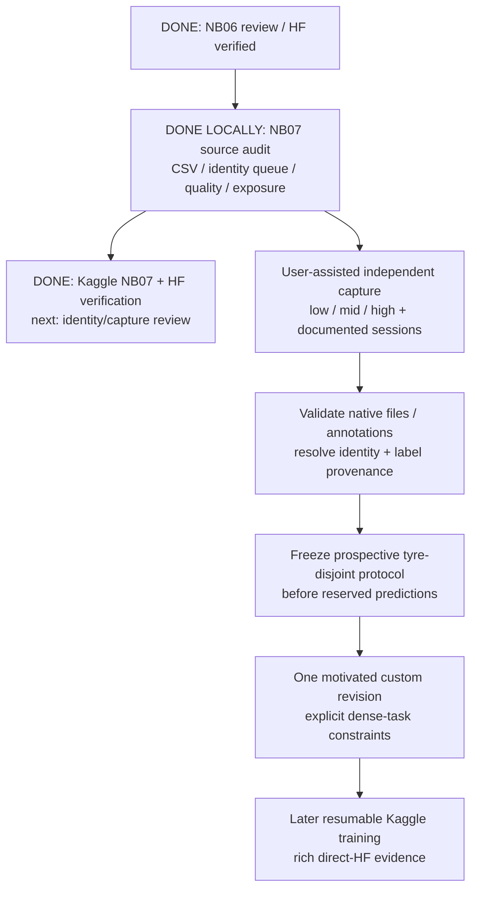

# TREAD-ONE — prospective data and protocol gate

<!-- STATION CURRENT -->
**Superseded acquisition plan — 29 October 2026.** The user has explicitly
decided to use only existing tyre data and will not collect more tyre photos.
The current authorized work is the [separate TREAD-ONE workstation](phase3TreadOneWorkstation.md).
The identity review and prospective gate below remain historical/optional
evidence. Their unmet prospective criteria do not block current desktop use.
No additional collection, protocol-freeze exercise or NB07 rerun is requested now.
<!-- END STATION CURRENT -->

**Repeat checked, 29 October 2026:** the latest supplied NB07 also passes.
All 45 payload files are unchanged and HF uploaded zero new payload objects.
**No further NB07 run is needed now.** A false readiness flag requires actual
new intake/protocol work, not another identical execution. [Repeat check](phase3NB07RepeatCheck.md).

**29 October 2026: NB07 is complete on Kaggle and independently HF-verified.**
[Completion and exact publication](phase3NB07Completion.md). The source-data
audit is complete; actual independent collection and protocol freeze remain
open. Read [NB07 technical/run guide](phase3NB07DataGate.md),
[22-table CSV inventory](data_gate_outputs/CSV_INDEX.md) and
[intake instructions](data_intake/README.md).

| Gate | State | Evidence / next action |
|---|---|---|
| Existing source and historical grouping | Pass locally | 570 images / 12 tyres; 10 conservative components; hashes and split constraints checked |
| Richer CSV collection | Implemented and executed locally | 22 tables / 7,614 rows, including schema; 47,040 old augmented occurrences summarized |
| Identity review | Queue implemented; mapping unresolved | Three distinct existing mid clips, nine possible parent combinations; no automatic identity assignment |
| New independent subjects | Missing | Zero additional tyres/images supplied; user plans to help later |
| Prospective data readiness | False, expected | 12 explicit gaps; actual intake, role/class minima and frozen policy missing |
| Kaggle / HF execution | Complete / independently verified | Five successful cells, 46 direct files, 26 CSVs; released writer |
| Identity/capture review tool | Implemented/checked locally | [Comparison and export guide](phase3CollectionReview.md); actual new data still needed |
| Later custom revision | Not started | Choose one justified hypothesis after data/protocol review; no r3 fit or promotion |

## Evidence behind the order

| Observation | Consequence |
|---|---|
| Both NB05 selected models miss all 62 low test photos | Low transfer must remain an explicit endpoint |
| Training contains only one low tyre | Add independent subjects rather than counting repeated photos as evidence of transfer |
| No mid tyre in historical validation/test | Acquire new reserved mid subjects before claiming unseen-mid generalization |
| Projection validation BA 83.75%, selected test BA 17.073% | Validation spikes do not replace representative independent evaluation |
| Dice remains near 97.8%; candidate point error rises | Declare dense-task preservation before the next fit |
| Labels are mileage proxies | Physical wear/depth requires separate actual measurement truth |

This motivates a data/representation investigation; it does not establish a
single cause of failure or a universal optimizer conclusion.

## Rules before another model fit

Keep all views/derivatives of a tyre together. The old inspected test set is
development evidence; new reserved validation/test subjects must be independent.
Leave unknown readings/identities blank with a reason. Human and weak point
labels remain distinct. Record proxy sources, mask review and capture conditions.
Choose actual positive per-class/per-role subject minima against the study
budget; no sample size, recruitment campaign or split ratio is invented here.

Passing the software data gate is not approval of a complete scientific
experiment. Document model hypothesis, changed parameters/objectives, selection
rule, task/failure endpoints, dense preservation and budget before training.
A tread-focused classification path remains a candidate design question,
not a selected or validated architecture. If data changes too, comparison to
old models does not isolate architecture effects.

Future training follows [standing instructions](AGENTS.md): Kaggle notebook,
measured storage, documented dual-T4 usage, native completed-update recovery,
extensive direct CSV, explicit HF_TOKEN and bounded periodic/stop publication.
NB07 itself is a finite CPU audit with completed-stage publication.
