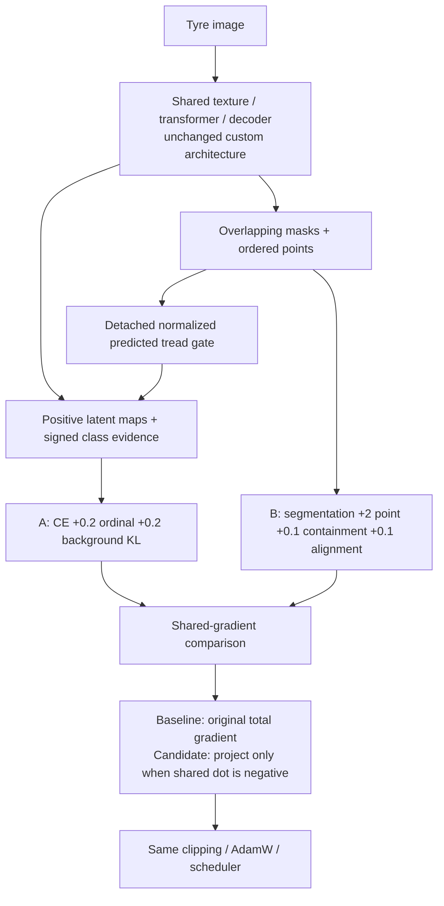
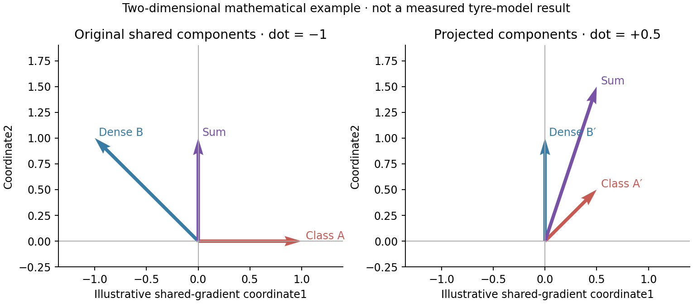
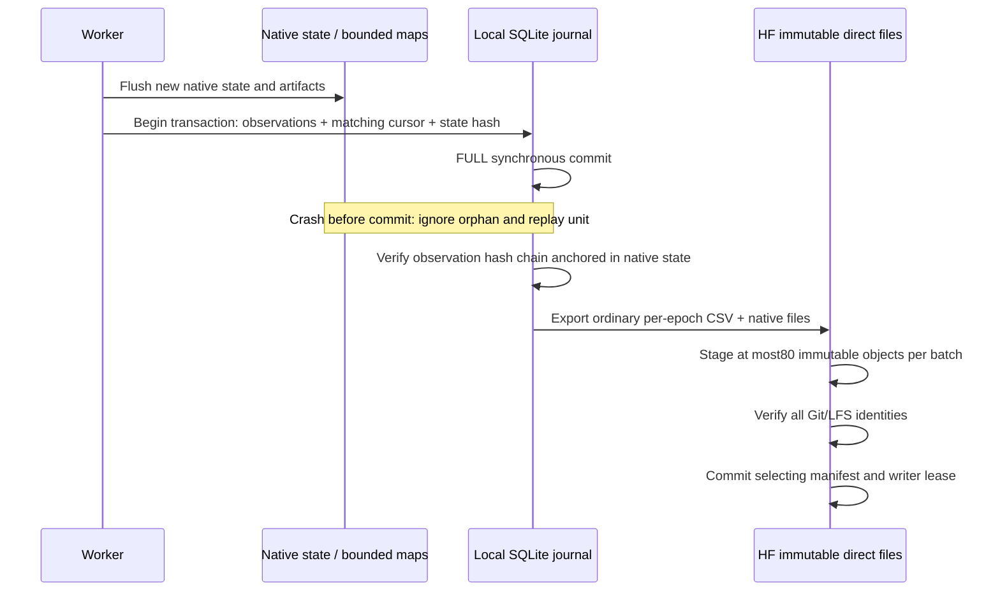

# TREAD-ONE r2 — one paired shared-gradient pilot

**Completed, 29 October 2026:** both measured conditions and live recovery
preflights are independently verified. Selected test BA is baseline 50% vs
projection 17.073%; no candidate promotion. [Full completion](phase3NB05Completion.md).
The remainder is the frozen design/acceptance/run history. **No NB05 rerun is
needed.** Next: [NB06 CPU review/publication](phase3NB06Review.md).

**Historical 29 October 2026 repair:** the earlier supplied execution stopped at an occupied HF
writer lease during baseline preflight. The current notebook waits and safely
retries every 5 minutes, up to 90 minutes of accumulated waiting; Stop cancels.
All 27 experiment files and the source/checkpoint contract remain unchanged.
[Exact failure, local tests and instructions](phase3NB05Repair.md). A new live
Kaggle run and measured results are still pending.

**28 October 2026.** [NB04 is complete and independently HF-verified on both T4s](phase3NB04Completion.md).
The next step is a controlled optimization comparison within the existing custom
TREAD-ONE architecture. **Local acceptance passed:**16 offline faults/analytic
checks and both actual-model recovery cases, with exact original baseline math.
The measured study has not started here; Kaggle/live r2 preflight is pending.

**Notebook:** [NB05 — Shared Gradient Paired Pilot](notebooks/phase3_NB05_TREAD_ONE_Shared_Gradient_Paired_Pilot.ipynb).
It contains the automatic live recovery preflight and the two measured runs in
one Run All workflow. It does not reuse engineering-fixture weights for training.

| Accepted delivery | Identity |
|---|---|
| Notebook, repaired 29 October |168,270 bytes; SHA-256 `5bd1855e04fbac4abbeb0b96b6a023b15419c21c96954828bb9c7fb9715ec3a2` |
| Embedded sources |27 exact files, including17 frozen r1/NB04 dependencies |
| Notebook-only launcher |Safe preflight lease waiting; separate from the unchanged experiment payload; [repair provenance](phase3NB05Repair.md) |
| Stable study intent |`16dfddd7672e70c3b321cc6adc4044d5a6c4453a75d7b84a29f72fdd6ab6c1dc` |
| Local paired initialization hash |`6a9d01f3e8c5c3e7e21bb19467942457b11066003bc6124fa2f8a633d42c8263` |
| Local model scope |GTX1650/cv_conda; four-update/two-surrogate-epoch fixtures per condition |

The local candidate encountered four conflicting shared-gradient observations
and applied four projections; the baseline encountered three and applied none.
Their trajectories diverge after intervention, so these small counts are
implementation evidence, not a quality comparison. Head-gradient change was
measured as zero. Timing, resource and native-file metadata are excluded from
scientific equality checks; model/optimizer/scheduler/scaler/RNG/cursors agree
exactly after resume. [Exact identities](revision2_validation/ACCEPTED_IDENTITIES.json).

## Decision and connection to the tyre evidence

| Observed project evidence | Design consequence |
|---|---|
| NB03: all six endpoints fit every nominal training image, but validation transfer is unstable | Keep a matched baseline and all class/tyre records; do not assume model size fixes the problem |
| Oracle gates improve validation BA by at most 1.25 points | Preserve the existing forward gate and architecture in this comparison |
| Class/segmentation gradients oppose on one fixed batch | Test a shared-gradient conflict mechanism and measure both objectives at every update |
| Dense prediction already works better than classification within TREAD-ONE | Retain dense-task endpoints and failures; projection is not a guarantee that dense quality stays constant |
| Very few independent tyres; no held-out mid/video cohort | Treat this as a development pilot; continue independent data acquisition with the user's help |
| User prioritizes few models and much richer retained evidence | One unchanged architecture, one predeclared paired seed, two matched conditions, full scalar/validation evidence |

**Selected change:** symmetric two-objective conflict projection on the shared
modules. This is an adaptation of an established gradient-surgery idea, not a
claim to have invented a new general optimizer. The original PCGrad paper
projects conflicting task gradients away from each other; our implementation
uses two weighted objectives and preserves the original summed-gradient scale.
Application to this tyre network is a hypothesis to test. [Original paper](https://arxiv.org/abs/2001.06782v4).

## Fixed experiment

| Contract item | Frozen choice |
|---|---|
| Architecture | Original custom TREAD-ONE-r1, 1,372,159 parameters; from scratch |
| Conditions | `baseline` and `shared_projection` |
| Scientific seed | **1**, the first original seed by fixed ordering; not selected using a best test result |
| Runs | **Two fits of one architecture**, one per condition |
| Budget | 60 epochs ×49 optimizer updates =2,940 updates per condition |
| Pairing | Identical initialization seed, batch identities/order, augmentation seeds, loss weights and optimizer recipe |
| Initialization proof | Each condition retains its actual initial model tensor-content SHA-256 and parameter count; paired local acceptance checks equality |
| GPUs | Baseline `cuda:0`; projection `cuda:1`, concurrently on Kaggle T4×2 |
| Inputs | Original safe prepared overlay:386 train, 81 validation, 103 existing test images;8/2/2 tyres |
| Source identity | Checksum-list SHA `06c6c9d003aff808babf7ebb5786f441e95064eb000f5e5ed5b155d0ee9e7c6a`; overlay `f81a80d20b60ba505d94e31c26615e7e7171a91a8506948be6c392b68107a039` |
| Sampling/augmentation | Frozen r1 class/domain/group-balanced schedule; synchronous seeded transforms; batch8,512×384 |
| Optimizer | Frozen AdamW lr1e-4,weight decay0.01,cosine60/minimum1e-6,clip norm1,FP16/scaler512 and same-batch/RNG fallback |
| Selection | Original joint validation utility, strict improvement, earliest tie; separate selected endpoint per condition |
| Test | Fixed selected/final endpoints after training; the103 images are already inspected development evidence |
| Installation | No automatic app-model replacement |

The original r1 random schedule uses **zero-based schedule epochs**. NB05
preserves that convention while reporting one-based CSV epoch labels. It records
`schedule_epoch0` explicitly. Both conditions compute the same task-gradient
observations; only the projection condition modifies a conflicting shared update.
This avoids comparing different observation overheads or quietly changing the
baseline's update formula.

## Forward model and gradient routing

For the declared shared parameter vector, let `a=∇A`, `b=∇B`, and `d=a·b`.
When `d<0`, the candidate forms

\[
a'=a-\frac{d}{\max(\lVert b\rVert^2,10^{-20})}b,\qquad
b'=b-\frac{d}{\max(\lVert a\rVert^2,10^{-20})}a,
\]

then assigns the shared gradient `a'+b'`. When gradients do not conflict, it
leaves the original total gradient untouched. The baseline always retains that
original gradient. This shared-only, sum-preserving two-objective variant is
explicitly distinguished from other PCGrad implementations. Task-specific head
gradients remain those of the original total objective. Gradient clipping and
AdamW follow routing.

Zero head-gradient change is measured **at the routing boundary**. The later
global clipping coefficient can differ across conditions, so actual head weight
updates need not match. This is not a promise to preserve dense-task accuracy.

| Parameter group | Routing |
|---|---|
| `stem,s1,s2,s3,s4,position,context,d3,d2,d1` | Candidate projection only when the combined shared dot product is negative |
| `concepts,class_weights,class_bias` | Original class-head total-objective gradients |
| `seg,point_features,points` | Original dense-head total-objective gradients |

The log records pre/post dot products/cosines, component norms, applied/not
applied status, actual shared-gradient change and measured head-gradient change.
Zero shared gradients are handled without dividing by zero. Projection can
change update magnitudes or even cancel opposite directions; it is not a proof
of improved optimization or transfer under AdamW.

Scaled task gradients are obtained using `autograd.grad`, then divided by the
actual scaler value. The original total backward still supplies head gradients;
finite checks precede routing and clipping. Same-batch/RNG retries remain
explicit. [PyTorch 2.11 AMP guidance](https://docs.pytorch.org/docs/2.11/notes/amp_examples.html).

## Expanded retained evidence

[Exact source-derived CSV/auxiliary data dictionary](phase3R2EvidenceSchema.md)
defines every field, coordinate grid, unit and blank-value meaning. The source
contains23 core families; the older compatibility `validation_predictions`
table remains empty because full validation is in `eval_predictions` and its
companions. A header-only compatibility table is not counted as newly observed
validation data.

| Scope | Retained |
|---|---|
| Every optimizer update | Actual augmented predictions/logits, labels/IDs/provenance, augmentation parameters, all objective components and per-image sufficient statistics |
| Every training occurrence | Two-region confusion/boxes, six point records/eligibility, 12 latent and3 evidence records |
| Every update's task interaction | Both weighted shared-gradient vectors' statistics and projection decisions; same observations for baseline |
| Gradient/activation health | Module gradients each update; activations at update1 and every 10th update; AMP/retry events |
| Every validation epoch | All 81 images: probabilities, pixel counts, points, latent/evidence statistics, source identity and timing |
| Validation summaries | Cohort/tyre/class supports, confusion-derived precision/recall/F1, calibration bins, NLL/Brier and selection score |
| Selected/final endpoints | All 103 development-test images per endpoint, all scalar records and native output maps |
| Model selection | Every improved selected-weight file, score/epoch and final weights; earliest equal-score checkpoint retained |
| Recovery | Model/AdamW/scheduler/scaler/Python+NumPy+CPU+CUDA RNG, training/evaluation cursors, partial epoch statistics and matching observation counts |
| Failures | Direct exception logs, post-commit timing journal and separately labelled numerical-attempt CSV, including unsuccessful/uncommitted attempts |
| Active worker wall time | Direct lifecycle CSV with main-process start/resume/exit, elapsed seconds, restored/completed updates and termination status; upload waiting is a separate publisher cost |

This is a closed-form two-dimensional illustration, not measured tyre-model
gradients. Actual high-dimensional task statistics remain in `task_gradients.csv`.
The [baseline engineering viewer](revision2_validation/summary_exports/TREAD_ONE_R2_baseline_Engineering.html)
and [projection engineering viewer](revision2_validation/summary_exports/TREAD_ONE_R2_shared_projection_Engineering.html)
use the actual short local fixtures. They are not the60-epoch study results.

Training maps are retained for the first batch at epochs **1,10,20,30,40,50,60**.
Validation maps retain a fixed six low and six high images, prioritized by human
geometry then source ID, at those epochs. This gallery is fixed before model
outcomes are seen. All selected/final test output maps are retained in chunks.
The full input dataset is not duplicated. Full validation pixel maps at every
epoch, full gradient tensors and continuous energy are explicitly not saved.

Selection uses the **frozen r1 Torch point-error arithmetic** to preserve the
declared utility. Diagnostic point statistics also remain directly available;
small precision differences are not hidden. The extra field
`frozen_r1_selection_point_mae` identifies the selection denominator/statistic.
Absent mid-class validation support is explicit, not invented.

## Local transactions and publication

The database is a **local transaction journal** to avoid tens of thousands of
tiny update files. No SQLite database is uploaded. Every tabular family is
exported as a normal, directly readable CSV with its schema; JSON/PT/NPY
supplement these tables. Native checkpoints rotate to the latest two, while all
scalar observations, declared maps and improved selected weights remain.

Training commits every complete optimizer update. Evaluation commits chunks of
up to eight images; an interrupted partial chunk is replayed. A native-anchored
observation hash chain detects changes to retained rows. A corrupt cursor,
checkpoint or contract fails visibly instead of starting from epoch zero.

CSV caches and immutable-map hard links bound duplicate local snapshot storage.
Only older **derived snapshots** are pruned after verified publication; the
canonical local journal/CSV/artifacts and immutable HF history remain. Source
datasets and historical experiments are outside this cleanup scope.

Each HF condition owns a stable study namespace:
`phase3/tread-one/r2/paired-seed1/<study-intent>/<condition>`.
The intent pins sources, recipe and data; environment changes are checked inside
the contract and rejected before claiming a compatible resume. Engineering
preflight uses a separate `r2/engineering` namespace.

Immutable evidence files retain `.csv/.pt/.npy/.json/.html/.py` extensions and a
content hash in their names. `MANIFEST.json` maps logical epoch/family names to
their direct physical files. Bounded staging commits cannot make a half-uploaded
snapshot active. The final manifest selects verified objects; readers pin its
revision. This follows HF's recommendation to keep commits small;80 objects
plus control files remain below 100 operations. [HF storage recommendations](https://huggingface.co/docs/hub/storage-limits).

One parent holds the explicit Kaggle `HF_TOKEN`; compute children have that
variable removed. Publishing runs every 30 minutes, after major stages, or on a
catchable Stop/error. Server reset/backoff headers, ambiguous responses and
writer fencing are retained. Forced death cannot flush unsent local units.
The user’s approximate128/hour concern is handled through batching, unchanged
object reuse and server backoff; it is not treated as a universal quota.

## Running NB05

Both conditions finish their remote restore before either measured worker
starts. Lightweight owner-only heartbeats renew leases every 15 minutes without
changing the data manifest; data publication remains on the30-minute cadence.
This prevents a slow second restore from leaving an already-training first
condition outside its normal publication/ownership window.

1. Use a **fresh Kaggle notebook/session** for NB05. Keep executed NB04 as evidence.
2. Select **T4×2**, InternetON and exactly one expanded
   `shanmuk4622/tire-dataset-prepared-phase2` input.
3. Enable the write-authorized **HF_TOKEN** Kaggle secret for
   `Shanmuk4622/tyre-wear-study`.
4. Start with at least **12 GiB free**. The runtime also guards the saved-output
   scope at **16 billion logical file bytes**, counting hard-link appearances
   conservatively, to leave room for publication. It stops safely before free
   space falls below **3 GiB**. No 1 TB scratch is assumed. Kaggle documents20 GB of
   saved output in working storage.
   [Kaggle notebook documentation](https://www.kaggle.com/docs/notebooks).
5. **Run All.** The automatic short preflight checks both conditions using only
   validation fixtures, publishes an update1 native/CSV snapshot, downloads it
   into a fresh base and verifies exact continuation and original baseline math. It must pass before the
   two 60-epoch measured runs start.
6. The launcher displays changed worker progress lines as epochs advance;
   complete evidence remains in the journals/CSV rather than notebook output.
   Preserve the executed notebook and final receipts for independent audit.
   The final cell links each self-contained progress viewer and direct
   `PAIR_COMPARISON.csv`.

The automatic preflight is required because the longer-run journal and bounded
publisher are new code. It is part of NB05, not another notebook to run manually.
It never reads test images. The measured runs then start from scratch with the
declared seed, not from the four-update preflight model.

| Situation | Response |
|---|---|
| Stop/restart | Keep the session open while flushing; rerun the unchanged notebook to restore the published compatible cursor |
| Interrupted evaluation | Replay only the incomplete eight-image chunk |
| HF server delay | Wait for bounded backoff; preserve local native/journal files; avoid duplicate writers |
| Changed source/software contract | Preserve the rejected state and request compatibility review; do not bypass identity checks |
| Live writer lease | Stop the other owner cleanly or wait for its45-minute expiry |
| Low storage/container memory | Safely stop at a committed unit, flush if possible and preserve logs |
| Preflight failure | Long measured training stays blocked; retain the preflight error and publication receipts |
| Candidate loses or a task deteriorates | Retain the failed comparison; keep current workstation models |

## Source ownership

| Source | Responsibility |
|---|---|
| [spec.py](revision2/spec.py) | Frozen paired recipe, data/source identities and stable study intent |
| [optimizer_r2.py](revision2/optimizer_r2.py) | Original total backward, observed task gradients, conditional shared projection and numerical attempts |
| [metrics_r2.py](revision2/metrics_r2.py) | Full image/task evidence, per-class/tyre summaries and calibration supports |
| [journal.py](revision2/journal.py) | Atomic native/observation units, hash chain, direct CSV export/install and scoped rotation |
| [train.py](revision2/train.py) | Training/validation/selected/final state machine and full recovery state |
| [publisher_r2.py](revision2/publisher_r2.py) | Bounded immutable direct-file staging, selecting manifest, pinning and owner control |
| [acceptance.py](revision2/acceptance.py) | Automatic actual-model pause/direct-base recovery preflight |
| [coordinator.py](revision2/coordinator.py) | One HF parent, live preflight, concurrent paired runs and final comparison |
| [report_r2.py](revision2/report_r2.py) | Self-contained loss/validation/gallery viewer and coverage declarations |
| [Notebook builder](analysis/build_revision2_notebook.py) | Regenerates only NB05; executed notebooks remain preserved |
| [Acceptance tests](analysis/test_revision2.py) | Analytic surgery, native/SQLite faults, publisher batches, original-math reference and real-model recovery |

Current exact code identities and checks belong in
[delivery](revision2_validation/DELIVERY.json),
[offline checks](revision2_validation/OFFLINE_TESTS.json) and
[real-model acceptance](revision2_validation/VALIDATION.json).
The [combined handoff](revision2_validation/HANDOFF_VALIDATION.json) binds the
current notebook/source hashes, paired initialization/data checks, native/CSV
recovery, visual-source checks and original-project preservation.
Only a completed measured Kaggle run can establish the pilot's actual task
outcomes. The local engineering checks establish software correctness within
their tested scope; they are not model-quality evidence.
