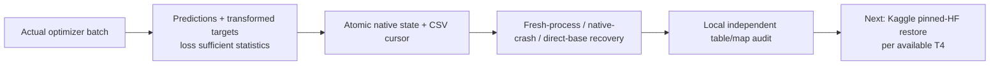
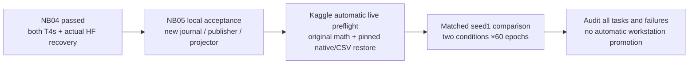

# Phase 3 — session log

<!-- IEEE_ACCESS_PAPER_20261103 -->
## 2–3 November 2026 — separate IEEE Access manuscript

1. Created `paper_ieee_access/`; copied compact evidence and template assets with hashes.
2. Wrote nine substantive sections, equations, references, AI disclosure and working-author biographies.
3. Generated seven scientific figures and five tables, including all 60 TRACE epochs and two deterministic saved-image examples.
4. Separated primary sweep decoder reads from additional bridge reads; preserved original rank/gate arithmetic and selected=None.
5. Checked primary citations and the current IEEE template; core class/style hashes match.
6. Compiled the paper and checked numeric tables, gains, execution counts, citations, original-file preservation and PDF layout.
7. Added claim ledger, reproducibility guide, citation audit, writing log and author-action checklist.
8. Kept new paper/aggregation assets local. No new fit, photo, HF upload, Git push, or workstation change.

Final numeric and visual receipts are in the [paper package](paper_ieee_access/README.md).
Next: author review and genuine declaration/availability decisions.
<!-- END_IEEE_ACCESS_PAPER_20261103 -->

<!-- TEXTURE_AGGREGATION_20261102 -->
## 2 November 2026 — authorized local-texture aggregation investigation

1. Froze the primary nine-variant protocol, then fetched/reused249 pinned native/metadata bodies,66,722,671 bytes, using public reads only.
2. Verified all saved pooling/projector/decoder bridges and every original local/masked prediction replay. Compared unchanged decoders after weighted means, band/column means, spatial/random modes and train-only templates/residuals.
3. Retained every counterfactual prediction plus image/channel/tile losses, all feature spectra and covariance/energy details. No image encoder/geometry forward or neural training.
4. Measured61.14% local validation utility retention for one average and 81.76% for position-template +five residual moments; identified orientation/contrast losses and disproportionate low-group detail loss.
5. Distinguished context/aggregation concentration, rank scale-dependence and exploratory mask-layout association. Reconciled all channel/role/component reductions and retained original selected=None.
6. Added scientific Markdown/methods, two figures and an interactive component/tile explorer. New derivatives local; source evidence, notebooks, workstations and previous reports preserved.
<!-- END_TEXTURE_AGGREGATION_20261102 -->

<!-- RETROSPECTIVE_RECORD -->
## 2 November 2026 — whole-project analysis requested

1. Inventoried236 maintained Markdown documents and reconciled original-study, Phase 2, Phase 3, application and manuscript scopes with40 controlling source records.
2. Built measured-fit and selected/final endpoint ledgers; distinguished10 Phase 3 fit executions from notebook counts, reviews, engineering and continuation.
3. Read/checksummed444 actual saved CSV bodies and calculated570 final-view image comparisons,10 component summaries,3 role summaries and 6 retained tile-statistic summaries.
4. Reconciled role means to original NB24 endpoints. Both validation/test components improve reconstruction; original global diversity rejection remains unchanged.
5. Added whole-project and component Markdown reports, two scientific figures,10 CSV tables and a standalone interactive explorer. New derivatives are local, not HF-published.
6. Preserved source evidence, completed notebooks, both workstations and all original selections. No model forward/training, new photo, network/HF write or paper rewrite.
<!-- END_RETROSPECTIVE_RECORD -->

<!-- NB24_RECORD -->
## 2 November 2026 — NB24 verified after user execution

1. Archived supplied executed NB24 and verified33 exact payloads /three complete code cells.
2. Checked all five public HF selecting manifests,12,262 object existence/size identities, released owners, bounded full-body hashes and explicit large-Git metadata limits.
3. Independently reconstructed all 2,940 objectives and60 validation gates using946 fully checked native inputs and SVD; verified complete state, source coverage, all epoch weights and selected=None.
4. Confirmed original dense-review receipts, actual viewer, seven earlier selecting manifests, direct CSV retention and scientific limitations.
5. Added illustrated completion/findings records and current status updates. No new training, photos, local credentials, HF write or workstation change.
<!-- END_NB24_RECORD -->

<!-- TRACE_BATCH_SESSION -->
## 2 November 2026 — complete TRACE notebook implementation

1. Built separate cache/data/schedule, transaction, telemetry, resource/selection and parent/review modules without changing the checked prototype or completed experiments.
2. Delivered four self-contained notebooks with one sequential Run All master. Added actual HF seam/restore/continue and capacity gates before one 60-epoch candidate.
3. Exercised actual8-image CPU lifecycle/within-epoch continuation, raw prediction/objective/selection review, seven fault/selected/error boundaries,16-image preparation restart and all 570-image frozen cache with60 schedules.
4. Tested real orchestration with explicit injected HF/numeric services and actual notebook setup in fresh interpreters. No local credential lookup, remote write or measured fit occurred.
5. Fixed allocator initialisation, final publication acknowledgement, partial-stage artifact selection and serialization/review issues caught before delivery. Updated documentation, source provenance and Git ignores.
6. Next user action: Run All in NB24 on Kaggle T4×2 with existing prepared input, Internet/HF_TOKEN and sufficient measured space. Live gates and measured outcome remain pending.
<!-- END_TRACE_BATCH_SESSION -->

<!-- TRACE_SESSION -->
## 2 November2026 — authorised next design and checked prototype

1. Read current instructions, GEO/NB20 evidence and the proposed fixed-target brief.
2. Implemented isolated TRACE target, model, objective and frozen-geometry modules; no completed source changed.
3. Audited every 386 train image from verified original pixels and saved final geometry. Preserved the correlated v0 descriptor attempt; refined image fields and retained spatial evidence.
4. Checked leakage, objective reductions, gradients, rank guard, explicit spatial moments, native CPU continuation and exact inherited geometry.
5. Wrote the mathematical/design/experiment/retention/operations/delivery documents,48-family schema and interactive existing-image explorer. Updated current records and Git ignore rules.
6. Full trainer/writers/storage/two-T4/live-HF proofs and runnable notebooks remain separate next engineering work. No measured fit, new photos, local credentials, HF writes or workstation changes.
<!-- END_TRACE_SESSION -->

<!-- NB20_SESSION -->
## 2 November 2026 — NB20 verified and documented

1. Archived executed NB20 unchanged; matched all 19 payloads and three completed cells.
2. Downloaded/verified both actual HF publications, released owners and unchanged manifests. Checked 48 comparable tables, exact vectors, original/native audit records and actual passport provenance.
3. Quantified one-ULP cross-platform norm diagnostics and 4,020 FP64 original-weight norms. Parsed atlas and script are identical despite a seven-byte serialization difference.
4. Added completion report, pinned research registry and proposed next-design brief. Completed sources and both workstations are preserved.
5. No current-cycle rerun remains. A texture revision is proposed; no new training, photos or workstation changes started.
<!-- END_NB20_SESSION -->

<!-- NB17_BATCH_SESSION -->
## 2 November2026 — NB17 verification and uninterrupted postrun batch

1. Archived supplied executed NB17; distinguished its filename/output from the message's NB16 wording.
2. Independently downloaded/verified pinned HF content without local credentials or remote writes; checked original earlier selecting manifests unchanged.
3. Reconstructed all objectives, original validation criteria, raw native evidence, final masks and retained recovery state. Recorded geometry improvement and failed latent rank honestly.
4. Built a separate saved-data runtime and NB18/NB19/NB20; one master runs both stages sequentially, caches once and publishes direct evidence.
5. Checked actual-data outputs, notebook schema/fresh setup, completed-stage recovery, offline handoff/restore and interactive controls. Updated structured docs and Git ignores; both workstations/completed sources preserved.
6. Next user action: Run All in NB20 on Kaggle CPU / None with existing prepared input, Internet and HF_TOKEN. No extra full fit/new photos; actual report publication pending.
<!-- END_NB17_BATCH_SESSION -->

<!-- NB17_DETAILS -->
## NB16 verified; NB17 implemented — 1 November 2026

User reported NB16 complete and requested HF verification, documentation and continuation. Preserved executed SHAea4f6784588f… with three complete cells/no errors and27 matching payload files. Pinned public audit at 9f991635… checked all 173 selected objects/174logical files, 24,341,191bytes, 60 CSV/42,217rows, 65 finiteNPY arrays, both complete-unit chains and32-case viewer behavior. Original context-fit/review/readiness manifests remain unchanged and owner released.96 scientific files match after actual two-T4/HF restore; independent raw-vector/target reconstruction agrees within FP32 tolerances. Diagnostic scalar warnings are not failed checks. The visible wait was conservative API-budget handling.

Implemented the isolated NB17 runtime: every 40family emitter, 468typed fields, train-only mean/quality-median controls, G0 validation, all 60epoch weights, original eligibility/selection, same-source/component-excluded retrieval, selected/final all 570image endpoints, 10diagnostics and standalone interactive mask overlays. Corrected draft field types and added explicit loss denominators/provenance. Selected predictions retain their actual checkpoint epoch/update, distinct from final training counter. Utility uses original selected validation metrics plus training coverage. No classifier/depth/safety promotion is introduced.

Added bounded CSV/raw native prefix transactions, 64-observation/8-update NPY sealing, two rotating full native states, source/env/history verification, local-ahead publication and fresh-session full HF restore. A stable registry binds one measured experiment. Single-owner transport has30-minute / major/stop flush, visible waits, actual-header80%API/resolver budgets and unchanged96/hour commit guard. Replay-safe request/publication IDs and native service acknowledgement prevent metadata duplication across sessions. Pinned logical files resolve through immutable manifests rather than assuming root-level paths.

Disposable local tests cover full lifecycle, exact fresh-process model/moments/RNG/cursor and307 scientific shards, independent total-loss reconstruction, seal crash points, cross-session transport IDs, service replay and injected selected-export provenance. These are CPU/offline fixtures, not a measured model. Actual new live storage/hardlink/HF gate runs in NB17 before fitting. Built29-file self-contained notebook with three code cells under 1 MB; updated schema/run/protocol/acceptance docs and current trackers. No credentials read or remote write locally. All completed notebooks/runtime/workstations/original Markdown remain preserved.

Next: user runs NB17 T4×2/Internet/expanded input/HF_TOKEN/RunAll. After execution, independently verify actual publication and create NB18's retained-evidence review. No NB16 rerun, new photographs or automatic additional candidate fit.
<!-- END_NB17_DETAILS -->

<!-- GEO_NB16_DETAILS -->
## NB16 preparation implementation — 1 November 2026

User approved the complete GEO plan and requested notebooks. Implemented the frozen-hook anchor, bounded zero-init geometry heads, detached original-equivalent atlas, four-channel local-contrast patch encoder, two axial blocks,64D VIC projector, masked-target decoder and experimental detached error head. Measured355,879 trainable /1,728,038 total parameters, split27,068 geometry /326,632 texture /2,179 error.

Implemented exact existing-data overlay/component checks and a full-source coverage schedule; separate group clipping; loss numerator/count records; dense original-grid confusion reconstruction; finite engineering native/CSV complete-update persistence; owner-fenced HF transport copying; secret-free worker; visible30-second status;30-minute / major/stop flush; actual published-unit1 download/continuation design. Added individual tensor gradients, complete vectors/tokens/logits/masked targets/weights and view/support/provenance records. The live notebook creates a32-case interactive predicted-mask passport.

Local full-model tests passed warm-start/atlas equality, gradient isolation, hidden-token/actual hidden-RGB leakage, independent covariance/Huber reconstruction, missing/ignored targets, human-only point quality, texture-skip moment/decay invariance, dense block counts, interrupted pointer states and FP32 CSV roundtrip. Direct four-update and restored paths match model/moments/counters/RNG/scientific records; a fresh process continues a verified offline snapshot identically. Local CPU proof is explicitly distinct from actual T4/HF proof. No credential lookup or remote write occurred.

Built self-contained NB16 with27 embedded files/three code cells, under1MB; notebook schema and source payload checks pass. Clarified per-tile photometric contrast means before measured freeze, preventing a hidden-pixel shortcut. Preserved all completed runtime/catalog/notebook identities, both workstations and103 original Markdown records. The approved design snapshots remain historical; added six structured implementation/run/retention/validation documents and current trackers.

Next user action is NB16 T4×2/Internet/expanded Kaggle input/HF_TOKEN/RunAll. Measured_fit_ready remains false until its actual receipt is independently verified and the full40-family shard/staging/validation pipeline is integrated. NB17/NB18 are not yet delivered; no measured fit or new photos.
<!-- END_GEO_NB16_DETAILS -->

<!-- GEO_PLAN_20261101 -->
## Complete GEO planning requested and delivered — 1 November 2026

After discussing remaining work, the user requested the geometry-first direction be planned completely. Read the current project instructions, ATLAS closure/readiness results, original TREAD-ONE architecture, NB05/NB06 gradient/dense failures, the exact frozen anchor/canonicalizer and NB07 annotation-support records. Consulted the original VICReg paper and official PyTorch2.11 grid-sampling/reproducibility and HF rate-limit documentation; sources and local hashes are retained.

Designed TREAD-TWO / GEO: original selected r1 seed3/epoch20 anchor frozen, small zero-initialized bounded mask/raw-point refinements, detached predicted-support atlas, two-view local-contrast96Dtexture encoder/two axial blocks, masked tile reconstruction,64Dvariance/invariance/covariance projector, and three detached-target experimental annotation-error estimates. Parameter groups/gradient paths/clips are separate; no mileage-classification objective enters pilot1. Exact geometry/quality/texture reductions, source grouping, deterministic392draw full-coverage epoch, selection/failure rules and diagnostics are chosen in the plan.

Created eight Markdown design documents and four machine-readable JSON records under the new plan folder/master entry point. Defined40draftCSVfamilies/443fields with proposed types/keys/cadences, full training raw tensor retention, uncompressed native shard/prefix semantics,60epoch weights and complete rolling recovery. Shape arithmetic covers29,520train/validation/endpoint source passes and59,040texture views before controls; adjusted logical estimate14.630GB and same-filesystem peak15.167GB remain provisional because CSV widths/real model writes are unmeasured. Ceilings15GBlogical/18GBpeak preserve2GBreserve within a20GBassumption. No1TBscratch dependence or silent mid-fit evidence reduction.

Specified planned NB16 actual dual-T4 engineering/contract gate, one NB17 seed1/60epoch/2940update measured model, and conditional NB18 review. GPU1 owns frozen feature inference and barrier evaluation; GPU0 trains disjoint heads/texture. Planned HF cadence remains30min/major/catchable-stop with private SDK, immutable objects, owner fencing, visible server backoff and fresh-session restore. Exact model parameter count, actual T4 math/memory/runtime, native/CSV capacity and model outcomes are pending measured gates, not invented results.

Updated current project trackers, decisions, evidence/inventory/map and marked older closure statements by scope. This task produced a design only: no model implementation, .ipynb delivery, optimizer step, image/model forward, dataset expansion, HF write or workstation change. Next engineering milestone is isolated runtime/data/store implementation and NB16. Existing photos, completed experiments/research index and both workstations remain preserved.
<!-- END_GEO_PLAN_20261101 -->

<!-- NB15_CLOSED_20261101 -->
## NB15 verification and consolidated research handoff — 1 November 2026

User reported NB15 complete and requested HF verification, Markdown updates and continuation. Preserved executed SHA `98837b907abc…`, all 40 matching source/metadata payloads and four completed code cells with no saved errors. The actual private HF SDK setup and publication completed successfully.

Independent public audit at `f4b44d3d…` verified all 37 selected objects / 38 logical direct files, 58,797,180 bytes, all 16 CSVs / 196,905 rows, three PNG figures, actual interactive passport controls, SUMMARY.json and CAPABILITIES.json. All 1,502 original context-fit manifest entries and 79 context-review entries are unchanged at this revision; owner released. No credential reads or remote writes. Cross-environment numeric/text/schema/missingness comparisons are recorded in the receipt.

Scientific readiness remains false as expected: low/mid/high conservative components 1/1/4 and two conditional holdouts missing a fit class. Original known tyres remain 1/3/4; unresolved mid co-assignment is a leakage constraint, not physical identity equivalence. The training-only correction utility finding is unchanged: prior already correct on all 47,040 sampled views; context rescues 0 prior errors, transiently spoils 44 and mainly increases confidence through spatial correction. All three candidates' historical low recall remains 0/62. No classification promotion or new physical wear/depth/safety claim.

Implemented the next consolidation step as a local research release: three model cards, seven metadata CSVs / 134 rows, six original endpoint records, nine pinned verified publications, fourteen checkpoint/explorer/figure descriptors, comparison PNG and interactive evidence hub. Every consumed receipt/manifest/metric CSV hash and each generated artifact hash is retained. Original validation-selected epochs 18/7/7 are preserved; no model weights loaded or republished. NB08 cursor-declared row counts remain distinguished from later exhaustive raw-row and derived-table audits.

Local acceptance checks all sources/artifacts/tables, native object SHA/size/URL descriptors, original selected epochs, model-card links, three model filters and fit/review/gate controls against actual HTML JavaScript. Comparison figure visually inspected; native browser rendering is not claimed. No further notebook is needed to close unchanged current studies. Underlying science is already on HF; the new index itself is local and not claimed uploaded. Added a narrow Git exception for its curated figure. Both workstations, all frozen fits/gates/reviews and existing source photos remain preserved. Application work remains deferred; no acquisition prerequisite or automatic fourth full classifier fit introduced.
<!-- END_NB15_CLOSED_20261101 -->

<!-- NB14_COMPLETED_20261101 -->
## NB14 verification and existing-data readiness implementation — 1 November 2026

User reported NB14 complete and requested HF verification, Markdown updates and continuation. Preserved executed SHA `356dc789…` and all 44 matching payloads. All four code cells completed without errors. The public-read audit at HF `10c2f16d…` verified 79 objects / 80 logical files, 217,059,186 bytes, 52 CSV tables / 585,825 rows, five PNGs, 1,854 interactive cases, 18 references and 206 full attention matrices. All scientific tables are byte-identical to independent local reconstruction; maximum numeric difference is 0. All 1,502 original fit manifest entries are unchanged; writer released. No local credential reads or remote writes.

Implemented and ran the isolated existing-data readiness and algebraic online utility analysis. Six pinned NB14/NB07 inputs total 70,218,229 bytes. Only 386 training images and 47,040 training-view observations enter numeric calculations. Known original tyres are 1/3/4; conservative components are 1/1/4. Six conditional holdouts are enumerated without fitting: low and mid folds each remove an entire fit class. Unresolved mid co-assignment is a constraint, not physical identity equivalence. Frozen 18-reference bank support is counted after complete component/source-SHA exclusion; unsupported normalization stays blank.

Four algebraic variants produce 188,160 rows. Frozen LC is already argmax-correct on all 47,040 saved training views; full context rescues 0 and transiently spoils 44 prior-correct view observations. Epoch 60 uses the same 784 views / 214 images: prior NLL 0.636877 versus full 0.031365; bias-only 0.636948 and spatial-only 0.031380. This describes confidence/loss fitting on known images, not unseen-tyre transfer or independently trained ablations. Research-only status retained; no fourth full classifier fit triggered.

Delivered NB15 for CPU / Internet / HF_TOKEN / no image attachment, with a 40-file package and private HF SDK publication directory. Sixteen CSVs / 196,905 rows, three figures, an interactive passport and CAPABILITIES.json are retained. Actual-data tests cover hashes, schemas and support; perturbing all held-out numeric predictions/corrections and registry labels leaves scientific outputs byte-identical; a training SHA mismatch is rejected. Actual setup cell, fresh extracted science, viewer JavaScript and offline publication lost-response/owner-release/idempotence checks pass. Actual NB15 Kaggle/HF completion remains pending. Added narrow Git ignores for cache, fixtures and the heavy counterfactual table; source, summaries and figures stay visible. No additional photos, fitting, inference, checkpoint reselection or workstation changes.
<!-- END_NB14_COMPLETED_20261101 -->

<!-- NB13_COMPLETED_20261101 -->
## NB13A completed verification and next review — 1 November 2026

User reported NB13A complete and requested HF verification, documentation and continuation. Preserved supplied executed notebook SHA `8bdf46ec…`, both complete code cells and all 35 matching payload entries. Public-read pinned audit at `a4441884…` verified all 1,502 manifest objects (5,645,673,072 bytes), all 27 raw CSV schemas/counts (58,176,066 rows), 3,913 history units and 45,852 CSV chunks. Native final/full order/cursors finite; all 60 epoch identities and original selected LC prior bit equality checked. All updates 0–2,940 retained, original partial-history prefix cryptographically linked, owner released.

Actual executed bootstrap restored newer HF update 2,486, then completed the original experiment at 2,940. Earlier update 1,294 remains historical partial evidence; no current loss/replay count is inferred from it. Actual dual-T4/live-HF gate reused. Exact earlier freeze cause still unproven.

Independent saved-science analysis consumed 876 cached inputs without network refetch, zero forwards or training: 52 derived CSVs / 585,825 rows. Validation selects epoch7/update343 (BA50%, NLL1.734916); unchanged LC prior validation BA56.25%, NLL0.934841. Historical selected/final BA50%, low0/62 high41/41, NLL2.174813/2.358475. Context reinforces low→mid confidence; candidate remains unpromoted. Frozen geometry retained, no new dense improvements claimed. Full correction/attention/layout/pair/self-exclusion accounting and limitations documented.

Implemented five separate review modules and four pinned peer assets; 44-file self-contained CPU NB14. Added direct 52-table publication, five figures, 1,854-case interactive base/context/combined evidence, 206 full endpoint attention cases with explicit missing probe/training matrices. Actual table hashes/counts/residuals, cache corruption/range handling, viewer JS controls, offline additive publication/lost-response/idempotence/owner release, and fresh extracted notebook science reproduction pass. This local evidence is distinct from pending actual NB14 Kaggle/HF completion.

Updated current project trackers, decision/evidence/inventory/map, repair/protocol/architecture outcome notices and detailed completion/review/run guides. Expanded narrow Git ignores for heavy context review rows/attention and acceptance fixtures; compact summaries/source/curated figures remain visible. No local credential reads, remote writes, fitting, additional photos or workstation changes. Next: NB14 CPU, Internet/HF_TOKEN,  no data attachment, Run All; return executed notebook for independent review publication audit.
<!-- END_NB13_COMPLETED_20261101 -->

## Git preparation — 30 October 2026

Updated root/Phase 3 ignore rules before the user's repository push. Excluded
the new multi-GB HF mirrors, raw review tables, large embedded-image explorers,
test/publication copies, binaries and credentials. Kept the six frozen reference
arrays, current notebooks, source, compact summaries and curated figures.
Stopped tracking seven pre-existing generated files with index-only removal;
all local sizes/SHA-256 values match their baseline. Four published figures were
copied unchanged outside ignored mirrors so three reports retain their images.
No commit, push, source-notebook rewrite or history rewrite was performed.

The read-only content/history check and whole-repository add preview pass.
Git-visible working files decreased from about 4.21 GB to 116 MB.
[Policy and run command](../docs/GIT_PUSH_CHECK.md),
[content receipt](audit/GIT_CONTENT_CHECK.json),
[ignore/retention checks](audit/GIT_IGNORE_POLICY_CHECK.json).

<!-- NB11_COMPLETE_UPDATE_20261030 -->
## Historical — NB11 complete; NB12 review ready

**30 October 2026. NB11 is complete and independently HF-verified:** 60 epochs / 2,940 updates, 1,351 direct files and 54,336,368 raw scientific rows. The actual T4×2/live-HF preflight passed; ownership is released. No NB11 rerun is needed. [Full completion and findings](phase3NB11Completion.md).

Archived the supplied NB11, checked payload/execution, audited the pinned publication and all raw rows, and completed the scientific review. Preserved all earlier studies/workstations. Implemented and checked a separate CPU NB12 that adds the derived CSVs, figures and complete explorer. No new fit, source photos or local HF writes occurred.

Next: [NB12 saved-evidence review](notebooks/phase3_NB12_TREAD_TWO_ATLAS_LC_Completed_Review.ipynb), **CPU / Internet / HF_TOKEN / no dataset attachment**, then Run All. It adds 40 derived CSVs / 380,595 rows, four figures and a 1,442-case explorer with zero fitting or model forwards. Local recovery/cache/publication/package checks pass; actual NB12/HF review publication is pending. [Run guide](tread_two/lc_review/README.md).

<!-- END_NB11_COMPLETE_UPDATE -->
<!-- NB10_LC_UPDATE_20261030 -->
## Historical — NB10 closed; NB11 ready, 30 October2026

Completed this user-requested follow-up: archived/inspected executed NB10; verified all public pinned HF objects,raw CSV counts,native training roles/hashes and released owner; froze NB10 references for a new model; implemented r2 LC/source-exclusion/paired-loss/sampler/telemetry/recovery; passed local actual batch8/fault/restore/package checks; wrote structured diagrams/tables/schema/figures. No remote writes from local work,no new photos,no workstation changes.

Next is [NB11 / ATLAS-LC r2](notebooks/phase3_NB11_TREAD_TWO_ATLAS_LC_Resumable_Pilot.ipynb): one separately versioned seed,paired LC views,18-photo source-SHA exclusions,all386queries and sqrt-size group sampling. Local batch8 recovery/package checks pass; actual Kaggle/live-HF preflight and measured accuracy remain pending. Use T4×2,Internet,the existing expanded Kaggle dataset and HF_TOKEN. [Architecture](phase3TreadTwoLCArchitecture.md), [protocol](phase3TreadTwoLCProtocol.md).

<!-- END_NB10_LC_UPDATE -->
## 2026-10-27 — orientation and documentation setup

**Requested:** name this chat `phase 3`; inspect the project structure and all Markdown files; create a separate Phase 3 working folder; write understanding and multiple durable tracking documents; retain instructions including `conda activate cv_conda` and the user's Kaggle/HF requirements.

**Actions:** renamed the chat successfully. Enumerated all Markdown using hidden/ignored-inclusive discovery outside `.git`, loaded complete file text into the section/inventory scan, directly read primary operational records, reviewed section excerpts for long historical plans/logs/reports, compared archived manuscript variants and identified byte-identical copies by SHA-256. Inspected top-level/subfolder roles and selected launcher, active-model adapter, engine, coordinator, reporting and notebook-builder references.

**Coverage:** 103 pre-existing Markdown paths, 94 distinct contents, 1,291,786 source bytes. Groups: four root files, 52 under docs, one notebook readme, 21 under Phase 2, seven under prototype, and 18 under the newer manuscript folder. Included packaged dataset and backup readmes, ignored `.build` copies and the bundled NumPy random-module licence. This is orientation coverage, not an exhaustive review of every source-code line or a fresh HF audit.

**Findings:** Phase 2 final records report 15/15 completed 60-epoch runs and final NB06. The active marker/adapter select five validation-chosen Phase 2 exports. The original paper and its NB33 illustration use original-study checkpoints. The newer September 24 paper records supersede older reference counts and earlier pending replay statements. Both installed classifiers' 50% internal low/high test balanced accuracy remains a material limitation. Data, source-package splits and training-overlay splits have different roles.

**Troubleshooting:** `conda` resolves to the existing batch wrapper; Conda and `cv_conda` interpreter files exist. The read-only `conda env list` command returned “The system cannot execute the specified program.” Cause is not established. No Python execution or package/environment repair was attempted. Kept this as an explicit pre-Python follow-up.

**Outputs:** Phase 3 entry point, instructions, understanding, repository map, Markdown catalogue, conflict ledger, environment notes, evidence register, progress, decisions, open items, and this dated log. The `audit/` folder retains the original Markdown baseline and section-review snapshots; final validation records coverage, local links and original-file preservation.

**Final checks:** passed. All 103 original Markdown hashes match their baseline, original-path inventory and review coverage have no drift, and all 173 local links across the 12 new Markdown notes resolve. Git status contains only the new `phase3/` directory. The exact check report is `audit/orientation-validation.json`.

**Scope boundary:** this session did not train/evaluate models, fetch/publish HF artifacts, modify the app, rebuild the manuscript, inspect token contents, move datasets or alter previous project Markdown. Existing reported tests/results are attributed to local records.

## 2026-10-27 — custom TREAD-ONE implementation

**Authorized:** the user grants creative freedom to build a custom project-specific model combining classification, localisation, segmentation and explainability, with few model runs, existing Kaggle/HF practices and detailed maintained documentation.

**Design:** one 1,372,159-parameter architecture from scratch. Custom multi-scale texture encoder, two explicit transformer blocks, shared decoder, overlapping tyre/tread masks, mask-derived boxes, ordered six-point head and additive signed class-logit evidence through a detached predicted-tread gate. Background intervention and guide-row consistency connect the tasks. No pretrained backbone, teacher, new annotation request or invented depth/alignment labels.

**Experiment:** safe existing Phase 2 split; one architecture ×3 seeds ×60 epochs, batch8, 49 updates/epoch. AdamW/cosine recipe, bounded AMP recovery, predeclared joint validation utility, separate selected/final endpoints and no test-seed substitution. All source/contracts are hashed; training's remote namespace is `phase3/tread-one-r1/`. Existing original/Phase 2 files and workstation/paper remain unchanged.

**Implementation:** readable sources in `runtime/`, including exact copies of the two Phase 2 data-contract files; coordinator with two independent GPU slots, complete per-update atomic state, frozen session anchor, CAS lease/fencing, consistent hash-verified ZIPs, deduplication, authenticated cached restore, bounded header-aware retries and catchable-stop publication. Raw test masks/points/evidence/gates/latent maps and task metrics are retained. Diagnostic-only failures before update zero are saved too.

**Environment:** recovered a working activation route through the existing base-Python Conda module and confirmed cv_conda/CUDA. No global package change. OpenCL hook warnings remain; they did not prevent the successful tests.

**Troubleshooting:** replaced unsupported deterministic CUDA CDF accumulation; made FP32 attention/evidence boundaries explicit; reconstructed the scheduler's process-local first-step flag after durable restore; separated final-state tensors from selected-weight evaluation; fixed stable ZIP timestamps, containing-revision restoration and self-owned lease retry after an ambiguous response. A stale local fixture correctly retained newer progress and exposed a test-isolation assumption, now fixed with unique fixture directories. One local check exited without a Python traceback; its cause remains unproven and a traced unchanged-runtime rerun passed. Details are maintained in TREAD_ONE_VALIDATION.

**Checks:** actual full-input batch-eight fresh-process seam has zero differences in losses/model/optimizer/scaler/scheduler/RNG. Thirteen offline persistence/fault cases passed. Actual two-update lifecycle pause/resume and final/selected NPZ/gallery checks passed; fixture scores are not scientific results. Notebook schemas and exact source round trips are checked during generation; full data/delivery verification records its own result.

**Deliverables:** two self-contained `.ipynb` files, compact Kaggle ZIP, extensive design/experiment/run/validation documents and updated understanding/progress/decisions/evidence/environment/open-item records. Next execution is NB00 CPU then NB01 dual-T4; long training, live HF and empirical performance are pending. No automatic workstation promotion.

**Final delivery verification:** passed. All 2,882 dataset source checksums and 570 image/mask sets passed; 172,439 conflict pixels remain explicitly ignored. Both notebook payloads match the exact current runtime, schemas/cells and ZIP/hash round trips pass, the GPU seam report binds the current source hashes, all 191 local Markdown links resolve and all 103 original Markdown hashes are unchanged. Git reports only `phase3/`. Delivery ZIP: 109,814 bytes; SHA-256 `d2559eef45f31190d49accd2db8f52f5444a9f762f52b01c4ec4f22c98be8fcd`. Machine record: `validation/DELIVERY_VALIDATION.json`.

## 2026-10-27 — user clarification, logging priority and epoch-13 report

**User clarification:** this is a normal reminder, not dissatisfaction or a redesign request. Keep custom models specific to the tyre application and grounded in insights from earlier models. Maintain technical/code/resource/workflow documentation with special care. Saving as much meaningful training evidence as feasible, including fine-grained metrics, is an important continuing requirement for future work.

**Progress reported:** seed 1 and seed 2 are at epoch 13. Recorded as user-reported only; no executed notebook or pinned HF snapshot was inspected, and no exact completed-update count, uploaded epoch, seed-3 status or performance is inferred.

**Actions:** inspected the current logger's actual fields and wrote `phase3ModelRationaleAndLogging.md`, mapping prior observations to the custom design and separating motivated hypotheses from demonstrated results. Documented currently retained update/validation/test/state records, honest logging gaps and future telemetry priorities. Updated standing instructions, current status, understanding, open items and decisions.

**Active-run preservation:** captured hashes for the 18 runtime/notebook/release/packaged-design/generator files in `audit/active-run-baseline-20261027.json`; documentation updates do not change those artifacts. No notebook regeneration, training interruption, package/code/protocol change, HF request or remote mutation was performed. Future logger expansion is deferred to an explicitly versioned later revision.

## 2026-10-28 — completed-run audit, direct CSV recovery and retention correction

**Requested:** check the executed notebooks/results, update Markdown with insights, record the user's rejection of HF ZIP publication and demand for richer future data, and identify the next step.

**Source/evidence:** exact executed NB00/NB01 bytes archived under `completion_20261028/executed_notebooks/`; all source cells match the original delivery. Final HF report revision `a0296f18e02b12d28f7e51377783d68538032209`, protocol `371c40c0c6aaedaf5c5970f7721a284b042494db7bb330065f6cbde8fc3a0b8c`. Public, bounded revision-pinned reads downloaded ~390 MiB of legacy bundles once, with all whole-file/member hashes checked. The SDK cache initially failed Windows long-path error206; explicit short local filenames fixed the read path without disabling TLS verification.

**Verification:** three seeds each completed60 epochs/2,940 updates, 8,820 sequential update histories total, 180 validation records, correct identities/exposures, finite recorded values, actual T4 fresh-process resume checks, both raw test endpoints and source masks. Compact export hash `a5b872ed2e4cbfb3b9782b0df563e2606631744cd0274fee2da42a832f985f65` matches seed 3's epoch20 selected weights bitwise. Nine runtime source blobs match the protected local implementation. Setup dependency conflicts are documented; no notebook exception outputs were found. Interrupted long-run cross-Kaggle-session recovery was not exercised by this record and is not claimed.

**Results:** selected checkpoint means: balanced accuracy34.146%, two-region Dice97.978%, human-point error1.189% width. The declared export remains seed 3/epoch20, with test BA50%, Dice98.419%, point1.196% width. Every selected checkpoint misses all 62 photos of the one low test tyre. Dense-task learning is useful but task scores do not improve on installed models. Exact evidence accounting is established; correctness/physical reasoning is not. No model promotion or test-based reselection.

**Data recovery:** wrote20 direct CSV tables (~32 MiB) exposing 8,820 updates, 70,560 sample exposures, 14,580 validation-image records, 618 test-image records, point predictions, class/calibration/confusion tables, region counts, GPU checks, provenance and comparisons. New derived metrics are labelled post-hoc; missing training-image predictions, full validation maps and continuous resource/stage timing cannot be fabricated. Added two inspected static figures from the recovered records. Analysis sources are separate from frozen training runtime.

**User correction/policy:** added `phase3DataRetentionPolicy.md` and superseding instructions: never HF ZIP bundles; directly browsable CSV, JSON contracts/manifests and native tensor state; much richer predeclared future telemetry and coverage checks. Original archives/delivery are preserved as history. No new training/weights/code/labels/app or paper change is made.

**Publication:** prepared one additive direct-file commit, schema/manifest and a new CPU-only `phase3_NB02_Audit_And_Direct_CSV.ipynb`. It uses authorized Kaggle HF_TOKEN,  no dependency downgrade, no training and no ZIP upload. Local standard Hub credential lookup returned none. Automatic approval review rejected a proposed project `.env` credential fallback because it was not explicitly authorized; the rejected patch was not applied, no `.env` credential was read, and no bypass was attempted. Local CSV recovery is complete; actual new HF publication remains pending NB02 execution.

**Next:** publish direct CSV, diagnose the classifier using existing selected/final checkpoints, freeze the richer direct-file logger/publisher, then choose one controlled model revision from the diagnosis. Keep current workstation models; wider generalization requires independent tyre evidence.

**Final review validation:** passed. Checked15,198 prediction labels/cohorts and independently recalculated4,650 human-point image scores from verified source geometry. All 20 CSV tables and the30-file direct publication manifest are consistent, with zero ZIP uploads planned. New CPU notebook schema/syntax/three embedded source payloads pass. All 103 original Markdown files, frozen r1 non-notebook delivery files and exact executed-notebook archives remain unchanged. All 229 local links resolve. Evidence: `completion_20261028/REVIEW_VALIDATION.json`. Actual new Kaggle notebook execution/CSV publication remains pending.

## 2026-10-28 — NB02 fresh-session missing-directory repair

**Requested:** fix the error in `phase3_NB02_Audit_And_Direct_CSV.ipynb`.

**Observed failure:** the supplied Kaggle execution's `CalledProcessError` wraps `FileNotFoundError` while writing `/kaggle/working/treadone_csv_recovery/completion_20261028/remote_tree.json`. The fetcher wrote metadata before creating its output parent. Existing local completion directories had masked this fresh-session defect. The exact failed notebook was preserved at `completion_20261028/nb02_repair/c6c6b287249a/executed.ipynb`; SHA-256 `c6c6b287249ac4187a80322d248f46f968b37f7dd407872ef28e837a08f8ccac`.

**Fix:** repair r2 creates the completion directory in notebook setup and independently in the fetcher's `main()`. The CSV stage creates missing parents too. The notebook generator embeds the corrected readable sources; current delivered notebook SHA-256 is `40c85084e1b983419c5f71cd57e26898110d4972d4ea2edee0b369a419296b39`. The failure occurred before archive retrieval and publication, so no training/checkpoint repair is required. Added `phase3NB02Repair.md`, updated run instructions and trackers, and excluded large disposable regression workspaces from Git.

**Checks actually run:** in activated `cv_conda`, `test_nb02_fresh_session.py` reproduces the original error with the failed notebook's embedded source, then executes the corrected embedded fetcher in an empty workspace against pinned local response fixtures. All 11 metadata files and three complete legacy bundles hash-match; an interrupted stream retries cleanly, and cached restart makes zero download/tree calls. The real full CSV audit and prepare-only publication stage then pass in that fresh workspace: 18 core tables / 25 prepared files, 8,820 update rows, 14,580 validation predictions and 618 test predictions, no ZIP upload planned. The earlier main review's two additional comparison tables/optional figures are separate local supplements, not missing core recovery. Evidence: `completion_20261028/nb02_repair/REGRESSION.json`. Notebook schema/payload, label/point derivations and preserved original files also pass the completed-review validator.

**Scope and remaining execution:** no live remote calls, credential access, HF writes, training, model reselection or original-study/runtime change in this repair check. Actual Kaggle re-execution/publication remains pending. Re-import the current **Repair r2** notebook into Kaggle, CPU/Internet ON, the existing prepared Phase 2 dataset and authorized `HF_TOKEN`, then Run All. Retrying the old Kaggle copy retains the old embedded fetcher.

## 2026-10-28 — successful NB02 publication, independent verification and visual documentation

**Requested:** review the completed file execution, update Markdown properly with diagrams/tables, and explain what comes next.

**Completion:** the supplied NB02 has all five code cells executed in order, no exception outputs, and a `published_and_verified` receipt for HF `91ccd3315bd296a76a8b583a6d0f2515ccb3d370`. Exact executed bytes were preserved at `completion_20261028/nb02_publication/executed.ipynb`, SHA-256 `fa3a7c70154a9fabb828ea46dd8dc31b3eb4f1b7ae6d97b792a13a78950b9180`. All three embedded sources match repaired r2 exactly. The original training revision/protocol and declared model selection remain unchanged.

| Verification performed | Result |
|---|---|
| Public reads of the exact new HF commit | 25 published files identified; no ZIP/NPZ/checkpoint upload |
| Remote Git/LFS and manifest hashes | Every file passes |
| Published CSV schema/count/hash | All 18 tables pass |
| Scientific records compared against local recovery | 191,904 records agree within recorded numeric tolerance |
| Decimal difference | One entropy value differs by 1.11e-16; preserved and documented, not rewritten |
| Original file preservation | 103 original Markdown files, frozen r1 release/runtime and earlier executed notebooks remain unchanged |

**Reproducible evidence:** added `analysis/verify_nb02_publication.py`, a read-only parser/verifier; `nb02_publication/CSV_PUBLICATION.json`, `VERIFICATION.json` and downloaded immutable direct files retain the proof. Initial strict cross-environment CSV comparison exposed the one final-decimal entropy difference. Inspection found `0.7392906757971748` versus `0.7392906757971749` at validation-epoch data row179. The verifier now records that difference and permits 1e-12 absolute/relative tolerance only for differing decimal numeric values; identities, integer/text fields, schemas and all remote byte hashes remain exact. Precise rounding cause was not isolated. No remote value or local scientific record was altered.

**Documentation:** added `phase3NB02Completion.md` with status/count tables, per-cell outcomes, all 18 CSV families, source/commit identities, workflow and proof-chain diagrams, scope reconciliation and limits. Reworked `phase3NextSteps.md` with completed/next gates, a hypothesis/intervention matrix, planned retained outputs and the future state/CSV publication flow. Added the model task-flow diagram and interpretation table to the scientific audit; refreshed README, progress, understanding, policy, instructions, repair history, conflicts, decisions, evidence and inventory. Preserved earlier dated pending-state records and explicitly identified their newer completion authority.

**Count reconciliation:** actual Kaggle publication is 18 core CSV /25 files, 33,630,232 bytes. Earlier local preparation is 20 CSV /30 files because it adds two comparison tables, two figures and a Phase2 registry snapshot. These are distinct documented scopes. The publication does not create additional independent tyres or recover observations never logged during training.

**Checks and next:** completed-review validation passes notebook/source consistency, label/cohort and human-point derivations, remote evidence preservation, original-file protection and local links. All Python used activated cv_conda. No notebook regeneration, training, model mutation/promotion, paper/label change or additional HF write was performed by this review. The user's Kaggle execution completed the original publication. Next work is a separately scoped inference-only classifier diagnosis using saved selected/final checkpoints; the diagnostic is planned, not executed. Only after that evidence should the richer direct-file logger be proven and one controlled revision selected.

## 2026-10-28 — TREAD-ONE NB03 implemented and completed locally

**Authorized:** perform the next fixed-checkpoint diagnosis; confirm it remains under TREAD-ONE; keep improving data/evidence collection and HF retention; record that the user will help collect more tyre data later; provide interactive image exploration where practical.

**Scope:** six r1 saved endpoints, 386 nominal train +81 validation images, five specified gate/background/occlusion variants, no optimizer creation/update, no new test evaluation/reselection. Original model/runtime/protocol/labels, installed models and executed NB00/NB01/NB02 are preserved. Local run contract `4a15626681359aced6e42b652f3c0638aba76c665a169a54019c7543bd821689` pins FP32/no-TF32 inference, source/data/checkpoint hashes and the GTX1650/cv_conda environment.

| Delivered / executed | Result |
|---|---|
| Separate `diagnostic/` sources | Atomic complete units, direct CSV snapshots/native gallery arrays, HF CAS owner lease/restore, metric/gradient computations and self-contained explorer |
| Full local diagnosis | 14,010 prediction/intervention rows; 336,600 core scientific table records; 78 fixed gallery examples |
| Raw gallery | FP32 shape78×3×19×128×96, with source identities and channel/axis metadata |
| Parameter preservation | All six before/after tensor-content hashes unchanged |
| Resume/fault tests | Actual GPU pause/resume versus uninterrupted inference matches five scientific CSVs byte-for-byte; 12 offline cases including direct native array/LFS restore |
| Scientific validation | Labels/probabilities/NLL/Brier, pixel sufficient statistics, point targets, human eligibility, region/point image aggregates, 60 cohort summaries and raw maps checked |
| Notebook | NB03 self-contained, 107,746 bytes; schema/syntax and15 payloads verified; not yet executed on Kaggle |
| Visuals | Self-contained 31 MiB interactive explorer plus two independently viewed static figures; compact notebook leaves large inline preview opt-in |

**Findings:** all six checkpoints classify every nominal training image correctly. Validation BA ranges2.439%–100%; matched training low/high BA is 100%, so differing class support does not explain the transfer gap. Oracle tread-gate replacement changes validation BA by at most1.25 points. Context/input interventions are checkpoint-dependent: background neutralization changes selected seed 1 from55% to88.75% but seed 2 from82.5% to50%; top-10% input occlusion changes seed 3 selected from100% to24.787%. Classification/segmentation gradient cosines are negative on the same three-image diagnostic batch at all six checkpoints (approximately-0.506 to-0.893). These support transfer/context and task-interaction hypotheses, not a proven causal mechanism or model improvement. More independent tyre coverage and the richer training logger precede the next controlled revision.

**Troubleshooting retained:** the first GPU fixture exposed missing cuBLAS workspace configuration before Torch initialization, now explicit; the real resumed gradient fixture exposed a gradient-indexing NameError, fixed and rerun successfully. The original strict float64 point check exposed FP32 scalar subtraction: the verifier now independently reproduces that arithmetic and reports the float64 rounding discrepancy (maximum2.97057e-8 width /0.0000642 native pixels), while preserving every original record. Full per-image human-point and region aggregates are independently verified. No retraining was needed for any repair.

**Browser limitation:** ordinary headless Edge validation failed to launch in this environment. The purpose-built browser then rejected local `file:` preview by security policy. No localhost/alternate-browser route or other workaround was attempted after that denial. The report is retained for manual opening; JavaScript syntax, embedded image/map/record consistency passed, and static plots were viewed separately. Browser rendering and Kaggle inline interaction are not claimed verified.

**HF and resource boundaries:** local diagnostic execution used cached pinned r1 sources and no credentials/new remote write. No Kaggle/HF connector is available here; the authorized secret remains Kaggle `HF_TOKEN`. NB03 restores a compatible remote snapshot before skipping work and publishes direct files at major checkpoint completion/30 minutes/catchable stop, with bounded server-delay retries and writer fencing. A hard kill cannot flush unsent work; lease45 minutes and last verified revision are explicit. HF API/resolver/page limit documentation and the versioned client reference were checked; no 128/hour universal quota or dependency upgrade is asserted. The local sum of inference-unit compute is 848.25 seconds, with data/metrics dominating; this is not a training or app-speed benchmark.

**Documentation:** added the technical/run contract, full results/figures, data-growth plan and interactive report links; refreshed README, understanding, progress, next steps, standing instructions, policy, evidence, decisions and inventory. The user's future data help is recorded as a standing priority for independent tyre identity/provenance/annotation/versioned HF releases, separate from more views and diagnostic telemetry. More records are never counted as new independent tyres.

**Current next action:** Kaggle NB03 execution/publication of its compatible diagnostic outputs, then implement/prove the richer training logger and optimizer/CSV recovery before selecting one controlled TREAD-ONE revision. No new architecture training or model promotion is started. Exact receipts: `diagnostics/DIAGNOSTIC_COMPLETION.json`, `DIAGNOSTIC_VALIDATION.json`, `DIAGNOSTIC_TESTS.json`, `NB03_DELIVERY.json` and `DIAGNOSTIC_INSIGHTS.json`.

**Final handoff checks:** `diagnostics/HANDOFF_VALIDATION.json` passes the current107,746-byte NB03 outer hash, all 15 embedded source identities, unchanged frozen r1 sources, completed local result/explorer identity and the12 fault cases/actual GPU resume evidence. The completed-review validator also passes all 336 local Markdown links, all 103 original Markdown hashes, original executed notebook archives and the frozen r1 delivery. New diagnostic HF publication, Kaggle NB03 execution and browser rendering remain explicitly unverified; no permission/credential workaround or automatic new training was performed.

## 28 October 2026 — NB03 Kaggle completion and NB04 engineering successor

**User request:** NB03 is done; update the Markdown properly and continue the
next step. This remains within TREAD-ONE. The standing requirements remain
Kaggle-compatible compact notebooks, `cv_conda` locally, direct CSV/native HF
publication, complete recovery state, richer observations and independent tyre
data later with the user's help.

### NB03 independent completion audit

| Observation / check | Recorded result |
|---|---|
| Executed notebook | Four code cells, no errors, 152,109 bytes; preserved unchanged |
| Executed SHA-256 | `fb00b911ec46ee1aefa3203d112d8bb22f66d152e5b923cdd9e502468fdf994f` |
| Embedded source identity | All 15 files match the preserved local sources |
| Final immutable HF commit | `75400f019ba0c6741b5060925b9c956c0a1ca0a8` |
| Direct publication | 27 files, 336,600 core CSV records, 78 native gallery examples, zero ZIP/NPZ |
| Independent semantics | 60 cohort summaries recalculated; source labels/weights/array identities checked |
| Local/Kaggle comparison | Zero class disagreements over 14,010 rows; max absolute probability difference 0.0007585883140563965 |
| Ownership | Released after completion |
| Console completeness | Three retained publication milestones; truncated output is not a full history |
| Audit side effects | Public reads only; no supplied notebook cells executed, no optimizer updates or HF writes |

The local/Kaggle environment contracts remain different. Small floating-point
probability differences do not change the class findings. NB03 does not support
new accuracy or safety claims. Its all-nominal-train fit, unstable validation
transfer, limited oracle-gate benefit and negative fixed-batch task-gradient
cosines motivate richer observations and a later controlled comparison, not a
claimed causal remedy.

### NB04 implementation and engineering acceptance

New `training/` sources import the frozen r1 architecture/data/objective without
changing them. Fresh engineering initialization seed 462204, batch8,512×384 and
three-update cases cross a two-batch surrogate epoch boundary. The code cannot
launch a 60-epoch study. Only train batches and two fixed human validation
examples are evaluated; no test inference or workstation promotion occurs.

| Evidence family | Scope |
|---|---|
| Core tables | 13 families, 261 column positions including repeated identities;703 core rows per complete instrumented local case |
| Actual samples | 24 augmented sampling occurrences; predictions, targets, provenance and loss contributions retained |
| Task evidence | Pixel confusion, half-open boxes, 144 point records, 288 latent records, 72 signed-evidence records per full case |
| Numerical/resource evidence | Module gradients/activations, AMP/retries, staged timings, memory/free disk and scheduled instantaneous GPU samples |
| Recovery state | Model/AdamW/cosine/scaler/Python+NumPy+CPU+CUDA RNG, partial epoch statistics and matching native/CSV cursors |
| Local atomicity | Native state→CSV/maps→manifest→pointer; latest2 native files, all CSV/maps retained and older-state hashes explicitly declared |
| HF engineering publisher | Direct files, one parent, device-specific namespace, CAS owner lease, bounded server/header-aware retries, catchable-stop/major/30-minute publication |
| Visuals | Small self-contained update/input viewer and separately inspected static actual-input/mask figure |

Real local CUDA math matches the original uninstrumented update exactly. Pause,
native crash before pointer and direct-base install/resume have zero differences
in model/optimizer/scheduler/scaler/RNG/losses/cursor. Eleven scientific tables
and nine native arrays agree across recovery paths after excluding timing and
native-file identity metadata. Per-image contributions reconstruct the optimizer
objective within approximately1.84e-7. The22 offline fault checks cover five
native-exit boundaries, corruption/cursor failures, native rotation, direct
Git/LFS restore, CAS/ownership, lost successful responses and server delays.
The actual flush-marker and SIGINT-entry tests and their exact protocol are
recorded in `training_gates/CONTROL_TESTS.json`; they do not claim mid-kernel or
live-HF Stop verification.

### Troubleshooting and provenance discipline

- An initial coordinator import resolved r1's `hub.py` instead of the new helper
  because of the frozen runtime search path. The new module is now named
  `evidence_hub.py`; original r1 imports/files were preserved.
- Direct snapshot installation initially carried historical native-presence flags
  from the source machine. Corrected exports preserve the hashes while marking
  missing earlier native files absent; a dedicated fault check passes.
- Snapshot resume proofs now accept original-generation manifests locally and
  preserved version hashes in a fresh remote base. An early timed snapshot that
  lacks the one-update fixture cannot be mistaken for the live resume source.
- Prepared JSON, the actual checksum-list file, sampled train/validation inputs
  and frozen safe overlay are checked. Metadata/guard refinements get separate
  source contracts; earlier local cases remain preserved rather than relabelled.
- A measured local device's first cases/exports/envelope occupy about 1.68 GB
  decimal. The final guard requires12 GiB free to leave room for two-device direct
  snapshots/downloads; no 1 TB scratch assumption or T4 peak-storage measurement
  is claimed.
- The signal test harness initially terminated without its expected retained
  exception under the first Windows child launch, then exposed nested `cmd`
  quoting around the workspace spaces. The final local signal fixture uses the
  verified activation route with generated workspace-relative paths. Failed
  test directories/logs remain alongside the passing receipt.
- The generated data dictionary first rejected an undocumented `batch_images`
  field. Its explicit definition was added; all 261 source column positions are
  now documented with units and aggregation/blank semantics.

The final clean NB04 and its17 embedded source identities are in
`training_gates/DELIVERY.json`; the accepted local source contract is
`0f53e9b421895a49f29438f818a4312dc9745b628ad623acc0016817e93fab0f`.
Current acceptance receipts, not earlier intermediate contracts, identify the
delivered code. The executed NB03 was never regenerated. The final preservation
check covers all 103 original Markdown files and frozen r1 artifacts.

### Documentation and next action

Added [NB03 completion](phase3NB03Completion.md),
[NB04 technical/run guide](phase3TrainingEvidenceGate.md) and
[exact data dictionary](phase3TrainingEvidenceSchema.md). Updated README,
Understanding, Progress, NextSteps, OpenItems, retention policy, design/logging
note, evidence/decision/session registers, repository map and inventory. Mermaid
flows, scientific tables, figures and interactive file links explain the actual
implemented behavior; unavailable measurements remain explicit.

**Next:** run NB04 on Kaggle T4×2, InternetON, one prepared Phase2 input and the
authorized `HF_TOKEN`. It uploads an update1 fixture, downloads that pinned state
to a new base, continues to3 and verifies the numerical state. This local turn
does not claim that live HF recovery already ran. Then freeze one controlled
TREAD-ONE revision with full validation/endpoints and a bounded long-run capture
schedule. More independent tyres remain a standing priority; more telemetry is
not more independent data. The installed app/models and manuscript remain
unchanged. No `.env` was read and no additional remote write was performed.

**Final combined handoff check: passed.** The current NB04 hash/payload, exact
real-model recovery, 22 fault checks, flush/SIGINT controls and checksum rejection
are bound in `training_gates/HANDOFF_VALIDATION.json`. All 421 maintained local
links resolve; all 103 original Markdown hashes and frozen r1 sources are
preserved. Kaggle NB04/live-HF recovery and browser rendering remain explicitly
unverified. The latest static gate-input/mask figure was visually inspected;
that does not imply a browser render pass.

## 28 October 2026 — NB04 verified on both T4s; NB05 paired pilot delivered

**Request:** inspect the user-executed NB04, update the Markdown and continue if
the gate passes. It passed. The supplied notebook was parsed as data, archived
byte-for-byte and never executed or regenerated locally.

| NB04 evidence | Independently checked result |
|---|---|
| Notebook |Three successful code cells;121,228 bytes; SHA-256 `800be1c9ed01d3b6e071035535667e4ebd8968779fbfd14b6b99394d8dbfd3fa` |
| Frozen payload |All 17 source identities agree with the delivered code |
| GPU0 final |`6922039ee7a5bb0ea75c9f0827c650aea0c99807` in its exact acbfc1… namespace;285 files |
| GPU1 final |`2878662661a364afc06be0627128adfd0d197b13` in its exact da7192… namespace;287 files |
| Live source recovery |Pinned update1 native state verified, then exact update3 model/optimizer/scheduler/scaler/RNG/loss/cursor equality |
| Data/maps |11 scientific tables and9 native arrays agree per full recovery path;7,524 repeated engineering rows across both devices |
| Ownership/format |Both writers released; all 572 Git/LFS/manifest file hashes verified; no ZIP/NPZ |
| Audit actions |Public reads only; zero optimizer updates or remote writes |

The source revision for GPU1 is also GPU0's final repository commit; namespace
and manifest distinguish them. Cached content is deduplicated with verified
hard links, and large raw audit files are Git-ignored. The read-only audit's
initial missing `common` import path was fixed in the new audit utility; no
executed notebook or frozen source was changed.

**Measured insight:** the first compute update takes about 8.39/8.27 seconds on
the two T4 fixtures; the later two average about 0.305/0.320 seconds of update
computation, plus approximately0.966/0.986 seconds of data loading/checks.
Three updates are not a reliable runtime benchmark. Cold cost is separated from
the tiny later sample in the inspected static figure. Recorded allocated CUDA
peak is 1,260,480,000 bytes within these samples, not a whole-study memory bound.
Loss sufficient statistics reconstruct the recorded objective within2.91e-7.

### Next controlled implementation

NB05 freezes one architecture and one paired seed 1. Two matched60-epoch
conditions compare the original summed shared gradient with a symmetric
two-objective conflict projection on declared shared modules. Initial weights,
sampler/augmentation, weighted forward losses, optimizer, selection and endpoints
are matched. All classification, segmentation, mask-box, point and additive
explanation outputs remain part of the study. This is a motivated intervention
test, not a proven remedy for identity transfer or a new-architecture claim.

New `revision2/` sources keep the17 r1/NB04 dependencies frozen. A local
SQLite/native transaction stores complete optimizer/evaluation units and an
observation hash chain; HF receives ordinary direct per-epoch CSV, native PT/NPY
and JSON, never the database. Immutable object batches contain at most80 data
files plus control records; a manifest selects only verified objects. Writer
nonces correctly release a newly claimed owner even when evidence is unchanged.
Global setup/coordinator locking prevents replacing sources under a live run.

Final orchestration review moved both remote restores ahead of measured-worker
launch. Owner-only heartbeats run every 15 minutes and leave the data manifest
unchanged; measured data still publishes every 30 minutes. A dedicated offline
check verifies lease renewal without dataset publication. This avoids a slow
second restore delaying the first condition's publication/lease schedule.

The source defines23 CSV families/498 column positions, including repeated IDs.
One compatibility validation table is deliberately empty; full validation uses
the expanded eval tables. All 81 validation images are observed every epoch, and
both selected/final development-test endpoints retain all 103 images and native
output maps. Training/validation map capture is bounded at declared epochs;
continuous energy, every validation map and complete gradient tensors are not
claimed. Every meaningful computed scalar is retained; additional metrics can
be derived from saved probabilities/sufficient statistics without retraining.

The longer-run resource policy requires12 GiB free initially, a16-billion-byte
logical saved-output guard and3 GiB remaining-space stop. Logical accounting
counts hard-link appearances conservatively. Local canonical data remains while
only scoped derived snapshots and superseded native recovery files rotate.
Full worker lifecycle and post-commit timings are direct CSV; forced-kill gaps
in these auxiliary observations remain explicit.

### Actual local acceptance and repairs

| Check | Result |
|---|---|
| New offline/analytic suite |16 checks: native/SQL crash seams, row tamper, native rotation, direct restore, immutable batching, stale/lost/new-owner cases and closed-form gradient cases |
| Real architecture/data |Both conditions complete four-update/two-surrogate-epoch fixtures with validation-only endpoint images; no test image inference |
| Original baseline math |Exact model/AdamW/scaler/scheduler/RNG equality against the frozen original update |
| Paired initialization |Same tensor-content SHA `6a9d01f3e8c5c3e7e21bb19467942457b11066003bc6124fa2f8a633d42c8263` |
| Paired inputs |Identical sampled IDs, augmentation parameters, native inputs/targets and first-forward losses |
| Actual routing |Baseline3 conflicts/0 projections; candidate4 conflicts/4 projections in its diverging fixture trajectory; measured head change zero at routing |
| Fresh native/CSV restore |Exact model/optimizer/scheduler/scaler/RNG/cursor state;20 CSV families compared, including the empty compatibility table |
| Visuals |Both actual engineering viewers' embedded data/images and JS syntax checked; static stage and mathematical-gradient figures inspected |

The first local attempt incorrectly treated global host-memory usage as a
container limit and stopped before training. The final hard memory guard applies
to an actual cgroup limit; host fallback remains recorded. Earlier attempts are
preserved under their own source identities. No package downgrade, source-data
change or credential fallback was used. Zero head change is a pre-clipping
routing observation; global clipping can still change applied head updates.

Notebook delivery is 160,917 bytes, 27 exact source files, SHA-256
`6f2c718bc6c82850b529198c00018a56c4f660ab1eb4a8a9309041a721eb2b33`.
Stable study intent is
`16dfddd7672e70c3b321cc6adc4044d5a6c4453a75d7b84a29f72fdd6ab6c1dc`.
The launcher displays changed worker/epoch lines; native/CSV evidence stays
outside notebook output. Local checks do not claim r2 live HF or dual-T4 measured
execution. NB05 performs its own live preflight before starting the paired study.

### Maintained records and boundaries

Added `phase3NB04Completion.md`, `phase3R2PairedPilot.md` and the exact
`phase3R2EvidenceSchema.md`. Updated README, Understanding, Progress, NextSteps,
OpenItems, retention/data-growth policy, Decisions, EvidenceRegister, repository
map and inventory. The executed-NB04-aware handoff checks retain its historical
clean delivery separately. Current binding is
`revision2_validation/HANDOFF_VALIDATION.json`:572 NB04 files, 27 NB05 sources,
paired data/math/recovery checks, 498 column positions, 486 resolved local links
and all 103 original Markdown/frozen r1 artifacts preserved.

**Next user action:** run NB05 in a fresh Kaggle T4×2 notebook with Internet,
one prepared Phase2 input and the enabled HF_TOKEN secret. Run All performs live
preflight then two 60-epoch conditions. New measured training has not run locally,
and no improvement or installation is claimed. More independent tyre data still
awaits the user's help. No `.env`, new remote write, app-model replacement or
manuscript change occurred. Browser rendering remains unverified; the earlier
local-file policy denial was not bypassed.

## 29 October 2026 — NB05 preflight lease contention repair

**User objective:** fix the error in the supplied executed NB05. Inspected
saved cells/outputs as data. Setup completed; the next cell reached baseline
preflight and failed in the frozen HF `claim()` because a different owner had
an unexpired lease. The generic outer exception hid the actionable cause.
The record does not establish whether the other process was still alive.
This execution had not launched measured workers.

| Action / boundary | Result |
|---|---|
| Preserve original | Archived exact 164,154-byte failure at `revision2_validation/nb05_repair/c49292d397d0/executed.ipynb`; SHA `c49292d397d03d1d9aac67f4c5f87721955fb220c86db4aa07d5f30ed68b1256` |
| Repair | Added readable notebook-only `analysis/nb05_launcher.py`; builder embeds it verbatim and requires an archive before replacing an executed NB05 |
| Retry | Only the exact preflight claim conflict; wait 5 minutes, up to 90 minutes of waiting; Stop cancels; measured errors do not restart automatically |
| Ownership | Local launcher lock; original HF CAS claims; no owner deletion/forced takeover or namespace change |
| Compatibility | All 27 embedded experiment files and their source hashes match both the failed notebook and earlier real-model acceptance |
| Attempt retention | Full coordinator output and timestamped launcher events saved locally under `WORK/launcher_logs/`; visible notebook status retained |
| Local regressions | 17 passed: saved traceback, frozen claim rejection/expiry, lease release/renewal, cancellation, error discrimination, duplicate fencing, real subprocess capture/retry and exact payload/provenance checks |
| Training / remote scope | Zero new optimizer updates or network requests; live r2 retry and measured completion still require Kaggle execution |

Current clean notebook is 168,270 bytes, SHA
`5bd1855e04fbac4abbeb0b96b6a023b15419c21c96954828bb9c7fb9715ec3a2`.
Study intent remains
`16dfddd7672e70c3b321cc6adc4044d5a6c4453a75d7b84a29f72fdd6ab6c1dc`.
Launcher SHA is
`422c9c6ca8bc627a1a67761556e86a38998292480a82872344c08d95077fed5f`.

Added the structured [repair audit](phase3NB05Repair.md), including the state
diagram, failure/compatibility/test tables and precise rerun instructions.
Updated README, Understanding, Progress, NextSteps, OpenItems, Decisions,
EvidenceRegister, repository map and inventory. Current regression and handoff
receipts carry the repaired notebook identity. Earlier clean-delivery hashes
remain historical. Original Markdown, r1 sources, executed NB02–NB04 notebooks,
datasets, checkpoint selection and installed app models stay preserved.

Use the corrected notebook with the original Kaggle settings and Run All. Stop
an older unneeded session cleanly if it still runs; otherwise wait for natural
lease expiry. Live preflight must still pass before measured training. No
package changes, `.env` fallback, remote write or app/manuscript change occurred.
Existing cv_conda activation warnings remain harmless; commands completed in
the required environment.

## 29 October 2026 — NB05 completed, independently verified; NB06 CPU review delivered

**User objective:** inspect the completed NB05, update the documentation and
continue if checks pass. Parsed supplied cells/outputs as data, archived the
exact execution and compared all 27 embedded files and launcher against frozen
readable sources. NB05 is 1,424,770 bytes, SHA
`f756dffaea87271d764b57e425be4a7529e87e1d7d2d99075de8fd1da60b4d6a`.
Counts 1/2/3 complete with zero saved errors. Neither NB05 nor earlier executed
notebooks was rebuilt.

| Completed action | Evidence / result |
|---|---|
| Read-only HF audit | Pinned baseline `705d8a2ca48c72becebf2265057a174e60a633b2`, candidate `f59d6bc4bb5e747b12999c7fbbd0684c8bc360a5`; 3,515 manifest-selected files / 3,065 unique payload objects, about 2.05 GB |
| Native/cursor check | Both phase completed, epoch 60 / update 2,940, 3,628 ledger units; full optimizer/scheduler/scaler/RNG retained; final model matches final weights |
| Evidence counts | 1,561,734 core rows across 23 families; 47,040 augmented occurrences, 9,720 validation-image observations and 412 selected/final test predictions |
| Independent metric check | All cohort summaries/selections, fixed schedules/augmentations, class probabilities/NLL, segmentation counts and all 412 raw endpoint maps verified |
| Live recovery proof | Both actual pinned update-1 sources and independent expected/restored update-4 native states checked; 20 scientific CSV families agree; original baseline math exact |
| Selected model outcome | Baseline epoch 23: BA 50%, Dice 97.852%, point error 1.067% width. Projection epoch 17: BA 17.073%, Dice 97.782%, point error 1.885% width |
| Interpretation | Validation BA 55%→83.75% did not transfer; both selected models miss all 62 low photos, and candidate predicts mid on 89/103 test photos. No promotion or test-based checkpoint substitution |
| Mechanism | Baseline 2,693 conflicts/0 projections; candidate 2,700 conflicts/2,700 projections; zero head-gradient routing change, later clipping coefficient can differ |
| Actual paired identity | Initial tensor SHA `6f5f47c8f34da08e32af191b9c2591d2ab91012b821b66758df563e77eb96e00`; pair samples/augmentations/captured native inputs equal; earlier local fixture tensor SHA remains separate |
| Next review completed locally | Ten derived CSV tables (758 rows), three scientific figures and a 19,155,288-byte self-contained atlas covering all 103 images / four endpoints |
| NB06 successor | CPU-only exact-source reproduction and additive HF publication; 36 embedded files, 516,785-byte notebook; exact SHA in delivery/guide; no new model fit or inference |
| Independent data intake | Empty physical tyre/session/image templates prepared for the user's later help; zero new tyres/captures claimed |

The independent scalar point check initially exposed an audit tolerance issue:
the NumPy-2 per-point subtraction rounds in FP32, unlike FP64 annotation MAE.
Maximum scalar difference is 2.95×10⁻⁸ width; the audit uses precision-appropriate
checks and recomputes annotation MAE directly from saved coordinates. Stored
metrics, training math, source data and selection remain unchanged. Loss
reconstruction error is below 3.6×10⁻⁷; additive residual is below 4.8×10⁻⁷.

Prepared a 35-file/ten-CSV direct review bundle using the frozen immutable
publisher. New review publication is **prepared, not live-published** locally;
NB06's final cell reads the authorized Kaggle HF_TOKEN secret. All source read
requests used explicit public access, with four concurrent downloads, cache
reuse, bounded retries and server backoff. No alternate credentials/.env were
read and zero remote writes were made by this audit.

Fresh CPU validation extracts the actual NB06 payload, reuses pinned objects,
disables network/CUDA and substitutes the local prepared-data locator for
Kaggle input discovery. It repeats cache/native/CSV auditing, renders figures
and the atlas, prepares the bundle and checks byte identity. A fake HF service
exercises direct publication/ambiguous success. The first local harness used
an empty CUDA_VISIBLE_DEVICES value, which did not disable Windows CUDA;
changing the harness to `-1` fixed that test setup before any model work.
Earlier failed harness directories remain preserved.

The fresh Windows test also caught a long-path limit in the prepared review
bundle. Local bundle folders now use a checked 12-character digest prefix;
the full contract stays in metadata and the HF namespace, with collision
verification. The CPU notebook was regenerated from that repaired publication
source; NB05 and all measured training sources remained untouched.

The explorer's local JavaScript syntax check caught literal line breaks in a
generated text string. A raw HTML template preserves the intended JavaScript
escapes; syntax now passes. The renderer, prepared review identity and clean
NB06 were regenerated consistently before final delivery. Earlier failed
local checks remain in their preserved workspaces; no measured data changed.

Added [NB05 completion](phase3NB05Completion.md), [NB06 guide](phase3NB06Review.md)
and [intake README](data_intake/README.md); refreshed current README/progress,
understanding, decisions, evidence, next steps, open items, schema precision
note, data growth/retention and file/document inventories. Historical run
instructions are explicitly superseded. Final handoff checks bind executed
NB05 and clean NB06, original 103 Markdown files, frozen sources and local links.
Browser interaction/rendering remains unverified; static figures and embedded
image/source data are inspected/checked. No additional model training,
installed-app model replacement, source annotation edit or manuscript change.

## 29 October 2026 — NB06 completed and published; current notes closed and next gate recorded

**User objective:** update the Markdown after running NB06 and explain what is
next. Inspected saved notebook cells as data and preserved the exact execution:
534,809 bytes; SHA
`b4d124aa282df7fc1b1da5239fe2a0dbcfe9143c1629e804bcfee735340029c4`.
Six code cells have execution counts 1–6 and no errors. All 36 embedded files
match the original accepted delivery and current readable inputs/sources.

| Completed action | Finding / evidence |
|---|---|
| Read-only pinned publication audit | HF revision `0a8bfa370792d61f89cd7622a49b002f3117e98b`, review contract `460613ddb46d06e7148c3834ef1f65dc3e035d955e3f99701212aa8b196e4d56` |
| File verification | All 35 manifest-selected files verified using Git/LFS identities and payload SHA-256; owner released at publication; zero ZIP/NPZ/database/model-weight uploads |
| Scalar review agreement | Ten CSV tables / 758 derived rows; headers/order/counts match and maximum numeric difference from the local review is zero |
| Atlas agreement | 103 source test images, 412 endpoint records and 1,854 embedded blocks; class probabilities/point coordinates equal and decoded mask/heat pixels identical; JS syntax valid |
| Environment / rendering | Kaggle CPU, Python 3.13.15, Torch 2.11.0+cu128, NumPy 2.1.3, Pillow 13.0.0; published HTML 19,840,337 bytes vs older local 19,155,288 bytes; scalar/pixel semantics unchanged |
| Measured model state | NB05 findings unchanged: selected baseline BA 50%, projection 17.073%; selected projection point error higher; no promotion/reselection |
| New computation scope | Review only; no model training, forward inference, independent tyres or source-label edits |
| Next decision | Classification generalization/data-and-protocol gate; empty intake templates ready, acquisition awaits the user's later help; no new training notebook/run created |

Added [NB06 completion](phase3NB06Completion.md) with provenance, tables,
workflow diagram, published figure, record inventory, limits and next actions.
Added the [prospective data/protocol gate](phase3ProspectiveDataGate.md), clearly
separating known failures, planned data/identity/label work and a later model
design hypothesis. Updated README, Progress, Understanding, NextSteps, OpenItems,
NB06 guide, NB05 follow-on status, growth/retention, file/document inventories,
Decisions and EvidenceRegister. Earlier clean/local acceptance receipts remain
historical; the new Kaggle publication has its own independent verification.

The documentation writer initially needed an explicit UTF-8 read for Windows;
that helper was corrected before the maintained entry points were updated.
No training/analysis payload source was changed. Published static figures were
inspected; browser layout/interaction remains unverified. Current combined
handoff checks now accept preserved executed NB06 separately from its original
clean-delivery hash. No repeat dataset audit, model fit, HF write, `.env` read,
alternative credentials, app-model installation or manuscript edit was performed
by this verification/documentation task.

## Entry format for future tasks

Record: date/timezone, user objective, relevant inputs/revisions, actions/files, observed results, checks actually run, failures/repairs, decisions, unresolved items and next step. Update Progress and the relevant specialist trackers in the same task.

## 29 October 2026 — implement NB07 and collect richer CSV evidence

The user approved the proposed data/protocol gate and requested more CSVs and
maintained Markdown. Implemented seven CPU modules, two JSON contracts and a
self-contained Kaggle NB07 notebook (42 embedded files). Executed the audit on
570 existing images: 22 structured CSVs / 7,614 rows, including schema, plus
four preserved raw input/control CSVs. New independent subjects/images remain
zero. Aggregated 120 pinned NB05 shards / 47,040 saved training occurrences
without inference or training.

| Finding / action | Outcome |
|---|---|
| Historical support | Train low/mid/high tyres 1/3/4; validation/test each 1/0/1 |
| Identity | 12 original tyres; three distinct existing mid clips, unresolved parents; 10 conservative co-assignment components |
| Annotation audit | 45 raw tread-outside-tyre images, zero after existing ignore masks; 720 human / 912 weak point rows |
| Actual prospective intake | Empty; 12 readiness gaps; correct ready=false |
| Outputs | Two figures, 570-preview filterable HTML, 46-file direct publication preparation; no ZIP/native incoming-media upload |
| Resume defect found by fresh replay | Cached point key order changed CSV headers; canonicalized column union; complete replay now byte-identical |
| Validation | 19 targeted unit checks; 22 exact Artifact Tool CSV round-trips; three fresh CPU stages with network/CUDA disabled; four real descriptor recomputations; offline ambiguous-response publication recovery |
| Preserved | Original 103 Markdown sources, frozen 27 experiment sources and executed NB05/NB06 |
| Not claimed | Kaggle execution/live NB07 HF publication, browser rendering, new training, inference or new acquired tyres |

Run identity `a0df0c048f177fddd64622f648a214d56f621584f0ec13900297abc75f432263`; notebook SHA
`aabf20e532daeaa8d349fd5ac66be5bd1d9ee2d2f739ca30f994becda5b85220`; prepared publication contract
`6f5306b473bd29f59de4184362ddc08e1acf38d9e3364afc6632bffe53ce8522`. Figures/CSV preview visually inspected; HTML syntax
and 570 embedded previews checked. [Technical/run guide](phase3NB07DataGate.md).
Next user action: Kaggle NB07 CPU/Internet/prepared input/HF_TOKEN,  Run All; later
actual independent intake and full prospective protocol before another fit.

## 29 October 2026 — verify executed NB07 and prepare actual capture review

The supplied executed NB07 has five successful code cells and SHA
`6bc422b8fd91984a1a3482b9fde2d4b66e63f50ff0e1865ce0939d5068bbd559`. Archived it without modification and verified
all 42 embedded accepted files. Independently fetched the pinned public HF
snapshot at `1b6d7122ed47350a9623476975912aff54c690a1` using read-only public requests and bounded retry,
verified 46 direct logical files / 26 CSVs, every manifest SHA-256 and Git/LFS
identity, publication contract and released owner. No credential fallbacks or
remote writes were used.

| Finding / action | Result |
|---|---|
| Actual audit | 570 images / 12 tyres, 7,614 structured rows; source and historical grouping pass |
| Prospective readiness | False as expected; zero intake/new subjects, 12 explicit gaps |
| Cross-environment records | 20 CSVs byte-identical; quality/capture numeric differences recorded per field; all text/truth/identity/exposure/support unchanged |
| Source gallery | 570 decoded previews, pixel difference zero; JS syntax valid; published figures inspected |
| Next work implemented | Local identity comparison/export and capture priorities; 44 native source hashes, 56 planning rows plus three unresolved controls, contact sheet |
| Review logic | Ten checks pass; actual project mappings remain unresolved; synthetic export validates in a temporary folder only |
| Coverage detail | High training tyres have 3/2/5/60 photos; viewer includes the two available views for the smallest group without duplicating a third |
| Publication boundary | NB07 is complete on HF; new review pack remains local preparation, no new upload or mapping claim |
| Preserved | Original 103 Markdown, 27 frozen experiment files, nine completed gate sources and all executed notebooks |

Updated completion/run/next-step/context/decision/evidence/intake-retention notes.
No model inference, optimizer update, physical acquisition or promotion occurred.
The next scientific input is actual user-assisted independent acquisition and
reviewed provenance/annotations, followed by a complete prospective protocol.

Final handoff checks pass: all earlier executed notebooks, 42 embedded NB07
sources, 27 frozen experiment files and 103 original Markdown files remain
unchanged. All four new review/control CSVs round-trip exactly through Artifact
Tool (59 rows including three unresolved controls). The reviewed source images
and capture priorities remain separate from acquired training data.

## 29 October 2026 — recheck user-supplied NB07 repeat

The user reran after interpreting earlier wording as requiring it, then asked
for another check and to continue. Preserved the first archive and created a
separate hash-named repeat archive. Five cells pass; code is identical. The
new pinned receipt is `fe3d125a74ab1039b1ac34b503b01a495711e0ab` with **0 uploaded objects**. Independent
remote verification confirms the same contract/run/environment, summary and
all 45 payload hashes. There are still 46 logical published files, 22 structured
CSV tables / 7,614 rows, 12 original tyres, no new intake and false prospective
readiness. This was a repeated CPU audit, not model training.

Clarified active documentation: **do not rerun NB07 with current inputs**.
Actual reviewed mappings, independent acquisition and protocol changes are
needed before another data-gate run is useful. The local identity/capture tool
remains the next action. Updated audit inspection to accept ordered positive
execution counters and avoid rewriting identical receipts; cached file copies
are reverified against the new remote tree. No training/runtime source or
executed notebook was modified. [Repeat report](phase3NB07RepeatCheck.md).

## 29 October 2026 — user chooses existing data; independent TREAD-ONE Studio

The user explicitly declined further tyre-photo collection and asked for
TREAD-ONE in another distinctive window or separate folder without disturbing
the original workstation. Recorded that scope in AGENTS and active notes;
acquisition-dependent plans remain historical and do not block this work.

Implemented a separate native PySide6 application under `workstation/`, with
private copied Qt bindings and the exact declared r1 seed-3/epoch-20 model.
Added own taskbar identity/icon, photo/example/video/optional-camera controls,
seven views, compare wipe/zoom, three-class probabilities, overlapping masks/
boxes, six native-pixel boundary proposals and exact signed evidence/bias/
texture readouts. The UI supervises one owned Torch child, verifies request/
input hashes and discards stale display results after source changes.

Automatic sessions retain per-frame/class/point/region/latent scalar CSV.
Explicit captures preserve ten CSV tables / 245,784 rows, ten native NPYs,
five PNGs, complete schema/identity and hashes. Save/restore is asynchronous
and checked; reference metrics remain blank and no HF credential is read.

Twelve engine checks pass: frozen CPU-reference differences are zero for all
ten arrays; GPU differences are recorded; every dense CSV value reconstructs
its array exactly. Fourteen UI checks cover actual inference-process exchange,
stale frame rejection, all controls, native widget screenshots, full captures,
restore, video seek/freeze/live and owned shutdown. The generated test movie
is engineering-only derived input, not another tyre/data release. Camera
hardware remains untested. Visual QA caught missing offscreen Latin glyphs;
per-process system-font registration fixed it without a package/environment
upgrade. All 47 original source/launcher/registry hashes still match.

The original selected models and workstation stay available. TREAD-ONE's known
classification limits remain in the app's model record. This work adds an
inference application and new inference records, not training, independent
subjects or a claim of better model accuracy. [Delivery](phase3TreadOneWorkstation.md).

Final Windows QA additionally found display-scaling compression in the side
rail. Minimum control heights and a scrollable sidebar fix it; a compact
desktop regression is included in the 14 UI checks. The final launch script
opened the real Qt Windows window and completed GPU inference. Delivery checks
pass: 47 original workstation/registry files, 103 original Markdown files,
27 frozen experiment sources, nine r1 runtime files and executed notebooks are
unchanged. Full capture retention is 28 files, 10 CSVs / 245,784 rows and about
11.1 MiB for the recorded fixture. [Final receipt](workstation_validation/DELIVERY.json).

## 29 October 2026 — TREAD-TWO / ATLAS concept and executable proof

The user requested a creative TREAD-TWO direction and deferred workstation
changes. Retained the existing-data-only constraint. Reviewed TREAD-ONE's
training-fit/transfer, oracle-gate and paired-gradient evidence before choosing
a new representation rather than repeating the failed mechanism or enlarging
the shared model. Primary spatial/part-prototype/metric-learning papers are
credited in the [architecture record](tread_two/DESIGN.md); no fundamental
novelty or accuracy claim is made.

Implemented a local architecture proof under `tread_two/`: frozen declared
seed-3/epoch-20 anchor; predicted-mask visible 2D atlas; 32 local 64×64 patches;
shared directional RGB/grayscale-gradient encoder; 18 literal training-source
reference cases; signed case evidence with a separate bias. The resulting
graph has 1,453,433 parameters, of which 81,274 are newly trainable. No optimizer
was created or stepped. A backward-only check tests the gradient boundary.

Fifteen CPU checks pass in cv_conda. Frozen mask and point differences are
zero, including under an outer mixed-precision context; exact evidence
accounting residual is zero. Missing rows remain invalid, empty atlas support
has zero evidence mass, and fixed bank/query identities are checked. The bank
uses one original training photo per original training tyre; independent
support is 1/3/4, not six tyres per class. Eight bank photos are excluded as
queries, leaving 378 images. No validation/test image was used by the proof.

Retained eight direct CSVs / 224,787 rows, exact float32 bank/labels in native
NPY, source/row mappings, gradient diagnostics, actual-image figures, environment
and hash manifests. The 221,184 pixel rows preserve exact bank values rather
than treating quantized PNG previews as recovery state. Scores in engineering
CSVs are explicitly untrained. No HF upload was performed.

Wrote the design, one-candidate pilot and extensive evidence/resource/recovery
contract with tables, equations, actual illustrations and Mermaid flows.
The reference preview exposes paint/marker/glare/weak-detail risks: freeze a
training-only review before a fit; do not polish cases after held-out outcomes.
The primary future pilot retains historical roles. A frozen anchor that saw
existing mid data cannot support calling a reshuffled mid holdout unseen.
The old inspected test remains a development endpoint. Existing-data-only
scope does not erase these limits or require additional acquisition.

The next deliverable is a self-contained Kaggle notebook, with actual T4
precision/storage tests, complete-update interruption/remote recovery and
direct HF publication gates before one measured classifier fit. It is not
delivered yet. Both workstation source trees, selected weights, frozen prior
study sources and executed notebooks are preserved; no UI process was closed
or restarted for this work.

Added a self-contained [atlas/case explorer](tread_two/ATLAS_EXPLORER.html),
with three training examples, selectable atlas patches/source coordinates and
all 18 real case records. It does not display untrained classifier scores.
Payload/JavaScript syntax are checked; browser rendering remains untested.
The final [delivery audit](tread_two/DELIVERY.json) verifies all 39 prototype
manifest files, eight CSV tables, bit-exact CSV/native bank reconstruction,
training-only provenance, previous source/notebook hashes and local links.

## 29 October 2026 — TREAD-TWO / ATLAS implemented NB08

The user approved implementing the proposed model. Built an isolated pilot
under `tread_two/pilot/`, with exact copied anchor/geometry/role dependencies,
fixed native case bank and a self-contained six-code-cell Kaggle notebook.
No original runtime, executed notebook, selected checkpoint or workstation
source was edited. Existing data only; application changes remain deferred.

Froze one seed-1 head fit: 60 epochs, 49 batch-eight updates per epoch, 378 query
images, fixed 18-case support, hierarchical class/domain/group sampling,
query-only [0.9,1.1] appearance factors, AdamW/cosine/clip-one and FP32.
Fixed microbatch-one dense inference preserves the application-style anchor
path and supports exact per-image dense retention. GPU 0 trains; GPU 1 uses an
immutable evaluation copy at barriers. It is one measured candidate, not DDP.

Implemented 21 transactional CSV families and a direct 247-definition column
dictionary, complete update/RNG/sampler/partial-epoch/evaluation recovery,
all epoch checkpoints, detailed gradients/resources/commit timings, raw
candidate/frozen-control scores and every patch/reference comparison. Added
mass-conserving native evidence projection with direct residual checks,
complete selected/final cases and four fixed sensitivity probes. The explorer
shows actual image/atlas/supporting/opposing cases from saved evidence.

The new append-only CSV/native pointer store survives abrupt process exits,
verifies committed chunk hashes and rolls back only uncommitted suffixes.
Immutable publication copies CSV and consolidates metadata without ZIP/NPZ/
database uploads. A single publisher handles leases, CAS, ambiguous replies,
deduplication, header-aware delays and a shared local HTTP budget. Catchable
Stop uses a marker, completes the current unit and attempts immediate HF flush.
Forced death and other-host account traffic remain explicit boundaries.

Local actual-model fixtures pass uninterrupted/pause/abrupt/fresh-process
equivalence, including all scientific CSV families and native model/optimizer/
scheduler/scaler/RNG/evidence values. Seventeen offline faults cover storage
and publication. A separate stop-marker path and extracted-notebook worker
are checked. Local device is GTX 1650; no token, live upload, actual dual-T4
execution or measured classifier fit is claimed.

Development checks caught mutable pre-update bias logging, a Windows optional
resource handle issue, shared working/committed state and stale-source guards.
Fixed them before delivery; failed attempts remain separate fixture history.
Added stable prior-session log names and direct dictionary/state-version/
commit-timing metadata. Five new structured guides, diagrams and schema/review
tables document implementation and limits. Next: user runs NB08 on Kaggle,
where actual dual-T4/pinned-HF/storage gates precede the one measured fit; then
independently audit the executed notebook and remote evidence.

Final NB08 packaging is 1,980,973 bytes, six code cells and 24 exact source/
asset files plus the inventory. Each full local trajectory retains 900,380
scientific rows across 21 families; stop at update one and a fresh extracted
notebook worker reproduce the reference state/rows. The conservative measured
storage estimate is about 12.8 GB, and native original-image evidence residual
is at most 5.63e-9 in the engineering checks. Curve PNG visual inspection found
readable labels/layout; browser interaction is not claimed. The
[handoff receipt](tread_two/pilot_validation/HANDOFF.json) binds source/notebook,
all current note links and preservation of 47 original workstation files,
18 separate-app sources, 103 original Markdown files, 27 frozen experiment/
nine r1 sources, selected weights and prior executed notebooks.

## 30 October 2026 — NB08 local HTTP timeout repaired without changing the experiment

The user supplied executed NB08 and requested an error fix. Archived the exact
5bb076e30cd8... notebook, inspection and original delivery receipts before
regeneration. Source/data preparation and the actual dual-T4/pinned-HF gate
completed; the training cell then raised TimeoutError and its attempted flush
also timed out. No normal saved-training progress appeared in the supplied
outputs.

Read public HF metadata and selected immutable proof/history files without
credentials or remote writes. Pinned revision is 8df18a09cde949a4a44e97d89cdf7131bf29ea5c.
The engineering proof reports success on two T4s; its bytes/hash are checked.
Captured HTTP history contains no 429 and still reports 984 API requests left
under q=1000/w=300. The measured fe7dc763... namespace has a writer lease but
no published manifest at that revision. This evidence does not substitute for
a completed measured-study audit or inspection of unsent Kaggle local state.

Reproduced the cause: the original local transport capped all API HTTP at
96/hour, then fabricated TimeoutError when its own predicted delay exceeded
300 seconds. Added an external audited launcher that preserves all 24 frozen
source/assets, FILES inventory, model/data/optimizer/sampling/selection and run
identity. Corrected API/resolver windows, kept commit attempts on a separate
96/hour guard, and respected actual quota/remaining/reset/Retry-After values.
Long quota waits retain progress and no longer masquerade as network failures.

The overlay is included with policy/history in published snapshots and retained
through restores. It adds safe stage/stack/cursor diagnostics. It does not clear
ownership or install/upgrade model dependencies. Existing-source extraction
remains byte-identical, so compatible completed gates and progress can be reused.
The source of truth and generated notebook were changed together; original
execution remains archived.

Thirteen deterministic tests pass: original reproduction, bucket windows,
separate commit action accounting, lower server quota/remaining, long/date
backoff, actual request dispatch, native/direct-CSV snapshot/restore, immutable
publication fixture, source identity and safe diagnostics. The rebuilt
notebook's extracted batch-eight worker matches original model/optimizer/RNG/
scientific rows. Actual repaired Kaggle execution is still pending. Updated
structured repair/run/status/decision/evidence notes and retained both
workstations and completed study artifacts. [Repair guide](phase3NB08Repair.md).

## 30 October 2026 — reported stop was completed execution, verified directly on HF

The user reported that NB08 stopped again and requested a fix or direct HF
check. The local NB08 remained the clean repaired delivery, without new saved
outputs. Asked for the latest error text while checking public pinned HF
records. The user clarified: no error appeared; execution simply stopped after
some time. No speculative code repair, notebook regeneration or training
restart was performed.

Pinned revision `82e7e1c5774f54c786571cdef7b3b60c1e96630f` contains the original
measured protocol completed at 60 epochs / 2,940 updates, selected epoch 18,
final epoch 60, all eight endpoint diagnostic passes and released ownership.
The last worker diagnostic completed at 03:03:02 IST on 30 October; final
publication followed. No current Kaggle UI execution state is inferred from
the local clean notebook.

Verified every manifest object: 827 Git object bytes/size/SHA-256/blob hashes
and 376 LFS metadata SHA-256/size values, 1,203 total objects / 4,123,061,147
bytes. The native state bytes additionally match both cursor and manifest.
Read and checked 40,330 metric rows, 60 selection rows, both complete 103-image
endpoint prediction sets and 618 explanation projection checks. The saved
cursor declares 35,502,696 scientific rows across 21 families; large telemetry
families were not all independently recounted. All 60 native epoch checkpoints
are present in the verified manifest.

The last display cell's dataframe construction/filter succeeds locally using
the saved tables. PNG integrity and the HTML's 206 endpoint records / 18
references pass; copied original reports byte-for-byte for local access and
visually inspected the curve PNG. No new browser interaction, native-state
deserialization, full recovery trial or model forward pass is claimed.

Both candidate endpoints have 50% observed-class balanced accuracy, identical
to the saved frozen-control score. **Corrected during the subsequent full
prediction review:** all 62 low images are predicted mid, and all 41 high
images high. The earlier all-high interpretation was incorrect; the saved
scores were unchanged. Low recall is 0/62, high recall 41/41. This is a completed fit,
not demonstrated classifier improvement. Detailed failure/probe analysis stays
open; test does not choose another checkpoint. Existing-data-only scope and
both workstations remain unchanged. Added a structured completion/status note
with table, Mermaid flow and saved visual/explorer, and synchronized current
status/next-step/decision/evidence/inventory/run instructions.

All local Python used cv_conda. The follow-up used public reads only, no token
lookup, remote writes or training. The original request limiter bug and its
repair remain dated history. [Verification and report](phase3NB08CompletionStatus.md).

## 30 October 2026 — complete ATLAS failure analysis and CPU NB09

The user authorized the next analysis. Worked only from pinned completed-run
evidence; all local Python used cv_conda. The full prediction read corrected an
avoidable interpretation error in the preceding note: low targets are predicted
mid, not high. Both original endpoint balanced accuracies remain 50%; no saved
row or original artifact changed. The corrected finding is now explicitly
recorded in the completion note and current scientific report.

Consumed 522 SHA/size-verified files / 147,182,968 bytes from pinned revision
82e7e1c5774f54c786571cdef7b3b60c1e96630f. Recomputed all cohort accuracy/BA/NLL/
Brier/ECE from 29,410 observations; checked 60 selection rows, 23,520 exposures,
all 378 query images, 2,940 finite optimizer rows and 64,680 gradient rows.
Training online sampled accuracy is 100% from epoch four; validation BA stays
50% throughout. Original endpoint NLL worsens from 1.17830 selected to 1.42830
final, with higher average raw confidence. Dense results remain frozen/strong.

Reconstructed all 1,030 endpoint/probe observations' three logits from the
saved cosine affinities, geometric pooling, signed coefficients and biases;
all errors are below 2e-6. Checked all patch sums, identity reference aggregates
and top-signed occlusion indices. Low endpoint images match mid references far
more than low references. Grayscale both query/bank gives BA0% at both endpoints;
query dimming gives BA0% at final. These are sensitivity observations, not a
unique causal diagnosis of paint, identity or capture conditions. All atlases
have supported patches; no recorded nonfinite or dense-gradient failure is found.

Delivered 30 new direct CSV tables / 246,157 rows, explicit methods/dictionary/
inventory, three scientific figures and a self-contained explorer covering
all 1,030 records. Original images/base atlases and literal references are
embedded; probe numbers are paired by image/checkpoint and base thumbnails
are clearly labeled. PNG layouts were visually inspected. Browser Use could
not reach the local loopback server (ERR_CONNECTION_TIMED_OUT), so no browser
render success is claimed; actual JavaScript passes synthetic-DOM controls.
The temporary local preview server was stopped.

Implemented self-contained four-code-cell NB09 for Kaggle CPU, no dataset
attachment/new inference. It consumes the pinned saved subset, regenerates
the review and publishes direct CSV/JSON/source/PNG/HTML under a new immutable
review contract. Original 24 source/assets and NB08 remain byte-identical.
The separately prepared bundle has 51 files including its manifest; actual
HF publication is pending user execution with Kaggle HF_TOKEN. No credential
fallback, remote write, model forward pass or fitting occurred locally.

Eight acceptance groups pass: all derived file hashes/counts/schema; corrected
confusion and fixed probes; gap/absence/exposure/reconstruction; cache reuse/
corruption/atomicity; actual JS controls; fresh extracted NB09 CPU analysis
with every CSV/JSON/MD/PNG/explorer byte-identical; fake-HF lost-response,
release and idempotent retry; original source/notebook preservation. During
development the checker exposed a train-summary endpoint-name alias and a
Windows UTF-8 subprocess encoding issue; both were corrected locally before
delivery. No original training recipe was changed to resolve them.

The proposed next-model gate examines training-only appearance consistency,
reference diversity and single-image group reuse using existing data. No new
model is claimed or scheduled by this analysis; old test scores must not choose
a replacement checkpoint. Next: run NB09 on CPU for HF retention, then audit
the executed notebook and new remote review. [Findings](phase3TreadTwoFindings.md).

## 30 October 2026 — NB09 HF completion and next appearance/reference gate

The user supplied executed NB09 and requested HF verification, Markdown updates
and the next step, then reaffirmed continuation while work was active.
Archived exact NB09 bytes before any other work: SHA5aa7e27d…, all four cells
completed, no notebook exceptions, all30 embedded files match delivery.
Downloaded/hash-checked the entire51-file publication at93d7ea34…; all30 CSVs /
246,157 rows agree with local tables at saved precision, including text fields,
and the owner is released. The Kaggle contract49e2f589… differs legitimately
from local prepared feb83056… because environment/artifact identities are part
of that contract. No local credentials were read and no remote write occurred.

The fit's current manifest has administrative/history changes after a restored
completion verification. Checked1,177 scientific/source/native objects remain
unchanged. Prior logs and commit-timing bytes survive under hashed session-history
names. The user's current NB08 was also updated/executed (ef318e21…, six cells),
with its original25-file model payload unchanged. Preserved both current
notebooks; corrected checker assumptions rather than replacing their execution
bytes with old clean-delivery copies. No new fit is indicated by the metadata.

Implemented a separate frozen-model train-only gate: original selected epoch18,
386 train-role images, original378 queries/eight support photos separated,
seven fixed appearance probes and deterministic masked local-contrast channels.
The exact rules/roles/weights/source/environment are hashed. GPU0/GPU1 roles
split frozen dense and patch branches on Kaggle; one GTX1650 serves both locally.
Every complete image commits raw scores, patch/reference evidence, feature and
quality rows with native RGB/valid/grid/masks/points/descriptors and byte cursors.
Periodic/Stop/error snapshots use the existing one-owner immutable publisher
with audited transport handling. Native candidate arrays stay direct .npy;
no ZIP/NPZ/database upload is introduced.

Completed the full local run:2,702 predictions, eight scientific families /
1,918,052 rows,489 manifest objects /1,909,948,028 bytes. Independently verified
all native source records and object hashes, recounted all rows, and reconstructed
all8,106 logits (maximum residual1.90e-7). The actual notebook-extracted worker
matches the checked scientific CSV strings; raw CSV reading avoids false
one-ULP mismatches from pandas floating parsing. Real-model interrupted/native/
fake-HF/fresh-process acceptance also matches native values, with timing/resource
fields retained but excluded from equivalence. Source/notebook syntax and the
train-role/remaining-query guards were resolved/tested before the full run.

All378 fixed-checkpoint training queries are correct under identity, brightness
and gamma; grayscale gives375/378. This does not repair the old endpoint
failures. Local contrast has lower brightness relative L2 on the declared
unclipped supported subsets, with only337 low patches eligible for the bright
condition. The18-distinct-photo proposal passes structure, still only1/3/4
known original training tyres, and leaves two high groups with one query photo.
The old uniform-group rule would still imply about1,960 expected draws per
single-image group over60 epochs; no such v2 training was executed. Visual
review found green/blue marker lines and blur/glare/weak-detail risks. Keep the
proposal UNTRAINED and do not install it or claim artifact removal.

Delivered NB10 (four cells/36 embedded files), full module/schema/recovery guide,
root findings with tables/Mermaid flow, two visually inspected figures and a
386-image interactive training/probe report. Actual JavaScript controls pass
synthetic-DOM cohort/class/variant/search/paging checks; no new browser-render
claim is made. Local complete results and one-GPU recovery checks are distinct
from pending actual Kaggle dual-T4/HF gate completion. No new training, held-out
forward, additional tyre photograph or workstation change occurred. All local
Python used cv_conda; the Kaggle input remains direct/read-only. Next: user runs
NB10, then independently audit its execution/new namespace before a separately
frozen model revision. [NB09 completion](phase3NB09Completion.md),
[gate findings](phase3TreadTwoAppearanceGate.md).

<!-- NB12_R3_SESSION -->
## 30 October 2026 — NB12 independently verified; NB13 implemented

User reported completed NB12 and authorized verification/documentation/next work. Archived executed notebook 036132254087… without regeneration; all four code cells and 39 payload files pass. Public HF revision 77d03303… contains 63 direct files, 40 CSVs/380,595 rows, four figures and 1,442 cases. Verified every payload byte/size/SHA and exact retained-precision tables; original NB11 1,350 manifest entries unchanged, owner released. No local credentials or remote writes.

Review interpretation: stable appearance probes, better selected NLL/Brier, worse ECE and unchanged low→mid endpoint failures. No promotion. Train-only structural check used eight known tyres, 24 cached head calls/16 permutations and zero optimizer/held-out/dense forwards; confirms pooling order invariance only.

Implemented isolated context r3 from selected LC epoch7: frozen full prior; warm-start trainable patch encoder; fixed 2D positions/coverage; two 96D four-head attention blocks; zero-initialized bounded spatial/global correction. One new seed/60epoch budget; same existing dataset/sampler/recovery/transport. Added three CSV families, 53,754 planned observations, full selected/final attention and every-observation summaries/corrections. All 27 CSV families and exact native state pass real four-update interruption/recovery checks. CSV-only audit reconstructs 312 logits,32 paired losses and32,768 attention entries; extracted notebook one-update comparison passes. Storage planning peak14.37GB; actual Kaggle guard remains required.

Delivered NB13 and six substantive Markdown documents with diagrams, full tables, exact pins, findings/visuals, schema/gaps, runtime ownership and run/resume/troubleshooting. Updated central indexes, decisions, retention, environment/scope context and Git policy. Existing photos only; both workstations, completed source packages/executed notebooks and original documentation baselines preserved. Local math/disposable engineering updates are not a measured context run. Actual T4×2/live-HF/60epoch metrics pending; next action is unchanged NB13 Run All on Kaggle, then pinned publication audit.
<!-- END_NB12_R3_SESSION -->

<!-- NB13_RECOVERY_LOG -->
## 31 October 2026 — NB13 partial/HF check and recovery

User reported apparent freezing; confirmed execution stopped with session/files retained. Archived supplied NB13 e0c714be…; all33payloadfiles match unchanged32source entries. No notebook exception, last displayed local update2467/2940, last displaycellunexecuted. Public pinnedHF head2d148d… holds798object partialmanifest. Downloaded and size/SHA-verified15diagnostic/native/control objects (11,973,539bytes); native checkpoint1294/2940, epoch27cursor20, model/optimizerfinite, sourceprotocol36f473b0… matches. Actual T4×2/live-HF preflightpassed; owner expired11:33IST, no clean release. This is not a full798object/rawrow audit. No local credentials or remote writes.

Confirmed orchestration visibility gaps; precise stop causeunknown without retained Kagglelogs. Implemented externalNB13recovery with exactsource/contract guards, verifiedlocal-prefix restore avoiding redundantold snapshotdownload, aheadlocalflushbeforefit,15secondphaseheartbeat,180secondstackcapture and timeoutsonlyotherwiseunboundedHTTP sends. Ratebudgets/backoff/CASscientificstateunchanged. PackagedNB13A two-code-cell existing-session companion; do not reset or replace original execution. Offline prefix/flush/divergence/byte-preservation/provenance/status/timeout/owned-process checks pass; actualKagglerecoverypending. UpdatedcurrentMarkdownstatus/evidence/inventory/retention/protocol guides, with diagramandtables. No new fitting, photos or workstation changes.
<!-- END_NB13_RECOVERY_LOG -->

<!-- NB13A_R2_RECORD -->
## 31 October 2026 — NB13A unavailable-workdir error repaired

User supplied executed NB13A with two AssertionErrors: expected local run pointer is unavailable in that execution. Archived the complete notebook b5a4dd68…, old launcher/generator and original delivery/check receipts. Both guards fired before recovery, Secret retrieval, fitting or publication. The error does not identify a defect in the deep-learning model or prove the older files no longer exist elsewhere.

Built standalone revision 2 under the same filename: embeds 33 unchanged runtime/inventory payload files, external launcher and original measured contract. Reconstructs Kaggle paths and exact upstream weights, enforces the saved environment/data/source protocol, discovers compatible attached output, preserves unanchored partial files, reuses the verified HF gate and performs full remote restore when local state is absent. Missing remote state still refuses a fresh fit; no new namespace, model, seed or scientific schema is introduced. Fresh public head check confirms the original partial HF checkpoint remains at update 1,294; local output 2,467 is only recoverable from retained/saved files.

Eighteen offline checks pass, including real native/CSV transfer through the in-memory immutable service and negative integrity/environment cases. The actual notebook setup cell executes successfully in an empty fixture directory, repeats idempotently, recognizes retained pointer metadata and rejects altered source without overwrite. No local model forwards, optimizer updates or remote writes. Updated current documentation with tables, flow diagram, precise run settings, recovery boundaries and actual-execution caveats. Next is revised NB13A Run All on Kaggle; actual recovery and final fit completion remain pending.
<!-- END_NB13A_R2_RECORD -->
