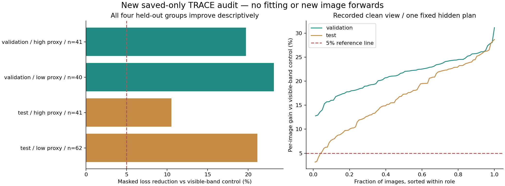

# TRACE component review — new saved-evidence analysis

**2 November 2026. Zero fitting, zero image forwards, zero new photos.**
This is an additional retrospective analysis of the original final epoch 60,
update 2,940. It does not alter the original NB24 gate or selected=None.

## Question and data

Is TRACE's aggregate reconstruction gain confined to one group, and does low
pooled rank imply that all local texture information disappeared?

The analysis reads 444 fully checksum-verified saved CSV files,59,176,731 bytes,
from the previously verified actual Kaggle fit. The source/cache identity and
completed state supply image roles, conservative components and native record
positions. No model is loaded for inference. Source data remain unchanged.
[Exact consumed-input inventory](retrospective_20261102/CONSUMED_SCIENCE_INPUTS.csv).

## Results by original held-out component

| Role | Mileage proxy | Photos | Masked gain vs visible-band control | Local gain vs position control | Images beating all 3 controls |
|---|---|---:|---:|---:|---:|
| test | low | 62 | 21.11% | 28.09% | 62/62 |
| test | high | 41 | 10.52% | 50.51% | 41/41 |
| validation | low | 40 | 23.17% | 27.85% | 40/40 |
| validation | high | 41 | 19.72% | 44.53% | 41/41 |

The four component-level masked gains are 23.17% /19.72% for validation low/high
and 21.11% /10.52% for test low/high. All ten training/validation/test components
have a positive aggregate advantage over every declared masked control. Every
one of 570 images has lower masked loss than all three controls on this saved
view/plan. All 81 validation images, and 98 of 103 test images, exceed 5% versus
each control. The five remaining test images still improve, by less than 5%
against at least one control.

These are correlated image records from ten conservative components, not 570
independent subjects or a new test set. No image-level binomial confidence
interval, p-value or universal perturbation guarantee is added.

## Local tokens and pooled features differ

The following summarizes the **retained per-tile statistics**, not a fresh
native-token covariance replay. Each role/layer has 32 positions; only supported
images enter each position's statistic. The counts/dimensions are not directly
interchangeable with one globally pooled vector per image.

| Role | Saved layer | Positions | Median per-position effective rank | Position range |
|---|---|---:|---:|---:|
| test | encoded | 32 | 3.446 | 2.300–8.427 |
| test | full_context | 32 | 2.682 | 1.971–5.534 |
| train | encoded | 32 | 5.953 | 4.610–8.338 |
| train | full_context | 32 | 4.559 | 2.853–6.017 |
| validation | encoded | 32 | 2.899 | 1.751–4.349 |
| validation | full_context | 32 | 2.127 | 1.661–2.964 |

Validation's encoded median rank 2.899, full-context median 2.127 and globally
pooled local rank 1.230 support a local-versus-aggregate distinction. Native
validation within-component ranks9.782 (local) and 11.272 (spatial moments)
are preserved from the independent NB24 audit. Training local-token median 5.953
and validation2.899 also show that local representations do not transfer
unchanged. This does not isolate a causal effect of pooling or prove that a new
pooling layer would improve mileage recognition.

## Exact calculation and boundaries

For each image and control, `gain = 1 - model_image_mean / control_image_mean`.
Component/role gain is the ratio of **equal-image mean losses**, not the mean
of per-image ratios or a pooled per-pixel loss. Local comparison uses local
supported cells; masked comparison uses common supported hidden cells. Original
normalization/controls remain train-only.

Only final endpoint, clean view0 and its recorded mask plan are analyzed. A
new plan, all appearance variants, every epoch or a physical-damage target is
not implied. The endpoint has already informed development. The previous
validation gate correctly still rejects all 60 epochs for global diversity.

| New derivative | Rows / purpose |
|---|---|
| [Image utility](retrospective_20261102/TRACE_IMAGE_UTILITY.csv) |570 image-level comparisons, exact source SHA, role, component and losses |
| [Component utility](retrospective_20261102/TRACE_COMPONENT_UTILITY.csv) |10 component summaries |
| [Role utility](retrospective_20261102/TRACE_ROLE_UTILITY.csv) |3 original-role summaries, reconciled to the saved NB24 endpoint |
| [Tile summaries](retrospective_20261102/TRACE_TILE_SUMMARY.csv) |6 retained-statistic summaries |
| [Analysis receipt](retrospective_20261102/ANALYSIS.json) | Scope, inputs, zero fitting/network activity and reconciled role values |

These derivatives are local and not uploaded to HF during this analysis. The
original raw science is already published at NB24's pinned fit revision.
[Whole-project interpretation](phase3ProjectRetrospective.md) ·
[Original NB24 completion and audit limits](phase3NB24Completion.md).
