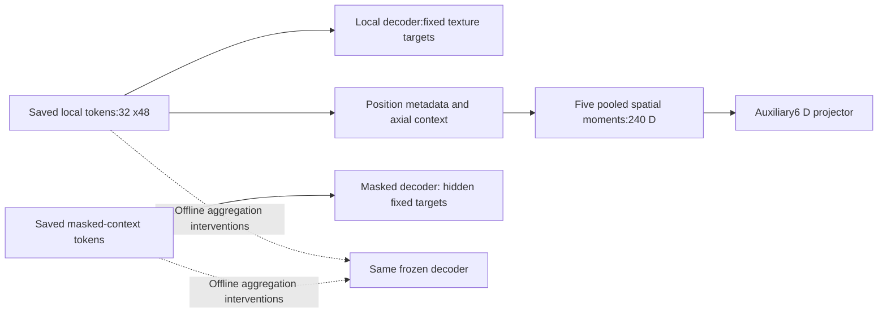
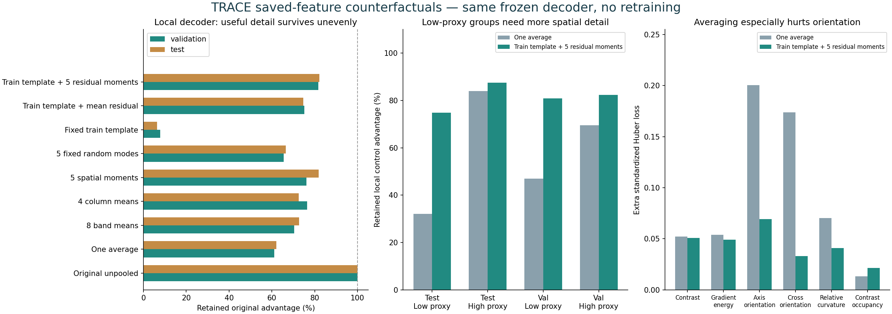
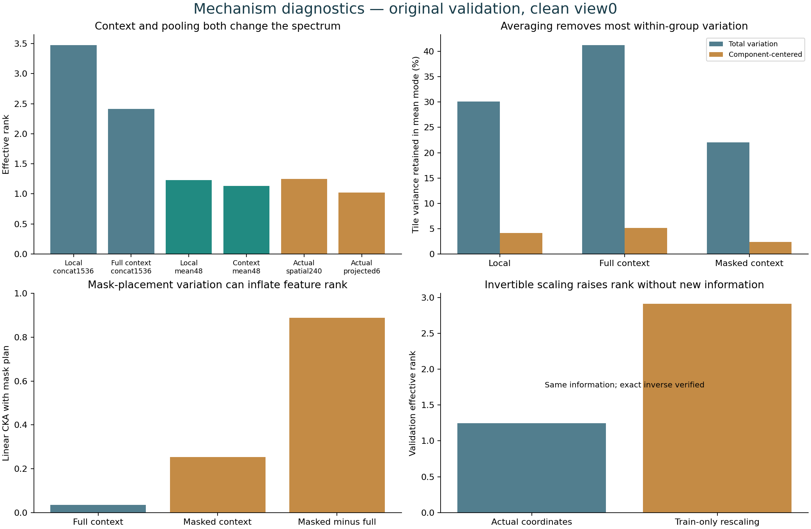

# TRACE aggregation investigation — where useful texture information survives

**2 November 2026. Investigation complete on the saved NB24 endpoint.**

Useful, image-dependent texture information exists in the local tokens. Simple
averaging discards part of its reconstruction utility and preferentially removes
within-component variation. However, the original local decoder bypasses global
pooling, context already changes diversity before pooling, and rank alone is
not a reliable measure of task usefulness. The evidence supports preserving
local spatial residuals; it does not identify a ready replacement model.

[Interactive aggregation explorer](texture_aggregation_20261102/Aggregation_Explorer.html) ·
[Exact methods/data dictionary](texture_aggregation_20261102/METHODS.md) ·
[Frozen protocol](texture_aggregation_20261102/PROTOCOL.json) ·
[Analysis receipt](texture_aggregation_20261102/ANALYSIS.json).

## 1. The useful decoder and the low-rank vector use different paths

The local reconstruction loss is computed directly from unpooled encoder tokens.
The masked reconstruction loss uses spatial masked-context tokens. Neither
primary decoder reads the auxiliary6 D projector output. Consequently, strong local utility
and a narrow auxiliary global representation can coexist. This is established
by the frozen source graph and replay of every saved bridge.

All 7,004,160 original local/masked prediction values were replayed through the
unchanged decoder on retained features. Maximum absolute differences were
1.01e-6 /2.23e-6 for local/masked heads. Saved mean, spatial-moment and projector
bridges also reproduce within 6.05e-7. No image encoder or geometry inference ran.
[Numerical bridge checks](texture_aggregation_20261102/BRIDGE_VERIFICATION.csv).

## 2. Controlled aggregation loses useful reconstruction detail

Nine comparisons were declared before the primary calculation. All use the same
original final epoch 60/update 2,940, both retained views, targets, support and
frozen decoder. View 0 is primary. Training templates/scales use only 386 train
images; no held-out target, label or feature mean fits an inference transform.

The table reports **retained original advantage over the train-position control**:

`R = (L_position_control - L_aggregation) / (L_position_control - L_original)`

Role losses are equal-image means on matched cells.100% means original utility;
0% means the position control; negative means worse than that control. These are
not accuracy percentages. The position control here differs from the stronger
visible-band control used for NB24's original 21.63% masked-gain headline.

| Frozen-feature intervention | Local validation | Local historical test | Masked validation | Masked historical test |
|---|---:|---:|---:|---:|
| Original unpooled | 100.00% | 100.00% | 100.00% | 100.00% |
| One average | 61.14% | 62.12% | 61.23% | 62.62% |
| 8 band means | 70.42% | 72.62% | 54.20% | 58.24% |
| 4 column means | 76.39% | 72.47% | 75.90% | 64.95% |
| 5 spatial moments | 76.05% | 81.89% | 68.39% | 81.55% |
| 5 fixed random modes | 65.47% | 66.43% | 61.07% | 62.87% |
| Fixed train template | 7.75% | 6.31% | -29.19% | -27.77% |
| Train template + mean residual | 75.09% | 74.69% | 52.85% | 52.84% |
| Train template + 5 residual moments | 81.76% | 82.17% | 65.82% | 65.29% |

Replacing each local token with the image's weighted average retains 61.14% of
the validation advantage, losing 38.86% of that margin. A train-position template
plus one global residual restores 75.09%; five spatial residual moments restore
81.76%. The template alone preserves only 7.75%. The benefit therefore includes
image-dependent information beyond a fixed position template.

Spatial structure helps: five actual spatial moments retain 76.05% local
validation utility, versus 65.47% for five fixed random spatial modes with a
constant mode. But there is no universal winning compression. Four column means
retain 75.90% masked validation utility, while raw moments retain 68.39% and the
template-plus-residual moments retain 65.82%. All nine comparisons remain visible;
no alternative was test-selected or installed.

These are **fixed-head counterfactuals**. Projected feature vectors may be off
the decoder's training manifold. Loss changes combine discarded information and
compatibility with this decoder; they do not predict what a newly trained head
or a different architecture could achieve.

## 3. Orientation and contrast are especially vulnerable

The following local-decoder validation losses use the same standardized target
units and support. Lower is better. Original control advantages are positive
for all six descriptors, but their sizes differ.

| Image-derived descriptor | Original local loss | One-average loss | Train-position control loss |
|---|---:|---:|---:|
| contrast | 0.575280 | 0.627355 | 0.645410 |
| gradient energy | 0.288874 | 0.342661 | 0.647119 |
| orientation axis | 0.385328 | 0.585783 | 0.624570 |
| orientation cross | 0.616969 | 0.790882 | 0.667389 |
| relative curvature | 0.383844 | 0.454087 | 0.807723 |
| contrast occupancy | 0.279495 | 0.292713 | 0.588040 |

Averaging preserves much of the advantage for gradient energy, relative curvature
and contrast occupancy, while damaging orientation. Cross-orientation becomes
worse than the position control (0.790882 versus 0.667389), despite the original
local decoder beating it (0.616969). With template-plus-five residual moments,
axis-orientation loss falls to 0.454548 and cross-orientation to 0.650077, but
contrast loss remains0.626081 versus original 0.575280. Low-order moments recover
some orientation detail; they do not preserve all local structure.

These fields describe image contrast/gradients. They are not measured groove
depth, physical damage or safety labels. [All channel comparisons](texture_aggregation_20261102/CHANNEL_UTILITY_SUMMARY.csv).

## 4. Averaging favors coherent group differences over local variation

On primary validation, concatenated local tokens have effective rank 3.473;
concatenated full-context tokens have rank 2.416. Thus context already changes
the feature spectrum before global pooling. Local mean rank is 1.230, full-context
mean1.132, actual spatial-moment rank 1.249 and actual projector rank 1.023.
Different dimensions are explicitly named; the concatenated space also has a
larger possible rank. These numbers are descriptive, not matched architecture
comparisons or replacement selection thresholds.

Using a fixed train-derived coverage mass, the constant spatial mean mode keeps
30.10% of total local token variance, but only 4.15% after component centering.
Under this defined projection,95.85% of within-component local variance lies
outside the constant mean mode. This is **not 95.85% of useful wear information**.
The utility experiment above measures a different, task-specific quantity.

Mean off-diagonal tile correlation drops from 0.2731 to 0.00947 after component
centering. Shared between-group changes are coherent across positions; many
within-group changes are not. Averaging preferentially retains the former.
The between-component fraction rises from 76.56% for concatenated local tokens
to 96.78% for the original local mean. This explains the observed statistical
concentration without identifying a physical cause or validating class transfer.

Centering by the already known component is a diagnostic only. It is not a
deployable correction, and components are strongly confounded with proxy class.
Removing identity/group signal indiscriminately could remove class information.
Both held-out roles have full 32-tile support. Two train images have unsupported
tiles; the support table records this rather than calling all 570 images complete.
[Covariance and exact decomposition](texture_aggregation_20261102/SPATIAL_COVARIANCE.csv) ·
[Support](texture_aggregation_20261102/SUPPORT_SUMMARY.csv).

## 5. The effect differs across the two proxy groups

For the historical low-proxy test component, one-average local utility retention
is 32.03%, versus 84.02% for the high-proxy component. Template-plus-five residual
moments gives 74.82% /87.52%, respectively. The masked branch similarly retains
only 23.16% /81.04% under one average.

This indicates that fine spatial detail matters more to the recorded descriptor
task in the low-proxy component. Each role still has only two conservative
components. It does not establish why earlier mileage classifiers failed,
demonstrate a repaired classifier, or separate mileage from tyre identity.
[Every component/variant](texture_aggregation_20261102/COMPONENT_UTILITY.csv).

## 6. Two ways to mistake numerical diversity for useful information

**Rescaling:** train-only coordinate standardization raises actual240 D full-context
moment rank from 1.249 to 2.912 on validation. The inverse recovers the same feature
values exactly within 1e-12. It adds no information. Coordinate balance matters
to the rank statistic, so increasing effective rank alone is not a model remedy.
The original unscaled gate stays unchanged and selected=None remains preserved.

**Mask layout:** masked-context concatenation has rank 15.31, much higher than
full-context2.42. An exploratory follow-up, separately declared after that result,
finds linear centered-kernel alignment0.888 between the masked-minus-full feature
change and hidden-tile layout; full-context alignment is 0.0356. After component
centering, masked-context alignment with layout is 0.909.

CKA is an association measure, not a fraction of variance explained. Mask plans
are deterministic image-addressed records, not a new randomized trial. Strong
mask association means high masked-feature rank must not be read as broad
semantic texture understanding. The actual projector uses full-context features,
so this does not mean its collapse was caused by mask noise.
[Exploratory mask protocol](texture_aggregation_20261102/MASK_ADDENDUM_PROTOCOL.json) ·
[Mask alignment results](texture_aggregation_20261102/MASK_PLAN_ALIGNMENT.csv).

The second retained view supports the broad local ordering, but photometric
factors and hidden plans both differ. It does not isolate a causal appearance
or masking effect, and stability is partly built into local contrast preprocessing.

## 7. Implications before choosing another objective

| Evidence | Design implication to investigate | Boundary |
|---|---|---|
| Local benefit bypasses the global vector | Preserve a spatial evidence path rather than requiring every task to use one average | Not proof that any new aggregator improves classification |
| Mean-plus-position restores part, but not all, of the margin | Evaluate **incremental local spatial residual utility** beyond a strong global/position control | Control/support must be frozen before any new fit |
| Contrast/orientation are lost disproportionately | Give local structure a separately measured target and per-channel diagnostics | Image-derived texture, not physical depth truth |
| Canonical moments beat fixed random modes for the local head | Spatial organization is useful to this task | Retain the random and band/column controls; no universal best summary |
| Rank can rise through invertible scaling or mask placement | Pair diversity metrics with saved-target utility, scale conventions and mask controls | No post-hoc gate relaxation |
| Group dominance and only one low training component persist | Keep role/component support explicit; avoid identity-adversarial claims | No new independent generalization evidence |

The most supported next research question is whether a local residual texture
objective can preserve contrast/orientation detail beyond a global/position
baseline. This investigation does **not** yet select an architecture or deliver
another training notebook. Any masked-task conditioning must use visible inputs,
never hidden target values. Geometry remains a fixed full-image input; the
original mask-leakage guarantee is conditional on that cache.

## 8. Execution, retention and what stayed unchanged

The investigation verified 249 pinned native/metadata inputs,66,722,671 bytes,
and 254 source CSV bodies. It uses 570 final images, two saved views, three feature
layers and nine fixed interventions. It performed 656,640 frozen-decoder token
readouts and 1,140 projector-vector readouts in CPU algebra; **zero image-encoder
or geometry forwards, zero optimizer updates, zero new photos**.

All counterfactual predictions are direct FP64 NPY files. Image/channel/tile
losses, template/scaling parameters, spectra, covariances, source hashes and
summary tables are direct CSV. The primary derivatives total about 769 MB; the
final inventory includes supplementary summaries and visualizations too.
No ZIP/NPZ or database envelope was created. Large native/detail tables stay
out of Git; compact summaries, code and curated figures remain visible.

New derivatives are **local and not uploaded to HF**. Original raw evidence
remains at pinned fit revision510cbc827337cbc963562c798811226326dc7c0c. All original
notebooks, model sources, selections, earlier reports and both workstations are
preserved. GEO/TRACE selected=None remains unchanged. This is post-hoc research
on previously inspected development cohorts, not independent physical-wear validation.
