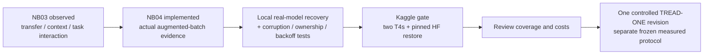
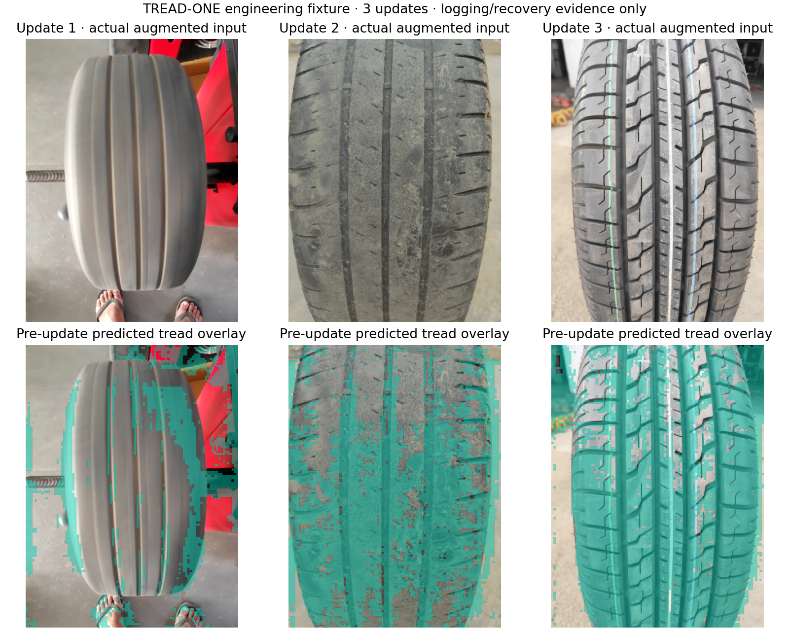

# TREAD-ONE NB04 — training evidence and recovery gate

**Execution update:** NB04 is complete on Kaggle and independently verified on
both T4s. No rerun is needed. [572-file completion audit](phase3NB04Completion.md).
The clean-delivery identities and reproduction instructions below are historical;
the executed notebook is 121,228 bytes, SHA-256
`800be1c9ed01d3b6e071035535667e4ebd8968779fbfd14b6b99394d8dbfd3fa`.
The next deliverable is [NB05](phase3R2PairedPilot.md).

**28 October 2026.** This is the engineering step after the
[completed NB03 diagnosis](phase3NB03Completion.md). It uses the real custom
TREAD-ONE network and prepared tyre data to prove richer observation and recovery
before spending another measured training budget.

**Deliverable:** [phase3_NB04_TREAD_ONE_Evidence_And_Recovery_Gate.ipynb](notebooks/phase3_NB04_TREAD_ONE_Evidence_And_Recovery_Gate.ipynb).
The compact notebook embeds its 17 required source files. Original r1 sources,
executed NB00–NB03 notebooks, checkpoints, selection and workstation exports stay
preserved. The next measured model revision is not started by this gate.

| Stage | Meaning / authority |
|---|---|
| NB03 | Complete on Kaggle and independently HF-verified; fixed-weight diagnosis |
| NB04 implementation | Real augmented training observations, direct CSV/native snapshots and transactional recovery |
| Local acceptance | Real CUDA/AMP and independent evidence checks; exact current receipts below |
| Kaggle / live HF acceptance | **Complete / independently verified on both T4s**; [exact publication and source-state proof](phase3NB04Completion.md) |
| Later controlled revision | Requires a frozen measured recipe, full validation coverage and bounded long-run telemetry budget |

| Accepted local artifact identity | Value |
|---|---|
| Source/environment contract | `0f53e9b421895a49f29438f818a4312dc9745b628ad623acc0016817e93fab0f` |
| NB04 SHA-256 | `d46768d62cbc2e51347e4f65aa87787a1441cc8fb7c9e54ff44058b0a3710619` |
| Clean notebook size | 110,703 bytes |
| Prepared checksum-list SHA-256 | `06c6c9d003aff808babf7ebb5786f441e95064eb000f5e5ed5b155d0ee9e7c6a` |
| Safe overlay identity | `f81a80d20b60ba505d94e31c26615e7e7171a91a8506948be6c392b68107a039` |

Kaggle generates its own environment-specific contract. The accepted local
configuration pins all 17 source files and prepared JSON metadata; every sampled
training/validation image and mask is hash-checked before use. A changed contract
cannot silently take over an earlier native recovery state.

## Why this is the next step

NB03 found strong nominal training-identity fit, unstable validation transfer,
checkpoint-dependent context sensitivity and opposing task gradients on one
fixed batch. Those findings do not select a proven remedy. They also cannot
recover the augmented training predictions, gradient history and detailed stage
costs r1 never saved. NB04 instruments actual optimizer updates so the next
experiment can answer those questions with retained evidence.



The gate does not introduce new independent tyres. The user's later help with
[data acquisition and provenance](phase3DataGrowth.md) remains a separate,
high-priority part of improving generalization.

## Exact engineering recipe

| Item | Gate contract |
|---|---|
| Model | Existing 1,372,159-parameter TREAD-ONE architecture, newly initialized for the fixture |
| Initial seed | 462204; not an added r1 scientific seed |
| Model weights read | No r1/pretrained checkpoint is loaded into the fixture |
| Input | Prepared Phase 2 source, frozen safe overlay; only train batches and two human validation examples |
| Input shape | Batch 8, RGB 512×384, existing normalization and deterministic synchronous augmentation |
| Sampler | Frozen r1 class/domain/group-balanced stateless schedule |
| Updates per case | At most **3**; two batches define a **surrogate engineering epoch** |
| Cursor crossing | After update 2: next epoch 2 / cursor 0; after update 3: epoch 2 / cursor 1 |
| Optimizer | Frozen r1 AdamW, lr `1e-4`, weight decay `0.01` |
| Scheduler | Frozen cosine schedule, `T_max=60`, minimum lr `1e-6`; exercised at the surrogate boundary |
| Numerics | CUDA FP16 autocast, initial gradient scale 512, norm clip 1; same-batch/RNG retries and final FP32 fallback from r1 |
| Accumulation | None; one completed optimizer update per batch |
| Validation fixture | One human-annotated low and one high image after update 2; **not** the full 81-image scientific validation |
| Test cohort | Not evaluated |
| Two T4s | Separate recovery cases execute on `cuda:0` and `cuda:1`; one parent handles HF. No data-parallel throughput claim |

The unchanged r1 update is an independent numerical reference for the
instrumented implementation. The accepted objective is

\[
L=L_{CE}+0.2L_{ordinal}+L_{seg}+2L_{point}
  +0.1L_{contain}+0.1L_{align}+0.2L_{background}.
\]

CE uses label smoothing 0.05; ordinal loss compares the first two class-CDF
entries. Segmentation uses valid-pixel BCE plus soft Dice with `+1` smoothing.
Point loss uses Smooth L1 with beta 0.02 and weights human=1, polygon-weak=0.25,
unlabelled=0. The exact frozen definitions are in
[model.py](runtime/model.py) and [worker.py](runtime/worker.py).
Background consistency runs when `cursor % 4 == 0`; donors and changed
probabilities/logits are retained.

Per-image numerators and denominators reconstruct the actual batch objective.
Geometry denominators use the batch sum of point weights; segmentation,
containment and alignment retain their own valid supports. A per-image
`objective_contribution` is its contribution to the **batch** objective, not a
standalone equally weighted image loss.

## Evidence retained at each level

There are **13 core CSV families**, with **261 column positions in total**
including repeated identity fields. This is not 261 distinct independent metrics.
One complete instrumented local case contains **703 core rows**, from only
**24 sampled image occurrences** over three updates. Repeated cases and repeated
views never increase the independent tyre count.

The [exact column-by-column data dictionary](phase3TrainingEvidenceSchema.md)
defines all fields, units, coordinate grids, aggregation denominators and blank
values. [Machine-readable source schema](training_gates/TELEMETRY_SCHEMA.json).

| CSV family | Local full-case rows | Stored evidence |
|---|---:|---|
| `train_steps` | 3 | Total/component losses, contribution reconstruction error, gradient norms/clipping, AMP scales/retries, lr, next cursor, before/after native hashes, stage timings |
| `train_samples` | 24 | Actual pre-update augmented probabilities/logits/correctness, NLL/Brier/entropy, all loss sufficient statistics, augmentation seed/parameters, background donor and outputs |
| `region_stats` | 48 | Tyre/tread TP/FP/FN/TN, valid/ignored pixels, Dice/IoU, half-open boxes and box IoU |
| `geometry_points` | 144 | Six predictions and transformed targets, original target/index, guide/side, human/weak/unknown status, weights, signed/absolute/squared/native-pixel errors |
| `latent_metrics` | 288 | Twelve non-semantic latent channels: range, mean/std and gated mass |
| `evidence_metrics` | 72 | Three class logits/biases, signed contribution sums, positive/negative support and true-tread partition |
| `class_confusion` | 27 | All nine class pairs per update, including observed zeros |
| `gradient_modules` | 48 | Module gradient norms/maxima, finite status and parameter counts before clipping |
| `activation_modules` | 40 | Selected module activation distributions; normal/background passes identified |
| `validation_predictions` | 2 | Fixed validation-fixture class probabilities, NLL/Brier, mean Dice and human-point error |
| `epoch_summaries` | 1 | Partial/complete sampled-image counts, objective sum and accuracy at the surrogate boundary |
| `resources` | 3 locally | Process/container/device memory, free disk; scheduled GPU utilization/power/temperature snapshots |
| `events` | 3 locally | Completed updates and any numerical retry events; UTC and scale history |

Resource row counts may differ on dual T4 because scheduled `nvidia-smi` snapshots
include each reported device. Unsupported fields are blank with a reason; zero
means an observed zero. Class metrics/supports are additionally exported as
`class_metrics.csv`. Every snapshot includes `SCHEMA.json`, `COVERAGE.json`,
`CURSOR.json`, `STATE_VERSIONS.csv` and a file manifest. Exceptions, worker logs
and post-pointer commit timing journals accompany the snapshot when present.

Metric conventions are inherited from the frozen diagnostic: mask threshold
0.5, nearest 4× upsampling for confusion counts, ignore pixels excluded,
`Dice=(2TP+1)/(2TP+FP+FN+1)`, `IoU=(TP+1)/(TP+FP+FN+1)`. Boxes use exclusive
right/bottom coordinates. Points are width fractions; native-pixel error is
fractional error times `(native_width-1)`. Unlabelled point placeholders are
separately named and never treated as evaluation truth. Latents have no invented
physical meanings.

| Native array per update | Shape / type | Channel meaning |
|---|---|---|
| `inputs.npy` | `[8,3,512,384]`, float32 | Exact normalized augmented optimizer inputs |
| `targets.npy` | `[8,3,512,384]`, uint8 | Tyre, tread, ignore |
| `outputs.npy` | `[8,18,128,96]`, float32 | Channels 0–1 mask probabilities; 2–13 latent maps; 14–16 signed class evidence; 17 normalized gate |
| `state.pt` | Native PyTorch structure | Model, AdamW, cosine scheduler, AMP scaler, Python/NumPy/CPU/CUDA RNG, losses, partial epoch statistics, next cursor and CSV row cursors |

All gate maps are retained. Recording full float32 inputs and maps at every
update for a 60-epoch study would exceed a sensible Kaggle output budget; a
bounded raw-map schedule must be frozen for that future protocol. Scalar CSV
coverage can remain much denser than image/map coverage.

## Atomic save and exact resume

```mermaid
sequenceDiagram
    participant W as Compute worker
    participant G as New local generation
    participant P as Atomic pointer
    participant H as HF publisher
    W->>W: Complete optimizer update
    W->>G: Native model + optimizer + scheduler + scaler + RNG
    W->>G: CSV shards + native arrays
    W->>G: Manifest with state and CSV cursors
    G->>P: Replace pointer last
    Note over G,P: Incomplete generation is ignored; replay its update
    P->>H: Consistent direct snapshot at a flush boundary
    H->>H: CAS owner check + one batched commit
    H->>H: Verify immutable Git/LFS hashes
```

1. Save a new generation; its native state contains the same row cursors as the
   CSV generation. Write the manifest and replace `POINTER.json` last.
2. Resume only the manifest-verified chain. Corruption fails visibly; it does
   not silently start at epoch zero. Incomplete generations can remain on disk
   as crash evidence and are excluded from the committed cursor.
3. Retain all CSV and declared maps. Keep the latest **two** local recovery
   states; every removed older native state is declared by hash in a pruning
   ledger. `STATE_VERSIONS.csv` preserves their identities, not fictitious files.
4. Publish current full native state plus all direct epoch CSV/maps. A fresh
   session installs the pinned snapshot as a remote base and continues its
   completed-update cursor; historical CSV is carried forward without relabelling
   it as newly computed.

The parent requests a safe update boundary for a timed snapshot. Workers yield
with exit 91 after committing and wait for marker removal. Catchable SIGINT,
SIGTERM, notebook Stop or errors attempt a final consistent publication and owner
release. A forced kernel/container death cannot publish pending local work.
An interrupted incomplete optimizer update is replayed from the previous native
state, including optimizer/scaler/RNG, rather than skipped.

## HF ownership, cadence and recovery proof

HF destination is
`phase3/tread-one/engineering/evidence-gate-r1/<environment-and-source-contract>`
inside `Shanmuk4622/tyre-wear-study`. It is separate from r1 scientific results.
Each device has its own contract/namespace. Only the parent receives the explicit
Kaggle `HF_TOKEN`; compute children have that environment variable removed.
No project `.env` or alternate credential lookup is used.

| Trigger / condition | Behavior |
|---|---|
| Normal interval | 30-minute consistent batched snapshot |
| Major gate stage / completion | Publish the one-update fixture, then the final recovered proof |
| Catchable stop/error | Attempt immediate safe snapshot; respect server backoff; retain local work if it fails |
| Concurrent writer | 45-minute owner lease plus parent-commit CAS; live owner blocks a second writer |
| Lost successful response | Read remote owner/manifest and acknowledge the committed result |
| HTTP 429 / transient server/transport failure | Bounded retries with server `Retry-After` and reset headers; requests/httpx transport handling |
| Resume | Download a pinned immutable manifest, verify all files, install state and CSV together |

The Kaggle proof publishes an update-1 fixture, downloads it to a different local
base, continues to update 3 and compares all numerical state to uninterrupted
training. The executed receipts and independent audit now verify that live proof
on both T4s. [Source and final revisions](phase3NB04Completion.md).

The historical “128 requests/hour” concern is not a universal HF quota. HF
documents separate API/resolver/page windows and server reset headers; the
publisher batches and respects those responses. Its journal counts coordinator
operations, not every internal SDK HTTP request, and cannot coordinate another
unrelated notebook using the same account. [HF rate-limit documentation](https://huggingface.co/docs/hub/rate-limits),
[versioned parent-commit API reference](https://huggingface.co/docs/huggingface_hub/v0.36.0/en/package_reference/hf_api).

## Actual acceptance evidence

| Check | Evidence / practical boundary |
|---|---|
| Frozen r1 update math vs instrumented math | Model, AdamW, scheduler, scaler, RNG, losses and next cursor have **zero differences** on local CUDA |
| Pause after update 1, new process continues | Exact native numerical state; first committed manifest preserved |
| Native crash after update-2 CSV before pointer | Last durable cursor remains 1; orphan ignored; replay matches uninterrupted |
| Fresh direct snapshot install and resume | Native state and CSV base restored together; same final numerical state |
| Scientific evidence consistency | 11 tables agree across pause/crash/install paths after excluding timing and native-file hash metadata; nine native batch arrays agree byte-for-byte |
| Independent source/target/map audit | All 24 sampled occurrences, input/target arrays, probabilities, pixel counts and 144 point eligibility/error records verified |
| Objective reconstruction | Maximum absolute difference about `1.84e-7` in the accepted local fixture; exact value in receipt |
| New-store/publisher fault suite | **22 checks**, zero network requests; five native crash seams, corruption, cursors, rotation, CAS, ownership, lost success and backoff |
| Timer marker / signal controls | [CONTROL_TESTS.json](training_gates/CONTROL_TESTS.json) records actual completed-update marker and SIGINT-entry tests; no mid-kernel signal claim |
| Notebook | Schema, cell syntax, 17 exact embedded sources and clean delivery hash checked |
| Interactive report | Embedded data/images and JS syntax checked; browser rendering remains unverified |

Authoritative current receipts:
[GATE_COMPLETION.json](training_gates/GATE_COMPLETION.json),
[EVIDENCE_VALIDATION.json](training_gates/EVIDENCE_VALIDATION.json),
[FAULT_TESTS.json](training_gates/FAULT_TESTS.json),
[CONTROL_TESTS.json](training_gates/CONTROL_TESTS.json),
[DELIVERY.json](training_gates/DELIVERY.json).
The original local device is GTX1650/cv_conda; exact T4 numerical recovery is now
independently verified by the [NB04 completion audit](phase3NB04Completion.md).
No accuracy improvement is inferred from three engineering updates.

## Visual evidence



These are the first examples from the actual three optimizer batches. The
fixture is freshly initialized; these overlays are logging examples, not the
trained r1 model's results. The
[interactive evidence viewer](training_gates/summary_exports/TREAD_ONE_Evidence_Gate.html)
selects an update and shows its input, loss reconstruction and AMP scale. NB03's
[larger diagnostic explorer](diagnostics/TREAD_ONE_Classifier_Explorer.html)
remains the richer tool for trained-model mask/gate/evidence inspection.

## Kaggle instructions and storage

1. Import NB04 as a **new notebook**; keep the executed NB03 as evidence.
2. Set **T4 ×2**, Internet **ON**. Attach
   `shanmuk4622/tire-dataset-prepared-phase2` directly from Kaggle. Keep the input
   read-only; no duplicate dataset or pretrained-weight download is required.
3. Enable the write-authorized **HF_TOKEN** Kaggle secret for
   `Shanmuk4622/tyre-wear-study`. Its value is never printed.
4. Start with at least **12 GiB free** in working storage; the gate checks actual
   free space. One local device's cases, first exports and envelope used about
   **1.68 GB decimal** before live downloads. Dual-device live recovery needs
   additional direct snapshots and temporary downloads. The 12-GiB guard is a
   conservative starting requirement, not a measured T4 peak or a promise that
   1-TB scratch exists.
5. **Run All**: setup, real-model gate, then receipts/report links. No global
   dependency downgrade or new package installation is performed.
6. Success requires the final `GATE_COMPLETION.json` to say `status=passed`,
   `live_hf_tested=true`, with a verified publication and recovery proof per
   visible device. Share the executed notebook afterward for independent audit.

| Symptom | Action |
|---|---|
| Wrong/multiple dataset inputs | Attach exactly one expanded prepared Phase 2 dataset; keep checksum checks enabled |
| Missing secret / write permission | Enable the Kaggle `HF_TOKEN` secret with access to the named dataset repository |
| 429 / server delay | Keep the session alive while bounded backoff runs; avoid repeated Run All |
| Another live owner | Stop the other run cleanly or wait for lease expiry; do not bypass ownership |
| Interrupted session | Rerun the same notebook/settings to restore compatible state before skipping completed updates |
| Contract/environment mismatch | Keep the rejected state and logs; review compatibility rather than bypassing the identity check |
| Disk guard | Free space outside this experiment or start a fresh session restoring HF state; do not delete the latest checkpoint |
| Catchable Stop still flushing | Keep the session open; the notebook reports waiting and does not force-kill a safe flush |
| Failure | Preserve `coordinator.log`, worker logs, `FAILURES.jsonl`, cursor and publication receipt for diagnosis |

## Source ownership and remaining gaps

| File | Responsibility |
|---|---|
| [training/gate.py](training/gate.py) | Contracts, two-device compute coordination, test cases, envelopes, timed/stop publication |
| [training/worker.py](training/worker.py) | Actual r1-compatible optimizer math, observed batches, validation fixture and full native state |
| [training/telemetry.py](training/telemetry.py) | CSV schemas, sufficient statistics, augmentation provenance and bounded resource samples |
| [training/transactions.py](training/transactions.py) | Atomic generation chain, cursors, native rotation, direct snapshot/export/install |
| [training/evidence_hub.py](training/evidence_hub.py) | Explicit-secret HF owner/CAS/backoff, immutable verification and pinned downloads |
| [training/report.py](training/report.py) | Coverage declarations, derived class metrics and self-contained image report |
| [analysis/build_training_gate_notebook.py](analysis/build_training_gate_notebook.py) | Regenerates only NB04 from current source; leaves executed notebooks intact |
| [analysis/validate_training_evidence.py](analysis/validate_training_evidence.py) | Independent numeric, source/array, payload and static visual audit |
| [analysis/test_training_evidence.py](analysis/test_training_evidence.py), [control tests](analysis/test_training_controls.py) | New-store/HF faults and actual completed-update/signal recovery controls |

This implementation does not yet supply a complete long-run training product:
full 81-image validation task tables/maps, measured selection/export/test
endpoints, bounded long-run map/gradient schedules and total wall/energy budgets
must be frozen for that revision. Current module gradients are of the total
objective, not per-step task-pair gradient alignment. Full failed-gradient
tensors and continuous energy are not saved. Post-pointer timing can be absent
if a process dies before that observational journal write. These gaps are
declared, not filled with invented measurements.

After the live gate, select **one** controlled TREAD-ONE change around transfer or
task interaction, while retaining all dense-task endpoints and the established
split/selection discipline. Additional independent tyres and measured labels
remain necessary for stronger wear/depth/safety/generalization claims.
